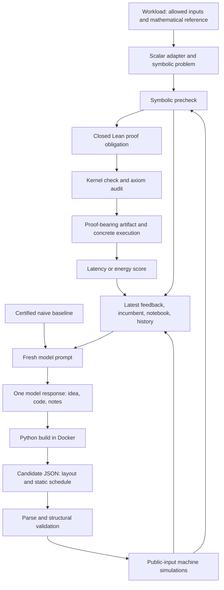
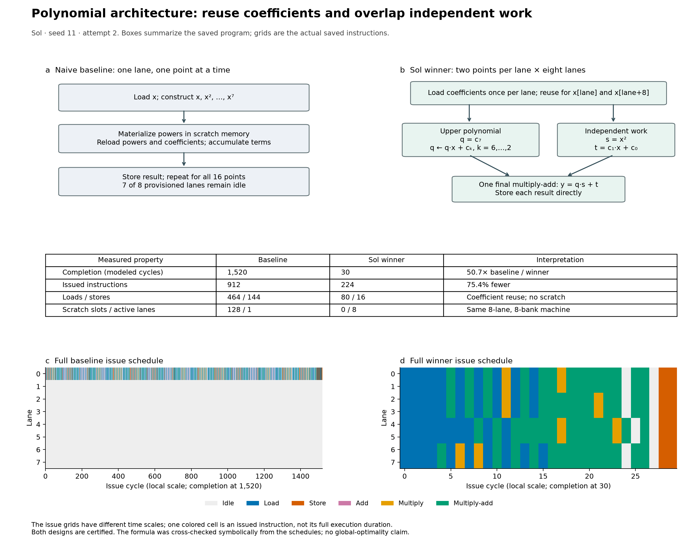
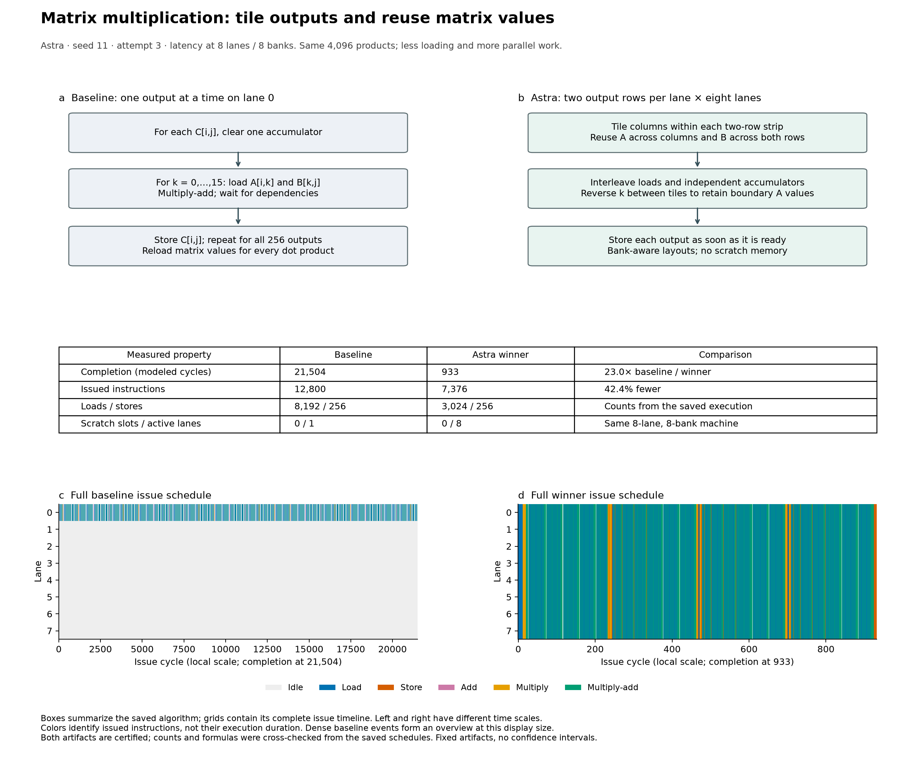
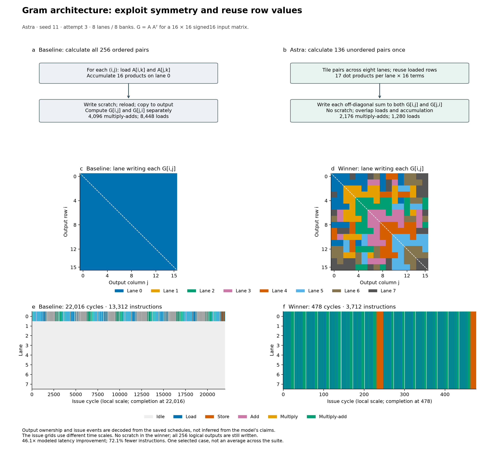
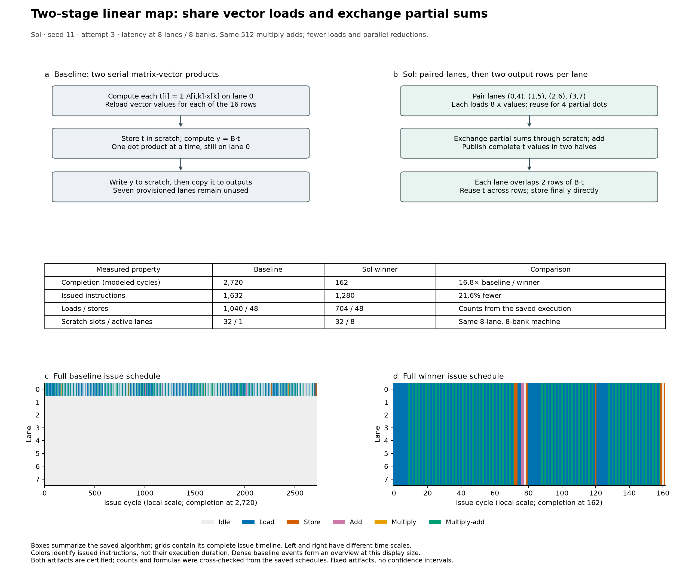

# Deep dive: inspect OptimalComputation from source to result

This is a reading and audit companion to [report.md](report.md). It puts the important definitions, executable checks, proof statements, model inputs/outputs, and evidence paths in one place. Explanations tell you what to inspect; the quoted source lets you check the explanation.

**Inspected source snapshot:** `71c608a2b573c322993264945dbb2be8a9e5006f` ([GitHub tree](https://github.com/adrienX18/OptimalComputation/tree/71c608a2b573c322993264945dbb2be8a9e5006f/)). The working tree was clean when inspection began. Source links and copied excerpts below are pinned to this commit, not to a moving `main`. This guide was written on 25 November 2026. It describes the repository at that snapshot; it does not update the historical experiments to newer code.

**How to read the evidence:** Every block introduced by **Source** is an exact contiguous copy, including the original comments and indentation. Its link identifies inclusive source line numbers. Separate blocks indicate omitted intervening material; there are no inserted ellipses or editorial comments inside them. Explanations, diagrams, calculated tables, and shell recipes are labeled separately. “Exact decoded JSON string” means the saved string with JSON escapes decoded, not a verbatim slice of the JSON file. The checker in [docs/check-deep-dive.py](docs/check-deep-dive.py) compares both kinds against the pinned Git objects and checks repository links.

An old comment is still copied exactly when it says something historical. The accompanying explanation identifies stale scope claims. The actual model name is **`arty-model-v1`** (the Arty-inspired model mentioned in the request). A `-v2` baseline is a new program schedule on this same machine, not a second machine model.

### Reading routes

| To inspect… | Start here |
| --- | --- |
| The whole pipeline and vocabulary | [1. Map](#map) |
| Every important machine rule | [2. Machine](#machine) |
| Exactly what a task means | [3. Tasks](#tasks) |
| What the comparison baselines actually do | [4. Baselines](#baselines) |
| How a hand-written proof establishes every row | [4.6. Proof walkthrough](#proof-walkthrough) |
| The all-input proof and its assumptions | [5. Certification](#certification) |
| A concrete arithmetic failure versus a conservative rejection | [5.10. Failure walkthrough](#failure-walkthrough) |
| How a certified execution gets a score | [6. Objectives](#objectives) |
| Calculate a latency/energy tradeoff by hand | [6.4. Energy walkthrough](#energy-walkthrough) |
| What the LLM sees, returns, and learns from | [7. Search loop](#search) |
| One real request → code → schedule → feedback | [8. Polynomial walkthrough](#walkthrough) |
| How the winning scheduler chooses instructions and registers | [8.7. Scheduler walkthrough](#scheduler-walkthrough) |
| The other three reported winning programs | [9. Matrix, Gram, two-stage](#other-winners) |
| Where each reported number comes from | [10. Experiments and evidence](#experiments) |
| Every source module and the artifact families | [11. Repository atlas](#atlas) |
| Commands for independent inspection and checks actually run | [12. Reproduce](#reproduce) |
| Replay the saved generator into the exact candidate | [12.4. Generator replay](#replay-walkthrough) |

For a first pass, follow the tiny six-cycle example in §2, read the task table in §3, then the proof contract in §5 and the real polynomial attempt in §8. Return to the lower-level proof excerpts when you want to challenge a particular implication.

<a id="map"></a>

## 1. The pipeline, without collapsing different kinds of evidence

The object being optimized is a **finite static program for a modeled accelerator**. Python runs before modeled execution and produces program data. The machine consumes runtime input values and that fixed program. It never asks Python or a reference function to do part of its computation.

The diagram is an explanation of call/data flow, not additional implementation:



| Term | What it actually guarantees |
| --- | --- |
| `RawCandidate` | Data: strings, numbers, lists. No correctness guarantee. |
| `Candidate shape` | Admissible hardware, bounded operands, correct layout counts and disjointness, permitted memory accesses. Not yet legal execution. |
| Successful simulation | This one input ran legally, drained its effects, and wrote all outputs. The CLI additionally compares those outputs to the reference. |
| `VerifiedCandidate adapter` | Successful execution **and** correct outputs for every allowed logical input, with a sufficient boundary budget. |
| `CertifiedExecution artifact values` | A specific allowed input and actual successful execution record bound to that proof-bearing candidate. |
| `AcceptedScore raw values` | Exact candidate equality, certified execution, and an objective whose terms compute the score. |
| `accepted: true` in a JSON archive | A recorded claim by the driver. Inspect the bound candidate, proof source, kernel result, and source snapshot to audit it. The JSON label is not itself a Lean proof. |

There are two catalogs. `Certification.Catalog` registers **workload problems**, so a new candidate identifier does not need registration. `Evaluation.objectiveCatalog` contains **already proved program artifacts**, including the naive baselines. A freshly generated certificate is scored through a singleton catalog containing that new artifact.

Build and entry-point wiring: [lakefile.toml](https://github.com/adrienX18/OptimalComputation/blob/71c608a2b573c322993264945dbb2be8a9e5006f/lakefile.toml), [Main.lean](https://github.com/adrienX18/OptimalComputation/blob/71c608a2b573c322993264945dbb2be8a9e5006f/Main.lean), [CertificationMain.lean](https://github.com/adrienX18/OptimalComputation/blob/71c608a2b573c322993264945dbb2be8a9e5006f/CertificationMain.lean), and the library import surface [OptimalComputation.lean](https://github.com/adrienX18/OptimalComputation/blob/71c608a2b573c322993264945dbb2be8a9e5006f/OptimalComputation.lean). `optimal_computation` exposes simulation/evaluation; `certification_check` prepares proof obligations. Their roles are deliberately different.

Source: [lakefile.toml:1–16](https://github.com/adrienX18/OptimalComputation/blob/71c608a2b573c322993264945dbb2be8a9e5006f/lakefile.toml#L1-L16).

<!-- source-excerpt {"commit": "71c608a2b573c322993264945dbb2be8a9e5006f", "path": "lakefile.toml", "start": 1, "end": 16} -->
```toml
name = "optimal_computation"
version = "0.1.0"
defaultTargets = ["OptimalComputation", "optimal_computation", "certification_check"]
testDriver = "optimal_computation"
testDriverArgs = ["--check"]

[[lean_lib]]
name = "OptimalComputation"

[[lean_exe]]
name = "optimal_computation"
root = "Main"

[[lean_exe]]
name = "certification_check"
root = "CertificationMain"
```

<a id="machine"></a>

## 2. The machine: what runs, what costs time, and what gets rejected

### 2.1 Versioned choices, not measured FPGA behavior

These strings bind the current contracts. The accelerator is inspired by an Arty board, but the transition system below is the actual object proved about. Board resource constants are comparison data; they do not turn these rules into measured clock frequency, physical routing, or energy consumption.

Source: [OptimalComputation/Versions.lean:9–17](https://github.com/adrienX18/OptimalComputation/blob/71c608a2b573c322993264945dbb2be8a9e5006f/OptimalComputation/Versions.lean#L9-L17).

<!-- source-excerpt {"commit": "71c608a2b573c322993264945dbb2be8a9e5006f", "path": "OptimalComputation/Versions.lean", "start": 9, "end": 17} -->
```lean
def model : String := "arty-model-v1"

def candidate : String := "candidate-v1"

def latency : String := "latency-v1"

def energy : String := "energy-proxy-v1"

def energyCoefficients : String := "energy-coefficients-v1"
```

Source: [OptimalComputation/Hardware/Config.lean:7–38](https://github.com/adrienX18/OptimalComputation/blob/71c608a2b573c322993264945dbb2be8a9e5006f/OptimalComputation/Hardware/Config.lean#L7-L38).

<!-- source-excerpt {"commit": "71c608a2b573c322993264945dbb2be8a9e5006f", "path": "OptimalComputation/Hardware/Config.lean", "start": 7, "end": 38} -->
```lean
def localMemorySlots : Nat := 4096
def memorySlotBits : Nat := 64
def bankPorts : Nat := 2
def registersPerLane : Nat := 16
def writableRegistersPerLane : Nat := 15
def registerBits : Nat := 48
def operandReadsPerLanePerCycle : Nat := 3
def resultWritesPerLanePerCycle : Nat := 1
def instructionsPerLanePerCycle : Nat := 1
def pendingInstructionsPerLane : Nat := 3
def completionsPerPendingInstruction : Nat := 1

/-- The only candidate-selectable hardware parameters. -/
structure Config where
  lanes : Nat
  banks : Nat
  deriving Repr, DecidableEq, BEq

def supportedCounts : List Nat := [1, 2, 4, 8]

def AllowedCount (n : Nat) : Prop := n ∈ supportedCounts

instance (n : Nat) : Decidable (AllowedCount n) :=
  inferInstanceAs (Decidable (n ∈ supportedCounts))

def Admissible (c : Config) : Prop := AllowedCount c.lanes ∧ AllowedCount c.banks

instance (c : Config) : Decidable (Admissible c) :=
  inferInstanceAs (Decidable (AllowedCount c.lanes ∧ AllowedCount c.banks))

/-- Validation evidence travels with any configuration used by the hardware. -/
abbrev ValidConfig := { c : Config // Admissible c }
```

`ValidConfig` is a subtype: a configuration accompanied by a proof of `Admissible`. Each count is independently selected, giving 16 configurations. The default is `(8,8)`. A lane is an execution context with its own registers; a bank is a memory-port group. Eight lanes do not imply eight instructions can always issue: bank conflicts and dependencies can prevent it.

### 2.2 Addresses and resource allocation

Source: [OptimalComputation/Hardware/Config.lean:87–117](https://github.com/adrienX18/OptimalComputation/blob/71c608a2b573c322993264945dbb2be8a9e5006f/OptimalComputation/Hardware/Config.lean#L87-L117).

<!-- source-excerpt {"commit": "71c608a2b573c322993264945dbb2be8a9e5006f", "path": "OptimalComputation/Hardware/Config.lean", "start": 87, "end": 117} -->
```lean
def bankCapacity (c : ValidConfig) : Nat := localMemorySlots / c.val.banks

theorem bankCapacity_partition (c : ValidConfig) :
    bankCapacity c * c.val.banks = localMemorySlots := by
  have h := c.property.2
  simp [AllowedCount, supportedCounts] at h
  rcases h with h | h | h | h <;> simp [bankCapacity, h, localMemorySlots]

abbrev Address := Fin localMemorySlots

/-- Every physical location is in a specific bounded bank and row. -/
structure BankLocation (c : ValidConfig) where
  bank : Fin c.val.banks
  row : Fin (bankCapacity c)
  deriving Repr, DecidableEq, BEq

def bankOf (c : ValidConfig) (a : Address) : Fin c.val.banks :=
  ⟨a.val % c.val.banks, Nat.mod_lt _ (allowedCount_positive c.property.2)⟩

def rowOf (c : ValidConfig) (a : Address) : Fin (bankCapacity c) :=
  ⟨a.val / c.val.banks, by
    apply (Nat.div_lt_iff_lt_mul (allowedCount_positive c.property.2)).2
    rw [bankCapacity_partition]
    exact a.isLt⟩

def mapAddress (c : ValidConfig) (a : Address) : BankLocation c :=
  ⟨bankOf c a, rowOf c a⟩

theorem mapAddress_reconstruct (c : ValidConfig) (a : Address) :
    (mapAddress c a).row.val * c.val.banks + (mapAddress c a).bank.val = a.val := by
  exact Nat.div_add_mod' a.val c.val.banks
```

For eight banks, addresses `0,8,16` all use bank 0, at rows 0,1,2. Two simultaneous loads at addresses 0 and 8 fit its two ports; a third at 16 exceeds capacity. Two loads of the **same** address also consume two ports. Input and output mappings select addresses, so layout changes can change contention.

Source: [OptimalComputation/Hardware/Resources.lean:7–29](https://github.com/adrienX18/OptimalComputation/blob/71c608a2b573c322993264945dbb2be8a9e5006f/OptimalComputation/Hardware/Resources.lean#L7-L29).

<!-- source-excerpt {"commit": "71c608a2b573c322993264945dbb2be8a9e5006f", "path": "OptimalComputation/Hardware/Resources.lean", "start": 7, "end": 29} -->
```lean
def wordsPerBramPair : Nat := 1024

/-- Integer ceiling for the fixed 1,024-word depth of a pair of BRAM36 blocks. -/
def bramPairsForDepth (depth : Nat) : Nat :=
  (depth + wordsPerBramPair - 1) / wordsPerBramPair

/-- The rounded depth covers the request with strictly less than one spare pair. -/
theorem bramPairsForDepth_rounding (depth : Nat) :
    depth ≤ bramPairsForDepth depth * wordsPerBramPair ∧
    bramPairsForDepth depth * wordsPerBramPair < depth + wordsPerBramPair := by
  simp only [bramPairsForDepth, wordsPerBramPair]
  omega

def allocatedBram36 (c : ValidConfig) : Nat :=
  c.val.banks * 2 * bramPairsForDepth (bankCapacity c)

theorem allocatedBram36_exact (c : ValidConfig) :
    allocatedBram36 c = if c.val.banks = 8 then 16 else 8 := by
  have h := c.property.2
  simp [AllowedCount, supportedCounts] at h
  rcases h with h | h | h | h <;>
    simp [allocatedBram36, bankCapacity, localMemorySlots, bramPairsForDepth,
      wordsPerBramPair, h]
```

Source: [OptimalComputation/Hardware/Resources.lean:55–69](https://github.com/adrienX18/OptimalComputation/blob/71c608a2b573c322993264945dbb2be8a9e5006f/OptimalComputation/Hardware/Resources.lean#L55-L69).

<!-- source-excerpt {"commit": "71c608a2b573c322993264945dbb2be8a9e5006f", "path": "OptimalComputation/Hardware/Resources.lean", "start": 55, "end": 69} -->
```lean
def resourceReport (c : ValidConfig) : ResourceReport := {
  modelVersion := Versions.model
  configuration := c.val
  dspSlices := c.val.lanes
  bram36Blocks := allocatedBram36 c
  logicalMemoryBits := localMemorySlots * memorySlotBits
  slotsPerBank := bankCapacity c
  generalPurposePortsPerBank := bankPorts
  writableArchitecturalRegisterBits := c.val.lanes * writableRegistersPerLane * registerBits
  pendingInstructionSlots := c.val.lanes * pendingInstructionsPerLane
  controlArea := none
  connectionArea := none
  pipelineArea := none
  totalLogicArea := none
}
```

The modeled BRAM36 counts for 1,2,4,8 banks are 8,8,8,16. At eight banks, every 512-slot bank still needs a pair of blocks in this allocation model. `none` in the four logic-area fields means uncalibrated, not zero. The theorem `resourceReport_fits_board` checks only the modeled DSP/BRAM totals against the stored board profile. It does not prove that control logic, ports, wiring, placement, or timing can be implemented.

Inspect the board constants and exact theorem: [OptimalComputation/Hardware/Board.lean](https://github.com/adrienX18/OptimalComputation/blob/71c608a2b573c322993264945dbb2be8a9e5006f/OptimalComputation/Hardware/Board.lean) and [resourceReport_fits_board](https://github.com/adrienX18/OptimalComputation/blob/71c608a2b573c322993264945dbb2be8a9e5006f/OptimalComputation/Hardware/Resources.lean#L72-L79). Manufacturer citations and modeling choices are categorized in [docs/assumptions.md](https://github.com/adrienX18/OptimalComputation/blob/71c608a2b573c322993264945dbb2be8a9e5006f/docs/assumptions.md); those external hardware specifications were not re-audited for this guide.

### 2.3 Arithmetic: integers with admission checks

Source: [OptimalComputation/Hardware/Arithmetic.lean:8–22](https://github.com/adrienX18/OptimalComputation/blob/71c608a2b573c322993264945dbb2be8a9e5006f/OptimalComputation/Hardware/Arithmetic.lean#L8-L22).

<!-- source-excerpt {"commit": "71c608a2b573c322993264945dbb2be8a9e5006f", "path": "OptimalComputation/Hardware/Arithmetic.lean", "start": 8, "end": 22} -->
```lean
def signed16Min : Int := -32768
def signed16Max : Int := 32767
def signed48Min : Int := -140737488355328
def signed48Max : Int := 140737488355327

def InSigned16 (x : Int) : Prop := signed16Min ≤ x ∧ x ≤ signed16Max
def InSigned48 (x : Int) : Prop := signed48Min ≤ x ∧ x ≤ signed48Max

instance (x : Int) : Decidable (InSigned16 x) :=
  inferInstanceAs (Decidable (signed16Min ≤ x ∧ x ≤ signed16Max))
instance (x : Int) : Decidable (InSigned48 x) :=
  inferInstanceAs (Decidable (signed48Min ≤ x ∧ x ≤ signed48Max))

abbrev Signed16 := { x : Int // InSigned16 x }
abbrev Signed48 := { x : Int // InSigned48 x }
```

Source: [OptimalComputation/Hardware/Arithmetic.lean:61–83](https://github.com/adrienX18/OptimalComputation/blob/71c608a2b573c322993264945dbb2be8a9e5006f/OptimalComputation/Hardware/Arithmetic.lean#L61-L83).

<!-- source-excerpt {"commit": "71c608a2b573c322993264945dbb2be8a9e5006f", "path": "OptimalComputation/Hardware/Arithmetic.lean", "start": 61, "end": 83} -->
```lean
def checkedResult (value : Int) : Except ArithmeticError Signed48 :=
  if h : InSigned48 value then .ok ⟨value, h⟩ else .error (.resultOutOfRange value)

def checkedAdd (a b : Int) : Except ArithmeticError Signed48 :=
  if InSigned48 a then
    if InSigned48 b then checkedResult (a + b)
    else .error (.operandOutOfRange .right 48 b)
  else .error (.operandOutOfRange .left 48 a)

def checkedMul (a b : Int) : Except ArithmeticError Signed48 :=
  if InSigned16 a then
    if InSigned16 b then checkedResult (a * b)
    else .error (.operandOutOfRange .right 16 b)
  else .error (.operandOutOfRange .left 16 a)

/-- Check multiplicands left-to-right, then accumulator, then exact result. -/
def checkedMac (a b accumulator : Int) : Except ArithmeticError Signed48 :=
  if InSigned16 a then
    if InSigned16 b then
      if InSigned48 accumulator then checkedResult (accumulator + a * b)
      else .error (.operandOutOfRange .accumulator 48 accumulator)
    else .error (.operandOutOfRange .right 16 b)
  else .error (.operandOutOfRange .left 16 a)
```

Multiplication has **signed16 inputs and a signed48 result**. A previously computed signed48 result cannot automatically be used as a multiplicand. `checkedMac a b accumulator` computes `accumulator + a*b`; only its first two arguments must be signed16. This distinction explains both the failed full-Horner designs and the successful split-Horner polynomial design later. Addition uses signed48 operands. No operation silently wraps or saturates.

### 2.4 Stored values are canonical full slots

Source: [OptimalComputation/Hardware/Storage.lean:8–12](https://github.com/adrienX18/OptimalComputation/blob/71c608a2b573c322993264945dbb2be8a9e5006f/OptimalComputation/Hardware/Storage.lean#L8-L12).

<!-- source-excerpt {"commit": "71c608a2b573c322993264945dbb2be8a9e5006f", "path": "OptimalComputation/Hardware/Storage.lean", "start": 8, "end": 12} -->
```lean
abbrev RawSlot64 := BitVec 64
def CanonicalSlot (bits : RawSlot64) : Prop := InSigned48 bits.toInt
instance (bits : RawSlot64) : Decidable (CanonicalSlot bits) :=
  inferInstanceAs (Decidable (InSigned48 bits.toInt))
abbrev Slot64 := { bits : RawSlot64 // CanonicalSlot bits }
```

Source: [OptimalComputation/Hardware/Storage.lean:21–37](https://github.com/adrienX18/OptimalComputation/blob/71c608a2b573c322993264945dbb2be8a9e5006f/OptimalComputation/Hardware/Storage.lean#L21-L37).

<!-- source-excerpt {"commit": "71c608a2b573c322993264945dbb2be8a9e5006f", "path": "OptimalComputation/Hardware/Storage.lean", "start": 21, "end": 37} -->
```lean
def encodeSlot (value : Signed48) : Slot64 :=
  ⟨BitVec.ofInt 64 value.val, by
    unfold CanonicalSlot
    rw [encode48_toInt]
    exact value.property⟩

def decodeSlot (slot : Slot64) : Signed48 := ⟨slot.val.toInt, slot.property⟩

@[simp] theorem decode_encode_slot (value : Signed48) :
    decodeSlot (encodeSlot value) = value := by
  apply Subtype.ext
  exact encode48_toInt value

@[simp] theorem encode_decode_slot (slot : Slot64) :
    encodeSlot (decodeSlot slot) = slot := by
  apply Subtype.ext
  exact BitVec.ofInt_toInt
```

A slot occupies 64 bits but carries a signed48 value. There is no packed pair of signed16 inputs, hidden high-bit payload, or partial-word transfer. `canonical_iff_sign_extension` proves the sign-extension characterization; `validateSlot` rejects noncanonical raw bits. The round-trip theorems above ensure a legal store followed by a load preserves its integer value.

### 2.5 Five instructions, no runtime branch

Source: [OptimalComputation/Hardware/Instruction.lean:8–42](https://github.com/adrienX18/OptimalComputation/blob/71c608a2b573c322993264945dbb2be8a9e5006f/OptimalComputation/Hardware/Instruction.lean#L8-L42).

<!-- source-excerpt {"commit": "71c608a2b573c322993264945dbb2be8a9e5006f", "path": "OptimalComputation/Hardware/Instruction.lean", "start": 8, "end": 42} -->
```lean
abbrev Register := Fin registersPerLane
abbrev WritableRegister := { r : Register // r.val ≠ 0 }
abbrev Lane (c : ValidConfig) := Fin c.val.lanes

/-- Sharing the syntax between unchecked and bounded forms prevents extra raw
opcodes or hidden operations from entering the format. -/
inductive Instruction (reg dst addr : Type) where
  | load (destination : dst) (address : addr)
  | store (source : reg) (address : addr)
  | add (destination : dst) (left right : reg)
  | multiply (destination : dst) (left right : reg)
  | multiplyAdd (destination : dst) (left right accumulator : reg)
  deriving Repr, DecidableEq, BEq

abbrev RawInstruction := Instruction Nat Nat Nat
abbrev BoundedInstruction := Instruction Register WritableRegister Address

def Instruction.reads : Instruction reg dst addr → List reg
  | .load _ _ => []
  | .store source _ => [source]
  | .add _ left right | .multiply _ left right => [left, right]
  | .multiplyAdd _ left right accumulator => [left, right, accumulator]

def Instruction.destination : Instruction reg dst addr → Option dst
  | .store _ _ => none
  | .load d _ | .add d _ _ | .multiply d _ _ | .multiplyAdd d _ _ _ => some d

inductive AccessKind where
  | read | write
  deriving Repr, DecidableEq, BEq

def Instruction.memoryAccess : Instruction reg dst addr → Option (AccessKind × addr)
  | .load _ a => some (.read, a)
  | .store _ a => some (.write, a)
  | .add _ _ _ | .multiply _ _ _ | .multiplyAdd _ _ _ _ => none
```

`Fin n` means a natural number below `n`; a subtype such as `WritableRegister` adds a proposition. Consequently a validated destination is not `r0`, and a lane cannot name another lane’s register. `reads` lists each source occurrence, which later matters for energy: `add d r0 r0` charges two reads. Waiting is represented by issue-cycle gaps, not by a sixth instruction.

### 2.6 Layout is a mapping from logical position to physical address

Source: [OptimalComputation/Candidates/Layout.lean:10–34](https://github.com/adrienX18/OptimalComputation/blob/71c608a2b573c322993264945dbb2be8a9e5006f/OptimalComputation/Candidates/Layout.lean#L10-L34).

<!-- source-excerpt {"commit": "71c608a2b573c322993264945dbb2be8a9e5006f", "path": "OptimalComputation/Candidates/Layout.lean", "start": 10, "end": 34} -->
```lean
structure RawLayout where
  inputs : List Nat
  outputs : List Nat
  scratch : List Nat := []
  deriving Repr, DecidableEq, BEq

structure Layout (shape : Shape) where
  inputs : List Address
  outputs : List Address
  scratch : List Address
  inputCount : inputs.length = shape.inputCount
  outputCount : outputs.length = shape.outputCount
  separate : (inputs ++ outputs ++ scratch).Nodup
  deriving Repr

def Layout.declared (layout : Layout shape) : List Address :=
  layout.inputs ++ layout.outputs ++ layout.scratch

def Layout.writable (layout : Layout shape) : List Address := layout.outputs ++ layout.scratch

def Layout.inputAddress (layout : Layout shape) (i : Fin shape.inputCount) : Address :=
  layout.inputs.get ⟨i.val, by simp [layout.inputCount]⟩

def Layout.outputAddress (layout : Layout shape) (i : Fin shape.outputCount) : Address :=
  layout.outputs.get ⟨i.val, by simp [layout.outputCount]⟩
```

Source: [OptimalComputation/Candidates/Layout.lean:146–160](https://github.com/adrienX18/OptimalComputation/blob/71c608a2b573c322993264945dbb2be8a9e5006f/OptimalComputation/Candidates/Layout.lean#L146-L160).

<!-- source-excerpt {"commit": "71c608a2b573c322993264945dbb2be8a9e5006f", "path": "OptimalComputation/Candidates/Layout.lean", "start": 146, "end": 160} -->
```lean
def validateLayout (shape : Shape) (raw : RawLayout) : Except LayoutError (Layout shape) := do
  if raw.inputs.length ≠ shape.inputCount then
    throw (.wrongInputCount shape.inputCount raw.inputs.length)
  if raw.outputs.length ≠ shape.outputCount then
    throw (.wrongOutputCount shape.outputCount raw.outputs.length)
  let inputs ← boundAddresses .input 0 raw.inputs
  let outputs ← boundAddresses .output 0 raw.outputs
  let scratch ← boundAddresses .scratch 0 raw.scratch
  if hi : inputs.length = shape.inputCount then
    if ho : outputs.length = shape.outputCount then
      if hs : distinctAddresses (inputs ++ outputs ++ scratch) = true then
        return ⟨inputs, outputs, scratch, hi, ho, distinctAddresses_iff _ |>.mp hs⟩
      else throw .aliasedStorage
    else throw (.wrongOutputCount shape.outputCount outputs.length)
  else throw (.wrongInputCount shape.inputCount inputs.length)
```

`inputs[i]` is where logical input scalar `i` is placed; it is not a runtime value. Likewise `outputs[i]` is where logical result `i` must end up. Global `Nodup` on all three lists proves both within-region uniqueness and cross-region disjointness. Scratch only declares initially empty storage. No candidate field can initialize it with a useful constant or a precomputed reference result.

Source: [OptimalComputation/Candidates/Program.lean:17–20](https://github.com/adrienX18/OptimalComputation/blob/71c608a2b573c322993264945dbb2be8a9e5006f/OptimalComputation/Candidates/Program.lean#L17-L20).

<!-- source-excerpt {"commit": "71c608a2b573c322993264945dbb2be8a9e5006f", "path": "OptimalComputation/Candidates/Program.lean", "start": 17, "end": 20} -->
```lean
def MemoryAllowed (layout : Layout shape) : BoundedInstruction → Prop
  | .load _ a => a ∈ layout.declared
  | .store _ a => a ∈ layout.writable
  | .add _ _ _ | .multiply _ _ _ | .multiplyAdd _ _ _ _ => True
```

### 2.7 Structural validation binds the expected task shape

Source: [OptimalComputation/Candidates/Program.lean:116–134](https://github.com/adrienX18/OptimalComputation/blob/71c608a2b573c322993264945dbb2be8a9e5006f/OptimalComputation/Candidates/Program.lean#L116-L134).

<!-- source-excerpt {"commit": "71c608a2b573c322993264945dbb2be8a9e5006f", "path": "OptimalComputation/Candidates/Program.lean", "start": 116, "end": 134} -->
```lean
structure RawCandidate where
  identifier : String
  workloadIdentifier : String
  modelVersion : String := Versions.model
  formatVersion : String := Versions.candidate
  configuration : Config
  layout : RawLayout
  schedule : List RawScheduledInstruction
  deriving Repr, DecidableEq, BEq

/-- Every field required by future execution is bound in this value. This type
proves structural validity only, never all-input safety or correctness. -/
structure Candidate (shape : Shape) where
  identifier : String
  identifier_nonempty : identifier ≠ ""
  configuration : ValidConfig
  layout : Layout shape
  schedule : List (ScheduledInstruction configuration layout)
  deriving Repr
```

Source: [OptimalComputation/Candidates/Program.lean:153–166](https://github.com/adrienX18/OptimalComputation/blob/71c608a2b573c322993264945dbb2be8a9e5006f/OptimalComputation/Candidates/Program.lean#L153-L166).

<!-- source-excerpt {"commit": "71c608a2b573c322993264945dbb2be8a9e5006f", "path": "OptimalComputation/Candidates/Program.lean", "start": 153, "end": 166} -->
```lean
def validateCandidate (shape : Shape) (raw : RawCandidate) :
    Except CandidateError (Candidate shape) := do
  if hi : raw.identifier ≠ "" then
    if raw.modelVersion ≠ Versions.model then
      throw (.wrongModelVersion Versions.model raw.modelVersion)
    if raw.formatVersion ≠ Versions.candidate then
      throw (.wrongFormatVersion Versions.candidate raw.formatVersion)
    if raw.workloadIdentifier ≠ shape.identifier then
      throw (.wrongWorkloadIdentifier shape.identifier raw.workloadIdentifier)
    let configuration ← (validateConfig raw.configuration).mapError .configuration
    let layout ← (validateLayout shape raw.layout).mapError .layout
    let schedule ← (validateSchedule configuration layout 0 raw.schedule).mapError .schedule
    return ⟨raw.identifier, hi, configuration, layout, schedule⟩
  else throw .emptyIdentifier
```

The caller supplies the trusted shape. The candidate cannot reduce the number of expected outputs or declare a different task merely by changing counts. `validateSchedule` checks every lane, operand bound, and memory permission. It preserves the supplied list order, while execution uses the explicit cycle field. Structural acceptance deliberately leaves dependency hazards, widths, pending capacity, and completion to execution.

Source: [OptimalComputation/Candidates/Json.lean:30–41](https://github.com/adrienX18/OptimalComputation/blob/71c608a2b573c322993264945dbb2be8a9e5006f/OptimalComputation/Candidates/Json.lean#L30-L41).

<!-- source-excerpt {"commit": "71c608a2b573c322993264945dbb2be8a9e5006f", "path": "OptimalComputation/Candidates/Json.lean", "start": 30, "end": 41} -->
```lean
def RawCandidate.toJson (candidate : RawCandidate) : Json := Json.mkObj [
  ("identifier", Lean.toJson candidate.identifier),
  ("workloadIdentifier", Lean.toJson candidate.workloadIdentifier),
  ("modelVersion", Lean.toJson candidate.modelVersion),
  ("formatVersion", Lean.toJson candidate.formatVersion),
  ("configuration", Json.mkObj [("lanes", Lean.toJson candidate.configuration.lanes),
    ("banks", Lean.toJson candidate.configuration.banks)]),
  ("layout", Json.mkObj [("inputs", Lean.toJson candidate.layout.inputs),
    ("outputs", Lean.toJson candidate.layout.outputs), ("scratch", Lean.toJson candidate.layout.scratch)]),
  ("schedule", Json.arr (candidate.schedule.map fun entry => Json.mkObj [
    ("cycle", Lean.toJson entry.cycle), ("lane", Lean.toJson entry.lane),
    ("instruction", instructionToJson entry.instruction)]).toArray)]
```

This is the complete JSON shape. The inverse decoder requires exact fields and ordinary natural numbers, and the custom JSON parser rejects duplicate decoded keys. The CLI additionally bounds nesting and numeral length and restricts identifier characters before they can be emitted into Lean source. These are transport checks, not the all-input proof.

Inspect the decoder and preflight: [strict JSON decoding](https://github.com/adrienX18/OptimalComputation/blob/71c608a2b573c322993264945dbb2be8a9e5006f/OptimalComputation/Candidates/Json.lean#L109-L188); [preflightCandidate / parseCandidate](https://github.com/adrienX18/OptimalComputation/blob/71c608a2b573c322993264945dbb2be8a9e5006f/OptimalComputation/CLI.lean#L152-L195).

### 2.8 Initial state: nothing except inputs and zero is readable

Source: [OptimalComputation/Hardware/Machine.lean:30–45](https://github.com/adrienX18/OptimalComputation/blob/71c608a2b573c322993264945dbb2be8a9e5006f/OptimalComputation/Hardware/Machine.lean#L30-L45).

<!-- source-excerpt {"commit": "71c608a2b573c322993264945dbb2be8a9e5006f", "path": "OptimalComputation/Hardware/Machine.lean", "start": 30, "end": 45} -->
```lean
structure State (c : ValidConfig) where
  registers : Vector (Vector (Option Signed48) registersPerLane) c.val.lanes
  memory : Vector (Option Slot64) localMemorySlots
  pending : Vector (List PendingEffect) c.val.lanes
  deriving Repr

def zero48 : Signed48 := ⟨0, by decide⟩

def State.empty (c : ValidConfig) : State c := {
  registers := Vector.replicate _ (Vector.replicate _ none)
  memory := Vector.replicate _ none
  pending := Vector.replicate _ []
}

def State.readRegister (s : State c) (lane : Lane c) (r : Register) : Option Signed48 :=
  if r.val = 0 then some zero48 else s.registers[lane.val][r.val]
```

Source: [OptimalComputation/Evaluation/Execution.lean:70–79](https://github.com/adrienX18/OptimalComputation/blob/71c608a2b573c322993264945dbb2be8a9e5006f/OptimalComputation/Evaluation/Execution.lean#L70-L79).

<!-- source-excerpt {"commit": "71c608a2b573c322993264945dbb2be8a9e5006f", "path": "OptimalComputation/Evaluation/Execution.lean", "start": 70, "end": 79} -->
```lean
def program (candidate : Candidate shape) : List (TimedAction candidate.configuration) :=
  (candidate.schedule.map (fun i => ⟨i.cycle, ⟨i.lane, i.instruction⟩⟩)).mergeSort
    (fun a b => a.cycle ≤ b.cycle)

/-- Inputs alone are initialized. Each is encoded into its full canonical slot.
The vector length is tied to the trusted layout's scalar count. -/
def initialState (config : ValidConfig) (layout : Layout shape)
    (inputs : Vector Signed48 shape.inputCount) : State config :=
  (layout.inputs.zip inputs.toList).foldl
    (fun state (address, value) => state.writeMemory address (encodeSlot value)) (State.empty config)
```

`Option` records initialization: `none` is not an implicit zero. Registers and all memory are initially `none`; the initializer writes just the input list. `readRegister` gives `r0` its special zero value. Outputs can be loaded later only after an earlier store has completed. Lane-to-lane communication therefore needs a declared memory slot and explicit store/load instructions.

### 2.9 Time, reservations, and operand capture

Source: [OptimalComputation/Hardware/Machine.lean:158–160](https://github.com/adrienX18/OptimalComputation/blob/71c608a2b573c322993264945dbb2be8a9e5006f/OptimalComputation/Hardware/Machine.lean#L158-L160).

<!-- source-excerpt {"commit": "71c608a2b573c322993264945dbb2be8a9e5006f", "path": "OptimalComputation/Hardware/Machine.lean", "start": 158, "end": 160} -->
```lean
def latency : BoundedInstruction → Nat
  | .load _ _ | .store _ _ => 1
  | .add _ _ _ | .multiply _ _ _ | .multiplyAdd _ _ _ _ => 3
```

Source: [OptimalComputation/Hardware/Machine.lean:167–186](https://github.com/adrienX18/OptimalComputation/blob/71c608a2b573c322993264945dbb2be8a9e5006f/OptimalComputation/Hardware/Machine.lean#L167-L186).

<!-- source-excerpt {"commit": "71c608a2b573c322993264945dbb2be8a9e5006f", "path": "OptimalComputation/Hardware/Machine.lean", "start": 167, "end": 186} -->
```lean
def registerPending (s : State c) (lane : Lane c) (r : Register) : Bool :=
  (s.pending[lane.val]).any fun p => p.effect.destination.any (fun d => d.val == r)

def readReady (t : Nat) (s : State c) (lane : Lane c) (r : Register) :
    Except MachineError Signed48 := do
  if registerPending s lane r then throw ⟨t, some lane.val, .pendingRead r.val⟩
  match s.readRegister lane r with
  | some value => return value
  | none => throw ⟨t, some lane.val, .uninitializedRegister r.val⟩

/-- Reserve before sampling; a destination can also be an old-value source. -/
def checkReservation (t : Nat) (s : State c) (a : Action c) : Except MachineError Unit := do
  let pending := s.pending[a.lane.val]
  if pending.length ≥ pendingInstructionsPerLane then
    throw ⟨t, some a.lane.val, .pendingCapacity pending.length⟩
  if let some r := a.instruction.destination then
    if registerPending s a.lane r.val then
      throw ⟨t, some a.lane.val, .pendingWrite r.val.val⟩
    if pending.any (fun p => p.due == t + latency a.instruction && p.effect.destination.isSome) then
      throw ⟨t, some a.lane.val, .writebackCollision (t + latency a.instruction)⟩
```

Source: [OptimalComputation/Hardware/Machine.lean:190–216](https://github.com/adrienX18/OptimalComputation/blob/71c608a2b573c322993264945dbb2be8a9e5006f/OptimalComputation/Hardware/Machine.lean#L190-L216).

<!-- source-excerpt {"commit": "71c608a2b573c322993264945dbb2be8a9e5006f", "path": "OptimalComputation/Hardware/Machine.lean", "start": 190, "end": 216} -->
```lean
def prepare (t : Nat) (s : State c) (a : Action c) : Except MachineError PendingEffect := do
  checkReservation t s a
  let read := readReady t s a.lane
  let arithmetic := fun result => result.mapError (fun e =>
    MachineError.mk t (some a.lane.val) (.arithmetic e))
  let effect ← match a.instruction with
    | .load d address =>
        match s.readMemory address with
        | some value => pure (Effect.register d (decodeSlot value))
        | none => throw ⟨t, some a.lane.val, .uninitializedMemory address.val⟩
    | .store r address => do
        let value ← read r
        pure (.memory address (encodeSlot value))
    | .add d l r => do
        let left ← read l
        let right ← read r
        pure (.register d (← arithmetic (checkedAdd left.val right.val)))
    | .multiply d l r => do
        let left ← read l
        let right ← read r
        pure (.register d (← arithmetic (checkedMul left.val right.val)))
    | .multiplyAdd d l r acc => do
        let left ← read l
        let right ← read r
        let accumulator ← read acc
        pure (.register d (← arithmetic (checkedMac left.val right.val accumulator.val)))
  return ⟨t + latency a.instruction, effect⟩
```

A three-cycle operation issued at boundary 2 is due at boundary 5. Reservation checks count all pending effects, including stores, against the three-slot limit. Only register-producing effects compete for the single writeback slot. Operands are read at issue: a store retains the source value even if that register is overwritten later; a load retains the memory value it observed. A destination may equal a ready source because capture precedes the new pending write.

### 2.10 Simultaneous issue, commit before issue, and atomic failure

Source: [OptimalComputation/Hardware/Machine.lean:223–233](https://github.com/adrienX18/OptimalComputation/blob/71c608a2b573c322993264945dbb2be8a9e5006f/OptimalComputation/Hardware/Machine.lean#L223-L233).

<!-- source-excerpt {"commit": "71c608a2b573c322993264945dbb2be8a9e5006f", "path": "OptimalComputation/Hardware/Machine.lean", "start": 223, "end": 233} -->
```lean
def checkBatch (t : Nat) (actions : List (Action c)) : Except MachineError Unit := do
  for lane in List.finRange c.val.lanes do
    if (actions.filter (fun a => a.lane == lane)).length > instructionsPerLanePerCycle then
      throw ⟨t, some lane.val, .issueCollision⟩
  let accesses := actions.filterMap (fun a => a.instruction.memoryAccess)
  for bank in List.finRange c.val.banks do
    let count := (accesses.filter (fun (_, address) => bankOf c address == bank)).length
    if count > bankPorts then throw ⟨t, none, .bankCapacity bank.val count⟩
  for (kind, address) in accesses do
    if kind == .write && (accesses.filter (fun (_, b) => b == address)).length > 1 then
      throw ⟨t, none, .addressConflict address.val⟩
```

Source: [OptimalComputation/Hardware/Machine.lean:241–255](https://github.com/adrienX18/OptimalComputation/blob/71c608a2b573c322993264945dbb2be8a9e5006f/OptimalComputation/Hardware/Machine.lean#L241-L255).

<!-- source-excerpt {"commit": "71c608a2b573c322993264945dbb2be8a9e5006f", "path": "OptimalComputation/Hardware/Machine.lean", "start": 241, "end": 255} -->
```lean
def commit (t : Nat) (s : State c) : Except MachineError (State c × List Event) := do
  let mut state := s
  let mut events := []
  for lane in List.finRange c.val.lanes do
    let pending := s.pending[lane.val]
    if let some p := pending.find? (fun p => p.due < t) then
      throw ⟨t, some lane.val, .overdueCompletion p.due⟩
    let due := pending.filter (fun p => p.due == t)
    if (due.filter (fun p => p.effect.destination.isSome)).length > resultWritesPerLanePerCycle then
      throw ⟨t, some lane.val, .writebackCollision t⟩
    state := state.setPending lane (pending.filter (fun p => p.due != t))
    for p in due do
      state := applyEffect state lane p.effect
      events := events ++ [.committed t lane.val p.effect]
  return (state, events)
```

Source: [OptimalComputation/Hardware/Machine.lean:259–275](https://github.com/adrienX18/OptimalComputation/blob/71c608a2b573c322993264945dbb2be8a9e5006f/OptimalComputation/Hardware/Machine.lean#L259-L275).

<!-- source-excerpt {"commit": "71c608a2b573c322993264945dbb2be8a9e5006f", "path": "OptimalComputation/Hardware/Machine.lean", "start": 259, "end": 275} -->
```lean
def enqueue (s : State c) (prepared : List (Action c × PendingEffect)) : State c :=
  prepared.foldl (fun state (action, p) =>
    state.setPending action.lane (state.pending[action.lane.val] ++ [p])) s

/-- One boundary: completion, simultaneous issue, then interval activity.
Empty actions are explicit waiting and still commit pending operations. -/
def step (t : Nat) (actions : List (Action c)) (s : State c) :
    Except MachineError (State c × List Event) := do
  let (committed, completionEvents) ← commit t s
  let actions := canonicalActions actions
  checkBatch t actions
  let prepared ← actions.mapM (fun a => do return (a, ← prepare t committed a))
  let next := enqueue committed prepared
  let issueEvents := prepared.map (fun (a, p) => Event.issued t a.lane.val a.instruction.toRaw p.due)
  let activeEvents := (List.finRange c.val.lanes).filterMap (fun lane =>
    if (next.pending[lane.val]).isEmpty then none else some (Event.active t lane.val))
  return (next, completionEvents ++ issueEvents ++ activeEvents)
```

Read these checks as a batch, not as a serial loop giving the first listed instruction priority. All payloads are prepared against the same `committed` state; they are enqueued only after every instruction passes. Sorting by lane stabilizes traces and error selection. A value committed at `t` is readable by an instruction issuing at `t`. A store and a load of its address issued simultaneously are rejected, even on different lanes. A store completing at `t` followed by a load issued at `t` is allowed.

Pending lists in the raw `State` type are not intrinsically length-bounded. Their bound is established for states reachable through legal transitions. Inspect [PendingBounded and preservation](https://github.com/adrienX18/OptimalComputation/blob/71c608a2b573c322993264945dbb2be8a9e5006f/OptimalComputation/Hardware/Invariants.lean) and [initialState_pending_bounded / run_finished_reachable](https://github.com/adrienX18/OptimalComputation/blob/71c608a2b573c322993264945dbb2be8a9e5006f/OptimalComputation/Evaluation/Verification.lean#L8-L58). That distinction matters when reading low-level tests that intentionally construct invalid states.

### 2.11 Finishing is not merely issuing the last store

Source: [OptimalComputation/Evaluation/Execution.lean:114–129](https://github.com/adrienX18/OptimalComputation/blob/71c608a2b573c322993264945dbb2be8a9e5006f/OptimalComputation/Evaluation/Execution.lean#L114-L129).

<!-- source-excerpt {"commit": "71c608a2b573c322993264945dbb2be8a9e5006f", "path": "OptimalComputation/Evaluation/Execution.lean", "start": 114, "end": 129} -->
```lean
def run (captureTrace : Bool) :
    Nat → Nat → List (TimedAction c) → State c → Counters → List BoundaryTrace → RunOutcome c
  | fuel, boundary, queue, state, counters, reversedTrace =>
      if queue.isEmpty && state.drained then
        .finished ⟨boundary - 1, state, counters, reversedTrace.reverse⟩
      else match fuel with
      | 0 => .exhausted ⟨boundary, counters.laneIssues.foldl (· + ·) 0,
          queue.length, state.pendingCount⟩
      | fuel + 1 =>
          let (batch, rest) := queue.span (fun i => i.cycle == boundary)
          match step boundary (batch.map TimedAction.action) state with
          | .error error => .failed error
          | .ok (next, events) =>
              run captureTrace fuel (boundary + 1) rest next
                (events.foldl (Counters.record c) counters)
                (if captureTrace then ⟨boundary, events⟩ :: reversedTrace else reversedTrace)
```

Source: [OptimalComputation/Evaluation/Execution.lean:206–240](https://github.com/adrienX18/OptimalComputation/blob/71c608a2b573c322993264945dbb2be8a9e5006f/OptimalComputation/Evaluation/Execution.lean#L206-L240).

<!-- source-excerpt {"commit": "71c608a2b573c322993264945dbb2be8a9e5006f", "path": "OptimalComputation/Evaluation/Execution.lean", "start": 206, "end": 240} -->
```lean
def finish (candidate : Candidate shape) (result : RunResult candidate.configuration) :
    ExecutionOutcome :=
  let missing := candidate.layout.outputs.filter (fun a => (result.state.readMemory a).isNone)
  if missing.isEmpty then
    .success {
      modelVersion := Versions.model
      candidateFormatVersion := Versions.candidate
      workloadIdentifier := shape.identifier
      candidateIdentifier := candidate.identifier
      cycles := result.elapsedCycles
      outputs := collectOutputs candidate.layout.outputs result.state
      counters := result.counters
      resources := resourceReport candidate.configuration
      storage := {
        inputSlots := candidate.layout.inputs.length
        outputSlots := candidate.layout.outputs.length
        scratchSlots := candidate.layout.scratch.length
        declaredSlots := candidate.layout.declared.length
        declaredBytes := candidate.layout.declared.length * 8
      }
      scheduleSize := candidate.schedule.length
      trace := result.trace
    }
  else .failure (.incompleteOutputs result.elapsedCycles (missing.map Fin.val))

/-- The typed-input entry point is convenient for all-input proofs. The caller
supplies a boundary budget explicitly; no execution is silently truncated. -/
def executeValues (candidate : Candidate shape) (inputs : Vector Signed48 shape.inputCount)
    (maxBoundaries : Nat) (captureTrace : Bool := true) : ExecutionOutcome :=
  match run captureTrace maxBoundaries 0 (program candidate)
      (initialState candidate.configuration candidate.layout inputs)
      (Counters.empty candidate.configuration) [] with
  | .finished result => finish candidate result
  | .failed error => .failure (.machine error)
  | .exhausted details => .resourceExhausted details
```

The runner consumes one **boundary** of fuel per call to `step`, including boundary zero and empty waits. It finishes only when the queue is empty and pending effects are drained, then separately requires every output slot to be initialized. Thus six elapsed cycles normally require seven processed boundaries (0 through 6). The empty, zero-output case is a special zero-cycle completion. A budget failure is `resourceExhausted`, not a proof that the program is wrong. The full record also retains configuration-derived resources and event-derived counters; the candidate never supplies those counts.

### 2.12 A complete six-cycle program you can follow by hand

Source: [OptimalComputation/Examples/TinyMultiply.lean:13–65](https://github.com/adrienX18/OptimalComputation/blob/71c608a2b573c322993264945dbb2be8a9e5006f/OptimalComputation/Examples/TinyMultiply.lean#L13-L65).

<!-- source-excerpt {"commit": "71c608a2b573c322993264945dbb2be8a9e5006f", "path": "OptimalComputation/Examples/TinyMultiply.lean", "start": 13, "end": 65} -->
```lean
def specification : Specification := {
  identifier := "scalar-multiply-signed16-v1"
  Input := Int × Int
  AllowedInput := fun (a, b) => InSigned16 a ∧ InSigned16 b
  Output := Int
  reference := fun (a, b) => a * b
}

def shape : Shape := ⟨specification.identifier, 2, 1⟩

def configuration : ValidConfig := ⟨⟨1, 1⟩, by decide⟩

def a0 : Address := ⟨0, by decide⟩
def a1 : Address := ⟨1, by decide⟩
def a2 : Address := ⟨2, by decide⟩
def lane0 : Lane configuration := ⟨0, by decide⟩

def layout : Layout shape := {
  inputs := [a0, a1]
  outputs := [a2]
  scratch := []
  inputCount := by decide
  outputCount := by decide
  separate := by decide
}

def r1 : WritableRegister := ⟨⟨1, by decide⟩, by decide⟩
def r2 : WritableRegister := ⟨⟨2, by decide⟩, by decide⟩
def r3 : WritableRegister := ⟨⟨3, by decide⟩, by decide⟩

/-- Loads at 0 and 1, multiplication at 2, store at 5. Cycles 3 and 4
contain no issued instruction. The output store commits at boundary six. -/
def candidate : Candidate shape := {
  identifier := "tiny-multiply-v1"
  identifier_nonempty := by decide
  configuration := configuration
  layout := layout
  schedule := [
    ⟨0, lane0, .load r1 a0, by decide⟩,
    ⟨1, lane0, .load r2 a1, by decide⟩,
    ⟨2, lane0, .multiply r3 r1.val r2.val, trivial⟩,
    ⟨5, lane0, .store r3.val a2, by decide⟩
  ]
}

def raw : RawCandidate := {
  identifier := "tiny-multiply-v1"
  workloadIdentifier := "scalar-multiply-signed16-v1"
  configuration := ⟨1, 1⟩
  layout := ⟨[0, 1], [2], []⟩
  schedule := [⟨0, 0, .load 1 0⟩, ⟨1, 0, .load 2 1⟩,
    ⟨2, 0, .multiply 3 1 2⟩, ⟨5, 0, .store 3 2⟩]
}
```

The following table is a manual expansion of that exact schedule and the latency/commit rules above. Inputs are arbitrary allowed `a,b`.

| Boundary | Commit first | Issue and captured value |
| ---: | --- | --- |
| 0 | None | Load `memory[0]=a` into pending `r1`, due 1. |
| 1 | `r1 ← a` | Load `memory[1]=b` into pending `r2`, due 2. |
| 2 | `r2 ← b` | Multiply `r1*r2`, pending `r3=a*b`, due 5. |
| 3 | None | Wait. |
| 4 | None | Wait. |
| 5 | `r3 ← a*b` | Store captured `r3` into address 2, due 6. |
| 6 | `memory[2] ← a*b` | No issue; all effects drained. |

Moving the multiply to boundary 1 would read pending `r2`; moving the store to 4 would read pending `r3`. Issuing both loads at 0 would violate one issue per lane even though two bank ports exist. These examples isolate three different restrictions.

The small all-input proof is [OptimalComputation/Examples/TinyVerified.lean](https://github.com/adrienX18/OptimalComputation/blob/71c608a2b573c322993264945dbb2be8a9e5006f/OptimalComputation/Examples/TinyVerified.lean); the specification adapter and `sufficientBoundaries := 7` package are [OptimalComputation/Examples/TinyCertificate.lean](https://github.com/adrienX18/OptimalComputation/blob/71c608a2b573c322993264945dbb2be8a9e5006f/OptimalComputation/Examples/TinyCertificate.lean). The commands in §12 expose the actual JSON and trace for this same program.

<a id="tasks"></a>

## 3. Task specifications: the quantified domain and the output obligation

### 3.1 The task owns the mathematics; the adapter owns scalar order

Source: [OptimalComputation/Workloads/Specification.lean:6–11](https://github.com/adrienX18/OptimalComputation/blob/71c608a2b573c322993264945dbb2be8a9e5006f/OptimalComputation/Workloads/Specification.lean#L6-L11).

<!-- source-excerpt {"commit": "71c608a2b573c322993264945dbb2be8a9e5006f", "path": "OptimalComputation/Workloads/Specification.lean", "start": 6, "end": 11} -->
```lean
structure Specification where
  identifier : String
  Input : Type
  AllowedInput : Input → Prop
  Output : Type
  reference : Input → Output
```

Source: [OptimalComputation/Workloads/ScalarAdapter.lean:10–20](https://github.com/adrienX18/OptimalComputation/blob/71c608a2b573c322993264945dbb2be8a9e5006f/OptimalComputation/Workloads/ScalarAdapter.lean#L10-L20).

<!-- source-excerpt {"commit": "71c608a2b573c322993264945dbb2be8a9e5006f", "path": "OptimalComputation/Workloads/ScalarAdapter.lean", "start": 10, "end": 20} -->
```lean
structure ScalarAdapter (spec : Specification) where
  shape : Shape
  identifier : shape.identifier = spec.identifier
  inputScalars : spec.Input → Vector Int shape.inputCount
  decodeInput : Vector Int shape.inputCount → spec.Input
  input_roundtrip : ∀ x, decodeInput (inputScalars x) = x
  input_fits : ∀ x, spec.AllowedInput x → ∀ i : Fin shape.inputCount,
    InSigned48 (inputScalars x)[i.val]
  outputScalars : spec.Output → Vector Int shape.outputCount
  decodeOutput : Vector Int shape.outputCount → spec.Output
  output_roundtrip : ∀ y, decodeOutput (outputScalars y) = y
```

`AllowedInput` is a mathematical premise, not a list of test cases. The round trips make the scalar encodings injective: different logical inputs/outputs cannot silently collapse into one scalar vector. The output decoder has no input argument and no access to a candidate’s scratch. The proof contract below compares the complete output scalar list, which is stronger than merely giving the decoder some result it happens to map to the answer.

Source: [OptimalComputation/Evaluation/Checked.lean:114–123](https://github.com/adrienX18/OptimalComputation/blob/71c608a2b573c322993264945dbb2be8a9e5006f/OptimalComputation/Evaluation/Checked.lean#L114-L123).

<!-- source-excerpt {"commit": "71c608a2b573c322993264945dbb2be8a9e5006f", "path": "OptimalComputation/Evaluation/Checked.lean", "start": 114, "end": 123} -->
```lean
def parseInput (adapter : ScalarAdapter spec) [∀ x, Decidable (spec.AllowedInput x)]
    (values : List Int) : Except Failure {x : spec.Input // spec.AllowedInput x} := do
  if h : values.length = adapter.shape.inputCount then
    let vector : Vector Int adapter.shape.inputCount := ⟨values.toArray, by simpa using h⟩
    let x := adapter.decodeInput vector
    if hx : spec.AllowedInput x then
      if adapter.inputScalars x = vector then return ⟨x, hx⟩
      else throw (.invalidInput .noncanonicalScalars)
    else throw (.invalidInput (.outsideDomain spec.identifier))
  else throw (.invalidInput (.transport (.wrongScalarCount adapter.shape.inputCount values.length)))
```

This is the concrete domain gate: decode the input, decide `AllowedInput`, then re-encode and compare the whole vector. The reverse comparison also rejects a raw scalar vector that a permissive decoder would otherwise discard or normalize. Only an allowed input accompanied by its proof leaves this function.

Logical scalar conventions, derived from the definitions below (indices are zero-based):

| Task and identifier | Input order / allowed values | Output order |
| --- | --- | --- |
| `scalar-multiply-signed16-v1` | 2 scalars `a,b`, signed16 | 1 scalar `a*b` |
| `product-pair-signed16-v1` | 4 scalars `a,b,c,d`, signed16 | 2 scalars `a*b,c*d` |
| `matvec-16x16-signed16-v1` | 0–255: row-major `A`; 256–271: `x`; all signed16 | 16 entries of `A*x` |
| `matmul-16x16-signed16-v1` | 0–255: row-major `A`; 256–511: row-major `B`; all signed16 | 256 row-major entries of `A*B` |
| `polynomial-degree7-points16-v1` | 0–7: `c0…c7` in `[-8,7]`; 8–23: 16 points in `[-4,3]` | 16 values of `Σ c_k x_i^k` |
| `gram-16x16-signed16-v1` | 256 row-major entries of `A`, signed16 | All 256 row-major entries of `A*Aᵀ`, including both triangles |
| `two-stage-linear-16-signed16-v1` | 0–255: `A`, 256–271: `x`, both in `[-45,45]`; 272–527: `B`, signed16 | 16 values of `B*(A*x)` |

These are logical positions. A candidate may map them to different physical addresses without changing the task. The first four toy/matrix specifications use typed scalar or matrix structures; the three additional experiment specifications use flat vectors.

Source: [OptimalComputation/Workloads/ExperimentWorkloads.lean:10–31](https://github.com/adrienX18/OptimalComputation/blob/71c608a2b573c322993264945dbb2be8a9e5006f/OptimalComputation/Workloads/ExperimentWorkloads.lean#L10-L31).

<!-- source-excerpt {"commit": "71c608a2b573c322993264945dbb2be8a9e5006f", "path": "OptimalComputation/Workloads/ExperimentWorkloads.lean", "start": 10, "end": 31} -->
```lean
structure FlatWorkload where
  identifier : String
  inputs : Nat
  outputs : Nat
  allowed : Vector Int inputs → Prop
  domainDecidable : ∀ x, Decidable (allowed x)
  inputFits : ∀ x, allowed x → ∀ i : Fin inputs, InSigned48 x[i.val]
  reference : Vector Int inputs → Vector Int outputs

def FlatWorkload.specification (w : FlatWorkload) : Specification :=
  ⟨w.identifier, Vector Int w.inputs, w.allowed, Vector Int w.outputs, w.reference⟩

def FlatWorkload.adapter (w : FlatWorkload) : ScalarAdapter w.specification where
  shape := ⟨w.identifier, w.inputs, w.outputs⟩
  identifier := rfl
  inputScalars := id
  decodeInput := id
  input_roundtrip := fun _ => rfl
  input_fits := w.inputFits
  outputScalars := id
  decodeOutput := id
  output_roundtrip := fun _ => rfl
```

### 3.2 Matrix products and the shared dot product

Source: [OptimalComputation/Workloads/DotProduct.lean:9–14](https://github.com/adrienX18/OptimalComputation/blob/71c608a2b573c322993264945dbb2be8a9e5006f/OptimalComputation/Workloads/DotProduct.lean#L9-L14).

<!-- source-excerpt {"commit": "71c608a2b573c322993264945dbb2be8a9e5006f", "path": "OptimalComputation/Workloads/DotProduct.lean", "start": 9, "end": 14} -->
```lean
def dotPrefix {n : Nat} (a b : Fin n → Int) : (count : Nat) → count ≤ n → Int
  | 0, _ => 0
  | count + 1, h =>
      dotPrefix a b count (by omega) + a ⟨count, by omega⟩ * b ⟨count, by omega⟩

def dot {n : Nat} (a b : Fin n → Int) : Int := dotPrefix a b n (Nat.le_refl n)
```

Source: [OptimalComputation/Workloads/MatMul.lean:6–26](https://github.com/adrienX18/OptimalComputation/blob/71c608a2b573c322993264945dbb2be8a9e5006f/OptimalComputation/Workloads/MatMul.lean#L6-L26).

<!-- source-excerpt {"commit": "71c608a2b573c322993264945dbb2be8a9e5006f", "path": "OptimalComputation/Workloads/MatMul.lean", "start": 6, "end": 26} -->
```lean
structure Input where
  left : Matrix16
  right : Matrix16

def AllowedInput (input : Input) : Prop :=
  Matrix16.Allowed input.left ∧ Matrix16.Allowed input.right

instance (input : Input) : Decidable (AllowedInput input) :=
  inferInstanceAs (Decidable (Matrix16.Allowed input.left ∧ Matrix16.Allowed input.right))

/-- Pure mathematical matrix product: row `i` of A against column `j` of B. -/
def reference (input : Input) : Matrix16 :=
  fun i j => dot (input.left i) (fun k => input.right k j)

def specification : Specification := {
  identifier := "matmul-16x16-signed16-v1"
  Input := Input
  AllowedInput := AllowedInput
  Output := Matrix16
  reference := reference
}
```

Source: [OptimalComputation/Workloads/MatrixAdapters.lean:12–19](https://github.com/adrienX18/OptimalComputation/blob/71c608a2b573c322993264945dbb2be8a9e5006f/OptimalComputation/Workloads/MatrixAdapters.lean#L12-L19).

<!-- source-excerpt {"commit": "71c608a2b573c322993264945dbb2be8a9e5006f", "path": "OptimalComputation/Workloads/MatrixAdapters.lean", "start": 12, "end": 19} -->
```lean
def matrixScalars (m : Matrix16) : Vector Int 256 :=
  Vector.ofFn fun k => m ⟨k.val / 16, by omega⟩ ⟨k.val % 16, Nat.mod_lt _ (by decide)⟩

def decodeVector (v : Vector Int 16) : Vector16 := fun i => v[i.val]

def matrixIndex (i j : Index16) : Fin 256 := ⟨i.val * 16 + j.val, by omega⟩

def decodeMatrix (v : Vector Int 256) : Matrix16 := fun i j => v[(matrixIndex i j).val]
```

Source: [OptimalComputation/Workloads/MatrixAdapters.lean:96–102](https://github.com/adrienX18/OptimalComputation/blob/71c608a2b573c322993264945dbb2be8a9e5006f/OptimalComputation/Workloads/MatrixAdapters.lean#L96-L102).

<!-- source-excerpt {"commit": "71c608a2b573c322993264945dbb2be8a9e5006f", "path": "OptimalComputation/Workloads/MatrixAdapters.lean", "start": 96, "end": 102} -->
```lean
def scalarInput (x : Input) : Vector Int (256 + 256) :=
  (matrixScalars x.left).append (matrixScalars x.right)

def scalarDecodeInput (v : Vector Int (256 + 256)) : Input := {
  left := fun i j => v[(matrixIndex i j).val]'(by have := (matrixIndex i j).isLt; omega)
  right := fun i j => v[256 + (matrixIndex i j).val]'(by have := (matrixIndex i j).isLt; omega)
}
```

A mathematical matrix is indexed by two `Fin 16` indices. The adapter establishes row-major order through `i*16+j`. Matmul uses row `i` of the left matrix and column `j` of the right; Gram below uses two rows of the same matrix. Every signed16 product has magnitude at most 1,073,741,824, so the conservative 16-term prefix bound is ±17,179,869,184, inside signed48. These reference bounds do not grant a candidate permission to overflow an intermediate.

Inspect the bounds and the other two small specifications: [OptimalComputation/Workloads/DotProduct.lean](https://github.com/adrienX18/OptimalComputation/blob/71c608a2b573c322993264945dbb2be8a9e5006f/OptimalComputation/Workloads/DotProduct.lean), [OptimalComputation/Workloads/MatVec.lean](https://github.com/adrienX18/OptimalComputation/blob/71c608a2b573c322993264945dbb2be8a9e5006f/OptimalComputation/Workloads/MatVec.lean), [OptimalComputation/Examples/ProductPair.lean](https://github.com/adrienX18/OptimalComputation/blob/71c608a2b573c322993264945dbb2be8a9e5006f/OptimalComputation/Examples/ProductPair.lean). Tiny multiplication was quoted in §2.12.

### 3.3 Polynomial evaluation: coefficients are runtime inputs

Source: [OptimalComputation/Workloads/ExperimentWorkloads.lean:34–45](https://github.com/adrienX18/OptimalComputation/blob/71c608a2b573c322993264945dbb2be8a9e5006f/OptimalComputation/Workloads/ExperimentWorkloads.lean#L34-L45).

<!-- source-excerpt {"commit": "71c608a2b573c322993264945dbb2be8a9e5006f", "path": "OptimalComputation/Workloads/ExperimentWorkloads.lean", "start": 34, "end": 45} -->
```lean
abbrev Input := Vector Int 24
def Allowed (x : Input) : Prop :=
  (∀ k : Fin 8, -8 ≤ x[k.val] ∧ x[k.val] ≤ 7) ∧
  (∀ i : Fin 16, -4 ≤ x[8 + i.val] ∧ x[8 + i.val] ≤ 3)
instance (x : Input) : Decidable (Allowed x) := inferInstanceAs (Decidable (_ ∧ _))
def coefficient (x : Input) (k : Fin 8) : Int := x[k.val]
def point (x : Input) (i : Fin 16) : Int := x[8 + i.val]
/-- Explicit powers, including the constant term. -/
def atPoint (x : Input) (i : Fin 16) : Int :=
  coefficient x 0 + dot (fun k : Fin 7 => coefficient x ⟨k.val + 1, by omega⟩)
    (fun k => point x i ^ (k.val + 1))
def reference (x : Input) : Vector Int 16 := Vector.ofFn (atPoint x)
```

This is a degree-at-most-seven polynomial with **eight runtime coefficients shared across sixteen runtime points**. It is not one hard-coded polynomial. Powers through seven of an allowed point fit signed16. The final answer need not fit signed16; the file proves a uniform bound of ±170,391. A mathematically equivalent algorithm still needs safe intermediate multiplicands at every machine multiply/MAC.

### 3.4 Gram product: symmetry is allowed, missing outputs are not

Source: [OptimalComputation/Workloads/ExperimentWorkloads.lean:98–119](https://github.com/adrienX18/OptimalComputation/blob/71c608a2b573c322993264945dbb2be8a9e5006f/OptimalComputation/Workloads/ExperimentWorkloads.lean#L98-L119).

<!-- source-excerpt {"commit": "71c608a2b573c322993264945dbb2be8a9e5006f", "path": "OptimalComputation/Workloads/ExperimentWorkloads.lean", "start": 98, "end": 119} -->
```lean
abbrev Input := Vector Int 256
def Allowed (x : Input) : Prop := ∀ k : Fin 256, InSigned16 x[k.val]
instance (x : Input) : Decidable (Allowed x) :=
  @Nat.decidableForallFin 256 (fun k => InSigned16 x[k.val]) (fun _ => inferInstance)
def entry (x : Input) (i j : Index16) : Int := x[(matrixIndex i j).val]
def atEntry (x : Input) (i j : Index16) : Int := dot (entry x i) (entry x j)
def reference (x : Input) : Vector Int 256 := matrixScalars (atEntry x)
theorem dot_comm {n : Nat} (a b : Fin n → Int) : dot a b = dot b a := by
  suffices ∀ k (hk : k ≤ n), dotPrefix a b k hk = dotPrefix b a k hk from this n (by omega)
  intro k hk
  induction k with
  | zero => rfl
  | succ k ih => simp only [dotPrefix, ih (by omega), Int.mul_comm]
theorem symmetric (x : Input) (i j : Index16) : atEntry x i j = atEntry x j i := dot_comm _ _
def workload : FlatWorkload where
  identifier := "gram-16x16-signed16-v1"
  inputs := 256
  outputs := 256
  allowed := Allowed
  domainDecidable := inferInstance
  inputFits := fun _ h i => signed16_fits_signed48 (h i)
  reference := reference
```

The task asks for all 256 entries, but only 136 unordered row pairs exist (`16*17/2`). A program can compute one dot product for each unordered pair and store an off-diagonal result to two distinct output addresses. `symmetric` proves the identity the algorithm exploits. The workload does not prescribe that optimization or waive either store.

### 3.5 Two-stage map: why the smaller domain is essential

Source: [OptimalComputation/Workloads/ExperimentWorkloads.lean:123–132](https://github.com/adrienX18/OptimalComputation/blob/71c608a2b573c322993264945dbb2be8a9e5006f/OptimalComputation/Workloads/ExperimentWorkloads.lean#L123-L132).

<!-- source-excerpt {"commit": "71c608a2b573c322993264945dbb2be8a9e5006f", "path": "OptimalComputation/Workloads/ExperimentWorkloads.lean", "start": 123, "end": 132} -->
```lean
abbrev Input := Vector Int 528
def Allowed (x : Input) : Prop :=
  (∀ k : Fin 272, -45 ≤ x[k.val] ∧ x[k.val] ≤ 45) ∧
  (∀ k : Fin 256, InSigned16 x[272 + k.val])
instance (x : Input) : Decidable (Allowed x) := inferInstanceAs (Decidable (_ ∧ _))
def a (x : Input) (i k : Index16) : Int := x[(matrixIndex i k).val]
def vector (x : Input) (k : Index16) : Int := x[256 + k.val]
def b (x : Input) (i k : Index16) : Int := x[272 + (matrixIndex i k).val]
def intermediate (x : Input) (i : Index16) : Int := dot (a x i) (vector x)
def reference (x : Input) : Vector Int 16 := Vector.ofFn fun i => dot (b x i) (intermediate x)
```

Source: [OptimalComputation/Workloads/ExperimentWorkloads.lean:145–162](https://github.com/adrienX18/OptimalComputation/blob/71c608a2b573c322993264945dbb2be8a9e5006f/OptimalComputation/Workloads/ExperimentWorkloads.lean#L145-L162).

<!-- source-excerpt {"commit": "71c608a2b573c322993264945dbb2be8a9e5006f", "path": "OptimalComputation/Workloads/ExperimentWorkloads.lean", "start": 145, "end": 162} -->
```lean
theorem intermediate_fits (x : Input) (h : Allowed x) (i : Index16) :
    InSigned16 (intermediate x i) := by
  have bound (n : Nat) (hn : n ≤ 16) :
      -(n : Int) * 2025 ≤ dotPrefix (a x i) (vector x) n hn ∧
      dotPrefix (a x i) (vector x) n hn ≤ (n : Int) * 2025 := by
    induction n with
    | zero => simp [dotPrefix]
    | succ n ih =>
      have prev := ih (by omega)
      have ha := h.1 ⟨i.val * 16 + n, by omega⟩
      have hb := h.1 ⟨256 + n, by omega⟩
      have prod := small_product ha hb
      simp only [Fin.val_mk] at prod
      simp only [dotPrefix, a, vector, matrixIndex]
      omega
  have := bound 16 (by omega)
  simp only [InSigned16, signed16Min, signed16Max, intermediate, dot]
  omega
```

The first-stage dot product has magnitude at most `16*45*45 = 32,400`, so it remains a valid signed16 multiplicand for stage two. This restriction is an explicit task assumption, not something learned from fixtures. Allowing arbitrary signed16 entries for both `A` and `x` would invalidate this guarantee. Stage-two outputs may be signed48. The reference exposes no storage or scheduling; the program must implement both stages itself.

### 3.6 Public fixtures are a separate, deliberately weaker object

Source: [OptimalComputation/Experiments/Fixtures.lean:8–16](https://github.com/adrienX18/OptimalComputation/blob/71c608a2b573c322993264945dbb2be8a9e5006f/OptimalComputation/Experiments/Fixtures.lean#L8-L16).

<!-- source-excerpt {"commit": "71c608a2b573c322993264945dbb2be8a9e5006f", "path": "OptimalComputation/Experiments/Fixtures.lean", "start": 8, "end": 16} -->
```lean
def fixtures (workload : String) : List (String × List Int) := Id.run do
  if workload == Polynomial.workload.identifier then
    return [
      ("zeros", List.replicate 24 0),
      ("negative-endpoints", List.replicate 8 (-8) ++ List.replicate 16 (-4)),
      ("positive-endpoints", List.replicate 8 7 ++ List.replicate 16 3),
      ("mixed-signs", [7,-8,7,-8,7,-8,7,-8] ++ List.replicate 16 3),
      ("generated-23", (List.range 8).map (fun k => ((11*k+23)%16 : Nat) - (8 : Int)) ++
        (List.range 16).map (fun i => ((3*i+23)%7 : Nat) - (3 : Int)))]
```

These fixed vectors are useful early rejection checks and feedback. They do not enumerate the domain. In particular, polynomial training fixtures were deliberately chosen so ordinary Horner multiplicands can pass them, while other allowed inputs break that algorithm’s signed16 requirement. The symbolic proof is what closes that gap. Matrix and remaining fixture definitions are linked in the atlas.

<a id="baselines"></a>

## 4. Baselines: what the reported speedups are relative to

### 4.1 Matrix baseline and the v1/v2 scheduling difference

Source: [OptimalComputation/Examples/SerialDot.lean:12–17](https://github.com/adrienX18/OptimalComputation/blob/71c608a2b573c322993264945dbb2be8a9e5006f/OptimalComputation/Examples/SerialDot.lean#L12-L17).

<!-- source-excerpt {"commit": "71c608a2b573c322993264945dbb2be8a9e5006f", "path": "OptimalComputation/Examples/SerialDot.lean", "start": 12, "end": 17} -->
```lean
def block (a b : Address) : List BoundedInstruction :=
  [.load r1 a, .load r2 b, .multiplyAdd acc r1.val r2.val acc.val]

def code {n : Nat} (a b : Fin n → Address) : (k : Nat) → k ≤ n → List BoundedInstruction
  | 0, _ => []
  | k + 1, h => code a b k (by omega) ++ block (a ⟨k, by omega⟩) (b ⟨k, by omega⟩)
```

Source: [OptimalComputation/Examples/MatMulNaive.lean:49–55](https://github.com/adrienX18/OptimalComputation/blob/71c608a2b573c322993264945dbb2be8a9e5006f/OptimalComputation/Examples/MatMulNaive.lean#L49-L55).

<!-- source-excerpt {"commit": "71c608a2b573c322993264945dbb2be8a9e5006f", "path": "OptimalComputation/Examples/MatMulNaive.lean", "start": 49, "end": 55} -->
```lean
def entryCode (i : Fin 256) : List BoundedInstruction :=
  [.add acc r0 r0] ++ SerialDot.code (leftAddress (entryRow i)) (fun k => rightAddress k (entryColumn i)) 16 (by omega) ++
    [.store acc.val (outputAddress i)]

def entriesCode : (n : Nat) → n ≤ 256 → List BoundedInstruction
  | 0, _ => []
  | n + 1, h => entriesCode n (by omega) ++ entryCode ⟨n, by omega⟩
```

Source: [OptimalComputation/Examples/MatMulNaive.lean:162–188](https://github.com/adrienX18/OptimalComputation/blob/71c608a2b573c322993264945dbb2be8a9e5006f/OptimalComputation/Examples/MatMulNaive.lean#L162-L188).

<!-- source-excerpt {"commit": "71c608a2b573c322993264945dbb2be8a9e5006f", "path": "OptimalComputation/Examples/MatMulNaive.lean", "start": 162, "end": 188} -->
```lean
def candidateV2For (c : ValidConfig) : Candidate MatMul.shape := {
  identifier := "matmul-naive-v2"
  identifier_nonempty := by decide
  configuration := c
  layout := layout
  schedule := tightSchedule c layout 0 (entriesCode 256 (by omega)) (entries_allowed 256 (by omega))
}

def candidateV2 : Candidate MatMul.shape := candidateV2For defaultConfig

theorem candidateV2For_program (c : ValidConfig) :
    program (candidateV2For c) = tightTimed 0 (entriesCode 256 (by omega)) := by
  unfold program candidateV2For
  rw [tightSchedule_timed]
  exact List.mergeSort_of_pairwise (tightTimed_sorted _ _)

theorem candidateV2_program : program candidateV2 = tightTimed 0 (entriesCode 256 (by omega)) :=
  candidateV2For_program C

theorem entry_tightDuration (i : Fin 256) : tightDuration (entryCode i) = 84 := by
  simp [entryCode, tightDuration_append, SerialDot.code_tightDuration, tightDuration, latency]

theorem entries_tightDuration (n : Nat) (hn : n ≤ 256) :
    tightDuration (entriesCode n hn) = 84 * n := by
  induction n with
  | zero => rfl
  | succ n ih => simp [entriesCode, tightDuration_append, entry_tightDuration, ih]; omega
```

For each of 256 outputs, reset the accumulator, then issue 16 load/load/MAC triples and one store. The tight v2 duration is `3 + 16*(1+1+3) + 1 = 84` cycles per output, hence `256*84 = 21,504`. There is no cross-dot-product reuse, tiling, or lane parallelism. All instructions use lane zero even on `(8,8)` hardware. V1 inserts an extra idle boundary between consecutive instructions; its 34,303-cycle result is retained as a historical baseline. The analogous matvec v2 is `16*84 = 1,344` cycles.

The shared serial timing definitions are [OptimalComputation/Evaluation/Serial.lean](https://github.com/adrienX18/OptimalComputation/blob/71c608a2b573c322993264945dbb2be8a9e5006f/OptimalComputation/Evaluation/Serial.lean); their candidate-specific all-input proofs are [OptimalComputation/Examples/MatMulProof.lean](https://github.com/adrienX18/OptimalComputation/blob/71c608a2b573c322993264945dbb2be8a9e5006f/OptimalComputation/Examples/MatMulProof.lean) and [OptimalComputation/Examples/MatVecProof.lean](https://github.com/adrienX18/OptimalComputation/blob/71c608a2b573c322993264945dbb2be8a9e5006f/OptimalComputation/Examples/MatVecProof.lean). `tightSchedule` removes the v1 waiting gap without changing `Hardware.step`.

### 4.2 Additional baselines are explicit networks of serial dot products

Source: [OptimalComputation/Examples/SerialNetwork.lean:30–45](https://github.com/adrienX18/OptimalComputation/blob/71c608a2b573c322993264945dbb2be8a9e5006f/OptimalComputation/Examples/SerialNetwork.lean#L30-L45).

<!-- source-excerpt {"commit": "71c608a2b573c322993264945dbb2be8a9e5006f", "path": "OptimalComputation/Examples/SerialNetwork.lean", "start": 30, "end": 45} -->
```lean
structure Network (w : FlatWorkload) where
  count : Nat
  fits : w.inputs + w.outputs + count ≤ localMemorySlots
  node : Fin count → Node w.inputs count
  output : Fin w.outputs → Fin count
  value : Vector Int w.inputs → Fin count → Int
  seedEarlier : ∀ j s, (node j).seed = some s → earlier j.val s
  leftEarlier : ∀ j k, earlier j.val ((node j).left k)
  rightEarlier : ∀ j k, earlier j.val ((node j).right k)
  seedFits : ∀ x, w.allowed x → ∀ j s, (node j).seed = some s → InSigned16 (sourceValue x (value x) s)
  leftFits : ∀ x, w.allowed x → ∀ j k, InSigned16 (sourceValue x (value x) ((node j).left k))
  rightFits : ∀ x, w.allowed x → ∀ j k, InSigned16 (sourceValue x (value x) ((node j).right k))
  equation : ∀ x, w.allowed x → ∀ j,
    value x j = ((node j).seed.map (sourceValue x (value x))).getD 0 +
      dot (sourceValue x (value x) ∘ (node j).left) (sourceValue x (value x) ∘ (node j).right)
  result : ∀ x, w.allowed x → ∀ i, value x (output i) = (w.reference x)[i.val]
```

Source: [OptimalComputation/Examples/SerialNetwork.lean:96–118](https://github.com/adrienX18/OptimalComputation/blob/71c608a2b573c322993264945dbb2be8a9e5006f/OptimalComputation/Examples/SerialNetwork.lean#L96-L118).

<!-- source-excerpt {"commit": "71c608a2b573c322993264945dbb2be8a9e5006f", "path": "OptimalComputation/Examples/SerialNetwork.lean", "start": 96, "end": 118} -->
```lean
def seedCode (net : Network w) (node : Node w.inputs net.count) : List BoundedInstruction :=
  match node.seed with
  | none => [.add acc r0 r0]
  | some s => [.load acc (sourceAddress net s)]

def nodeCode (net : Network w) (j : Fin net.count) : List BoundedInstruction :=
  seedCode net (net.node j) ++
  SerialDot.code (sourceAddress net ∘ (net.node j).left) (sourceAddress net ∘ (net.node j).right)
    (net.node j).terms (Nat.le_refl _) ++ [.store acc.val (nodeAddress net j)]

def nodesCode (net : Network w) : (n : Nat) → n ≤ net.count → List BoundedInstruction
  | 0, _ => []
  | n+1, h => nodesCode net n (by omega) ++ nodeCode net ⟨n, by omega⟩

def copyCode (net : Network w) (i : Fin w.outputs) : List BoundedInstruction :=
  [.load acc (nodeAddress net (net.output i)), .store acc.val (outputAddress net i)]

def outputsCode (net : Network w) : (n : Nat) → n ≤ w.outputs → List BoundedInstruction
  | 0, _ => []
  | n+1, h => outputsCode net n (by omega) ++ copyCode net ⟨n, by omega⟩

def code (net : Network w) : List BoundedInstruction :=
  nodesCode net net.count (Nat.le_refl _) ++ outputsCode net w.outputs (Nat.le_refl _)
```

`Network.value`, `equation`, and `result` describe and prove the intended intermediate mathematics. They are not extra machine operations. The emitted `nodeCode` performs actual loads, arithmetic, and stores, with one scratch slot per node; output-copy code performs additional transfers. The serial-composition proof connects this emitted code to those equations. Each supplied network must also establish dependency order and signed16 source bounds.

### 4.3 Polynomial baseline: explicit powers and scratch traffic

Source: [OptimalComputation/Examples/PolynomialBaseline.lean:41–63](https://github.com/adrienX18/OptimalComputation/blob/71c608a2b573c322993264945dbb2be8a9e5006f/OptimalComputation/Examples/PolynomialBaseline.lean#L41-L63).

<!-- source-excerpt {"commit": "71c608a2b573c322993264945dbb2be8a9e5006f", "path": "OptimalComputation/Examples/PolynomialBaseline.lean", "start": 41, "end": 63} -->
```lean
def polyCopy (j : Fin 128) : Node 24 128 := {
  seed := some (pointSource (polyPoint j))
  terms := 0
  short := by decide
  left := Fin.elim0
  right := Fin.elim0
}
def polyPower (j : Fin 128) (h : polyPhase j < 7) : Node 24 128 := {
  terms := 1
  short := by decide
  left := fun _ => .inr (previousPower j h)
  right := fun _ => pointSource (polyPoint j)
}
def polySum (j : Fin 128) : Node 24 128 := {
  seed := some (.inl 0)
  terms := 7
  short := by decide
  left := fun k => .inl ⟨k.val + 1, by omega⟩
  right := fun k => .inr (powerIndex (polyPoint j) k)
}
def polyNode (j : Fin 128) : Node 24 128 :=
  if polyPhase j = 0 then polyCopy j
  else if h : polyPhase j < 7 then polyPower j h else polySum j
```

For each point, the network stores powers `x¹…x⁷`, then the coefficient-weighted sum. That is eight nodes per point, 128 scratch nodes overall. It copies final results from scratch into the 16 output slots. The saved baseline has 912 instructions: 464 loads, 144 stores, 96 adds, and 208 MACs. Their serial durations sum to `464+144+3*(96+208)=1,520`. The scratch-heavy implementation explains why reusing coefficients and keeping intermediates in registers gives a large improvement.

### 4.4 Gram and two-stage baselines

Source: [OptimalComputation/Examples/ExperimentBaselines.lean:43–44](https://github.com/adrienX18/OptimalComputation/blob/71c608a2b573c322993264945dbb2be8a9e5006f/OptimalComputation/Examples/ExperimentBaselines.lean#L43-L44).

<!-- source-excerpt {"commit": "71c608a2b573c322993264945dbb2be8a9e5006f", "path": "OptimalComputation/Examples/ExperimentBaselines.lean", "start": 43, "end": 44} -->
```lean
def gramNaive : Network Gram.workload := gramNetwork (by decide)
  (Vector.ofFn fun i => (row i, column i)) id (fun _ => Or.inl (by simp))
```

Source: [OptimalComputation/Examples/ExperimentBaselines.lean:83–92](https://github.com/adrienX18/OptimalComputation/blob/71c608a2b573c322993264945dbb2be8a9e5006f/OptimalComputation/Examples/ExperimentBaselines.lean#L83-L92).

<!-- source-excerpt {"commit": "71c608a2b573c322993264945dbb2be8a9e5006f", "path": "OptimalComputation/Examples/ExperimentBaselines.lean", "start": 83, "end": 92} -->
```lean
def stageNode (j : Fin 32) : Node 528 32 where
  terms := 16
  short := by decide
  left := fun k => if h : j.val < 16 then .inl ⟨j.val * 16 + k.val, by omega⟩
    else .inl ⟨272 + ((j.val - 16) * 16 + k.val), by omega⟩
  right := fun k => if j.val < 16 then .inl ⟨256 + k.val, by omega⟩ else .inr ⟨k.val, by omega⟩

def stageValue (x : TwoStage.Input) (j : Fin 32) : Int :=
  if h : j.val < 16 then TwoStage.intermediate x ⟨j.val, h⟩
  else dot (TwoStage.b x ⟨j.val - 16, by omega⟩) (TwoStage.intermediate x)
```

Naive Gram has 256 dot-product nodes plus 256 output copies, hence `256*84 + 256*2 = 22,016` cycles. The two-stage baseline has 32 dot-product nodes plus 16 final copies, hence `32*84 + 16*2 = 2,720`. The repository also has a separate hand-written symmetric Gram network, `gram-symmetric-v1`; it is not the naive baseline used in the report’s ratio.

### 4.5 Where baseline certification is actually registered

Source: [OptimalComputation/Evaluation/ObjectiveRegistry.lean:11–25](https://github.com/adrienX18/OptimalComputation/blob/71c608a2b573c322993264945dbb2be8a9e5006f/OptimalComputation/Evaluation/ObjectiveRegistry.lean#L11-L25).

<!-- source-excerpt {"commit": "71c608a2b573c322993264945dbb2be8a9e5006f", "path": "OptimalComputation/Evaluation/ObjectiveRegistry.lean", "start": 11, "end": 25} -->
```lean
def configurationArtifacts (c : Hardware.ValidConfig) : List VerifiedArtifact := [
  ⟨Workloads.MatMul.specification, Workloads.MatMul.adapter,
    inferInstance, Examples.MatMulNaive.verifiedV2For c⟩,
  ⟨Workloads.Gram.workload.specification, Workloads.Gram.workload.adapter,
    Workloads.Gram.workload.domainDecidable,
    Examples.SerialNetwork.verifiedFor c Examples.ExperimentBaselines.gramNaive "gram-naive-v1" (by decide)
      (Examples.SerialNetwork.code_positive _ (by decide))⟩,
  ⟨Workloads.TwoStage.workload.specification, Workloads.TwoStage.workload.adapter,
    Workloads.TwoStage.workload.domainDecidable,
    Examples.SerialNetwork.verifiedFor c Examples.ExperimentBaselines.twoStage "two-stage-naive-v1" (by decide)
      (Examples.SerialNetwork.code_positive _ (by decide))⟩,
  ⟨Workloads.Polynomial.workload.specification, Workloads.Polynomial.workload.adapter,
    Workloads.Polynomial.workload.domainDecidable,
    Examples.SerialNetwork.verifiedFor c Examples.ExperimentBaselines.polynomial "polynomial-naive-v1" (by decide)
      (Examples.SerialNetwork.code_positive _ (by decide))⟩]
```

This gives all 16 configurations a proved matmul-v2, Gram-naive, two-stage-naive, and polynomial-naive artifact. The main `objectiveCatalog` adds the default matrix baselines and toy comparisons. Do not generalize this to every version/configuration of every task: matvec’s catalog entries here are its default proved artifacts. The search task menu accepting a configuration is not itself proof that initialization can export that particular baseline.

<a id="proof-walkthrough"></a>

### 4.6 Follow a baseline proof from three instructions to all matrix rows

The baseline has a direct proof as well as being checkable automatically. Follow matvec from one load/load/MAC block to a whole row, then sixteen rows, and finally the timed machine. Matrix multiplication composes output dot products similarly.

**The invariant:** after `k` terms, the accumulator contains `Σ(j<k) A[i,j]*x[j]`, input memory is unchanged, and pending effects have completed. Previously computed output rows remain stored. These storage conditions matter as much as the sum identity.

#### First, understand the proof relation

`Serial.Quiet` means every lane's pending list is empty. `Executes` relates a list of instructions to its starting and final concrete states. Here is its entire definition:

Source: [OptimalComputation/Evaluation/Serial.lean:310–318](https://github.com/adrienX18/OptimalComputation/blob/71c608a2b573c322993264945dbb2be8a9e5006f/OptimalComputation/Evaluation/Serial.lean#L310-L318).

<!-- source-excerpt {"commit": "71c608a2b573c322993264945dbb2be8a9e5006f", "path": "OptimalComputation/Evaluation/Serial.lean", "start": 310, "end": 318} -->
```lean
/-- A proof relation for serial instruction lists. Each head premise is a fact
about the actual issue-time checker, with its actual captured effect. -/
inductive Executes : List BoundedInstruction → State c → State c → Prop
  | nil (s : State c) (quiet : Quiet s) : Executes [] s s
  | cons (i : BoundedInstruction) (is : List BoundedInstruction) (s final : State c) (e : Effect)
      (quiet : Quiet s)
      (prepare_ok : ∀ t, prepare t s ⟨lane, i⟩ = .ok ⟨t + latency i, e⟩)
      (tail : Executes is (applyEffect s lane e) final) : Executes (i :: is) s final

```

`nil` proves that an empty instruction list preserves a quiet state. `cons` proves a nonempty list by providing the head instruction's actual `prepare` equality and a proof for the remaining list after applying the captured effect. The phrase `∀ t` requires the head instruction to prepare successfully at any starting boundary. It does not permit arbitrary simultaneous issues: this relation deliberately describes serial execution with drained effects between instructions.

The relation packages reasoning; it does not execute a second machine. Its bridge to elapsed time is proved using `Hardware.step` and `Evaluation.run`, below. That bridge is essential: a relation named `Executes` would have no special authority without it. Read `prepare_ok` as a required piece of evidence about the concrete issue-time checker, rather than a Boolean supplied by the candidate.

Lean reading key: `apply` selects a theorem and leaves its premises to prove; `exact` supplies an existing proof; `rw` rewrites an equality; `obtain ⟨...⟩` unpacks evidence; `refine` builds a result with remaining obligations. `simp` uses definitions and proved identities; `omega` proves integer/natural-number arithmetic conditions. All construct kernel-checked terms.

#### Prove one load/load/MAC block

The block's premises are unusually useful for inspection. `ha` and `hb` identify the values already stored at two particular addresses; `hv` identifies the current accumulator; `hc` proves that the actual checked arithmetic returns `next`. The conclusion specifies the exact register updates.

Source: [OptimalComputation/Examples/SerialDot.lean:19–39](https://github.com/adrienX18/OptimalComputation/blob/71c608a2b573c322993264945dbb2be8a9e5006f/OptimalComputation/Examples/SerialDot.lean#L19-L39).

<!-- source-excerpt {"commit": "71c608a2b573c322993264945dbb2be8a9e5006f", "path": "OptimalComputation/Examples/SerialDot.lean", "start": 19, "end": 39} -->
```lean
theorem block_executes (s : State c) (hs : Quiet s) (a b : Address)
    (av bv v next : Signed48)
    (ha : s.readMemory a = some (encodeSlot av)) (hb : s.readMemory b = some (encodeSlot bv))
    (hv : s.readRegister lane acc.val = some v)
    (hc : checkedMac av.val bv.val v.val = .ok next) :
    Executes (block a b) s (((s.writeRegister lane r1 av).writeRegister lane r2 bv).writeRegister lane acc next) := by
  apply Executes.cons (.load r1 a) _ s _ (.register r1 av) hs
  · intro t; exact prepare_load t s hs r1 a av ha
  apply Executes.cons (.load r2 b) _ (s.writeRegister lane r1 av) _ (.register r2 bv) hs
  · intro t; exact prepare_load t (s.writeRegister lane r1 av) hs r2 b bv hb
  apply Executes.cons (.multiplyAdd acc r1.val r2.val acc.val) _ ((s.writeRegister lane r1 av).writeRegister lane r2 bv) _ (.register acc next) hs
  · intro t
    apply prepare_mac t ((s.writeRegister lane r1 av).writeRegister lane r2 bv) hs av bv v next
    · rw [State.readRegister_write_other_register _ _ r2 r1.val _ (by decide)]
      exact State.readRegister_write_same _ _ _ _
    · exact State.readRegister_write_same _ _ _ _
    · rw [State.readRegister_write_other_register _ _ r2 acc.val _ (by decide),
        State.readRegister_write_other_register _ _ r1 acc.val _ (by decide)]
      exact hv
    · exact hc
  exact .nil (((s.writeRegister lane r1 av).writeRegister lane r2 bv).writeRegister lane acc next) hs
```

The first constructor uses `prepare_load` and `ha` to load `av` into `r1`. The second loads `bv` into `r2`. The third prepares the MAC against that updated state.

Its four indented obligations identify the left multiplicand, right multiplicand, accumulator, and arithmetic result. The “write other register” equalities show that writing `r2` did not erase `r1`, and that writing either temporary did not erase `acc`. The “write same” equalities recover the values just loaded. Finally `hc` closes the arithmetic obligation, and `.nil` ends the list. No test vector was substituted: `av`, `bv`, and the starting state are arbitrary values satisfying those premises.

For orientation, `a = [2,-3]` and `b = [4,5]` give accumulator values `8`, then `-7`. The formal proof makes this statement with variables, including every signed16 endpoint.

#### Repeat the block while preserving the invariant

The helper `value` packages `dotPrefix` with a signed48 bound for every prefix of at most sixteen products. The induction uses this bound at each MAC.

Source: [OptimalComputation/Examples/SerialDot.lean:45–72](https://github.com/adrienX18/OptimalComputation/blob/71c608a2b573c322993264945dbb2be8a9e5006f/OptimalComputation/Examples/SerialDot.lean#L45-L72).

<!-- source-excerpt {"commit": "71c608a2b573c322993264945dbb2be8a9e5006f", "path": "OptimalComputation/Examples/SerialDot.lean", "start": 45, "end": 72} -->
```lean
/-- Every dot prefix executes with the exact signed48 accumulator value, while
preserving the entire memory. The starting registers other than acc are arbitrary. -/
theorem executes_prefix {n : Nat} (a b : Fin n → Int)
    (ha : ∀ i, InSigned16 (a i)) (hb : ∀ i, InSigned16 (b i))
    (aa ba : Fin n → Address) (s : State c) (hs : Quiet s)
    (hma : ∀ i, s.readMemory (aa i) = some (encodeSlot ⟨a i, signed16_fits_signed48 (ha i)⟩))
    (hmb : ∀ i, s.readMemory (ba i) = some (encodeSlot ⟨b i, signed16_fits_signed48 (hb i)⟩))
    (hz : s.readRegister lane acc.val = some zero48)
    (k : Nat) (hk : k ≤ n) (h16 : k ≤ 16) :
    ∃ final, Executes (code aa ba k hk) s final ∧ final.memory = s.memory ∧
      final.readRegister lane acc.val = some (value a b ha hb k hk h16) := by
  induction k with
  | zero => exact ⟨s, .nil s hs, rfl, hz⟩
  | succ k ih =>
    obtain ⟨middle, hex, hm, hv⟩ := ih (by omega) (by omega)
    let i : Fin n := ⟨k, by omega⟩
    let av : Signed48 := ⟨a i, signed16_fits_signed48 (ha i)⟩
    let bv : Signed48 := ⟨b i, signed16_fits_signed48 (hb i)⟩
    let next := value a b ha hb (k + 1) hk h16
    have hma' : middle.readMemory (aa i) = some (encodeSlot av) := by
      simpa [State.readMemory, hm, av] using hma i
    have hmb' : middle.readMemory (ba i) = some (encodeSlot bv) := by
      simpa [State.readMemory, hm, bv] using hmb i
    have he := block_executes middle (executes_quiet hex) (aa i) (ba i) av bv
      (value a b ha hb k (by omega) (by omega)) next hma' hmb' hv
      (dotPrefix_checkedMac a b ha hb hk h16)
    refine ⟨_, executes_append hex he, hm, ?_⟩
    simp [next]
```

Read the conclusion before the tactics. It promises a final state, a proof that the prefix executes, equality of the whole memory before and after, and the exact accumulator value. Those last two facts are the induction invariant.

In the zero case, no instruction executes, memory equality is `rfl`, and `hz` supplies the initial zero accumulator. In the successor case, `ih` gives a middle state after `k` terms. `hm` says its memory still equals the original memory; consequently `hma'` and `hmb'` recover the next operands from the same addresses. `hv` supplies the current partial sum. `block_executes` adds one term, and `executes_append` composes the two executions.

The arithmetic premise comes from [dotPrefix_checkedMac](https://github.com/adrienX18/OptimalComputation/blob/71c608a2b573c322993264945dbb2be8a9e5006f/OptimalComputation/Workloads/DotProduct.lean#L50-L59). It proves that the concrete checked MAC returns the next mathematical prefix. Its proof calls `checkedMac_accepts` with signed16 operand evidence and the signed48 prefix bound. This is the step connecting “the intended next sum” to “the machine instruction is allowed to compute it.”

#### Add the reset and store for one matrix row

The row proof receives `Inputs x hx s`, which says that every matrix/vector input is present at its designated address. A mathematical input assumption alone would not establish this memory fact. Initialization proves it, and subsequent row proofs preserve it.

Source: [OptimalComputation/Examples/MatVecProof.lean:19–38](https://github.com/adrienX18/OptimalComputation/blob/71c608a2b573c322993264945dbb2be8a9e5006f/OptimalComputation/Examples/MatVecProof.lean#L19-L38).

<!-- source-excerpt {"commit": "71c608a2b573c322993264945dbb2be8a9e5006f", "path": "OptimalComputation/Examples/MatVecProof.lean", "start": 19, "end": 38} -->
```lean
theorem row_executes (x : MatVec.Input) (hx : MatVec.AllowedInput x)
    (i : Index16) (s : State C) (hs : Quiet s) (hi : Inputs x hx s) :
    ∃ final, Executes (rowCode i) s final ∧
      final.memory = (s.writeMemory (outputAddress i) (encodeSlot (resultValue x hx i))).memory := by
  let reset := s.writeRegister lane acc zero48
  have hr : Executes [.add acc r0 r0] s reset :=
    .cons _ _ _ _ (.register acc zero48) hs (fun t => prepare_reset t s hs) (.nil reset hs)
  have hm : Inputs x hx reset := hi
  obtain ⟨middle, hd, hmem, hv⟩ := SerialDot.executes_prefix (x.matrix i) x.vector (hx.1 i) hx.2
    (matrixAddress i) vectorAddress reset hs (hm.1 i) hm.2
    (State.readRegister_write_same s lane acc zero48) 16 (by omega) (by omega)
  have hv' : middle.readRegister lane acc.val = some (resultValue x hx i) := hv
  let final := middle.writeMemory (outputAddress i) (encodeSlot (resultValue x hx i))
  have hq := executes_quiet hd
  have he : Executes [.store acc.val (outputAddress i)] middle final :=
    .cons _ _ _ _ (.memory (outputAddress i) (encodeSlot (resultValue x hx i))) hq
      (fun t => prepare_store t middle hq acc.val (outputAddress i) _ hv') (.nil final hq)
  refine ⟨final, executes_append (executes_append hr hd) he, ?_⟩
  simp only [final, State.writeMemory, hmem]
  rfl
```

`hr` executes the explicit zeroing add. The call to `executes_prefix` chooses row `i`, the runtime vector, and their actual address functions, then instantiates the prefix length with sixteen. `hv'` names the completed dot-product value. `he` executes the explicit output store. Two applications of `executes_append` combine reset, dot product, and store.

Notice the conclusion's memory equality: the final memory is precisely the old memory with this output address written. That is stronger than saying this row's answer can be found somewhere. It lets the next proof establish that all input addresses and already completed rows survive.

The [row-induction proof](https://github.com/adrienX18/OptimalComputation/blob/71c608a2b573c322993264945dbb2be8a9e5006f/OptimalComputation/Examples/MatVecProof.lean#L70-L94) then maintains three facts after `n` rows: the accumulated code executes, `Inputs` still holds, and every output index below `n` contains its reference answer. For the next row it applies `row_executes`. The address-separation lemmas prove that the new output slot is not an input slot. Output-address injectivity proves that writing row `n` preserves any earlier row `j`. The proof explicitly splits “this is the newly written row” from “this is an earlier row.” This is where layout correctness becomes part of the whole-program argument.

#### Recover the actual cycle count and the final certificate

The v2 schedule issues each instruction at the predecessor's completion boundary. `tightDuration` adds the instruction latencies; it does not insert the extra boundaries of v1. The timed bridge has this statement and proof:

Source: [OptimalComputation/Evaluation/Serial.lean:548–563](https://github.com/adrienX18/OptimalComputation/blob/71c608a2b573c322993264945dbb2be8a9e5006f/OptimalComputation/Evaluation/Serial.lean#L548-L563).

<!-- source-excerpt {"commit": "71c608a2b573c322993264945dbb2be8a9e5006f", "path": "OptimalComputation/Evaluation/Serial.lean", "start": 548, "end": 563} -->
```lean
/-- A whole tight program from boundary zero. The final effect commits at
boundary `ticks`, which is therefore the elapsed cycle count. -/
theorem run_tight_complete {instructions : List BoundedInstruction} {s final : State c}
    (hex : Executes instructions s final) (ticks : Nat) (ht : tightDuration instructions = ticks)
    (hpos : 0 < ticks) :
    ∃ counts, run false (ticks + 1) 0 (tightTimed 0 instructions) s (Counters.empty c) [] =
      .finished ⟨ticks, final, counts, []⟩ := by
  have hne : instructions ≠ [] := by
    intro h; subst h; simp [tightDuration] at ht; omega
  obtain ⟨counts, hr⟩ := run_tight hex hne 0 0 (Counters.empty c)
  refine ⟨counts, ?_⟩
  rw [ht] at hr
  simp only [Nat.add_zero, Nat.zero_add] at hr
  rw [hr, run_finished false 0 (ticks + 1) final counts [] (quiet_drained (executes_quiet hex))]
  rfl

```

Its result is an equality about `run`, starting at boundary zero with empty counters. `run_tight` supplies the concrete transitions, and `run_finished` recognizes the drained final state. The positive-duration condition excludes the empty-program corner case. The `ticks + 1` budget includes processing the final completion boundary; it is not an extra elapsed cycle.

For matvec, the reset costs three cycles, sixteen load/load/MAC blocks cost `16*5`, and the store costs one: `84` cycles per row, `1,344` for sixteen rows. The final proof connects the abstract instruction list to the exact candidate's sorted program, collects the designated output slots, and packages the result:

Source: [OptimalComputation/Examples/MatVecProof.lean:252–282](https://github.com/adrienX18/OptimalComputation/blob/71c608a2b573c322993264945dbb2be8a9e5006f/OptimalComputation/Examples/MatVecProof.lean#L252-L282).

<!-- source-excerpt {"commit": "71c608a2b573c322993264945dbb2be8a9e5006f", "path": "OptimalComputation/Examples/MatVecProof.lean", "start": 252, "end": 282} -->
```lean
/-- All-input execution of the exact v2 artifact: 1,344 elapsed cycles. -/
theorem execution_correct_v2 (x : MatVec.Input) (hx : MatVec.AllowedInput x) :
    ∃ record, executeValues candidateV2 (MatVec.adapter.encode x hx) 1345 false = .success record ∧
      record.outputs = (MatVec.adapter.outputScalars (MatVec.reference x)).toList ∧
      record.cycles = 1344 := by
  let initial := initialState C layout (MatVec.adapter.encode x hx)
  obtain ⟨final, hex, _, ho⟩ := rows_executes x hx initial (initial_quiet _) (initial_inputs x hx) 16 (by omega)
  obtain ⟨counts, hr⟩ := run_tight_complete hex 1344 (rows_tightDuration 16 (by omega)) (by decide)
  have hrun : run false 1345 0 (program candidateV2) initial (Counters.empty C) [] =
      .finished ⟨1344, final, counts, []⟩ := by
    rw [candidateV2_program]
    exact hr
  obtain ⟨record, hf, hout, ht⟩ := finish_correct_v2 x hx final counts 1344 (fun i => ho i i.isLt)
  refine ⟨record, ?_, hout, ht⟩
  unfold executeValues
  erw [hrun]
  exact hf

def verifiedV2 : VerifiedCandidate MatVec.adapter where
  candidate := candidateV2
  sufficientBoundaries := 1345
  safety := by
    intro x hx
    obtain ⟨record, he, _, _⟩ := execution_correct_v2 x hx
    exact ⟨record, he⟩
  correctness := by
    intro x hx record he
    obtain ⟨expected, hh, ho, _⟩ := execution_correct_v2 x hx
    have hr : expected = record := ExecutionOutcome.success.inj (hh.symm.trans he)
    subst record
    exact ho
```

Follow the evidence names: `hex` is the row-composed execution; `hr` turns it into a timed run; `candidateV2_program` identifies that timed list with the candidate's real schedule; `finish_correct_v2` reads the output memory and constructs the final record. `execution_correct_v2` therefore states both the answer and the 1,344-cycle duration for every allowed input.

The final `verifiedV2` definition selects the fields needed by the public interface. `safety` keeps the successful execution witness. `correctness` compares a supplied successful record with the theorem's successful record: both are results of the same function call, so constructor injectivity makes them equal. It then transfers the proved output equality. A proof of correctness for some convenient execution would not be enough; this equality is what identifies the actual one.

These lemmas exploit serial execution and cannot directly certify the overlapped winner. Both proof routes reach `VerifiedCandidate`, supplying the same scoring obligations. Inspect this route with `lake env lean scripts/audit-matvec.lean` and `lake env lean scripts/audit-naive-v2.lean`; view the small concrete trace with `lake env lean scripts/reproduce-serial-dot-trace.lean`.

<a id="certification"></a>

## 5. Lean certification: the complete implication and its assumptions

### 5.1 Read the actual quantified contract first

Source: [OptimalComputation/Evaluation/Verification.lean:109–129](https://github.com/adrienX18/OptimalComputation/blob/71c608a2b573c322993264945dbb2be8a9e5006f/OptimalComputation/Evaluation/Verification.lean#L109-L129).

<!-- source-excerpt {"commit": "71c608a2b573c322993264945dbb2be8a9e5006f", "path": "OptimalComputation/Evaluation/Verification.lean", "start": 109, "end": 129} -->
```lean
def ExecutionSafety (adapter : ScalarAdapter spec) (candidate : Candidate adapter.shape)
    (boundaries : Nat) : Prop :=
  ∀ x (h : spec.AllowedInput x), ∃ record,
    executeValues candidate (adapter.encode x h) boundaries false = .success record

/-- Functional correctness is separate from safety; it speaks only about actual
successful records and compares every output scalar in the workload codec. -/
def FunctionalCorrectness (adapter : ScalarAdapter spec) (candidate : Candidate adapter.shape)
    (boundaries : Nat) : Prop :=
  ∀ x (h : spec.AllowedInput x) record,
    executeValues candidate (adapter.encode x h) boundaries false = .success record →
      record.outputs = (adapter.outputScalars (spec.reference x)).toList

/-- A certificate binds the specification and scalar codecs, the complete
candidate (configuration, layout, schedule), and the fixed model semantics
called by executeValues. Neither an identifier nor a Boolean is a certificate. -/
structure VerifiedCandidate (adapter : ScalarAdapter spec) where
  candidate : Candidate adapter.shape
  sufficientBoundaries : Nat
  safety : ExecutionSafety adapter candidate sufficientBoundaries
  correctness : FunctionalCorrectness adapter candidate sufficientBoundaries
```

Read `∀ x (h : spec.AllowedInput x)` as **for every logical input x, provided x satisfies the task’s allowed-input predicate**. Safety asserts an actual successful execution exists within the fixed budget. Correctness asserts any successful record at that budget has exactly the reference output list. Correctness alone could be vacuous for a program that never succeeds; the package requires both fields. Configuration, layout, full schedule, and the fixed transition semantics are all reached through the candidate and `executeValues`.

Lean reading key: `Prop` is a proposition; `:= by ...` constructs a proof; `∀` and `∃` mean “for every” and “there exists”; `.ok` and `.error` are success/failure constructors. `rfl` proves equality by definitional reduction. A field named `sound` below is a required proof, not a comment claiming soundness.

### 5.2 The task-to-symbolic bridge cannot just assert a convenient answer

Source: [OptimalComputation/Certification/Checker.lean:9–19](https://github.com/adrienX18/OptimalComputation/blob/71c608a2b573c322993264945dbb2be8a9e5006f/OptimalComputation/Certification/Checker.lean#L9-L19).

<!-- source-excerpt {"commit": "71c608a2b573c322993264945dbb2be8a9e5006f", "path": "OptimalComputation/Certification/Checker.lean", "start": 9, "end": 19} -->
```lean
def environment (a : ScalarAdapter spec) (x : spec.Input) (i : Nat) : Int :=
  if h : i < a.shape.inputCount then (a.inputScalars x)[i] else 0

/-- A workload connects its existing mathematical specification to an input
box and symbolic outputs once. No program, scheduler or objective is involved. -/
structure Problem (a : ScalarAdapter spec) where
  box : Box
  input_sound : ∀ x, spec.AllowedInput x → box.Allowed (environment a x)
  outputs : List Polynomial
  output_sound : ∀ x, spec.AllowedInput x →
    outputs.map (Polynomial.eval (environment a x)) = (a.outputScalars (spec.reference x)).toList
```

`input_sound` proves every allowed task input lies in the selected box of scalar intervals. A box may overapproximate the real domain; it must not exclude an allowed input. `output_sound` proves the symbolic reference expressions evaluate to the actual workload reference. Neither proof mentions a candidate, so a candidate cannot substitute easier mathematics.

Source: [OptimalComputation/Certification/WorkloadInstances.lean:85–117](https://github.com/adrienX18/OptimalComputation/blob/71c608a2b573c322993264945dbb2be8a9e5006f/OptimalComputation/Certification/WorkloadInstances.lean#L85-L117).

<!-- source-excerpt {"commit": "71c608a2b573c322993264945dbb2be8a9e5006f", "path": "OptimalComputation/Certification/WorkloadInstances.lean", "start": 85, "end": 117} -->
```lean
namespace PolynomialProblem

def entry (i : Index16) : Polynomial :=
  (Polynomial.input 0).add (Polynomial.dot
    (fun k : Fin 7 => Polynomial.input (k.val+1))
    (fun k => (Polynomial.input (8+i.val)).pow (k.val+1)))

def bounds (i : Fin 24) : Interval := if i.val < 8 then ⟨-8,7⟩ else ⟨-4,3⟩

theorem input_bound (x : Workloads.Polynomial.Input) (hx : Workloads.Polynomial.Allowed x) (i : Fin 24) :
    (bounds i).Contains x[i.val] := by
  unfold bounds
  split
  · exact hx.1 ⟨i.val, by assumption⟩
  · have h := hx.2 ⟨i.val-8, by omega⟩
    have he : 8+(i.val-8) = i.val := by omega
    simpa only [he, Interval.Contains, signed16Interval, InSigned16] using h

theorem entry_sound (x : Workloads.Polynomial.Input) (i : Index16) :
    (entry i).eval (environment Workloads.Polynomial.workload.adapter x) = Workloads.Polynomial.atPoint x i := by
  simp only [entry, Polynomial.eval_add, Polynomial.eval_dot, Polynomial.eval_variable, Polynomial.eval_pow]
  have h0 := flat_environment Workloads.Polynomial.workload x 0 (by decide)
  have hc (k : Fin 7) := flat_environment Workloads.Polynomial.workload x (k.val+1) (by change k.val+1 < 24; omega)
  have hx := flat_environment Workloads.Polynomial.workload x (8+i.val) (by change 8+i.val < 24; omega)
  simp only [h0, hc, hx, Workloads.Polynomial.atPoint, Workloads.Polynomial.coefficient, Workloads.Polynomial.point]
  rfl

def problem : Problem Workloads.Polynomial.workload.adapter where
  box := scalarBox Workloads.Polynomial.workload.adapter bounds
  input_sound := fun x hx => scalarBox_sound Workloads.Polynomial.workload.adapter _ x (input_bound x hx)
  outputs := List.ofFn entry
  output_sound := fun x _ => Polynomial.eval_outputs _ _ (environment Workloads.Polynomial.workload.adapter x) (entry_sound x)
end PolynomialProblem
```

The polynomial problem gives each coefficient `[-8,7]`, each point `[-4,3]`, and builds the same sum of powers as the task. The proof is provided once for the workload. Matrix multiplication, Gram, and two-stage have analogous `entry_sound` and `problem` definitions in this file; matvec’s bridge is in `Certification/Workloads.lean`, and the toy problems are in `SmallWorkloads.lean`. The exact two-stage symbolic input split is again at scalar 272, not at a candidate-chosen address.

Source: [OptimalComputation/Certification/Catalog.lean:10–21](https://github.com/adrienX18/OptimalComputation/blob/71c608a2b573c322993264945dbb2be8a9e5006f/OptimalComputation/Certification/Catalog.lean#L10-L21).

<!-- source-excerpt {"commit": "71c608a2b573c322993264945dbb2be8a9e5006f", "path": "OptimalComputation/Certification/Catalog.lean", "start": 10, "end": 21} -->
```lean
structure Entry where
  specification : Specification
  adapter : ScalarAdapter specification
  domainDecidable : ∀ x, Decidable (specification.AllowedInput x)
  problem : Problem adapter

def Entry.artifact (entry : Entry) (candidate : Candidate entry.adapter.shape)
    (boundaries maxTerms cycles : Nat)
    (h : (check entry.problem candidate boundaries maxTerms).toOption = some cycles) : Evaluation.VerifiedArtifact :=
  ⟨entry.specification, entry.adapter, entry.domainDecidable,
    certificate entry.problem candidate boundaries maxTerms cycles
      (check_of_toOption entry.problem candidate boundaries maxTerms cycles h)⟩
```

`Entry.artifact` converts a successful reflected check into the common verified-artifact interface. The seven entries are a finite supported-workload catalog, not a whitelist of LLM-generated programs.

### 5.3 Symbolic values carry integer polynomials and proved intervals

Source: [OptimalComputation/Certification/Polynomial.lean:9–11](https://github.com/adrienX18/OptimalComputation/blob/71c608a2b573c322993264945dbb2be8a9e5006f/OptimalComputation/Certification/Polynomial.lean#L9-L11).

<!-- source-excerpt {"commit": "71c608a2b573c322993264945dbb2be8a9e5006f", "path": "OptimalComputation/Certification/Polynomial.lean", "start": 9, "end": 11} -->
```lean
abbrev Monomial := List Nat
abbrev Term := Monomial × Int
abbrev Polynomial := List Term
```

Source: [OptimalComputation/Certification/Polynomial.lean:44–86](https://github.com/adrienX18/OptimalComputation/blob/71c608a2b573c322993264945dbb2be8a9e5006f/OptimalComputation/Certification/Polynomial.lean#L44-L86).

<!-- source-excerpt {"commit": "71c608a2b573c322993264945dbb2be8a9e5006f", "path": "OptimalComputation/Certification/Polynomial.lean", "start": 44, "end": 86} -->
```lean
def eval (x : Nat → Int) : Polynomial → Int
  | [] => 0
  | (m, c) :: rest => c * m.eval x + eval x rest

def term (m : Monomial) (c : Int) : Polynomial := if c = 0 then [] else [(m, c)]

def insert (m : Monomial) (c : Int) : Polynomial → Polynomial
  | [] => term m c
  | (n, d) :: rest =>
      if c = 0 then (n, d) :: rest
      else if m = n then
        if c + d = 0 then rest else (m, c + d) :: rest
      else if compare m n == .lt then (m, c) :: (n, d) :: rest
      else (n, d) :: insert m c rest

/-- Merge canonical term lists in one pass. The fallback preserves evaluation
even with insufficient fuel; `add` always supplies enough to consume both lists. -/
def addWithFuel : Nat → Polynomial → Polynomial → Polynomial
  | 0, p, q => p ++ q
  | _+1, [], q => q
  | _+1, p, [] => p
  | fuel+1, (m,c)::p, (n,d)::q =>
      if m = n then
        if c+d = 0 then addWithFuel fuel p q
        else (m,c+d) :: addWithFuel fuel p q
      else if compare m n == .lt then (m,c) :: addWithFuel fuel p ((n,d)::q)
      else (n,d) :: addWithFuel fuel ((m,c)::p) q

def add (p q : Polynomial) : Polynomial := addWithFuel (p.length+q.length) p q

def scaleTerm (m : Monomial) (c : Int) : Polynomial → Polynomial
  | [] => []
  | (n, d) :: rest => insert (m.mul n) (c * d) (scaleTerm m c rest)

def mul : Polynomial → Polynomial → Polynomial
  | [], _ => []
  | (m, c) :: rest, q => add (scaleTerm m c q) (mul rest q)

def constant (c : Int) : Polynomial := term [] c
def input (i : Nat) : Polynomial := [([i], 1)]
def pow (p : Polynomial) : Nat → Polynomial
  | 0 => constant 1
  | n + 1 => mul (pow p n) p
```

A monomial `[0,8,8]` means input 0 times input 8 squared. A term pairs that list with an integer coefficient. A polynomial is a list of terms. Multiplication merges/sorts variable lists; addition combines equal monomials and removes cancellation. This permits algebraic rewrites rather than requiring the candidate to follow the reference instruction order.

Source: [OptimalComputation/Certification/Polynomial.lean:160–177](https://github.com/adrienX18/OptimalComputation/blob/71c608a2b573c322993264945dbb2be8a9e5006f/OptimalComputation/Certification/Polynomial.lean#L160-L177).

<!-- source-excerpt {"commit": "71c608a2b573c322993264945dbb2be8a9e5006f", "path": "OptimalComputation/Certification/Polynomial.lean", "start": 160, "end": 177} -->
```lean
theorem eval_mul (x : Nat → Int) (p q : Polynomial) :
    eval x (mul p q) = eval x p * eval x q := by
  induction p with
  | nil => simp [mul, eval]
  | cons t rest ih =>
    obtain ⟨m, c⟩ := t
    simp only [mul, eval_add, eval_scaleTerm, ih, eval, Int.add_mul]

@[simp] theorem eval_constant (x : Nat → Int) (c : Int) : eval x (constant c) = c := by
  simp [constant, eval_term, Monomial.eval]
@[simp] theorem eval_variable (x : Nat → Int) (i : Nat) : eval x (input i) = x i := by
  simp [input, eval, Monomial.eval]

theorem eval_pow (x : Nat → Int) (p : Polynomial) (n : Nat) :
    eval x (pow p n) = eval x p ^ n := by
  induction n with
  | zero => simp [pow]
  | succ n ih => simp [pow, eval_mul, ih, Int.pow_succ]
```

These are evaluation-preservation theorems, not an assumption that normalization works. Syntactic equality after these operations is sufficient for equality of values. Completeness over a finite input domain is not claimed: distinct polynomials can agree on that domain, and interval overapproximations can fail to prove a legal bound.

Source: [OptimalComputation/Certification/Polynomial.lean:180–196](https://github.com/adrienX18/OptimalComputation/blob/71c608a2b573c322993264945dbb2be8a9e5006f/OptimalComputation/Certification/Polynomial.lean#L180-L196).

<!-- source-excerpt {"commit": "71c608a2b573c322993264945dbb2be8a9e5006f", "path": "OptimalComputation/Certification/Polynomial.lean", "start": 180, "end": 196} -->
```lean
structure Interval where
  lo : Int
  hi : Int
  deriving Repr, DecidableEq, BEq

namespace Interval

def Contains (r : Interval) (v : Int) : Prop := r.lo ≤ v ∧ v ≤ r.hi
instance (r : Interval) (v : Int) : Decidable (r.Contains v) := inferInstanceAs (Decidable (_ ∧ _))
def point (v : Int) : Interval := ⟨v, v⟩
def add (a b : Interval) : Interval := ⟨a.lo + b.lo, a.hi + b.hi⟩
def mul (a b : Interval) : Interval :=
  ⟨min (min (a.lo*b.lo) (a.lo*b.hi)) (min (a.hi*b.lo) (a.hi*b.hi)),
   max (max (a.lo*b.lo) (a.lo*b.hi)) (max (a.hi*b.lo) (a.hi*b.hi))⟩
def square (a : Interval) : Interval := ⟨0, (mul a a).hi⟩
def fits16 (r : Interval) : Bool := decide (Hardware.signed16Min ≤ r.lo ∧ r.hi ≤ Hardware.signed16Max)
def fits48 (r : Interval) : Bool := decide (Hardware.signed48Min ≤ r.lo ∧ r.hi ≤ Hardware.signed48Max)
```

Source: [OptimalComputation/Certification/Value.lean:10–20](https://github.com/adrienX18/OptimalComputation/blob/71c608a2b573c322993264945dbb2be8a9e5006f/OptimalComputation/Certification/Value.lean#L10-L20).

<!-- source-excerpt {"commit": "71c608a2b573c322993264945dbb2be8a9e5006f", "path": "OptimalComputation/Certification/Value.lean", "start": 10, "end": 20} -->
```lean
abbrev Box := Nat → Interval

def Box.at (box : Box) (i : Nat) : Interval := box i
def Box.Allowed (box : Box) (x : Nat → Int) : Prop := ∀ i, (box.at i).Contains (x i)

def Monomial.bound (box : Box) : Monomial → Interval
  | [] => Interval.point 1
  | [i] => box.at i
  | i :: j :: rest =>
      if i = j then (box.at i).square.mul (bound box rest)
      else (box.at i).mul (bound box (j :: rest))
```

Source: [OptimalComputation/Certification/Value.lean:33–55](https://github.com/adrienX18/OptimalComputation/blob/71c608a2b573c322993264945dbb2be8a9e5006f/OptimalComputation/Certification/Value.lean#L33-L55).

<!-- source-excerpt {"commit": "71c608a2b573c322993264945dbb2be8a9e5006f", "path": "OptimalComputation/Certification/Value.lean", "start": 33, "end": 55} -->
```lean
def Polynomial.bound (box : Box) : Polynomial → Interval
  | [] => Interval.point 0
  | (m, c) :: rest => ((Interval.point c).mul (m.bound box)).add (bound box rest)

theorem Polynomial.bound_sound (box : Box) (x : Nat → Int) (hx : box.Allowed x) (p : Polynomial) :
    (p.bound box).Contains (p.eval x) := by
  induction p with
  | nil => exact Interval.contains_point 0
  | cons t rest ih =>
    obtain ⟨m, c⟩ := t
    exact Interval.contains_add
      (Interval.contains_mul (Interval.contains_point c) (m.bound_sound box x hx)) ih

/-- An abstract value is accompanied by a range proof for the whole input box.
Proof fields erase at runtime; the kernel checks their construction once. -/
structure Value (box : Box) where
  polynomial : Polynomial
  interval : Interval
  sound : ∀ x, box.Allowed x → interval.Contains (polynomial.eval x)
  fits : interval.fits48 = true

def Value.eval (v : Value box) (x : Nat → Int) (hx : box.Allowed x) : Signed48 :=
  ⟨v.polynomial.eval x, Interval.signed48 (v.sound x hx) v.fits⟩
```

A `Value` is not merely an expression paired with two guessed numbers. `sound` proves its interval contains its evaluated expression for every environment in the box, and `fits` proves that entire interval lies inside signed48. Repeated equal variables get the dedicated square bound, so `x*x` need not be treated as two unrelated values. Across different terms, interval addition can still lose correlations.

Source: [OptimalComputation/Certification/Value.lean:64–102](https://github.com/adrienX18/OptimalComputation/blob/71c608a2b573c322993264945dbb2be8a9e5006f/OptimalComputation/Certification/Value.lean#L64-L102).

<!-- source-excerpt {"commit": "71c608a2b573c322993264945dbb2be8a9e5006f", "path": "OptimalComputation/Certification/Value.lean", "start": 64, "end": 102} -->
```lean
def maxDegree : Nat := 64

def Value.ofPolynomial (box : Box) (p : Polynomial) (maxTerms : Nat) : Except ArithmeticFailure (Value box) :=
  if p.length > maxTerms then .error (.expressionBudget p.length)
  else if let some term := p.find? (fun t => t.1.length > maxDegree) then
    .error (.degreeBudget term.1.length)
  else
    let interval := p.bound box
    if h : interval.fits48 = true then
      .ok ⟨p, interval, p.bound_sound box, h⟩
    else .error (.rangeNotProved "result" 48 interval)

def Value.zero (box : Box) : Value box :=
  ⟨[], Interval.point 0, fun _ _ => Interval.contains_point 0, by decide⟩

@[simp] theorem Value.eval_zero (box : Box) (x : Nat → Int) (hx : box.Allowed x) :
    (zero box).eval x hx = zero48 := rfl

def Value.require16 (v : Value box) (operand : String) : Except ArithmeticFailure Unit :=
  if v.interval.fits16 then .ok () else .error (.rangeNotProved operand 16 v.interval)

def Value.add (maxTerms : Nat) (a b : Value box) : Except ArithmeticFailure (Value box) :=
  ofPolynomial box (a.polynomial.add b.polynomial) maxTerms

def Value.mul (maxTerms : Nat) (a b : Value box) : Except ArithmeticFailure (Value box) := do
  a.require16 "left"
  b.require16 "right"
  if a.polynomial.length * b.polynomial.length > maxTerms then
    throw (.expressionBudget (a.polynomial.length * b.polynomial.length))
  ofPolynomial box (a.polynomial.mul b.polynomial) maxTerms

def Value.mac (maxTerms : Nat) (a b acc : Value box) : Except ArithmeticFailure (Value box) := do
  a.require16 "left"
  b.require16 "right"
  if a.polynomial.length * b.polynomial.length > maxTerms then
    throw (.expressionBudget (a.polynomial.length * b.polynomial.length))
  -- Insert the usually small product into the accumulator, rather than
  -- rebuilding the accumulator by inserting each of its terms from scratch.
  ofPolynomial box ((a.polynomial.mul b.polynomial).add acc.polynomial) maxTerms
```

Every multiply/MAC checks **both operands’** interval fits16 first. The new expression must fit48. The default external term budget is 4,096; the hard degree cap is 64. The multiplication preflight uses the product of term counts, which may reject an expansion even if later cancellations would shrink it. Such rejection is incomplete analysis, not necessarily incorrect code. Proofs `Value.add_sound`, `Value.mul_sound`, and `Value.mac_sound` establish agreement with the exact checked concrete arithmetic in §2.3.

### 5.4 The symbolic machine is separate code, with a proved interpretation

Source: [OptimalComputation/Certification/State.lean:37–58](https://github.com/adrienX18/OptimalComputation/blob/71c608a2b573c322993264945dbb2be8a9e5006f/OptimalComputation/Certification/State.lean#L37-L58).

<!-- source-excerpt {"commit": "71c608a2b573c322993264945dbb2be8a9e5006f", "path": "OptimalComputation/Certification/State.lean", "start": 37, "end": 58} -->
```lean
structure State (box : Box) (c : ValidConfig) where
  registerTable : Vector (Vector (Option (Value box)) registersPerLane) c.val.lanes
  memoryTable : Std.TreeMap Nat (Value box)
  pendingTable : Vector (List (Pending box)) c.val.lanes

def State.registers (s : State box c) (l : Lane c) (r : Register) : Option (Value box) :=
  s.registerTable[l.val][r.val]

def State.pending (s : State box c) (l : Lane c) : List (Pending box) :=
  s.pendingTable[l.val]

def State.memory (s : State box c) (a : Address) : Option (Value box) :=
  s.memoryTable[a.val]?

def State.empty (box : Box) (c : ValidConfig) : State box c :=
  ⟨Vector.replicate _ (Vector.replicate _ none), ∅, Vector.replicate _ []⟩

def State.eval (s : State box c) (x : Nat → Int) (hx : box.Allowed x) : Hardware.State c := {
  registers := Vector.ofFn fun lane => Vector.ofFn fun r => (s.registers lane r).map (·.eval x hx)
  memory := Vector.ofFn fun a => (s.memory a).map fun v => encodeSlot (v.eval x hx)
  pending := Vector.ofFn fun lane => (s.pending lane).map (·.eval x hx)
}
```

Source: [OptimalComputation/Certification/Machine.lean:183–188](https://github.com/adrienX18/OptimalComputation/blob/71c608a2b573c322993264945dbb2be8a9e5006f/OptimalComputation/Certification/Machine.lean#L183-L188).

<!-- source-excerpt {"commit": "71c608a2b573c322993264945dbb2be8a9e5006f", "path": "OptimalComputation/Certification/Machine.lean", "start": 183, "end": 188} -->
```lean
def step (maxTerms t : Nat) (actions : List (Action c)) (s : State box c) : Except Diagnostic (State box c) := do
  let committed ← commit t s
  let actions := sort actions (fun a b => a.lane.val ≤ b.lane.val)
  (checkBatch t actions).mapError Diagnostic.machine
  let prepared ← actions.mapM (fun a => do return (a, ← prepare maxTerms t committed a))
  return enqueue committed prepared
```

There really are two implementations to inspect: a concrete machine holding bounded integer values and a symbolic evaluator holding polynomials. The crucial connection is proved, not inferred from their similarity. `State.eval` interprets every register, memory slot, and pending payload as a concrete state. The symbolic step shares `Hardware.checkBatch` and the fixed latency rules. It has its own proved register/commit/prepare operations.

Source: [OptimalComputation/Certification/Machine.lean:90–93](https://github.com/adrienX18/OptimalComputation/blob/71c608a2b573c322993264945dbb2be8a9e5006f/OptimalComputation/Certification/Machine.lean#L90-L93).

<!-- source-excerpt {"commit": "71c608a2b573c322993264945dbb2be8a9e5006f", "path": "OptimalComputation/Certification/Machine.lean", "start": 90, "end": 93} -->
```lean
theorem prepare_sound (s : State box c) (x : Nat → Int) (hx : box.Allowed x)
    (maxTerms t : Nat) (a : Action c) (p : Pending box)
    (h : prepare maxTerms t s a = .ok p) :
    Hardware.prepare t (s.eval x hx) a = .ok (p.eval x hx) := by
```

Source: [OptimalComputation/Certification/Soundness.lean:109–111](https://github.com/adrienX18/OptimalComputation/blob/71c608a2b573c322993264945dbb2be8a9e5006f/OptimalComputation/Certification/Soundness.lean#L109-L111).

<!-- source-excerpt {"commit": "71c608a2b573c322993264945dbb2be8a9e5006f", "path": "OptimalComputation/Certification/Soundness.lean", "start": 109, "end": 111} -->
```lean
theorem step_sound (s next : State box c) (maxTerms t : Nat) (actions : List (Action c))
    (x : Nat → Int) (hx : box.Allowed x) (h : step maxTerms t actions s = .ok next) :
    ∃ events, Hardware.step t actions (s.eval x hx) = .ok (next.eval x hx, events) := by
```

These signatures say: a successful symbolic instruction or boundary becomes **the exact successful concrete operation** for any allowed environment. The proof of `step_sound` composes `commit_sound`, `prepare_sound`, and `enqueue_eval`. It also uses the sorting-equality theorem so a faster symbolic sort cannot silently change the semantics.

Source: [OptimalComputation/Certification/Runner.lean:13–28](https://github.com/adrienX18/OptimalComputation/blob/71c608a2b573c322993264945dbb2be8a9e5006f/OptimalComputation/Certification/Runner.lean#L13-L28).

<!-- source-excerpt {"commit": "71c608a2b573c322993264945dbb2be8a9e5006f", "path": "OptimalComputation/Certification/Runner.lean", "start": 13, "end": 28} -->
```lean
def run (maxTerms : Nat) : Nat → Nat → List (Evaluation.TimedAction c) → State box c →
    Except Diagnostic (RunResult box c)
  | fuel, boundary, queue, state =>
      if queue.isEmpty && state.drained then .ok ⟨boundary - 1, state⟩
      else match fuel with
      | 0 => .error (.exhausted boundary)
      | fuel + 1 => do
          let (batch, rest) := queue.span (fun i => i.cycle == boundary)
          let next ← step maxTerms boundary (batch.map Evaluation.TimedAction.action) state
          run maxTerms fuel (boundary+1) rest next.materialize

theorem run_sound (maxTerms fuel boundary : Nat) (queue : List (Evaluation.TimedAction c))
    (state : State box c) (result : RunResult box c) (h : run maxTerms fuel boundary queue state = .ok result)
    (x : Nat → Int) (hx : box.Allowed x) (counts : Evaluation.Counters) :
    ∃ counts', Evaluation.run false fuel boundary queue (state.eval x hx) counts [] =
      .finished ⟨result.cycles, result.state.eval x hx, counts', []⟩ := by
```

`run_sound` lifts the boundary theorem to the full concrete runner. It preserves the reported elapsed cycles and final interpreted state, and obtains actual concrete counters. The symbolic state materialization used for performance has its own `State.materialize_eq` theorem; it is not a state-changing shortcut.

### 5.5 Checking all outputs and assembling the theorem

Source: [OptimalComputation/Certification/Checker.lean:21–29](https://github.com/adrienX18/OptimalComputation/blob/71c608a2b573c322993264945dbb2be8a9e5006f/OptimalComputation/Certification/Checker.lean#L21-L29).

<!-- source-excerpt {"commit": "71c608a2b573c322993264945dbb2be8a9e5006f", "path": "OptimalComputation/Certification/Checker.lean", "start": 21, "end": 29} -->
```lean
def checkOutputs (s : State box c) : Nat → List Address → List Polynomial → Except Diagnostic Unit
  | _, [], [] => .ok ()
  | index, a :: addresses, p :: expected =>
      match s.memory a with
      | none => .error (.missingOutput index a.val)
      | some v =>
          if v.polynomial = p then checkOutputs s (index+1) addresses expected
          else .error (.outputNotProved index p v.polynomial)
  | _, addresses, expected => .error (.outputCount expected.length addresses.length)
```

Source: [OptimalComputation/Certification/Checker.lean:66–111](https://github.com/adrienX18/OptimalComputation/blob/71c608a2b573c322993264945dbb2be8a9e5006f/OptimalComputation/Certification/Checker.lean#L66-L111).

<!-- source-excerpt {"commit": "71c608a2b573c322993264945dbb2be8a9e5006f", "path": "OptimalComputation/Certification/Checker.lean", "start": 66, "end": 111} -->
```lean
def check (p : Problem a) (candidate : Candidate a.shape) (boundaries maxTerms : Nat) : Except Diagnostic Nat := do
  let values ← (makeInputs p.box a.shape.inputCount maxTerms).mapError Diagnostic.inputBounds
  let initial := writeInputs candidate.layout.inputs values (State.empty p.box candidate.configuration)
  let result ← run maxTerms boundaries 0 (program candidate) initial
  checkOutputs result.state 0 candidate.layout.outputs p.outputs
  return result.cycles

theorem check_sound (p : Problem a) (candidate : Candidate a.shape) (boundaries maxTerms cycles : Nat)
    (h : check p candidate boundaries maxTerms = .ok cycles) (x : spec.Input) (hx : spec.AllowedInput x) :
    ∃ record, Evaluation.executeValues candidate (a.encode x hx) boundaries false = .success record ∧
      record.outputs = (a.outputScalars (spec.reference x)).toList := by
  unfold check at h
  rw [program_eq] at h
  cases hv : makeInputs p.box a.shape.inputCount maxTerms with
  | error e => simp [hv, Except.mapError, bind, Except.bind] at h
  | ok values =>
    simp only [hv, Except.mapError, bind, Except.bind] at h
    let initial := writeInputs candidate.layout.inputs values (State.empty p.box candidate.configuration)
    cases hr : run maxTerms boundaries 0 (Evaluation.program candidate) initial with
    | error e => simp [initial, hr, bind, Except.bind] at h
    | ok result =>
      change (do let result ← run maxTerms boundaries 0 (Evaluation.program candidate) initial
                 checkOutputs result.state 0 candidate.layout.outputs p.outputs
                 pure result.cycles) = .ok cycles at h
      simp only [hr, bind, Except.bind] at h
      cases ho : checkOutputs result.state 0 candidate.layout.outputs p.outputs with
      | error e => simp [ho, bind, Except.bind] at h
      | ok u =>
        cases u
        have hbox := p.input_sound x hx
        have hi : initial.eval (environment a x) hbox = Evaluation.initialState candidate.configuration
            candidate.layout (a.encode x hx) := by
          have hvalues := makeInputs_sound p.box a.shape.inputCount maxTerms values hv (a.encode x hx)
            (environment a x) hbox (fun i => by simp [environment, ScalarAdapter.encode, i.isLt])
          simp only [initial, writeInputs_eval, State.eval_empty, hvalues, Evaluation.initialState]
        obtain ⟨counts, hrun⟩ := run_sound maxTerms boundaries 0 (Evaluation.program candidate) initial result hr
          (environment a x) hbox (Evaluation.Counters.empty candidate.configuration)
        rw [hi] at hrun
        obtain ⟨hn, hout⟩ := checkOutputs_sound result.state 0 candidate.layout.outputs p.outputs ho
          (environment a x) hbox
        rw [p.output_sound x hx] at hout
        unfold Evaluation.executeValues
        rw [hrun]
        unfold Evaluation.finish
        simp only [hn, List.isEmpty_nil, ↓reduceIte]
        exact ⟨_, rfl, hout⟩
```

The complete `check_sound` proof is reproduced above because this is the most consequential implication in the project. Follow it in four steps: construct symbolic inputs; use `input_sound` to interpret them as the exact shared initializer; apply `run_sound`; use `checkOutputs_sound` and `output_sound` to obtain the full reference output list. It then unfolds the ordinary `executeValues`/`finish` path. No public fixture occurs in this proof.

Source: [OptimalComputation/Certification/Checker.lean:123–136](https://github.com/adrienX18/OptimalComputation/blob/71c608a2b573c322993264945dbb2be8a9e5006f/OptimalComputation/Certification/Checker.lean#L123-L136).

<!-- source-excerpt {"commit": "71c608a2b573c322993264945dbb2be8a9e5006f", "path": "OptimalComputation/Certification/Checker.lean", "start": 123, "end": 136} -->
```lean
def certificate (p : Problem a) (candidate : Candidate a.shape) (boundaries maxTerms cycles : Nat)
    (h : check p candidate boundaries maxTerms = .ok cycles) : Evaluation.VerifiedCandidate a where
  candidate := candidate
  sufficientBoundaries := boundaries
  safety := by
    intro x hx
    obtain ⟨record, he, _⟩ := check_sound p candidate boundaries maxTerms cycles h x hx
    exact ⟨record, he⟩
  correctness := by
    intro x hx record he
    obtain ⟨record', he', hout⟩ := check_sound p candidate boundaries maxTerms cycles h x hx
    have hr := Evaluation.ExecutionOutcome.success.inj (he'.symm.trans he)
    subst record
    exact hout
```

The theorem is one-way. Successful checking implies safety and correctness. It does not say every safe/correct program will pass this checker, or that a failed interval check supplies a counterexample.

### 5.6 Compiled precheck versus closed kernel obligation

Source: [OptimalComputation/Certification/Transport.lean:68–77](https://github.com/adrienX18/OptimalComputation/blob/71c608a2b573c322993264945dbb2be8a9e5006f/OptimalComputation/Certification/Transport.lean#L68-L77).

<!-- source-excerpt {"commit": "71c608a2b573c322993264945dbb2be8a9e5006f", "path": "OptimalComputation/Certification/Transport.lean", "start": 68, "end": 77} -->
```lean
def rawSource (raw : RawCandidate) : String :=
  "{\n" ++
  s!"  identifier := \"{raw.identifier}\"\n" ++
  s!"  workloadIdentifier := \"{raw.workloadIdentifier}\"\n" ++
  s!"  modelVersion := \"{raw.modelVersion}\"\n" ++
  s!"  formatVersion := \"{raw.formatVersion}\"\n" ++
  s!"  configuration := ⟨{raw.configuration.lanes}, {raw.configuration.banks}⟩\n" ++
  s!"  layout := ⟨{raw.layout.inputs}, {raw.layout.outputs}, {raw.layout.scratch}⟩\n" ++
  "  schedule := [\n" ++ String.intercalate ",\n" (raw.schedule.map fun s =>
    s!"    ⟨{s.cycle}, {s.lane}, {instructionSource s.instruction}⟩") ++ "]\n}"
```

The first representation in the emitted proof is this literal `RawCandidate`. Its field-by-field transcription is the transport bridge discussed in §5.8. The emitter also constructs a bounded typed candidate and structural proofs, then adds the following checked obligations.

Source: [OptimalComputation/Certification/Transport.lean:124–136](https://github.com/adrienX18/OptimalComputation/blob/71c608a2b573c322993264945dbb2be8a9e5006f/OptimalComputation/Certification/Transport.lean#L124-L136).

<!-- source-excerpt {"commit": "71c608a2b573c322993264945dbb2be8a9e5006f", "path": "OptimalComputation/Certification/Transport.lean", "start": 124, "end": 136} -->
```lean
def certificateSource (entryName : String) (raw : RawCandidate) (boundaries maxTerms cycles : Nat) : String :=
  "import OptimalComputation.Certification.Catalog\n\n" ++
  "namespace GeneratedCertificate\n" ++
  "open OptimalComputation OptimalComputation.Hardware OptimalComputation.Candidates OptimalComputation.Certification\n" ++
  "set_option maxRecDepth 100000\nset_option maxHeartbeats 20000000\n\n" ++
  s!"def entry := {entryName}\n" ++
  "def raw : RawCandidate := " ++ rawSource raw ++ "\n\n" ++
  candidateSource raw ++
  s!"theorem checked : (check entry.problem candidate {boundaries} {maxTerms}).toOption = some {cycles} := by decide +kernel\n\n" ++
  s!"def artifact := entry.artifact candidate {boundaries} {maxTerms} {cycles} checked\n\n" ++
  "theorem exactBinding : artifact.verified.candidate.toRaw = raw := by decide +kernel\n\n" ++
  "#print axioms checked\n#print axioms artifact\n#print axioms exactBinding\n" ++
  "end GeneratedCertificate\n"
```

Source: [OptimalComputation/Certification/Transport.lean:139–162](https://github.com/adrienX18/OptimalComputation/blob/71c608a2b573c322993264945dbb2be8a9e5006f/OptimalComputation/Certification/Transport.lean#L139-L162).

<!-- source-excerpt {"commit": "71c608a2b573c322993264945dbb2be8a9e5006f", "path": "OptimalComputation/Certification/Transport.lean", "start": 139, "end": 162} -->
```lean
def prepareFile (contents : String) (boundaries maxTerms : Nat) : Json :=
  match CLI.parseCandidate contents with
  | .error e => failureJson e.category e.message e.details
  | .ok raw =>
    match Catalog.find? raw.workloadIdentifier with
    | none => failureJson "unknown-workload" s!"No proved reference for {raw.workloadIdentifier}."
    | some (name, entry) =>
      match validateCandidate entry.adapter.shape raw with
      | .error e => failureJson "invalid-candidate" (reprStr e) (Evaluation.candidateErrorJson e)
      | .ok candidate =>
        match check entry.problem candidate boundaries maxTerms with
        | .error e => e.toJson
        | .ok cycles =>
          -- A successful execution needs no more than its completion boundary
          -- plus the final drained-state check. The kernel checks this smaller
          -- sufficient budget directly; the caller's search cap stays intact.
          let proofBoundaries := min boundaries (cycles + 2)
          Json.mkObj [
            ("accepted", Lean.toJson false), ("status", Lean.toJson "requires-kernel-check"),
            ("candidateIdentifier", Lean.toJson raw.identifier), ("workloadIdentifier", Lean.toJson raw.workloadIdentifier),
            ("modelVersion", Lean.toJson raw.modelVersion), ("candidateFormatVersion", Lean.toJson raw.formatVersion),
            ("cycles", Lean.toJson cycles), ("boundaryBudget", Lean.toJson boundaries), ("termBudget", Lean.toJson maxTerms),
            ("certificateBoundaryBudget", Lean.toJson proofBoundaries),
            ("source", Lean.toJson (certificateSource name raw proofBoundaries maxTerms cycles))]
```

The compiled executable’s positive result is explicitly `accepted=false`, `status="requires-kernel-check"`. It emits literal candidate data and a closed `by decide +kernel` theorem. The proof budget is reduced to at most `cycles+2` for practicality and then itself checked. This number is a sufficient cap, not a different definition of elapsed cycles. The final theorem proves the checker equality; `entry.artifact` applies the generic soundness theorem. `exactBinding` separately compares the entire typed candidate serialization with the emitted `raw` term.

A real committed certificate uses precisely this pattern. The preceding hundreds of lines in that file contain its literal raw schedule, typed layout, and typed schedule:

Source: [docs/certificates/matvec-grid-exchange-v1.lean:1963–1972](https://github.com/adrienX18/OptimalComputation/blob/71c608a2b573c322993264945dbb2be8a9e5006f/docs/certificates/matvec-grid-exchange-v1.lean#L1963-L1972).

<!-- source-excerpt {"commit": "71c608a2b573c322993264945dbb2be8a9e5006f", "path": "docs/certificates/matvec-grid-exchange-v1.lean", "start": 1963, "end": 1972} -->
```lean
theorem checked : (check entry.problem candidate 81 4096).toOption = some 79 := by decide +kernel

def artifact := entry.artifact candidate 81 4096 79 checked

theorem exactBinding : artifact.verified.candidate.toRaw = raw := by decide +kernel

#print axioms checked
#print axioms artifact
#print axioms exactBinding
end Certificate_d67edb031d166280ee2b39971bbc5f388c8857a8bc88be0dcf4e50201f27d78e
```

### 5.7 What the Python driver requires before saying “Correct”

Source: [scripts/certify.py:24–25](https://github.com/adrienX18/OptimalComputation/blob/71c608a2b573c322993264945dbb2be8a9e5006f/scripts/certify.py#L24-L25).

<!-- source-excerpt {"commit": "71c608a2b573c322993264945dbb2be8a9e5006f", "path": "scripts/certify.py", "start": 24, "end": 25} -->
```python
ALLOWED_AXIOMS = {'propext', 'Quot.sound', 'Classical.choice'}
MAX_FILE_BYTES = 8 * 1024 * 1024
```

Source: [scripts/certify.py:57–65](https://github.com/adrienX18/OptimalComputation/blob/71c608a2b573c322993264945dbb2be8a9e5006f/scripts/certify.py#L57-L65).

<!-- source-excerpt {"commit": "71c608a2b573c322993264945dbb2be8a9e5006f", "path": "scripts/certify.py", "start": 57, "end": 65} -->
```python
def audit_kernel_output(output, namespace="GeneratedCertificate"):
    """Require all three declarations, not just absence of a forbidden axiom."""
    matches = re.findall(
        rf"'{re.escape(namespace)}\.(checked|artifact|exactBinding)' "
        r"(does not depend on any axioms|depends on axioms:\s*\[([^]]*)\])", output, re.S)
    if len(matches) != 3 or {m[0] for m in matches} != {'checked', 'artifact', 'exactBinding'}:
        return False
    return all(not m[2] or set(re.sub(r'\s+', '', m[2]).split(',')) <= ALLOWED_AXIOMS
               for m in matches)
```

Source: [scripts/certify.py:129–182](https://github.com/adrienX18/OptimalComputation/blob/71c608a2b573c322993264945dbb2be8a9e5006f/scripts/certify.py#L129-L182).

<!-- source-excerpt {"commit": "71c608a2b573c322993264945dbb2be8a9e5006f", "path": "scripts/certify.py", "start": 129, "end": 182} -->
```python
    binding = dict(candidateSha256=hashlib.sha256(snapshot).hexdigest(),
                   checkerVersion='symbolic-certifier-v1')
    started = time.monotonic()
    context = nullcontext(archive) if archive is not None else tempfile.TemporaryDirectory(prefix='optimal-certify-')
    with context as directory:
        temp = Path(directory)
        candidate = temp / 'candidate.json'
        candidate.write_bytes(snapshot)
        try:
            precheck = run_process([str(CHECKER), str(candidate), str(boundaries), str(terms)], timeout, archive / 'precheck' if archive else None)
            if precheck.returncode:
                return failure('checker-process', 'The symbolic checker did not complete.', **binding,
                               exitCode=precheck.returncode, log=precheck.stderr[-4000:])
            report = json.loads(precheck.stdout)
        except subprocess.TimeoutExpired:
            return failure('checker-timeout', 'The symbolic checker exceeded its time budget.', **binding)
        except (OSError, ValueError) as exc:
            return failure('checker-process', str(exc), **binding)
        report.update(binding)
        report['recordVersion'] = 'certification-result-v1'
        if report.get('status') != 'requires-kernel-check':
            return report
        source = report.pop('source')
        namespace = 'Certificate_' + hashlib.sha256((source + (objective or '') + (fixture if objective else '')).encode('utf-8')).hexdigest()
        source = source.replace('namespace GeneratedCertificate\n', f'namespace {namespace}\n')
        source = source.replace('end GeneratedCertificate\n', f'end {namespace}\n')
        if objective:
            source = 'import OptimalComputation.Certification.Scoring\n' + source
            source += f'\n#eval OptimalComputation.Certification.printScore {namespace}.artifact "{objective}" "{fixture}"\n'
        lean_file = temp / 'Certificate.lean'
        lean_file.write_text(source, encoding='utf-8')
        try:
            with kernel_slot(archive):
                proof_started = time.monotonic()
                kernel = run_process(['lake', 'env', 'lean', str(lean_file)], timeout, archive / 'kernel' if archive else None)
        except subprocess.TimeoutExpired:
            return failure('kernel-timeout', 'Kernel checking exceeded its time budget; no certificate was accepted.', **binding)
        except OSError as exc:
            return failure('kernel-process', str(exc), **binding)
        log = kernel.stdout + kernel.stderr
        if kernel.returncode or not audit_kernel_output(log, namespace):
            return failure('kernel-check', 'The generated certificate failed kernel checking or its axiom audit.',
                           **binding, exitCode=kernel.returncode, log=log[-6000:])
        score = None
        if objective:
            lines = [line.removeprefix('CERTIFIED_SCORE ') for line in kernel.stdout.splitlines()
                     if line.startswith('CERTIFIED_SCORE ')]
            try:
                score = json.loads(lines[0]) if len(lines) == 1 else None
            except ValueError:
                pass
            if not isinstance(score, dict) or score.get('verificationStatus') != 'all-input-certified':
                return failure('scoring-failed', 'Certified scoring did not return an accepted result.',
                               **binding, score=score)
```

The driver reads one bounded snapshot of the candidate and runs both phases on that snapshot. It assigns a namespace derived from the generated source and scoring request, invokes `lake env lean`, requires a zero exit, and requires all three named axiom reports. An absent report does not pass. The allowed axioms are Lean’s `propext` (propositional extensionality), `Quot.sound` (quotient soundness), and `Classical.choice`. A placeholder proof introducing `sorryAx` fails the whitelist. External certificate output is written atomically only after success; intermediate `Certificate.lean` files in failed archives remain unsuccessful proof attempts.

The generic 23-declaration audit is [scripts/audit-certification.lean](https://github.com/adrienX18/OptimalComputation/blob/71c608a2b573c322993264945dbb2be8a9e5006f/scripts/audit-certification.lean). The broader source/axiom validation is [scripts/validate.py](https://github.com/adrienX18/OptimalComputation/blob/71c608a2b573c322993264945dbb2be8a9e5006f/scripts/validate.py). In addition to auditing axioms, that script rejects `sorry`, `admit`, `native_decide`, and several unsafe/source-override patterns in Lean files. A syntax scan is supplemental; dependency auditing is what checks which axioms a declaration actually uses.

### 5.8 Exactly where the guarantee stops

| Boundary | Established here | Still an assumption or external observation |
| --- | --- | --- |
| Task intent → specification | Precise `AllowedInput`, scalar order, and integer reference. | A human must agree this is the intended task. A proof of the wrong specification remains a proof of that specification. |
| Mathematical input → symbolic box/reference | Required `input_sound` and `output_sound` proofs. | These do not establish behavior outside `AllowedInput`. |
| Symbolic evaluation → ordinary machine | `prepare_sound`, `step_sound`, `run_sound`, `check_sound`. | No statement about an unrelated RTL implementation or physical processor. |
| Typed candidate → emitted raw Lean term | Kernel-checked `exactBinding` equality for all fields. | This theorem is not literally an equality with the bytes on disk. |
| Candidate JSON bytes → emitted Lean terms | Snapshot, SHA-256, strict parser, literal source emitter, then structural and equality checks. | File I/O, parsing/emission, the surrounding Python process, and inspection of the intended file-to-term binding are outside the theorem. A hash identifies bytes; it does not prove the emitter transcribed them correctly. |
| Proof source → accepted theorem | Kernel checking and named declaration axiom audit under the installed environment. | Trust in Lean’s implementation, imported compiled environment, standard axioms, OS/hardware, and the integrity of the toolchain being run. |
| Proof-bearing execution → displayed score | The Lean API carries actual-run evidence and computes objective terms; the driver evaluates it after checking the certificate. | The JSON printed by `#eval` is a runtime result, not itself a kernel theorem about those text bytes. |
| One accepted program → “best” | Strictly best certified observed score in that loop’s finite budget. | No exhaustive search, optimality proof, or general model-ranking theorem. |
| Modeled cycles/energy → FPGA performance | Explicit abstract costs and resource counts. | Frequency, timing closure, interconnect/control implementation, external transfers, and calibrated energy. |

The particularly subtle file-binding point is visible in `Transport.rawSource`: it formats a parsed `RawCandidate` as Lean text, while `candidateSource` formats the typed counterpart. `exactBinding` catches discrepancies between these two emitted representations. It cannot on its own rule out the same transcription error in both. Inspecting the literal raw term against the original JSON (or independently comparing them) remains part of auditing the transport boundary. This is narrower and more accurate than saying “the kernel proved that these exact file bytes are correct.”

Inspect the literal field emission here: [rawSource and candidateSource](https://github.com/adrienX18/OptimalComputation/blob/71c608a2b573c322993264945dbb2be8a9e5006f/OptimalComputation/Certification/Transport.lean#L55-L120).

### 5.9 Failure vocabulary: what not to infer

| Outcome | Interpretation |
| --- | --- |
| Invalid candidate / wrong workload or configuration | The submitted representation or experiment constraints were not satisfied. |
| `simulation-failed` with a concrete arithmetic, hazard, or output mismatch | A recorded public input demonstrates a violation for that candidate. |
| `machine-rule` / `missing-output` in symbolic checking | The symbolic execution encountered the indicated structural execution problem. Inspect its location. |
| `range-not-proved` | Derived interval is not contained in the required width. It may indicate a real out-of-range case or a conservative bound. |
| `output-not-proved` | Symbolic expressions differ. No equivalence certificate was produced; the checker makes no completeness claim over the finite domain. |
| Expression/degree/boundary budget, checker/kernel timeout | The bounded procedure did not establish the theorem. No accepted score. |
| Proposal/API/generator error or interrupted slot | Search infrastructure did not supply a completed certified candidate for that slot. This is not automatically incorrect mathematics. |

The classifications and diagnostic payloads are generated in the code below; they are preserved in the archive rather than flattened to a single “wrong answer” label.

Source: [OptimalComputation/Certification/Transport.lean:43–57](https://github.com/adrienX18/OptimalComputation/blob/71c608a2b573c322993264945dbb2be8a9e5006f/OptimalComputation/Certification/Transport.lean#L43-L57).

<!-- source-excerpt {"commit": "71c608a2b573c322993264945dbb2be8a9e5006f", "path": "OptimalComputation/Certification/Transport.lean", "start": 43, "end": 57} -->
```lean
def Diagnostic.toJson : Diagnostic → Json
  | .machine error => failureJson "machine-rule" (reprStr error)
      (Evaluation.failureDetails (Evaluation.machineFailure error))
  | .arithmetic cycle lane error => arithmeticJson error (some cycle) (some lane)
  | .inputBounds error => arithmeticJson error
  | .outputCount expected actual => failureJson "output-count" "The output count does not match the reference."
      (Json.mkObj [("expected", Lean.toJson expected), ("actual", Lean.toJson actual)])
  | .exhausted boundary => failureJson "boundary-budget" "The boundary budget ran out; certification is inconclusive."
      (Json.mkObj [("nextBoundary", Lean.toJson boundary)])
  | .missingOutput index address => failureJson "missing-output" s!"Output {index} at address {address} was never written."
      (Json.mkObj [("outputIndex", Lean.toJson index), ("address", Lean.toJson address)])
  | .outputNotProved index expected actual => failureJson "output-not-proved"
      s!"Output {index} has a different polynomial from the reference. No all-input certificate was produced."
      (Json.mkObj [("outputIndex", Lean.toJson index), ("expectedTerms", Lean.toJson expected.length),
        ("actualTerms", Lean.toJson actual.length), ("firstDifference", firstDifference 0 expected actual)])
```

<a id="failure-walkthrough"></a>

### 5.10 Two failures that require different conclusions

The failure vocabulary in §5.9 matters because a rejection can mean different things. Here are two executable examples using the existing polynomial task. The first supplies a concrete counterexample to a candidate. The second exposes an approximation in the certifier. Both retain the original input domain; neither changes the arithmetic rules to make an example pass.

#### Full Horner: a mathematically valid identity with an illegal instruction

The repository contains a full-Horner generator used in the earlier experiment:

Source: [scripts/experiment.py:295–308](https://github.com/adrienX18/OptimalComputation/blob/71c608a2b573c322993264945dbb2be8a9e5006f/scripts/experiment.py#L295-L308).

<!-- source-excerpt {"commit": "71c608a2b573c322993264945dbb2be8a9e5006f", "path": "scripts/experiment.py", "start": 295, "end": 308} -->
```python
def horner(config):
    lanes, banks = config
    streams = [[] for _ in range(lanes)]
    for p in range(16):
        stream = streams[p % lanes]
        stream += [load(1, 8+p), load(3, 7)]
        for k in reversed(range(7)):
            stream += [load(2, k), mac(3, 3, 1, 2)]
        stream += [store(3, 24+p)]
    schedule, _ = schedule_streams(streams, banks)
    result = hand_reference('polynomial', config)
    result.update(identifier=f'polynomial-horner-l{lanes}-b{banks}-v1', schedule=schedule)
    return result

```

At each point it starts with `c7` and repeatedly computes `acc*x + ck`. Register `r3` is both the old multiplicand and the destination, which is allowed when ready. The problem is its numeric width. A MAC permits a signed48 accumulator input, but the previous Horner result is passed as the **left multiplicand**, which must be signed16.

The saved [held-out vector](https://github.com/adrienX18/OptimalComputation/blob/71c608a2b573c322993264945dbb2be8a9e5006f/docs/results/section9-v1/held-out-polynomial.json) has coefficients `[7,-8,7,-8,7,-8,7,-8]` and sixteen points equal to `-4`. Every scalar satisfies the task's allowed-input predicate. For lane zero's first point, the generated `(8,8)` schedule gives this calculation. “Result” is the value at completion; the final row is only the mathematical result because the instruction is rejected at issue.

<!-- derived-table horner-values -->
| Coefficient added | MAC issue | Left multiplicand | Mathematical result |
| --- | ---: | ---: | ---: |
| `c6 = 7` | 3 | -8 | 39 |
| `c5 = -8` | 6 | 39 | -164 |
| `c4 = 7` | 9 | -164 | 663 |
| `c3 = -8` | 12 | 663 | -2,660 |
| `c2 = 7` | 15 | -2,660 | 10,647 |
| `c1 = -8` | 18 | 10,647 | -42,596 |
| `c0 = 7` | 21 | -42,596 | 170,391 |

The result `-42,596` is a valid signed48 destination of the MAC issued at 18. It commits at 21, just before the next issue. Reading it is therefore not a readiness failure. Using it as a signed16 multiplicand is illegal, and the concrete simulator reports `arithmetic-failure`, cycle `21`, lane `0`, `operandOutOfRange`, operand `left`, bits `16`, value `-42596`.

The final mathematical answer `170,391` fits signed48, so checking only final output bounds would miss the error. The five public fixtures still pass this generator. Their success and the held-out failure can coexist because fixtures sample the input domain; the all-input obligation includes this vector as well. The split-Horner winner avoids the oversized multiplicand by stopping the Horner chain earlier and combining it with `x²` (§8.3).

#### A safe expression that the interval checker cannot admit

Start with the saved, certified 30-cycle winner and append the following ordinary instructions on lane zero after it has drained. `c0` and `x0` are loaded from their declared input addresses. There are no additional stores, so the prefix's output values remain intact.

<!-- derived-table conservative-suffix -->
| Issue | Destination / operation | Value after completion |
| ---: | --- | --- |
| 40 | `r1 ← load c0` | `c0` |
| 44 | `r2 ← load x0` | `x0` |
| 48 | `r3 ← r2*r2` | `x0²` |
| 52 | `r4 ← r3*r3` | `x0⁴` |
| 56 | `r5 ← r4*r2` | `x0⁵` |
| 60 | `r6 ← r4*r3` | `x0⁶` |
| 64 | `r7 ← r5+r6` | `x0⁵+x0⁶` |
| 68 | `r8 ← r1*r7` | `c0*(x0⁵+x0⁶)` |
| 72 | `r9 ← r8*r0` | `0` |

Every operation has completed before the next issue. One lane uses one instruction and at most one memory port at a time. For integer `x0 ∈ [-4,3]`, the eight values of `x0⁵+x0⁶` are `[3072,486,32,0,0,2,96,972]`. Thus `r7 ∈ [0,3072]`, and with `c0 ∈ [-8,7]`, `r8 ∈ [-24576,21504]`. Both fit signed16. Earlier powers have magnitude at most 4,096, and every result fits signed48. The final multiply by zero is consequently legal, although it contributes no useful work.

This is a small human safety argument for the appended suffix, combined with the existing prefix certificate. The recipe exhaustively checks the 128 relevant `(c0,x0)` pairs for the displayed range. It does not claim that five whole-program simulations are a new universal proof, or that Lean has certified this modified program.

The automatic checker normalizes `r8` to `c0*x0⁵ + c0*x0⁶`. Bounding these monomials separately gives `[-7168,8192]` and `[-32768,28672]`; interval addition yields `[-39936,36864]`. These separate bounds forget that the same `x0` and `c0` appear in both terms. The derived range fits signed48, so the instruction at 68 succeeds symbolically. At 72, `Value.require16` rejects `r8` as the left operand before the checker simplifies the multiplication by zero.

Observed diagnostic: `range-not-proved`, cycle `72`, lane `0`, left operand, bounds `[-39936,36864]`. It is not evidence that any allowed input reaches either extreme. The exact range above proves those extremes cannot occur in this expression. Increasing the time or term budget cannot recover the lost correlation; the range method itself would need a stronger argument, or the program could remove this unnecessary suffix.

#### Reproduce both outcomes

Run from the repository root after `lake build`. This **new inspection recipe** writes derived candidates and diagnostic JSON to a fresh temporary directory. It imports the repository's hand-written experiment generator; it does not call a model or execute model-written Python. The second candidate is a deliberately inefficient teaching example, not a new search result.

<!-- inspection-recipe failures -->
```sh
python3 -B - <<'PY'
from pathlib import Path
import json
import subprocess
import sys
import tempfile

sys.path.insert(0, 'scripts')
import experiment

work = Path(tempfile.mkdtemp(prefix='optimal-failure-walkthrough-'))
binary = '.lake/build/bin/optimal_computation'
checker = '.lake/build/bin/certification_check'
fixtures = ['zeros', 'mixed-signs', 'negative-endpoints', 'positive-endpoints', 'generated-23']
def simulate(path, *args):
    result = subprocess.run([binary, 'simulate', str(path), *args, '--json'],
                            text=True, capture_output=True, timeout=30)
    return result.returncode, json.loads(result.stdout)

horner = work / 'horner.json'
horner.write_text(json.dumps(experiment.horner((8, 8))))
for fixture in fixtures:
    status, _ = simulate(horner, '--fixture', fixture)
    if status != 0:
        raise SystemExit('Unexpected public-fixture failure: ' + fixture)
status, failure = simulate(horner, '--input', 'docs/results/section9-v1/held-out-polynomial.json')
(work / 'horner-failure.json').write_text(json.dumps(failure, indent=2))
if status == 0 or failure['details']['violation']['value'] != -42596:
    raise SystemExit('Expected the concrete Horner failure')
print('Horner: public fixtures pass; held-out failure:', failure['details'])

walk = Path('analysis/2026-11-23-five-model-search/walkthrough')
raw = json.loads((walk / 'winner/candidate.json').read_text())
raw['identifier'] = 'deep-dive-conservative-range'
load = experiment.load
mul = experiment.mul
operations = [load(1, raw['layout']['inputs'][0]), load(2, raw['layout']['inputs'][8]),
    mul(3, 2, 2), mul(4, 3, 3), mul(5, 4, 2), mul(6, 4, 3),
    dict(kind='add', destination=7, left=5, right=6), mul(8, 1, 7), mul(9, 8, 0)]
for i, instruction in enumerate(operations):
    raw['schedule'].append(dict(cycle=40+4*i, lane=0, instruction=instruction))
path = work / 'conservative.json'
path.write_text(json.dumps(raw))
values = [c*(x**5+x**6) for c in range(-8, 8) for x in range(-4, 4)]
if (min(values), max(values)) != (-24576, 21504):
    raise SystemExit('Unexpected exact range')
for fixture in fixtures:
    status, _ = simulate(path, '--fixture', fixture)
    if status != 0:
        raise SystemExit('Unexpected conservative-example execution failure')
result = subprocess.run([checker, str(path), '200', '4096'],
                        text=True, capture_output=True, check=True, timeout=30)
report = json.loads(result.stdout)
(work / 'conservative-failure.json').write_text(json.dumps(report, indent=2))
if report['category'] != 'range-not-proved' or report['details'] != dict(
        bits=16, cycle=72, lane=0, lowerBound=-39936, operand='left', upperBound=36864):
    raise SystemExit('Unexpected symbolic result')
print('Conservative example:', report['message'])
print('Exact range:', min(values), max(values), 'over all 128 relevant input pairs')
print('Inspection directory:', work)
PY
```

For a further negative check, inspect the existing [certificate-tampering regression](https://github.com/adrienX18/OptimalComputation/blob/71c608a2b573c322993264945dbb2be8a9e5006f/scripts/check-certification.py#L152-L164). It changes a tiny candidate's claimed six-cycle checker result to five and expects kernel rejection; it also changes the emitted candidate identifier and expects `exactBinding` to fail. Those tests address another boundary: an accepted compiled precheck or a mathematically equivalent replacement does not authorize a false closed equality. The examples here keep “a bad execution,” “an incomplete analysis,” and “a tampered proof claim” separate because their remedies differ.

<a id="objectives"></a>

## 6. Objectives: what is actually minimized

### 6.1 Counters come from execution events

Source: [OptimalComputation/Evaluation/Execution.lean:39–58](https://github.com/adrienX18/OptimalComputation/blob/71c608a2b573c322993264945dbb2be8a9e5006f/OptimalComputation/Evaluation/Execution.lean#L39-L58).

<!-- source-excerpt {"commit": "71c608a2b573c322993264945dbb2be8a9e5006f", "path": "OptimalComputation/Evaluation/Execution.lean", "start": 39, "end": 58} -->
```lean
def Counters.record (c : ValidConfig) (counts : Counters) : Event → Counters
  | .issued _ lane instruction _ =>
      let counts := { counts with
        registerReads := counts.registerReads + instruction.reads.length
        laneIssues := incrementAt counts.laneIssues lane }
      let counts := match instruction.memoryAccess with
        | none => counts
        | some (_, address) =>
            { counts with bankAccesses := incrementAt counts.bankAccesses (address % c.val.banks) }
      match instruction with
      | .load _ _ => { counts with loads := counts.loads + 1 }
      | .store _ _ => { counts with stores := counts.stores + 1 }
      | .add _ _ _ => { counts with additions := counts.additions + 1 }
      | .multiply _ _ _ => { counts with multiplications := counts.multiplications + 1 }
      | .multiplyAdd _ _ _ _ => { counts with multiplyAdds := counts.multiplyAdds + 1 }
  | .committed _ lane effect =>
      { counts with
        registerWrites := counts.registerWrites + (if effect.destination.isSome then 1 else 0)
        laneCompletions := incrementAt counts.laneCompletions lane }
  | .active _ lane => { counts with laneActiveCycles := incrementAt counts.laneActiveCycles lane }
```

Loads, stores, arithmetic, and register reads are counted at issue. Register writes are counted at completion. Every occurrence of a source register counts, even repeated operands or `r0`. Stores have no destination-register write. A multiply-add increments the MAC count only, not the add and multiply counts as well. Lane activity counts occupied intervals after issue, not just instruction count.

### 6.2 Two independent scalar objectives

Source: [OptimalComputation/Evaluation/Objectives.lean:50–95](https://github.com/adrienX18/OptimalComputation/blob/71c608a2b573c322993264945dbb2be8a9e5006f/OptimalComputation/Evaluation/Objectives.lean#L50-L95).

<!-- source-excerpt {"commit": "71c608a2b573c322993264945dbb2be8a9e5006f", "path": "OptimalComputation/Evaluation/Objectives.lean", "start": 50, "end": 95} -->
```lean
def latency : Objective := {
  identifier := Versions.latency
  unit := "cycles"
  breakdown := fun r => [⟨"elapsed cycles", r.cycles, 1⟩]
}

/-- Frozen hypothetical coefficients. Changing these requires a distinct
profile and objective version; these numbers have no physical energy unit. -/
def energyCoefficients : CoefficientProfile := {
  identifier := Versions.energyCoefficients
  coefficients := [("base_per_cycle", 1), ("lane_per_cycle", 1), ("bram_per_cycle", 1),
    ("load", 4), ("store", 4), ("addition", 1), ("multiplication", 8),
    ("multiply_add", 9), ("register_read", 1), ("register_write", 1)]
}

theorem energyCoefficients_positive :
    ∀ entry ∈ energyCoefficients.coefficients, 0 < entry.2 := by decide

def energy : Objective := {
  identifier := Versions.energy
  unit := "abstract energy units"
  coefficients := some energyCoefficients
  breakdown := fun r => [
    ⟨"base duration", r.cycles, 1⟩,
    ⟨"provisioned lane duration", r.cycles * r.resources.configuration.lanes, 1⟩,
    ⟨"allocated BRAM36 duration", r.cycles * r.resources.bram36Blocks, 1⟩,
    ⟨"loads", r.counters.loads, 4⟩,
    ⟨"stores", r.counters.stores, 4⟩,
    ⟨"additions", r.counters.additions, 1⟩,
    ⟨"multiplications", r.counters.multiplications, 8⟩,
    ⟨"multiply-adds", r.counters.multiplyAdds, 9⟩,
    ⟨"register reads (including r0)", r.counters.registerReads, 1⟩,
    ⟨"register writes", r.counters.registerWrites, 1⟩]
}

theorem latency_formula (r : ExecutionRecord) : (scoreRecord latency r).value = r.cycles := by
  simp [scoreRecord, latency, Score.value, ScoreTerm.cost]

theorem energy_formula (r : ExecutionRecord) :
    (scoreRecord energy r).value =
      r.cycles * (1 + r.resources.configuration.lanes + r.resources.bram36Blocks) +
      4 * r.counters.loads + 4 * r.counters.stores + r.counters.additions +
      8 * r.counters.multiplications + 9 * r.counters.multiplyAdds +
      r.counters.registerReads + r.counters.registerWrites := by
  simp [scoreRecord, energy, Score.value, ScoreTerm.cost, Nat.mul_add,
    Nat.mul_comm, Nat.add_assoc, Nat.add_comm, Nat.add_left_comm]
```

The displayed score is the sum of breakdown quantities times coefficients. Lower is better for both objectives. Energy charges every provisioned lane and BRAM block for every elapsed cycle, including idle time. Thus a faster high-resource configuration can lose on energy. No physical units or frequency conversion are attached. The product-pair serial/parallel fixtures explicitly demonstrate that latency and energy can prefer different designs; their saved objective records are linked in the atlas.

### 6.3 Why a simulation record cannot just be assigned an accepted score

Source: [OptimalComputation/Evaluation/CertifiedExecution.lean:19–27](https://github.com/adrienX18/OptimalComputation/blob/71c608a2b573c322993264945dbb2be8a9e5006f/OptimalComputation/Evaluation/CertifiedExecution.lean#L19-L27).

<!-- source-excerpt {"commit": "71c608a2b573c322993264945dbb2be8a9e5006f", "path": "OptimalComputation/Evaluation/CertifiedExecution.lean", "start": 19, "end": 27} -->
```lean
structure CertifiedExecution (artifact : VerifiedArtifact) (values : List Int) where
  input : artifact.specification.Input
  allowed : artifact.specification.AllowedInput input
  inputBinding : (artifact.adapter.inputScalars input).toList = values
  boundaries : Nat
  withinCertificate : boundaries ≤ artifact.verified.sufficientBoundaries
  record : ExecutionRecord
  executed : executeValues artifact.verified.candidate (artifact.adapter.encode input allowed)
    boundaries false = .success record
```

Source: [OptimalComputation/Evaluation/CertifiedExecution.lean:48–75](https://github.com/adrienX18/OptimalComputation/blob/71c608a2b573c322993264945dbb2be8a9e5006f/OptimalComputation/Evaluation/CertifiedExecution.lean#L48-L75).

<!-- source-excerpt {"commit": "71c608a2b573c322993264945dbb2be8a9e5006f", "path": "OptimalComputation/Evaluation/CertifiedExecution.lean", "start": 48, "end": 75} -->
```lean
def executeCertified (artifact : VerifiedArtifact) (values : List Int) (maxBoundaries : Nat) :
    CertifiedOutcome artifact values :=
  letI := artifact.domainDecidable
  match hi : parseInput artifact.adapter values with
  | .error e => .failure e
  | .ok input =>
    match he : executeValues artifact.verified.candidate (artifact.adapter.encode input.val input.property)
        (min maxBoundaries artifact.verified.sufficientBoundaries) false with
    | .success record => .success {
        input := input.val
        allowed := input.property
        inputBinding := parseInput_values artifact.adapter hi
        boundaries := min maxBoundaries artifact.verified.sufficientBoundaries
        withinCertificate := Nat.min_le_right _ _
        record := record
        executed := he
      }
    | .failure reason => .failure (executionFailure reason)
    | .resourceExhausted details => .resourceExhausted details

/-- Lookup carries exact raw-artifact equality, not just a matching identifier. -/
def lookupArtifact (catalog : List VerifiedArtifact) (raw : RawCandidate) :
    Option { artifact : VerifiedArtifact // artifact.verified.candidate.toRaw = raw } :=
  match catalog with
  | [] => none
  | artifact :: rest =>
    if h : artifact.verified.candidate.toRaw = raw then some ⟨artifact, h⟩
    else lookupArtifact rest raw
```

Source: [OptimalComputation/Evaluation/Objectives.lean:100–139](https://github.com/adrienX18/OptimalComputation/blob/71c608a2b573c322993264945dbb2be8a9e5006f/OptimalComputation/Evaluation/Objectives.lean#L100-L139).

<!-- source-excerpt {"commit": "71c608a2b573c322993264945dbb2be8a9e5006f", "path": "OptimalComputation/Evaluation/Objectives.lean", "start": 100, "end": 139} -->
```lean
structure AcceptedScore (raw : RawCandidate) (values : List Int) where
  artifact : VerifiedArtifact
  exactArtifact : artifact.verified.candidate.toRaw = raw
  execution : CertifiedExecution artifact values
  inputIdentifier : String
  objective : Objective

def AcceptedScore.result (accepted : AcceptedScore raw values) : Score :=
  scoreRecord accepted.objective accepted.execution.record

def AcceptedScore.rescore (accepted : AcceptedScore raw values) (objective : Objective) :
    AcceptedScore raw values := {accepted with objective := objective}

theorem AcceptedScore.rescore_preserves_record (accepted : AcceptedScore raw values) (objective : Objective) :
    (accepted.rescore objective).execution.record = accepted.execution.record := rfl

theorem AcceptedScore.correct (accepted : AcceptedScore raw values) :
    accepted.execution.record.outputs = (accepted.artifact.adapter.outputScalars
      (accepted.artifact.specification.reference accepted.execution.input)).toList :=
  accepted.execution.correct

inductive ScoringOutcome (raw : RawCandidate) (values : List Int) where
  | accepted (score : AcceptedScore raw values)
  | failure (reason : Failure)
  | resourceExhausted (details : Exhaustion)

/-- This entry point executes the exact registered proof-bearing artifact.
It never promotes a status tag or an arbitrary record to acceptance. -/
def evaluateObjective (catalog : List VerifiedArtifact) (raw : RawCandidate) (values : List Int)
    (maxBoundaries : Nat) (inputIdentifier : String) (objective : Objective) : ScoringOutcome raw values :=
  match lookupArtifact catalog raw with
  | none => .failure (.unverifiedCandidate raw.identifier)
  | some found =>
    match executeCertified found.val values maxBoundaries with
    | .success execution => .accepted ⟨found.val, found.property, execution, inputIdentifier, objective⟩
    | .failure reason => .failure reason
    | .resourceExhausted details => .resourceExhausted details

/-- Every accepted result from catalog evaluation came from an exact registered
artifact. The carried execution separately proves the exact input/run binding. -/
```

`CertifiedExecution.executed` ties the entire concrete record to the actual run. `AcceptedScore.exactArtifact` ties the raw candidate to the proof-bearing artifact. A status field, identifier, favorable cycle count, or matching hash is not accepted in place of those propositions. `rescore` changes only the objective and leaves the record unchanged. The runtime input is also checked against the workload predicate via `parseInput`.

Source: [OptimalComputation/Certification/Scoring.lean:9–20](https://github.com/adrienX18/OptimalComputation/blob/71c608a2b573c322993264945dbb2be8a9e5006f/OptimalComputation/Certification/Scoring.lean#L9-L20).

<!-- source-excerpt {"commit": "71c608a2b573c322993264945dbb2be8a9e5006f", "path": "OptimalComputation/Certification/Scoring.lean", "start": 9, "end": 20} -->
```lean
def printScore (artifact : VerifiedArtifact) (objectiveId fixture : String) : IO Unit := do
  let result : Json := match CLI.objectives.find? (·.identifier == objectiveId) with
    | none => (CLI.Error.mk "unknown-objective" objectiveId Json.null 1).toJson
    | some objective => match CLI.fixtureValues artifact.specification.identifier fixture with
      | .error e => e.toJson
      | .ok values =>
        match evaluateObjective [artifact] artifact.verified.candidate.toRaw values
            artifact.verified.sufficientBoundaries fixture objective with
        | .accepted score => score.toJson
        | .failure reason => (CLI.failureError reason).toJson
        | .resourceExhausted details => (CLI.exhaustionError details).toJson
  IO.println ("CERTIFIED_SCORE " ++ result.compress)
```

For a new candidate, `printScore` uses a singleton catalog containing the newly proved artifact. The chosen fixture supplies concrete output values for the record. For a successful fixed schedule, timing and issued instruction counts are determined by the schedule and configuration, so this is not an average or best-of-fixtures latency benchmark. The numeric printed score remains a computed output of the Lean runtime; the certificate itself establishes the candidate’s all-input semantics.

<a id="energy-walkthrough"></a>

### 6.4 Calculate both objectives for the same two products

The small product-pair workload computes `[a*b, c*d]` from four runtime signed16 inputs. Its serial and parallel candidates perform the same eight instructions and produce the same two outputs. They make the energy formula inspectable without a large matrix schedule. The serial configuration is `(1,1)`; the parallel candidate uses the default `(8,8)` and activates only lanes zero and one.

Source: [OptimalComputation/Examples/ProductPair.lean:39–54](https://github.com/adrienX18/OptimalComputation/blob/71c608a2b573c322993264945dbb2be8a9e5006f/OptimalComputation/Examples/ProductPair.lean#L39-L54).

<!-- source-excerpt {"commit": "71c608a2b573c322993264945dbb2be8a9e5006f", "path": "OptimalComputation/Examples/ProductPair.lean", "start": 39, "end": 54} -->
```lean
def candidate (p : Bool) : Candidate shape := {
  identifier := if p then "product-pair-parallel-v1" else "product-pair-serial-v1"
  identifier_nonempty := by cases p <;> decide
  configuration := configuration p
  layout := layout
  schedule := [
    ⟨0, lane0 p, .load r1 (address 0), by decide⟩,
    ⟨1, lane0 p, .load r2 (address 1), by decide⟩,
    ⟨2, lane0 p, .multiply r3 r1.val r2.val, trivial⟩,
    ⟨5, lane0 p, .store r3.val (address 4), by decide⟩,
    ⟨if p then 0 else 6, laneSecond p, .load r1 (address 2), by decide⟩,
    ⟨if p then 1 else 7, laneSecond p, .load r2 (address 3), by decide⟩,
    ⟨if p then 2 else 8, laneSecond p, .multiply r3 r1.val r2.val, trivial⟩,
    ⟨if p then 5 else 11, laneSecond p, .store r3.val (address 5), by decide⟩
  ]
}
```

Substitute `p = false`: the first product loads at 0/1, multiplies at 2, and stores at 5; the second follows at 6/7, 8, and 11 on the same lane. The final store commits at 12. Substitute `p = true`: the second product uses lane one at the same cycles as the first, so both final stores commit at 6. The distinct addresses make the parallel memory accesses legal in this layout.

The workload example evaluates `[-7,6,5,-3]` and obtains `[-42,-15]`. The candidates have all-input proofs; these particular inputs identify the concrete scored records. The saved [four objective records](https://github.com/adrienX18/OptimalComputation/blob/71c608a2b573c322993264945dbb2be8a9e5006f/docs/results/product-pair-v1-objectives.json) contain each candidate scored once under latency and once under energy. The [both helper](https://github.com/adrienX18/OptimalComputation/blob/71c608a2b573c322993264945dbb2be8a9e5006f/OptimalComputation/Examples/ObjectiveResults.lean#L8-L14) evaluates a certified execution and then calls `rescore` on that same record, so this comparison does not quietly change the input or execution between objectives.

#### Derive the event costs

Each product has two loads, one multiply, and one store. A load writes a register but reads no source register; a multiply reads two and writes one; a store reads one and writes none. Across two products that gives four loads, two multiplies, two stores, six register reads, and six writes. There are no adds, MACs, or scratch accesses. The instruction-related cost is therefore `4*4 + 2*8 + 2*4 + 6 + 6 = 52` in either candidate.

The remaining cost is duration multiplied by provisioned resources. One bank allocates eight BRAM36 blocks; eight banks allocate sixteen. This difference follows the fixed full-memory allocation rule in §2.2, even though this program uses only six declared slots. Declaring fewer slots does not shrink that physical-resource proxy.

<!-- derived-table pair-energy -->
| Energy term | Serial `(1,1)` | Parallel `(8,8)` |
| --- | ---: | ---: |
| Base duration | `12*1 = 12` | `6*1 = 6` |
| Provisioned lane duration | `12*1 = 12` | `6*8 = 48` |
| Allocated BRAM36 duration | `12*8 = 96` | `6*16 = 96` |
| Four loads | 16 | 16 |
| Two stores | 8 | 8 |
| Two multiplies | 16 | 16 |
| Six register reads | 6 | 6 |
| Six register writes | 6 | 6 |
| **Total energy proxy** | **172** | **202** |
| **Latency** | **12 cycles** | **6 cycles** |

The six inactive lanes in the parallel candidate still contribute to provisioned lane duration. Activity counters describe their inactivity, but the frozen formula does not use those counters to provide clock-gating credit. The winner under latency is therefore the parallel program; the winner under energy among these two is the serial program.

With these exact event counts, the serial duration multiplier is `1+1+8 = 10`, and the parallel multiplier is `1+8+16 = 25`. Parallelism would need a speedup greater than `25/10 = 2.5` to offset the larger duration charge. Here it achieves only two. This is a calculation about two specified artifacts, not an optimality proof for either one. A differently provisioned parallel candidate could have a better tradeoff and would need its own exact candidate certificate.

#### Connect the example to actual energy search

The smoke study's polynomial energy loops chose the following incumbents. These rows are taken from [the loop summary table](https://github.com/adrienX18/OptimalComputation/blob/71c608a2b573c322993264945dbb2be8a9e5006f/analysis/2026-11-23-suite-smoke/runs.csv), rather than inferred from latency winners:

<!-- derived-table polynomial-energy -->
| Model | Selected lanes | Selected banks | Best energy proxy |
| --- | ---: | ---: | ---: |
| fable | 4 | 4 | 2,576 |
| opus | 4 | 4 | 2,576 |
| sonnet | 8 | 4 | 3,087 |
| astra | 4 | 4 | 2,576 |
| sol | 4 | 4 | 2,576 |

Four banks still allocate eight BRAM36 blocks, while eight banks allocate sixteen. This explains an incentive supplied by the objective; the selected configurations alone do not prove which schedule change caused each improvement. Free hardware choice is part of the energy search, whereas latency cases hold lane/bank counts fixed. Comparing an energy incumbent with an eight-lane latency incumbent therefore requires inspecting both schedule and provisioned resources.

To reproduce the small example, run `lake env lean scripts/reproduce-product-pair-objectives.lean`. It prints all four records, including the breakdown above. `python3 docs/check-deep-dive.py` independently recomputes these totals from the stored counters and verifies the displayed smoke rows. Energy remains an abstract coefficient-based score throughout this calculation; none of these numbers is a measurement in joules.

<a id="search"></a>

## 7. The LLM loop: exact interfaces and retained memory

### 7.1 Task menu and limits

Source: [scripts/harness/evaluate.py:13–34](https://github.com/adrienX18/OptimalComputation/blob/71c608a2b573c322993264945dbb2be8a9e5006f/scripts/harness/evaluate.py#L13-L34).

<!-- source-excerpt {"commit": "71c608a2b573c322993264945dbb2be8a9e5006f", "path": "scripts/harness/evaluate.py", "start": 13, "end": 34} -->
```python
TASKS = {
    'tiny': ('scalar-multiply-signed16-v1', 'tiny-multiply-v1',
             'Inputs a,b are signed16; output a*b.', ['zeros', 'mixed-signs']),
    'pair': ('product-pair-signed16-v1', 'product-pair-serial-v1',
             'Inputs a,b,c,d are signed16; outputs a*b,c*d.', ['zeros', 'mixed-signs']),
    'matvec': ('matvec-16x16-signed16-v1', 'matvec-naive-v2',
               'Inputs: row-major A[16,16] then x[16], all signed16. Outputs A*x in row order.',
               ['zeros', 'mixed-signs', 'negative-endpoints', 'positive-endpoints', 'generated-23']),
    'matmul': ('matmul-16x16-signed16-v1', 'matmul-naive-v2',
               'Inputs: row-major A[16,16] then B[16,16], all signed16. Outputs A*B row-major.',
               ['zeros', 'mixed-signs', 'negative-endpoints', 'positive-endpoints', 'generated-23']),
    'polynomial': ('polynomial-degree7-points16-v1', 'polynomial-naive-v1',
                   'Inputs c[0..7] in [-8,7], then 16 points x in [-4,3]. Output sum(c[k]*x^k,k=0..7) per point.',
                   ['zeros', 'mixed-signs', 'negative-endpoints', 'positive-endpoints', 'generated-23']),
    'gram': ('gram-16x16-signed16-v1', 'gram-naive-v1',
             'Input row-major A[16,16], all signed16. Output A*A^T row-major.',
             ['zeros', 'mixed-signs', 'negative-endpoints', 'positive-endpoints', 'generated-23']),
    'two-stage': ('two-stage-linear-16-signed16-v1', 'two-stage-naive-v1',
                  'Inputs row-major A[16,16], x[16], row-major B[16,16]. A,x in [-45,45], B signed16. Output B*(A*x).',
                  ['zeros', 'mixed-signs', 'negative-endpoints', 'positive-endpoints', 'generated-23']),
}
STARTER = 'from candidate_tools import baseline\n\ndef build():\n    return baseline()\n'
```

Source: [scripts/search.py:25–28](https://github.com/adrienX18/OptimalComputation/blob/71c608a2b573c322993264945dbb2be8a9e5006f/scripts/search.py#L25-L28).

<!-- source-excerpt {"commit": "71c608a2b573c322993264945dbb2be8a9e5006f", "path": "scripts/search.py", "start": 25, "end": 28} -->
```python
DEFAULTS = dict(task='matvec', objective='latency-v1', configuration=[8, 8], attempts=100, seed=0,
                max_tokens=32768, prompt_bytes=32000, code_bytes=8000, notes_bytes=2000,
                request_timeout=600, generator_timeout=30, check_timeout=120,
                boundaries=1000000, terms=4096, image='python:3.12-slim-bookworm')
```

The menu binds each human-facing task key to a workload identifier, original baseline identifier, task sentence, and public fixture names. The default per-run budget is at most 100 slots; the reported polynomial batch overrides it to 50. Limits apply to different objects: output tokens to the provider request, UTF-8 bytes to code/notebook/prompt, wall time to subprocess phases, and boundary/term caps to the checker. They are not interchangeable compute budgets.

### 7.2 The complete current system rules

Source: [scripts/harness/prompt.py:8–42](https://github.com/adrienX18/OptimalComputation/blob/71c608a2b573c322993264945dbb2be8a9e5006f/scripts/harness/prompt.py#L8-L42).

<!-- source-excerpt {"commit": "71c608a2b573c322993264945dbb2be8a9e5006f", "path": "scripts/harness/prompt.py", "start": 8, "end": 42} -->
```python
RULES = '''Optimize a finite candidate for the fixed arty-model-v1 machine.
Return ONLY a JSON object with strings: idea, code, notes. code defines build()
returning candidate-v1 JSON. notes replaces your short notebook for the next attempt.
Use Python's standard library and candidate_tools. No external packages or tools.
Python's global random module is seeded for each attempt. If you create a private
PRNG, use random.Random(candidate_tools.seed()); avoid time or OS entropy.
Generator loops expand a static schedule; the machine itself has no runtime branches.
You may change algorithm, layout, registers, schedule, and (only for energy) configuration.
Keep the workload and model fixed. Only a kernel-certified candidate can be best.
Hardware: lanes/banks independently 1,2,4,8; 4096 address slots (0..4095).
Bank = address % banks, at most 2 memory accesses/bank/cycle. Same-address
simultaneous accesses must both be reads. Inputs, outputs, scratch are disjoint
unique address lists. Inputs are read-only. Only inputs and r0 start initialized.
Each lane has r0=0 and writable r1..r15, one instruction issued per cycle,
at most 3 pending instructions, and at most one register writeback per cycle.
Loads/stores take 1 cycle; add/multiply/multiplyAdd take 3. Commit before issue.
A pending destination cannot be read or overwritten. Stores capture their source
at issue. Communication between lanes uses explicit stores/loads.
Signed16 multiplicands [-32768,32767], signed48 addition/accumulation/results.
Overflow is invalid, never wrapping. All stores must finish. A certification
limit means inconclusive, not necessarily wrong. The next attempt may repair your
latest failure or explore a different design. All times in feedback are modeled cycles
unless explicitly labeled seconds. Avoid repeating an unsuccessful idea unchanged.
'''

ENERGY_RULES = '''Minimize energy-proxy-v1 (abstract units, not joules):
cycles * (1 + lanes + allocated_BRAM36) + 4*loads + 4*stores + additions
+ 8*multiplications + 9*multiplyAdds + registerReads + registerWrites.
allocated_BRAM36 is 16 for 8 banks, otherwise 8 (1, 2 or 4 banks).
Provisioned lanes and BRAM are charged for every cycle, including idle time.
Register reads count every operand, including r0 and repeated operands; stores
do not write a register. A multiplyAdd is charged once, not also as add/multiply.
You may change lanes and banks independently to 1,2,4,8. The configuration in
context is the initial baseline only. Optimize the energy score, not just cycles.
'''
```

The system message appends either the latency rule or the energy rule and the entire `candidate_tools.py` source. It therefore describes helper behavior as actual code, not an assumed API. The current rules above are not retroactively the exact messages from the earlier studies: use each saved `request.json` for that.

### 7.3 Exactly how each fresh user message is assembled

Source: [scripts/harness/prompt.py:58–107](https://github.com/adrienX18/OptimalComputation/blob/71c608a2b573c322993264945dbb2be8a9e5006f/scripts/harness/prompt.py#L58-L107).

<!-- source-excerpt {"commit": "71c608a2b573c322993264945dbb2be8a9e5006f", "path": "scripts/harness/prompt.py", "start": 58, "end": 107} -->
```python
def build(config, baseline, rows, root):
    best = min([r for r in rows if r['accepted']], key=lambda r: r['score'], default=None)
    best_code = (Path(root) / best['directory'] / 'generator.py').read_text() if best else STARTER
    latest = rows[-1] if rows else None
    last_code = ''
    notes = ''
    if latest:
        where = Path(root) / latest['directory']
        if (where / 'generator.py').exists():
            last_code = (where / 'generator.py').read_text()
    for row in reversed(rows):
        proposal = Path(root) / row['directory'] / 'proposal.json'
        if proposal.exists():
            notes = clip(json.loads(proposal.read_text()).get('notes', ''), config['notes_bytes'])
            break
    # Keep the baseline incumbent when every completed proposal is worse.
    if best is None or best['score'] >= baseline['score']:
        best_code, best_score = STARTER, baseline['score']
    else:
        best_score = best['score']
    raw = baseline['raw']
    context = dict(task=TASKS[config['task']][2], objective=config['objective'],
                   configuration=config['configuration'], attempt=len(rows)+1, limit=config['attempts'],
                   runSeed=config['seed'], attemptSeed=attempt_seed(config['seed'], len(rows)+1),
                   codeByteLimit=config['code_bytes'], notebookByteLimit=config['notes_bytes'],
                   baseline=dict(score=baseline['score'], unit=baseline['unit'],
                                 objectiveBreakdown=baseline.get('objective'),
                                 layout=raw['layout'], scheduleSize=len(raw['schedule']),
                                 firstInstructions=raw['schedule'][:5], lastInstructions=raw['schedule'][-2:]),
                   best=dict(score=best_score, code=best_code),
                   latest=dict(code=last_code if last_code != best_code else '(same as best)',
                               feedback=clip(json.dumps(stable_feedback(latest), ensure_ascii=False), 3000)) if latest else None,
                   notebook=notes,
                   history=[dict(attempt=r['attempt'], idea=clip(r.get('idea', ''), 100),
                                 status=r['category'], score=r.get('score')) for r in rows])
    objective_rules = ENERGY_RULES if config['objective'] == 'energy-proxy-v1' else (
        'Minimize latency-v1: elapsed cycles through final completion. Keep the configured lanes and banks fixed.\n')
    system = RULES + objective_rules + '\nAvailable candidate_tools.py:\n' + Path(__file__).with_name('candidate_tools.py').read_text()
    def messages():
        return [dict(role='system', content=system),
                dict(role='user', content=json.dumps(context, ensure_ascii=False))]
    def size():
        return len(json.dumps(messages(), ensure_ascii=False).encode('utf-8'))
    while size() > config['prompt_bytes'] and context['history']:
        context['history'].pop(0)
    if size() > config['prompt_bytes']:
        context['notebook'] = ''
    if size() > config['prompt_bytes']:
        raise ValueError('Complete current/best code cannot fit prompt_bytes; increase the budget or reduce code_bytes.')
    return messages()
```

Read the context fields literally:

| Field | Exact role |
| --- | --- |
| `task`, `objective`, `configuration` | Task sentence, objective identifier, and initial hardware. Under latency the hardware stays fixed; under energy it is the baseline’s starting hardware. |
| `attempt`, `limit` | Next slot number and total slot cap, including failed attempts. |
| `runSeed`, `attemptSeed` | Run identity and deterministic per-attempt seed. |
| `codeByteLimit`, `notebookByteLimit` | Bounds the response should respect. |
| `baseline` | Score/unit, current objective breakdown, entire layout, instruction count, first five and last two instructions. It is not the entire schedule in the prompt. |
| `best` | Best certified code and score so far, or the baseline starter when none strictly improves it. |
| `latest` | Last saved generator, unless identical to best, plus a clipped serialization of latest feedback. It can be a failed design. |
| `notebook` | Most recent successfully parsed proposal’s notes, clipped to the notebook byte limit. These are model-authored advice, not verified facts. |
| `history` | Every retained row’s attempt, clipped idea, category, and optional score; old rows are dropped if the prompt is too large. |

Only two messages are constructed: system and user. This is not a growing API conversation containing every old response. Latest feedback drops wall-clock fields and is clipped to 3,000 bytes; each history idea is clipped to 100 bytes. Old history goes first, then the notebook; best/latest code remains whole. If the prompt still cannot fit, construction raises an explicit error. Full archives remain on disk. A malformed response does not erase the last parsed notebook.

Source: [scripts/harness/prompt.py:45–55](https://github.com/adrienX18/OptimalComputation/blob/71c608a2b573c322993264945dbb2be8a9e5006f/scripts/harness/prompt.py#L45-L55).

<!-- source-excerpt {"commit": "71c608a2b573c322993264945dbb2be8a9e5006f", "path": "scripts/harness/prompt.py", "start": 45, "end": 55} -->
```python
def clip(value, limit):
    return str(value).encode('utf-8')[:limit].decode('utf-8', errors='ignore')


def stable_feedback(value):
    if isinstance(value, dict):
        return {key: stable_feedback(item) for key, item in value.items()
                if key not in ('seconds', 'kernelSeconds', 'totalSeconds', 'started', 'ended', 'time')}
    if isinstance(value, list):
        return [stable_feedback(item) for item in value]
    return value
```

### 7.4 The helper module available to generated Python

Source: [scripts/harness/candidate_tools.py:1–46](https://github.com/adrienX18/OptimalComputation/blob/71c608a2b573c322993264945dbb2be8a9e5006f/scripts/harness/candidate_tools.py#L1-L46).

<!-- source-excerpt {"commit": "71c608a2b573c322993264945dbb2be8a9e5006f", "path": "scripts/harness/candidate_tools.py", "start": 1, "end": 46} -->
```python
"""Tiny helpers available to generators. These build data, not proofs."""
import json
from pathlib import Path


def seed():
    """Seed assigned to this attempt; use it for any private random.Random instance."""
    return json.loads(Path('/input/randomness.json').read_text())['attemptSeed']


def baseline():
    """Return a fresh copy of this run's original certified candidate."""
    return json.loads(Path('/input/baseline.json').read_text())


def load(destination, address):
    return dict(kind='load', destination=destination, address=address)


def store(source, address):
    return dict(kind='store', source=source, address=address)


def add(destination, left, right):
    return dict(kind='add', destination=destination, left=left, right=right)


def mul(destination, left, right):
    return dict(kind='multiply', destination=destination, left=left, right=right)


def mac(destination, left, right, accumulator):
    return dict(kind='multiplyAdd', destination=destination, left=left, right=right, accumulator=accumulator)


def issue(cycle, lane, instruction):
    return dict(cycle=cycle, lane=lane, instruction=instruction)


def serial(instructions, lane=0, start=0):
    """Issue each instruction at its predecessor's completion boundary."""
    schedule = []
    for instruction in instructions:
        schedule.append(issue(start, lane, instruction))
        start += 1 if instruction['kind'] in ('load', 'store') else 3
    return schedule
```

`baseline()` reads a fresh original candidate, not the latest incumbent. `serial()` simply emits successive issue cycles using fixed latencies; it neither proves arithmetic correctness nor magically fixes memory/register initialization. Generated Python can implement its own scheduling search and then return one static candidate. That Python search’s running time is separate from the modeled candidate’s cycle count.

### 7.5 Actual provider request and strict response parsing

Source: [scripts/search.py:199–210](https://github.com/adrienX18/OptimalComputation/blob/71c608a2b573c322993264945dbb2be8a9e5006f/scripts/search.py#L199-L210).

<!-- source-excerpt {"commit": "71c608a2b573c322993264945dbb2be8a9e5006f", "path": "scripts/search.py", "start": 199, "end": 210} -->
```python
            request = dict(model=config['model'], messages=messages, max_tokens=config['max_tokens'],
                           timeout=config['request_timeout'], num_retries=0, stream=False)
            seed = attempt_seed(config['seed'], index)
            if seed_supported:
                request['seed'] = seed
            for key in ('temperature', 'reasoning_effort', 'api_base'):
                if key in config:
                    request[key] = config[key]
            write_json(directory / 'request.json', request)
            write_json(directory / 'randomness.json', dict(version='naive-search-seed-v1',
                       runSeed=config['seed'], attemptSeed=seed,
                       apiSeed=seed if seed_supported else None, apiSeedSupported=seed_supported))
```

Source: [scripts/harness/model.py:107–107](https://github.com/adrienX18/OptimalComputation/blob/71c608a2b573c322993264945dbb2be8a9e5006f/scripts/harness/model.py#L107).

<!-- source-excerpt {"commit": "71c608a2b573c322993264945dbb2be8a9e5006f", "path": "scripts/harness/model.py", "start": 107, "end": 107} -->
```python
                response = sdk.completion(**(request | dict(num_retries=0, stream=False)), callbacks=[Logger()])
```

Source: [scripts/search.py:77–94](https://github.com/adrienX18/OptimalComputation/blob/71c608a2b573c322993264945dbb2be8a9e5006f/scripts/search.py#L77-L94).

<!-- source-excerpt {"commit": "71c608a2b573c322993264945dbb2be8a9e5006f", "path": "scripts/search.py", "start": 77, "end": 94} -->
```python
def proposal(response, config):
    choice = response['choices'][0]
    if choice.get('finish_reason') not in ('stop', 'end_turn'):
        raise ValueError(f"Incomplete response: {choice.get('finish_reason')}")
    content = choice['message']['content']
    if not isinstance(content, str):
        raise ValueError('Expected a text response.')
    text = content.strip()
    if text.startswith('```json\n') and text.endswith('```'):
        text = text[8:-3]
    result = evaluator.strict_json(text)
    if not isinstance(result, dict) or set(result) != {'idea', 'code', 'notes'} or not all(isinstance(v, str) for v in result.values()):
        raise ValueError('Return exactly three strings: idea, code, notes.')
    if len(result['code'].encode()) > config['code_bytes']:
        raise ValueError('Generator exceeds code_bytes.')
    if not result['code'].strip():
        raise ValueError('Empty generator.')
    return result
```

The required model response is **exactly three strings**: `idea`, `code`, and `notes`. A complete fenced `json` response is tolerated, but extra keys, duplicate keys, nonstandard JSON constants, non-text content, unfinished stop reasons, blank code, or excessive code bytes fail. There are no provider tool calls, streaming, fallback providers, or automatic retries. `reasoning_effort`, temperature, and endpoint settings are forwarded only when configured. The model is not asked to produce a Lean proof.

### 7.6 Generator execution: build data, then discard the process

Source: [scripts/harness/evaluate.py:95–127](https://github.com/adrienX18/OptimalComputation/blob/71c608a2b573c322993264945dbb2be8a9e5006f/scripts/harness/evaluate.py#L95-L127).

<!-- source-excerpt {"commit": "71c608a2b573c322993264945dbb2be8a9e5006f", "path": "scripts/harness/evaluate.py", "start": 95, "end": 127} -->
```python
def generate(code, baseline, directory, image, timeout=30, *, seed=0):
    directory = Path(directory)
    inputs = directory / 'input'
    inputs.mkdir(parents=True)
    inputs.chmod(0o755)
    (inputs / 'generator.py').write_text(code)
    write_json(inputs / 'baseline.json', baseline)
    write_json(inputs / 'randomness.json', dict(attemptSeed=seed))
    for name in ['candidate_tools.py', 'container_entry.py']:
        shutil.copyfile(TOOLS / name, inputs / name)
    for path in inputs.iterdir():
        path.chmod(0o644)
    name = 'optimal-generator-' + uuid.uuid4().hex
    write_json(directory / 'container.json', dict(name=name, image=image))
    args = ['docker', 'run', '--rm', '--name', name, '--pull=never', '--init',
            '--network=none', '--read-only', '--cap-drop=ALL', '--security-opt=no-new-privileges',
            '--pids-limit=64', '--memory=256m', '--cpus=1', '--user=65534:65534',
            '--tmpfs', '/tmp:rw,nosuid,nodev,size=16777216', '--workdir', '/tmp',
            '--env', f'PYTHONHASHSEED={seed}',
            '--mount', f'type=bind,src={inputs.resolve()},dst=/input,readonly',
            image, 'python', '-P', '-s', '-B', '/input/container_entry.py']
    try:
        result = command(args, directory / 'process', cwd=ROOT, timeout=timeout,
                         output_limit=certify.MAX_FILE_BYTES)
    finally:
        # Killing the Docker client alone does not necessarily stop its container.
        command(['docker', 'rm', '-f', name], directory / 'cleanup', cwd=ROOT, timeout=30)
    if result['status'] != 'completed' or result['exitCode'] != 0:
        return dict(accepted=False, category='generator-failed', process=result,
                    message=output(directory / 'process', 'stderr')[-2000:])
    payload = (directory / 'process/stdout.txt').read_bytes()
    (directory.parent / 'candidate.json').write_bytes(payload)
    return None
```

Source: [scripts/harness/container_entry.py:1–15](https://github.com/adrienX18/OptimalComputation/blob/71c608a2b573c322993264945dbb2be8a9e5006f/scripts/harness/container_entry.py#L1-L15).

<!-- source-excerpt {"commit": "71c608a2b573c322993264945dbb2be8a9e5006f", "path": "scripts/harness/container_entry.py", "start": 1, "end": 15} -->
```python
"""Executed only inside the generator container."""
import contextlib
import json
from pathlib import Path
import random
import runpy
import sys

sys.path.insert(0, '/input')
random.seed(json.loads(Path('/input/randomness.json').read_text())['attemptSeed'])
with contextlib.redirect_stdout(sys.stderr):
    module = runpy.run_path('/input/generator.py')
    candidate = module['build']()
json.dump(candidate, sys.stdout, allow_nan=False)
sys.stdout.write('\n')
```

The container sees its source, helpers, seed file, and original baseline through `/input`. It has no network, runs as an unprivileged user, has a read-only root and input mount, and has the stated CPU/memory/PID/tmp limits. `build()` runs once; its returned object is dumped to stdout as candidate JSON. Generator prints go to stderr. The host verifier does not import the model’s Python. These are operational containment settings, not properties proved by Lean.

### 7.7 What is checked before the expensive proof

Source: [scripts/harness/evaluate.py:130–173](https://github.com/adrienX18/OptimalComputation/blob/71c608a2b573c322993264945dbb2be8a9e5006f/scripts/harness/evaluate.py#L130-L173).

<!-- source-excerpt {"commit": "71c608a2b573c322993264945dbb2be8a9e5006f", "path": "scripts/harness/evaluate.py", "start": 130, "end": 173} -->
```python
def evaluate(config, baseline, directory):
    directory = Path(directory)
    path = directory / 'candidate.json'
    try:
        if path.stat().st_size > certify.MAX_FILE_BYTES:
            raise ValueError('Candidate exceeds the 8 MiB limit.')
        raw = strict_json(path.read_text())
        if not isinstance(raw, dict):
            raise ValueError('Candidate must be an object.')
    except (ValueError, OSError) as exc:
        return dict(accepted=False, category='invalid-candidate-file', message=str(exc))
    if raw.get('workloadIdentifier') != TASKS[config['task']][0]:
        return dict(accepted=False, category='wrong-workload', message='Workload must stay fixed.')
    if config['objective'] == 'latency-v1' and raw.get('configuration') != dict(zip(['lanes', 'banks'], config['configuration'])):
        return dict(accepted=False, category='wrong-configuration', message='Latency configuration must stay fixed.')
    checks = []
    for name in baseline['fixtures']:
        work = directory / 'simulation' / name
        work.mkdir(parents=True)
        write_json(work / 'input.json', baseline['fixtures'][name])
        result, report = cli(['simulate', path.resolve(), '--input', (work / 'input.json').resolve(),
                              '--budget', config['boundaries'], '--trace', (work / 'trace.json').resolve()],
                             work / 'process', config['check_timeout'])
        if (work / 'trace.json').exists():
            compress_trace(work / 'trace.json')
        passed = result['status'] == 'completed' and result['exitCode'] == 0 and report is not None
        checks.append(dict(fixture=name, passed=passed, process=result, report=report))
    write_json(directory / 'simulations.json', checks)
    if not all(item['passed'] for item in checks):
        failed = next(item for item in checks if not item['passed'])
        write_json(directory / 'certification-skipped.json', dict(reason='A public simulation did not pass.'))
        return dict(accepted=False, category='simulation-failed', message='A public fixture failed.', failure=failed)
    observed = checks[0]['report']['execution']
    result = certify.certify(path, boundaries=config['boundaries'], terms=config['terms'],
                             timeout=config['check_timeout'], archive=directory / 'certification',
                             objective=config['objective'], fixture=baseline['scoreFixture'])
    if not result['accepted']:
        return dict(accepted=False, category=result['category'], message=result['message'],
                    details=result.get('details'), observedCycles=observed['cycles'])
    score = result['score']
    write_json(directory / 'score.json', score)
    return dict(accepted=True, category='certified', score=score['objective']['score'],
                unit=score['objective']['unit'], cycles=score['execution']['cycles'],
                certificate=result['certificateDeclaration'])
```

All public fixtures are simulated, not just the first one. A failed simulation skips certification and records why. The first observed execution supplies timing feedback only when a later proof does not certify. Fixed-latency hardware is checked before simulation; energy candidates may select another admissible lane/bank count. Arbitrary accepted candidates still must implement the same workload identifier.

Source: [OptimalComputation/CLI.lean:402–409](https://github.com/adrienX18/OptimalComputation/blob/71c608a2b573c322993264945dbb2be8a9e5006f/OptimalComputation/CLI.lean#L402-L409).

<!-- source-excerpt {"commit": "71c608a2b573c322993264945dbb2be8a9e5006f", "path": "OptimalComputation/CLI.lean", "start": 402, "end": 409} -->
```lean
  | .simulated record =>
      let expected := (artifact.adapter.outputScalars (artifact.specification.reference input.val)).toList
      let outputsMatch := record.outputs == expected
      let scope := toJson "this input only; not an all-input proof"
      let referenceCheck := if outputsMatch
        then Json.mkObj [("status", toJson "match"), ("scope", scope)]
        else Json.mkObj [("status", toJson "mismatch"), ("scope", scope),
          ("expectedOutputs", toJson expected)]
```

This CLI branch is the reference comparison behind the harness’s “passed” flag. A later mismatch branch returns a nonzero error with differing indices and both output lists; a mere completed but wrong computation does not pass public fixtures. The generic low-level simulator has a weaker contract, so it is worth inspecting this CLI layer rather than inferring it from `ExecutionOutcome.success`.

### 7.8 Accepted is not the same as improved

Source: [scripts/search.py:97–109](https://github.com/adrienX18/OptimalComputation/blob/71c608a2b573c322993264945dbb2be8a9e5006f/scripts/search.py#L97-L109).

<!-- source-excerpt {"commit": "71c608a2b573c322993264945dbb2be8a9e5006f", "path": "scripts/search.py", "start": 97, "end": 109} -->
```python
def summarize(root, baseline, rows):
    best = dict(attempt=0, directory=baseline['directory'], score=baseline['score'],
                unit=baseline['unit'], accepted=True, category='baseline')
    for row in rows:
        if row['accepted'] and row['score'] < best['score']:
            best = row
    write_json(root / 'best.json', best)
    write_json(root / 'summary.json', dict(completed=len(rows), best=best, attempts=rows))
    with (root / 'summary.csv').open('w', newline='') as stream:
        fields = ['attempt', 'accepted', 'category', 'score', 'cycles', 'seconds', 'idea', 'directory']
        writer = csv.DictWriter(stream, fields, extrasaction='ignore')
        writer.writeheader()
        writer.writerows(rows)
```

Source: [scripts/search.py:235–246](https://github.com/adrienX18/OptimalComputation/blob/71c608a2b573c322993264945dbb2be8a9e5006f/scripts/search.py#L235-L246).

<!-- source-excerpt {"commit": "71c608a2b573c322993264945dbb2be8a9e5006f", "path": "scripts/search.py", "start": 235, "end": 246} -->
```python
            previous_best = min([baseline['score']] + [r['score'] for r in rows if r['accepted']])
            row['improved'] = row['accepted'] and row['score'] < previous_best
            row['bestScore'] = min(previous_best, row['score']) if row['accepted'] else previous_best
            write_json(directory / 'feedback.json', row)
            event(root, 'attempt-completed', **row)
            rows.append(row)
            summarize(root, baseline, rows)
            print(f"{index}/{config['attempts']}: {row['category']}" + (f" score={row['score']}" if row['accepted'] else ''), flush=True)
            consecutive_api_errors = consecutive_api_errors + 1 if stage == 'api' else 0
            if consecutive_api_errors >= 3:
                event(root, 'stopped', reason='Three consecutive API errors; resume explicitly.')
                return read_json(root / 'summary.json')
```

A certified proposal is recorded as `accepted` even if it is worse than the baseline or ties the incumbent. Only a strict improvement replaces the best. A failed slot still becomes a row and counts toward the limit. Three consecutive API-stage failures stop the loop; explicit resume can continue remaining slots. Attempts that reached parsing, generation, or evaluation reset that API error sequence.

### 7.9 Seeds, resume, and local archives

Source: [scripts/harness/randomness.py:1–7](https://github.com/adrienX18/OptimalComputation/blob/71c608a2b573c322993264945dbb2be8a9e5006f/scripts/harness/randomness.py#L1-L7).

<!-- source-excerpt {"commit": "71c608a2b573c322993264945dbb2be8a9e5006f", "path": "scripts/harness/randomness.py", "start": 1, "end": 7} -->
```python
"""Stable search seeds, independent of process order and Python's hash seed."""
import hashlib


def attempt_seed(run_seed, attempt):
    payload = f'naive-search-seed-v1:{run_seed}:{attempt}'.encode('ascii')
    return int.from_bytes(hashlib.sha256(payload).digest()[:4], 'big') & 0x7fffffff
```

The attempt seed depends only on run seed and slot number. It seeds Python’s global PRNG and `PYTHONHASHSEED`; helpers expose it for private PRNGs. It is sent to the provider only when the adapter reports support. Seeds identify repetitions and stabilize ordinary local generation, but they do not guarantee identical provider replies, nor prevent a generator from choosing another entropy source.

Resume compares source hashes, Python version, adapter dependency versions, image ID, and seed support. An unfinished slot is preserved and marked `interrupted`; it is not automatically sent again. Each run has a file lock and independent prompt memory. Batch concurrency interleaves independent loops, not shared notebooks. The per-checkout kernel lock serializes the memory-heavy Lean proof phase while allowing model calls to overlap.

Inspect exact resume and archival logic: [run initialization and interrupted slots](https://github.com/adrienX18/OptimalComputation/blob/71c608a2b573c322993264945dbb2be8a9e5006f/scripts/search.py#L105-L191); [adapter metadata and redaction](https://github.com/adrienX18/OptimalComputation/blob/71c608a2b573c322993264945dbb2be8a9e5006f/scripts/harness/model.py#L30-L73); [scripts/harness/archive.py](https://github.com/adrienX18/OptimalComputation/blob/71c608a2b573c322993264945dbb2be8a9e5006f/scripts/harness/archive.py); [kernel_slot](https://github.com/adrienX18/OptimalComputation/blob/71c608a2b573c322993264945dbb2be8a9e5006f/scripts/certify.py#L28-L48).

<a id="walkthrough"></a>

## 8. One real exchange: Sol, seed 11, polynomial attempt 2

This is the saved example used in the report. It follows a certified 35-cycle attempt and produces a certified 30-cycle candidate. The frozen evidence directory is [analysis/2026-11-23-five-model-search/walkthrough/README.md](https://github.com/adrienX18/OptimalComputation/blob/71c608a2b573c322993264945dbb2be8a9e5006f/analysis/2026-11-23-five-model-search/walkthrough/README.md); [analysis/2026-11-23-five-model-search/walkthrough/provenance.json](https://github.com/adrienX18/OptimalComputation/blob/71c608a2b573c322993264945dbb2be8a9e5006f/analysis/2026-11-23-five-model-search/walkthrough/provenance.json) lists original archive paths, sizes, and SHA-256 hashes. Candidate labels can remain `polynomial-naive-v1` after the schedule is replaced; the label alone does not identify the original baseline.

### 8.1 The exact input, not a reconstruction from today’s prompt builder

The saved request specifies model `openai/gpt-6.2-sol`, 32,768 output tokens, 600-second timeout, no retries, no streaming, medium reasoning, and seed `1162763546`. Its user context is attempt 2 of 50, run seed 11, eight lanes/eight banks, 8,000 code bytes and 2,000 notebook bytes. The baseline is 1,520 cycles; best is the full 35-cycle generator; latest code is explicitly “same as best.” There is one history row. Unlike the current prompt builder, this historical baseline object does not contain `objectiveBreakdown`.

<details>
<summary>Open the entire original request JSON, byte-for-byte source text</summary>

Source: [analysis/2026-11-23-five-model-search/walkthrough/winner/request.json:1–19](https://github.com/adrienX18/OptimalComputation/blob/71c608a2b573c322993264945dbb2be8a9e5006f/analysis/2026-11-23-five-model-search/walkthrough/winner/request.json#L1-L19).

<!-- source-excerpt {"commit": "71c608a2b573c322993264945dbb2be8a9e5006f", "path": "analysis/2026-11-23-five-model-search/walkthrough/winner/request.json", "start": 1, "end": 19} -->
```json
{
  "model": "openai/gpt-6.2-sol",
  "messages": [
    {
      "role": "system",
      "content": "Optimize a finite candidate for the fixed arty-model-v1 machine.\nReturn ONLY a JSON object with strings: idea, code, notes. code defines build()\nreturning candidate-v1 JSON. notes replaces your short notebook for the next attempt.\nUse Python's standard library and candidate_tools. No external packages or tools.\nPython's global random module is seeded for each attempt. If you create a private\nPRNG, use random.Random(candidate_tools.seed()); avoid time or OS entropy.\nGenerator loops expand a static schedule; the machine itself has no runtime branches.\nYou may change algorithm, layout, registers, schedule, and (only for energy) configuration.\nKeep the workload and model fixed. Only a kernel-certified candidate can be best.\nHardware: lanes/banks independently 1,2,4,8; 4096 address slots (0..4095).\nBank = address % banks, at most 2 memory accesses/bank/cycle. Same-address\nsimultaneous accesses must both be reads. Inputs, outputs, scratch are disjoint\nunique address lists. Inputs are read-only. Only inputs and r0 start initialized.\nEach lane has r0=0 and writable r1..r15, one instruction issued per cycle,\nat most 3 pending instructions, and at most one register writeback per cycle.\nLoads/stores take 1 cycle; add/multiply/multiplyAdd take 3. Commit before issue.\nA pending destination cannot be read or overwritten. Stores capture their source\nat issue. Communication between lanes uses explicit stores/loads.\nSigned16 multiplicands [-32768,32767], signed48 addition/accumulation/results.\nOverflow is invalid, never wrapping. All stores must finish. A certification\nlimit means inconclusive, not necessarily wrong. The next attempt may repair your\nlatest failure or explore a different design. All times in feedback are modeled cycles\nunless explicitly labeled seconds. Avoid repeating an unsuccessful idea unchanged.\n\nAvailable candidate_tools.py:\n\"\"\"Tiny helpers available to generators. These build data, not proofs.\"\"\"\nimport json\nfrom pathlib import Path\n\n\ndef seed():\n    \"\"\"Seed assigned to this attempt; use it for any private random.Random instance.\"\"\"\n    return json.loads(Path('/input/randomness.json').read_text())['attemptSeed']\n\n\ndef baseline():\n    \"\"\"Return a fresh copy of this run's original certified candidate.\"\"\"\n    return json.loads(Path('/input/baseline.json').read_text())\n\n\ndef load(destination, address):\n    return dict(kind='load', destination=destination, address=address)\n\n\ndef store(source, address):\n    return dict(kind='store', source=source, address=address)\n\n\ndef add(destination, left, right):\n    return dict(kind='add', destination=destination, left=left, right=right)\n\n\ndef mul(destination, left, right):\n    return dict(kind='multiply', destination=destination, left=left, right=right)\n\n\ndef mac(destination, left, right, accumulator):\n    return dict(kind='multiplyAdd', destination=destination, left=left, right=right, accumulator=accumulator)\n\n\ndef issue(cycle, lane, instruction):\n    return dict(cycle=cycle, lane=lane, instruction=instruction)\n\n\ndef serial(instructions, lane=0, start=0):\n    \"\"\"Issue each instruction at its predecessor's completion boundary.\"\"\"\n    schedule = []\n    for instruction in instructions:\n        schedule.append(issue(start, lane, instruction))\n        start += 1 if instruction['kind'] in ('load', 'store') else 3\n    return schedule\n"
    },
    {
      "role": "user",
      "content": "{\"task\": \"Inputs c[0..7] in [-8,7], then 16 points x in [-4,3]. Output sum(c[k]*x^k,k=0..7) per point.\", \"objective\": \"latency-v1\", \"configuration\": [8, 8], \"attempt\": 2, \"limit\": 50, \"runSeed\": 11, \"attemptSeed\": 1162763546, \"codeByteLimit\": 8000, \"notebookByteLimit\": 2000, \"baseline\": {\"score\": 1520, \"unit\": \"cycles\", \"layout\": {\"scratch\": [40, 41, 42, 43, 44, 45, 46, 47, 48, 49, 50, 51, 52, 53, 54, 55, 56, 57, 58, 59, 60, 61, 62, 63, 64, 65, 66, 67, 68, 69, 70, 71, 72, 73, 74, 75, 76, 77, 78, 79, 80, 81, 82, 83, 84, 85, 86, 87, 88, 89, 90, 91, 92, 93, 94, 95, 96, 97, 98, 99, 100, 101, 102, 103, 104, 105, 106, 107, 108, 109, 110, 111, 112, 113, 114, 115, 116, 117, 118, 119, 120, 121, 122, 123, 124, 125, 126, 127, 128, 129, 130, 131, 132, 133, 134, 135, 136, 137, 138, 139, 140, 141, 142, 143, 144, 145, 146, 147, 148, 149, 150, 151, 152, 153, 154, 155, 156, 157, 158, 159, 160, 161, 162, 163, 164, 165, 166, 167], \"outputs\": [24, 25, 26, 27, 28, 29, 30, 31, 32, 33, 34, 35, 36, 37, 38, 39], \"inputs\": [0, 1, 2, 3, 4, 5, 6, 7, 8, 9, 10, 11, 12, 13, 14, 15, 16, 17, 18, 19, 20, 21, 22, 23]}, \"scheduleSize\": 912, \"firstInstructions\": [{\"lane\": 0, \"instruction\": {\"kind\": \"load\", \"destination\": 3, \"address\": 8}, \"cycle\": 0}, {\"lane\": 0, \"instruction\": {\"source\": 3, \"kind\": \"store\", \"address\": 40}, \"cycle\": 1}, {\"lane\": 0, \"instruction\": {\"right\": 0, \"left\": 0, \"kind\": \"add\", \"destination\": 3}, \"cycle\": 2}, {\"lane\": 0, \"instruction\": {\"kind\": \"load\", \"destination\": 1, \"address\": 40}, \"cycle\": 5}, {\"lane\": 0, \"instruction\": {\"kind\": \"load\", \"destination\": 2, \"address\": 8}, \"cycle\": 6}], \"lastInstructions\": [{\"lane\": 0, \"instruction\": {\"kind\": \"load\", \"destination\": 3, \"address\": 167}, \"cycle\": 1518}, {\"lane\": 0, \"instruction\": {\"source\": 3, \"kind\": \"store\", \"address\": 39}, \"cycle\": 1519}]}, \"best\": {\"score\": 35, \"code\": \"from candidate_tools import baseline, load, store, mul, mac, issue, seed\\nfrom random import Random\\n\\n\\ndef build():\\n    candidate = baseline()\\n    layout = candidate['layout']\\n    layout['scratch'] = []\\n    inputs, outputs = layout['inputs'], layout['outputs']\\n    graphs = []\\n    for lane in range(8):\\n        g = []\\n        def node(kind, deps=(), addr=-1):\\n            g.append((kind, deps, addr, 1 if kind < 2 else 3))\\n            return len(g)-1\\n        c = [node(0, addr=inputs[k]) for k in range(8)]\\n        for p in (lane, lane+8):\\n            x = node(0, addr=inputs[8+p])\\n            q = c[7]\\n            for k in range(6, 1, -1):\\n                q = node(3, (q, x, c[k]))\\n            sq = node(2, (x, x))\\n            low = node(3, (c[1], x, c[0]))\\n            val = node(3, (q, sq, low))\\n            node(1, (val,), outputs[p])\\n        graphs.append(g)\\n    n = len(graphs[0])\\n    # Use counts include both occurrences of the operand in a square.\\n    uses = [0]*n\\n    depth = [0]*n\\n    for i in reversed(range(n)):\\n        kind, deps, addr, dt = graphs[0][i]\\n        depth[i] += dt\\n        for j in deps:\\n            uses[j] += 1\\n            depth[j] = max(depth[j], depth[i])\\n    rng = Random(seed())\\n    lanes = list(range(8))\\n    best = None\\n    bound = 70\\n    for trial in range(576):\\n        left = [set(range(n)) for l in lanes]\\n        refs = [uses[:] for l in lanes]\\n        regs = [[0]*n for l in lanes]\\n        free = [set(range(1,16)) for l in lanes]\\n        ready = [[1000]*n for l in lanes]\\n        writes = [set() for l in lanes]\\n        trace = []\\n        noise = rng.choice((0.6, 1.5, 2.5, 4.0, 6.0, 9.0))\\n        arithmetic = rng.uniform(-0.5, 3.0)\\n        lastuse = rng.uniform(0.0, 1.5)\\n        point_bias = rng.uniform(-1.5, 1.5)\\n        static = [[rng.uniform(-noise, noise) for i in range(n)] for l in lanes]\\n        for t in range(bound):\\n            banks = [0]*8\\n            rng.shuffle(lanes)\\n            for l in lanes:\\n                g, f, r, u, w = graphs[l], free[l], ready[l], refs[l], writes[l]\\n                key, chosen = -10000, -1\\n                for i in left[l]:\\n                    k, ds, a, dt = g[i]\\n                    if k != 1 and t+dt in w:\\n                        continue\\n                    if k < 2 and banks[a%8] == 2:\\n                        continue\\n                    if any(r[j] > t for j in ds):\\n                        continue\\n                    released = sum(u[j] == ds.count(j) for j in set(ds))\\n                    if k != 1 and not f and not released:\\n                        continue\\n                    s = depth[i] + (arithmetic if k >= 2 else 0) + released*lastuse + static[l][i] + rng.random()*noise\\n                    if i >= 8:\\n                        s += point_bias if i < 18 else -point_bias\\n                    if s > key:\\n                        key, chosen = s, i\\n                if chosen < 0:\\n                    continue\\n                i = chosen\\n                k, ds, a, dt = g[i]\\n                args = [regs[l][j] for j in ds]\\n                for j in ds:\\n                    u[j] -= 1\\n                    if u[j] == 0:\\n                        f.add(regs[l][j])\\n                if k != 1:\\n                    d = min(f)\\n                    f.remove(d)\\n                    regs[l][i] = d\\n                    w.add(t+dt)\\n                    r[i] = t+dt\\n                if k < 2:\\n                    banks[a%8] += 1\\n                if k == 0:\\n                    inst = load(d, a)\\n                elif k == 1:\\n                    inst = store(args[0], a)\\n                elif k == 2:\\n                    inst = mul(d, *args)\\n                else:\\n                    inst = mac(d, *args)\\n                trace.append(issue(t, l, inst))\\n                left[l].remove(i)\\n            if len(trace) == 8*n:\\n                best = trace\\n                bound = t\\n                break\\n    candidate['schedule'] = best if best is not None else baseline()['schedule']\\n    if best is None:\\n        return baseline()\\n    return candidate\\n\"}, \"latest\": {\"code\": \"(same as best)\", \"feedback\": \"{\\\"accepted\\\": true, \\\"category\\\": \\\"certified\\\", \\\"score\\\": 35, \\\"unit\\\": \\\"cycles\\\", \\\"cycles\\\": 35, \\\"certificate\\\": \\\"Certificate_ee46a82f082f34714b02584756024910d578f8343f1a3e8fd7bc37ccd8873d2c.artifact\\\", \\\"attempt\\\": 1, \\\"idea\\\": \\\"Evaluate two points per lane, sharing the eight coefficient loads. Use Horner for coefficients c7 through c2, then combine that result with the linear term using x². Search static schedules that respect bank bandwidth, writeback slots, and register lifetimes.\\\", \\\"directory\\\": \\\"attempts/0001\\\", \\\"improved\\\": true, \\\"bestScore\\\": 35}\"}, \"notebook\": \"Attempt 1: split Horner at x². q evaluates c7..c2, |q| <= 10920; final mac(q,x²,c1*x+c0) keeps all multiplicands signed16. Each lane shares coeff loads across 2 points, 28 instructions/lane. 576 randomized forward list schedules with explicit writeback/bank/liveness checks. If certified but slow, optimize scheduling first; Estrin is a shorter critical path but costs 2 more issues/lane. If proof times out, inspect baseline representation and try matching its algebraic structure.\", \"history\": [{\"attempt\": 1, \"idea\": \"Evaluate two points per lane, sharing the eight coefficient loads. Use Horner for coefficients c7 th\", \"status\": \"certified\", \"score\": 35}]}"
    }
  ],
  "max_tokens": 32768,
  "timeout": 600,
  "num_retries": 0,
  "stream": false,
  "seed": 1162763546,
  "reasoning_effort": "medium"
}
```

</details>

<details>
<summary>Read the exact historical system message without JSON escaping</summary>

Exact decoded JSON string at `/messages/0/content` in [analysis/2026-11-23-five-model-search/walkthrough/winner/request.json](https://github.com/adrienX18/OptimalComputation/blob/71c608a2b573c322993264945dbb2be8a9e5006f/analysis/2026-11-23-five-model-search/walkthrough/winner/request.json). JSON escaping alone is removed; the string is not rewritten.

<!-- json-string {"commit": "71c608a2b573c322993264945dbb2be8a9e5006f", "path": "analysis/2026-11-23-five-model-search/walkthrough/winner/request.json", "pointer": "/messages/0/content"} -->
```text
Optimize a finite candidate for the fixed arty-model-v1 machine.
Return ONLY a JSON object with strings: idea, code, notes. code defines build()
returning candidate-v1 JSON. notes replaces your short notebook for the next attempt.
Use Python's standard library and candidate_tools. No external packages or tools.
Python's global random module is seeded for each attempt. If you create a private
PRNG, use random.Random(candidate_tools.seed()); avoid time or OS entropy.
Generator loops expand a static schedule; the machine itself has no runtime branches.
You may change algorithm, layout, registers, schedule, and (only for energy) configuration.
Keep the workload and model fixed. Only a kernel-certified candidate can be best.
Hardware: lanes/banks independently 1,2,4,8; 4096 address slots (0..4095).
Bank = address % banks, at most 2 memory accesses/bank/cycle. Same-address
simultaneous accesses must both be reads. Inputs, outputs, scratch are disjoint
unique address lists. Inputs are read-only. Only inputs and r0 start initialized.
Each lane has r0=0 and writable r1..r15, one instruction issued per cycle,
at most 3 pending instructions, and at most one register writeback per cycle.
Loads/stores take 1 cycle; add/multiply/multiplyAdd take 3. Commit before issue.
A pending destination cannot be read or overwritten. Stores capture their source
at issue. Communication between lanes uses explicit stores/loads.
Signed16 multiplicands [-32768,32767], signed48 addition/accumulation/results.
Overflow is invalid, never wrapping. All stores must finish. A certification
limit means inconclusive, not necessarily wrong. The next attempt may repair your
latest failure or explore a different design. All times in feedback are modeled cycles
unless explicitly labeled seconds. Avoid repeating an unsuccessful idea unchanged.

Available candidate_tools.py:
"""Tiny helpers available to generators. These build data, not proofs."""
import json
from pathlib import Path


def seed():
    """Seed assigned to this attempt; use it for any private random.Random instance."""
    return json.loads(Path('/input/randomness.json').read_text())['attemptSeed']


def baseline():
    """Return a fresh copy of this run's original certified candidate."""
    return json.loads(Path('/input/baseline.json').read_text())


def load(destination, address):
    return dict(kind='load', destination=destination, address=address)


def store(source, address):
    return dict(kind='store', source=source, address=address)


def add(destination, left, right):
    return dict(kind='add', destination=destination, left=left, right=right)


def mul(destination, left, right):
    return dict(kind='multiply', destination=destination, left=left, right=right)


def mac(destination, left, right, accumulator):
    return dict(kind='multiplyAdd', destination=destination, left=left, right=right, accumulator=accumulator)


def issue(cycle, lane, instruction):
    return dict(cycle=cycle, lane=lane, instruction=instruction)


def serial(instructions, lane=0, start=0):
    """Issue each instruction at its predecessor's completion boundary."""
    schedule = []
    for instruction in instructions:
        schedule.append(issue(start, lane, instruction))
        start += 1 if instruction['kind'] in ('load', 'store') else 3
    return schedule
```

</details>

The baseline mapping in this request places logical inputs at addresses 0–23, outputs at 24–39, and 128 scratch nodes at 40–167. It supplies the first five and last two instructions plus a count of 912. The incumbent at 35 cycles is a complete program supplied to the model, not merely a score:

<details>
<summary>Read the exact 35-cycle incumbent code supplied in the user message</summary>

Exact decoded JSON string at `/best/code` after decoding the JSON message at `/messages/1/content` in [analysis/2026-11-23-five-model-search/walkthrough/winner/request.json](https://github.com/adrienX18/OptimalComputation/blob/71c608a2b573c322993264945dbb2be8a9e5006f/analysis/2026-11-23-five-model-search/walkthrough/winner/request.json). JSON escaping alone is removed; the string is not rewritten.

<!-- json-string {"commit": "71c608a2b573c322993264945dbb2be8a9e5006f", "path": "analysis/2026-11-23-five-model-search/walkthrough/winner/request.json", "pointer": "/best/code", "decodePointer": "/messages/1/content"} -->
```python
from candidate_tools import baseline, load, store, mul, mac, issue, seed
from random import Random


def build():
    candidate = baseline()
    layout = candidate['layout']
    layout['scratch'] = []
    inputs, outputs = layout['inputs'], layout['outputs']
    graphs = []
    for lane in range(8):
        g = []
        def node(kind, deps=(), addr=-1):
            g.append((kind, deps, addr, 1 if kind < 2 else 3))
            return len(g)-1
        c = [node(0, addr=inputs[k]) for k in range(8)]
        for p in (lane, lane+8):
            x = node(0, addr=inputs[8+p])
            q = c[7]
            for k in range(6, 1, -1):
                q = node(3, (q, x, c[k]))
            sq = node(2, (x, x))
            low = node(3, (c[1], x, c[0]))
            val = node(3, (q, sq, low))
            node(1, (val,), outputs[p])
        graphs.append(g)
    n = len(graphs[0])
    # Use counts include both occurrences of the operand in a square.
    uses = [0]*n
    depth = [0]*n
    for i in reversed(range(n)):
        kind, deps, addr, dt = graphs[0][i]
        depth[i] += dt
        for j in deps:
            uses[j] += 1
            depth[j] = max(depth[j], depth[i])
    rng = Random(seed())
    lanes = list(range(8))
    best = None
    bound = 70
    for trial in range(576):
        left = [set(range(n)) for l in lanes]
        refs = [uses[:] for l in lanes]
        regs = [[0]*n for l in lanes]
        free = [set(range(1,16)) for l in lanes]
        ready = [[1000]*n for l in lanes]
        writes = [set() for l in lanes]
        trace = []
        noise = rng.choice((0.6, 1.5, 2.5, 4.0, 6.0, 9.0))
        arithmetic = rng.uniform(-0.5, 3.0)
        lastuse = rng.uniform(0.0, 1.5)
        point_bias = rng.uniform(-1.5, 1.5)
        static = [[rng.uniform(-noise, noise) for i in range(n)] for l in lanes]
        for t in range(bound):
            banks = [0]*8
            rng.shuffle(lanes)
            for l in lanes:
                g, f, r, u, w = graphs[l], free[l], ready[l], refs[l], writes[l]
                key, chosen = -10000, -1
                for i in left[l]:
                    k, ds, a, dt = g[i]
                    if k != 1 and t+dt in w:
                        continue
                    if k < 2 and banks[a%8] == 2:
                        continue
                    if any(r[j] > t for j in ds):
                        continue
                    released = sum(u[j] == ds.count(j) for j in set(ds))
                    if k != 1 and not f and not released:
                        continue
                    s = depth[i] + (arithmetic if k >= 2 else 0) + released*lastuse + static[l][i] + rng.random()*noise
                    if i >= 8:
                        s += point_bias if i < 18 else -point_bias
                    if s > key:
                        key, chosen = s, i
                if chosen < 0:
                    continue
                i = chosen
                k, ds, a, dt = g[i]
                args = [regs[l][j] for j in ds]
                for j in ds:
                    u[j] -= 1
                    if u[j] == 0:
                        f.add(regs[l][j])
                if k != 1:
                    d = min(f)
                    f.remove(d)
                    regs[l][i] = d
                    w.add(t+dt)
                    r[i] = t+dt
                if k < 2:
                    banks[a%8] += 1
                if k == 0:
                    inst = load(d, a)
                elif k == 1:
                    inst = store(args[0], a)
                elif k == 2:
                    inst = mul(d, *args)
                else:
                    inst = mac(d, *args)
                trace.append(issue(t, l, inst))
                left[l].remove(i)
            if len(trace) == 8*n:
                best = trace
                bound = t
                break
    candidate['schedule'] = best if best is not None else baseline()['schedule']
    if best is None:
        return baseline()
    return candidate
```

</details>

The latest code field says `(same as best)`. The latest feedback carries its certified 35-cycle result with wall-clock time omitted; the one history row repeats that score and a shortened idea. The retained notebook is:

Exact decoded JSON string at `/notebook` after decoding the JSON message at `/messages/1/content` in [analysis/2026-11-23-five-model-search/walkthrough/winner/request.json](https://github.com/adrienX18/OptimalComputation/blob/71c608a2b573c322993264945dbb2be8a9e5006f/analysis/2026-11-23-five-model-search/walkthrough/winner/request.json). JSON escaping alone is removed; the string is not rewritten.

<!-- json-string {"commit": "71c608a2b573c322993264945dbb2be8a9e5006f", "path": "analysis/2026-11-23-five-model-search/walkthrough/winner/request.json", "pointer": "/notebook", "decodePointer": "/messages/1/content"} -->
```text
Attempt 1: split Horner at x². q evaluates c7..c2, |q| <= 10920; final mac(q,x²,c1*x+c0) keeps all multiplicands signed16. Each lane shares coeff loads across 2 points, 28 instructions/lane. 576 randomized forward list schedules with explicit writeback/bank/liveness checks. If certified but slow, optimize scheduling first; Estrin is a shorter critical path but costs 2 more issues/lane. If proof times out, inspect baseline representation and try matching its algebraic structure.
```

The raw JSON above keeps embedded message strings escaped, exactly as stored. For a readable inspection of the actual message strings, this offline command only decodes and prints them:

```sh
python3 - <<'PY'
import json
from pathlib import Path
path = Path('analysis/2026-11-23-five-model-search/walkthrough/winner/request.json')
request = json.loads(path.read_text())
for message in request['messages']:
    print('\nROLE:', message['role'])
    print(message['content'])
PY
```

The original prompt builder is preserved as [analysis/2026-11-23-five-model-search/walkthrough/prompt-at-run.py](https://github.com/adrienX18/OptimalComputation/blob/71c608a2b573c322993264945dbb2be8a9e5006f/analysis/2026-11-23-five-model-search/walkthrough/prompt-at-run.py). The provider-adapter request is separately saved in [analysis/2026-11-23-five-model-search/walkthrough/winner/provider-001-request.json](https://github.com/adrienX18/OptimalComputation/blob/71c608a2b573c322993264945dbb2be8a9e5006f/analysis/2026-11-23-five-model-search/walkthrough/winner/provider-001-request.json); the harness request is not claimed to be the provider’s raw wire serialization.

### 8.2 The actual output: idea, code, notes

Exact decoded JSON string at `/idea` in [analysis/2026-11-23-five-model-search/walkthrough/winner/proposal.json](https://github.com/adrienX18/OptimalComputation/blob/71c608a2b573c322993264945dbb2be8a9e5006f/analysis/2026-11-23-five-model-search/walkthrough/winner/proposal.json). JSON escaping alone is removed; the string is not rewritten.

<!-- json-string {"commit": "71c608a2b573c322993264945dbb2be8a9e5006f", "path": "analysis/2026-11-23-five-model-search/walkthrough/winner/proposal.json", "pointer": "/idea"} -->
```text
Pack the same signed16-safe polynomial evaluation into four lane-pair schedules. Search for a 29-cycle schedule first, requiring each pair to load a given coefficient in a different cycle. Assign point and output banks after scheduling, when their available bank slots are known.
```

The next block is the complete returned `code` string, also preserved as `generator.py`. The documentation checker verifies those two copies are equal and that parsing the saved model response reproduces `proposal.json`. Read the computation graph first, then schedule search, then register/address allocation; the fallback is part of the returned program too.

<details>
<summary>Open the complete 6,988-byte returned generator</summary>

Source: [analysis/2026-11-23-five-model-search/walkthrough/winner/generator.py:1–206](https://github.com/adrienX18/OptimalComputation/blob/71c608a2b573c322993264945dbb2be8a9e5006f/analysis/2026-11-23-five-model-search/walkthrough/winner/generator.py#L1-L206).

<!-- source-excerpt {"commit": "71c608a2b573c322993264945dbb2be8a9e5006f", "path": "analysis/2026-11-23-five-model-search/walkthrough/winner/generator.py", "start": 1, "end": 206} -->
```python
from candidate_tools import baseline, load, store, mul, mac, issue, seed
from random import Random


def build():
    rng = Random(seed())
    # SSA nodes: coefficients, then each point's computation.
    deps = [()] * 8
    kinds = [0] * 8
    def node(k, *ds):
        i = len(deps)
        deps.append(ds)
        kinds.append(k)
        return i
    xs, ys = [], []
    for p in range(2):
        x = node(0)
        xs.append(x)
        q = 7
        for k in range(6, 1, -1):
            q = node(2, q, x, k)
        s = node(1, x, x)
        lo = node(2, 1, x, 0)
        ys.append(node(2, q, s, lo))
    n = len(deps)
    bits = [1 << i for i in range(n)]
    full = (1 << n) - 1
    pre = [sum(1 << j for j in set(ds)) for ds in deps]
    lat = [3 if k else 1 for k in kinds]
    use = [0] * n
    for ds in deps:
        for j in ds:
            use[j] += 1
    for y in ys:
        use[y] += 1

    def template(h, bans, budget):
        # The two stores are issued at h-2 and h-1. All loads and
        # arithmetic precede them, with the last MAC no later than h-4.
        end = h - 3
        due = [h - 4] * n
        due[ys[0]] = h - 5
        for i in range(n-1, -1, -1):
            for j in deps[i]:
                due[j] = min(due[j], due[i] - lat[j])
        overdue = [sum(bits[i] for i in range(n) if due[i] < t) for t in range(end+1)]
        masks = [full] * end
        for i in range(8):
            for t in bans[i]:
                masks[t] &= ~bits[i]
        order = sorted(range(n), key=lambda i: due[i] * rng.uniform(.4, 1.1) + rng.uniform(0, 13))
        dead = set()
        path = []
        def dfs(t, mask, a, b, left):
            nonlocal budget
            if not left:
                return True
            if budget <= 0 or t >= end or end-t < left or overdue[t] & ~mask:
                return False
            key = (t, mask, a, b)
            if key in dead:
                return False
            budget -= 1
            avail = masks[t] & ~mask
            ready = mask & ~(a | b)
            for i in order:
                bit = bits[i]
                if not avail & bit or pre[i] & ~ready or (not kinds[i] and b):
                    continue
                path.append((t, i))
                if dfs(t+1, mask | bit, bit if kinds[i] else 0, a, left-1):
                    return True
                path.pop()
                if budget <= 0:
                    return False
            if end-t > left and dfs(t+1, mask, 0, a, left):
                return True
            dead.add(key)
            return False
        if dfs(0, 0, 0, 0, n):
            return path

    chosen = None
    for h, tries in [(29, 36), (30, 30), (31, 18), (32, 16), (33, 12), (34, 12), (35, 8)]:
        for rep in range(tries):
            bans = [set() for _ in range(8)]
            paths = []
            for pair in range(4):
                path = template(h, bans, 4800 if rep < tries//2 else 12500)
                if path is None:
                    break
                paths.append(path)
                for t, i in path:
                    if i < 8:
                        bans[i].add(t)
            if len(paths) == 4:
                chosen = paths
                break
        if chosen is not None:
            break

    if chosen is None:
        return fallback(rng)
    c = baseline()
    inputs = list(range(8)) + [None]*16
    outputs = [None]*16
    bank_use = [[0]*8 for _ in range(h)]
    for path in chosen:
        for t, i in path:
            if i < 8:
                bank_use[t][i] += 2
    nextrow = [1]*8
    def alloc(t):
        row = bank_use[t]
        b = min(range(8), key=row.__getitem__)
        assert row[b] < 2
        row[b] += 1
        a = nextrow[b]*8 + b
        nextrow[b] += 1
        return a
    schedule = []
    for lane in range(8):
        refs = use[:]
        regs = [0]*n
        free = set(range(1, 16))
        for t, i in chosen[lane//2]:
            args = [regs[j] for j in deps[i]]
            for j in deps[i]:
                refs[j] -= 1
                if refs[j] == 0:
                    free.add(regs[j])
            d = min(free)
            free.remove(d)
            regs[i] = d
            if i < 8:
                op = load(d, inputs[i])
            elif not kinds[i]:
                p = lane + 8*xs.index(i)
                inputs[8+p] = alloc(t)
                op = load(d, inputs[8+p])
            else:
                op = (mul if kinds[i] == 1 else mac)(d, *args)
            schedule.append(issue(t, lane, op))
        for p, i in enumerate(ys):
            t = h-2+p
            idx = lane + 8*p
            outputs[idx] = alloc(t)
            schedule.append(issue(t, lane, store(regs[i], outputs[idx])))
    c['layout'].update(inputs=inputs, outputs=outputs, scratch=[])
    c['schedule'] = sorted(schedule, key=lambda v: (v['cycle'], v['lane']))
    return c


def fallback(rng):
    c = baseline()
    # Deterministic hazard-free serial progression within each lane pair.
    # Start pairs two cycles apart so identical coefficient reads never overlap.
    inp, out = c['layout']['inputs'], c['layout']['outputs']
    schedule = []
    for l in range(8):
        t = l//2
        for k in range(8):
            schedule.append(issue(t, l, load(k+1, inp[k])))
            t += 1
        for p in (l, l+8):
            schedule.append(issue(t, l, load(9, inp[8+p])))
            t += 1
            schedule.append(issue(t, l, mul(10, 9, 9)))
            t += 1
            schedule.append(issue(t, l, mac(11, 2, 9, 1)))
            t += 1
            q = 8
            for k in range(6, 1, -1):
                schedule.append(issue(t, l, mac(12, q, 9, k+1)))
                t += 3
                q = 12
            schedule.append(issue(t, l, mac(12, q, 10, 11)))
            t += 3
            schedule.append(issue(t, l, store(12, out[p])))
            t += 1
    # Reassign point and output banks to avoid overlaps with late coefficient reads.
    uses = [[0]*8 for _ in range(80)]
    for v in schedule:
        op = v['instruction']
        if op['kind'] == 'load' and op['address'] in inp[:8]:
            uses[v['cycle']][op['address']%8] += 1
    newinp, newout = inp[:], out[:]
    for v in schedule:
        op = v['instruction']
        if op['kind'] == 'store' or (op['kind'] == 'load' and op['address'] not in inp[:8]):
            row = uses[v['cycle']]
            b = min(range(8), key=row.__getitem__)
            row[b] += 1
            a = 256 + 8*v['lane'] + b
            if op['kind'] == 'store':
                p = out.index(op['address'])
                a += 128 + 64*(p//8)
                newout[p] = a
            else:
                p = inp.index(op['address'])
                a += 64*((p-8)//8)
                newinp[p] = a
            op['address'] = a
    c['layout'].update(inputs=newinp, outputs=newout, scratch=[])
    c['schedule'] = sorted(schedule, key=lambda v: (v['cycle'], v['lane']))
    return c
```

</details>

Exact decoded JSON string at `/notes` in [analysis/2026-11-23-five-model-search/walkthrough/winner/proposal.json](https://github.com/adrienX18/OptimalComputation/blob/71c608a2b573c322993264945dbb2be8a9e5006f/analysis/2026-11-23-five-model-search/walkthrough/winner/proposal.json). JSON escaping alone is removed; the string is not rewritten.

<!-- json-string {"commit": "71c608a2b573c322993264945dbb2be8a9e5006f", "path": "analysis/2026-11-23-five-model-search/walkthrough/winner/proposal.json", "pointer": "/notes"} -->
```text
Attempt 2 keeps the certified split Horner DAG (5 MACs for c7..c2, plus square, linear MAC, final MAC per point). With 28 issues, a 29-cycle schedule is a lower bound for this per-lane graph: the last MAC needs two intervening cycles and only one other store can fill them. Search four duplicated templates with distinct issue times for each coefficient, then allocate point/output banks on demand. DFS tracks the previous two arithmetic destinations, deadlines, and idle budget. If 29 certifies, a further gain needs a different algorithm or work distribution rather than tighter packing of this graph.
```

The notes claim a 29-cycle lower bound for the model’s chosen per-lane graph and discuss what to do if 29 certifies. This is the model’s commentary, not a theorem or the achieved score. The observed winner is **30** cycles. The full normalized response, usage, and provider metadata are in [analysis/2026-11-23-five-model-search/walkthrough/winner/response.json](https://github.com/adrienX18/OptimalComputation/blob/71c608a2b573c322993264945dbb2be8a9e5006f/analysis/2026-11-23-five-model-search/walkthrough/winner/response.json); the raw provider response is [analysis/2026-11-23-five-model-search/walkthrough/winner/provider-002-response.json](https://github.com/adrienX18/OptimalComputation/blob/71c608a2b573c322993264945dbb2be8a9e5006f/analysis/2026-11-23-five-model-search/walkthrough/winner/provider-002-response.json).

### 8.3 Translate the arithmetic graph into an equation

Source: [analysis/2026-11-23-five-model-search/walkthrough/winner/generator.py:15–24](https://github.com/adrienX18/OptimalComputation/blob/71c608a2b573c322993264945dbb2be8a9e5006f/analysis/2026-11-23-five-model-search/walkthrough/winner/generator.py#L15-L24).

<!-- source-excerpt {"commit": "71c608a2b573c322993264945dbb2be8a9e5006f", "path": "analysis/2026-11-23-five-model-search/walkthrough/winner/generator.py", "start": 15, "end": 24} -->
```python
    xs, ys = [], []
    for p in range(2):
        x = node(0)
        xs.append(x)
        q = 7
        for k in range(6, 1, -1):
            q = node(2, q, x, k)
        s = node(1, x, x)
        lo = node(2, 1, x, 0)
        ys.append(node(2, q, s, lo))
```

This is the generator’s arithmetic plan for **two points per lane**. Node indices 0–7 are the shared coefficient loads. For each point it computes:

```text
q = (((((c7*x + c6)*x + c5)*x + c4)*x + c3)*x + c2)
s = x*x
lo = c1*x + c0
result = q*s + lo
```

The equations are a derived explanation, not copied source. The five steps building `q` keep multiplicands small: a simple absolute bound is `8*(1+4+4²+4³+4⁴+4⁵)=10,920`. Also `s≤16` and `|lo|≤40`. The final result can exceed signed16 because it is a signed48 destination and is not multiplied again. A full Horner chain would use a longer partial polynomial as a multiplicand and can violate signed16 even though the final mathematical answer fits signed48.

Per lane: eight coefficient loads plus two point loads; for each point, seven MACs and one square multiply; two stores. That is `10 + 14 + 2 + 2 = 28` instructions, or 224 across eight lanes. This equation/count explanation does not replace the all-input interval and machine proof.

### 8.4 Translate the schedule search into machine constraints

`template()` is a bounded depth-first search over ready nodes. Its two recent-arithmetic masks track results that have not become readable yet; it prevents a one-cycle load from colliding with a scheduled arithmetic writeback. Four templates are each copied to two lanes. Since a shared coefficient has one address/bank, the `bans` sets prevent different lane pairs from loading that coefficient in the same cycle. Point and output addresses are then allocated to available bank ports. Register allocation reuses a register after the last source capture, and the Lean machine independently checks the resulting schedule. None of these Python heuristics is trusted as a proof.

The generated candidate, rather than a rerun of the generator, is the artifact certified in the original attempt: [analysis/2026-11-23-five-model-search/walkthrough/winner/candidate.json](https://github.com/adrienX18/OptimalComputation/blob/71c608a2b573c322993264945dbb2be8a9e5006f/analysis/2026-11-23-five-model-search/walkthrough/winner/candidate.json). The generator may perform thousands of search steps, but that work is not charged as accelerator cycles. Only the static candidate schedule is scored.

### 8.5 Follow every instruction of lane 0

This table is mechanically derived from the saved candidate JSON. `due` applies the fixed latency rule. Other lanes have their own schedule entries; the full file remains the authority. The source links open the original one-line JSON; search for the cycle and lane there. The table expands lane 0 into readable rows without changing the candidate.

| Issue | Due | Instruction | Memory bank (8 banks) |
| ---: | ---: | --- | ---: |
| [0](https://github.com/adrienX18/OptimalComputation/blob/71c608a2b573c322993264945dbb2be8a9e5006f/analysis/2026-11-23-five-model-search/walkthrough/winner/candidate.json#L1) | 1 | `r1 ← mem[7]` | 7 |
| [1](https://github.com/adrienX18/OptimalComputation/blob/71c608a2b573c322993264945dbb2be8a9e5006f/analysis/2026-11-23-five-model-search/walkthrough/winner/candidate.json#L1) | 2 | `r2 ← mem[1]` | 1 |
| [2](https://github.com/adrienX18/OptimalComputation/blob/71c608a2b573c322993264945dbb2be8a9e5006f/analysis/2026-11-23-five-model-search/walkthrough/winner/candidate.json#L1) | 3 | `r3 ← mem[5]` | 5 |
| [3](https://github.com/adrienX18/OptimalComputation/blob/71c608a2b573c322993264945dbb2be8a9e5006f/analysis/2026-11-23-five-model-search/walkthrough/winner/candidate.json#L1) | 4 | `r4 ← mem[6]` | 6 |
| [4](https://github.com/adrienX18/OptimalComputation/blob/71c608a2b573c322993264945dbb2be8a9e5006f/analysis/2026-11-23-five-model-search/walkthrough/winner/candidate.json#L1) | 5 | `r5 ← mem[8]` | 0 |
| [5](https://github.com/adrienX18/OptimalComputation/blob/71c608a2b573c322993264945dbb2be8a9e5006f/analysis/2026-11-23-five-model-search/walkthrough/winner/candidate.json#L1) | 8 | `r6 ← r4 + r1 × r5` | — |
| [6](https://github.com/adrienX18/OptimalComputation/blob/71c608a2b573c322993264945dbb2be8a9e5006f/analysis/2026-11-23-five-model-search/walkthrough/winner/candidate.json#L1) | 7 | `r7 ← mem[16]` | 0 |
| [7](https://github.com/adrienX18/OptimalComputation/blob/71c608a2b573c322993264945dbb2be8a9e5006f/analysis/2026-11-23-five-model-search/walkthrough/winner/candidate.json#L1) | 10 | `r1 ← r4 + r1 × r7` | — |
| [8](https://github.com/adrienX18/OptimalComputation/blob/71c608a2b573c322993264945dbb2be8a9e5006f/analysis/2026-11-23-five-model-search/walkthrough/winner/candidate.json#L1) | 9 | `r4 ← mem[3]` | 3 |
| [9](https://github.com/adrienX18/OptimalComputation/blob/71c608a2b573c322993264945dbb2be8a9e5006f/analysis/2026-11-23-five-model-search/walkthrough/winner/candidate.json#L1) | 12 | `r6 ← r3 + r6 × r5` | — |
| [10](https://github.com/adrienX18/OptimalComputation/blob/71c608a2b573c322993264945dbb2be8a9e5006f/analysis/2026-11-23-five-model-search/walkthrough/winner/candidate.json#L1) | 11 | `r8 ← mem[4]` | 4 |
| [11](https://github.com/adrienX18/OptimalComputation/blob/71c608a2b573c322993264945dbb2be8a9e5006f/analysis/2026-11-23-five-model-search/walkthrough/winner/candidate.json#L1) | 14 | `r9 ← r7 × r7` | — |
| [12](https://github.com/adrienX18/OptimalComputation/blob/71c608a2b573c322993264945dbb2be8a9e5006f/analysis/2026-11-23-five-model-search/walkthrough/winner/candidate.json#L1) | 13 | `r10 ← mem[2]` | 2 |
| [13](https://github.com/adrienX18/OptimalComputation/blob/71c608a2b573c322993264945dbb2be8a9e5006f/analysis/2026-11-23-five-model-search/walkthrough/winner/candidate.json#L1) | 16 | `r1 ← r3 + r1 × r7` | — |
| [14](https://github.com/adrienX18/OptimalComputation/blob/71c608a2b573c322993264945dbb2be8a9e5006f/analysis/2026-11-23-five-model-search/walkthrough/winner/candidate.json#L1) | 15 | `r3 ← mem[0]` | 0 |
| [15](https://github.com/adrienX18/OptimalComputation/blob/71c608a2b573c322993264945dbb2be8a9e5006f/analysis/2026-11-23-five-model-search/walkthrough/winner/candidate.json#L1) | 18 | `r6 ← r8 + r6 × r5` | — |
| [16](https://github.com/adrienX18/OptimalComputation/blob/71c608a2b573c322993264945dbb2be8a9e5006f/analysis/2026-11-23-five-model-search/walkthrough/winner/candidate.json#L1) | 19 | `r1 ← r8 + r1 × r7` | — |
| [17](https://github.com/adrienX18/OptimalComputation/blob/71c608a2b573c322993264945dbb2be8a9e5006f/analysis/2026-11-23-five-model-search/walkthrough/winner/candidate.json#L1) | 20 | `r8 ← r5 × r5` | — |
| [18](https://github.com/adrienX18/OptimalComputation/blob/71c608a2b573c322993264945dbb2be8a9e5006f/analysis/2026-11-23-five-model-search/walkthrough/winner/candidate.json#L1) | 21 | `r6 ← r4 + r6 × r5` | — |
| [19](https://github.com/adrienX18/OptimalComputation/blob/71c608a2b573c322993264945dbb2be8a9e5006f/analysis/2026-11-23-five-model-search/walkthrough/winner/candidate.json#L1) | 22 | `r1 ← r4 + r1 × r7` | — |
| [20](https://github.com/adrienX18/OptimalComputation/blob/71c608a2b573c322993264945dbb2be8a9e5006f/analysis/2026-11-23-five-model-search/walkthrough/winner/candidate.json#L1) | 23 | `r4 ← r3 + r2 × r7` | — |
| [21](https://github.com/adrienX18/OptimalComputation/blob/71c608a2b573c322993264945dbb2be8a9e5006f/analysis/2026-11-23-five-model-search/walkthrough/winner/candidate.json#L1) | 24 | `r6 ← r10 + r6 × r5` | — |
| [22](https://github.com/adrienX18/OptimalComputation/blob/71c608a2b573c322993264945dbb2be8a9e5006f/analysis/2026-11-23-five-model-search/walkthrough/winner/candidate.json#L1) | 25 | `r1 ← r10 + r1 × r7` | — |
| [23](https://github.com/adrienX18/OptimalComputation/blob/71c608a2b573c322993264945dbb2be8a9e5006f/analysis/2026-11-23-five-model-search/walkthrough/winner/candidate.json#L1) | 26 | `r2 ← r3 + r2 × r5` | — |
| [25](https://github.com/adrienX18/OptimalComputation/blob/71c608a2b573c322993264945dbb2be8a9e5006f/analysis/2026-11-23-five-model-search/walkthrough/winner/candidate.json#L1) | 28 | `r1 ← r4 + r1 × r9` | — |
| [26](https://github.com/adrienX18/OptimalComputation/blob/71c608a2b573c322993264945dbb2be8a9e5006f/analysis/2026-11-23-five-model-search/walkthrough/winner/candidate.json#L1) | 29 | `r2 ← r2 + r6 × r8` | — |
| [28](https://github.com/adrienX18/OptimalComputation/blob/71c608a2b573c322993264945dbb2be8a9e5006f/analysis/2026-11-23-five-model-search/walkthrough/winner/candidate.json#L1) | 29 | `mem[24] ← r1` | 0 |
| [29](https://github.com/adrienX18/OptimalComputation/blob/71c608a2b573c322993264945dbb2be8a9e5006f/analysis/2026-11-23-five-model-search/walkthrough/winner/candidate.json#L1) | 30 | `mem[32] ← r2` | 0 |

The last store issues at 29 and commits at 30. The lower-level checker’s 32-boundary certificate budget is a sufficient cap, not a 32-cycle score. Each lane owns output indices `lane` and `lane+8`. No scratch slots remain, and the 40 declared scalar slots occupy 320 bytes even though the machine still provisions its full local memory.

### 8.6 The feedback the next attempt could actually use

Source: [analysis/2026-11-23-five-model-search/walkthrough/winner/feedback.json:1–14](https://github.com/adrienX18/OptimalComputation/blob/71c608a2b573c322993264945dbb2be8a9e5006f/analysis/2026-11-23-five-model-search/walkthrough/winner/feedback.json#L1-L14).

<!-- source-excerpt {"commit": "71c608a2b573c322993264945dbb2be8a9e5006f", "path": "analysis/2026-11-23-five-model-search/walkthrough/winner/feedback.json", "start": 1, "end": 14} -->
```json
{
  "accepted": true,
  "category": "certified",
  "score": 30,
  "unit": "cycles",
  "cycles": 30,
  "certificate": "Certificate_4f62a6b595a2d7c69c6e898c7d10a1ee38f11e146492a6d7259ae00d43acf790.artifact",
  "attempt": 2,
  "idea": "Pack the same signed16-safe polynomial evaluation into four lane-pair schedules. Search for a 29-cycle schedule first, requiring each pair to load a given coefficient in a different cycle. Assign point and output banks after scheduling, when their available bank slots are known.",
  "directory": "attempts/0002",
  "seconds": 78.531,
  "improved": true,
  "bestScore": 30
}
```

`accepted` records successful certification; `improved` records a strict improvement over 35; `bestScore` becomes 30. The next prompt drops `seconds`, clips the idea in history, includes this full generator as best/latest code, and carries the returned notebook. The saved [analysis/2026-11-23-five-model-search/walkthrough/next-request.json](https://github.com/adrienX18/OptimalComputation/blob/71c608a2b573c322993264945dbb2be8a9e5006f/analysis/2026-11-23-five-model-search/walkthrough/next-request.json) lets you inspect that actual next input. It is separate evidence from the feedback file itself.

For a visual overview of the two actual schedules and their computation graphs:



The two schedule panels use different time scales. The count of drawn issue events is not their duration; arithmetic remains pending for three cycles. The source figure and provenance are linked in the atlas. The new independent certification performed for this guide is recorded in §12.

<a id="scheduler-walkthrough"></a>

### 8.7 Follow the winning scheduler's decisions and register lifetimes

The generator in §8.2 searches for a static program. Its Python variables are separate from the accelerator registers. Follow its internal representation into the lane-zero schedule of §8.5; the successful path does not establish exhaustive search.

#### Name the graph nodes before reading the bit masks

Nodes 0–7 load `c0` through `c7`. For the first point, node 8 loads the point, nodes 9–13 are the five Horner MACs ending at `c2`, node 14 squares the point, node 15 computes `c1*x+c0`, and node 16 combines the pieces. The second point repeats that structure at nodes 17–25. In lane zero those points are logical `x0` and `x8`; the physical addresses are chosen later.

`deps[i]` lists the nodes read by node `i`. `pre[i]` is a bit set of its distinct prerequisites; repeating an operand does not create a second prerequisite bit. In contrast, `use[i]` counts every source occurrence, including both reads in a square. That count is for register lifetime management. The two concepts answer different questions: whether a value exists, and how many future reads still need it.

For example, node 14 has dependencies `(8,8)` but one prerequisite bit. Once node 8 is ready, the square can issue. Its register must remain allocated until all reads by that square and the other consumers have captured the value. Each final result has an extra use reserved for its output store.

#### What one DFS state means

`dfs(t, mask, a, b, left)` schedules the next boundary `t`. `mask` contains nodes already issued. `a` contains an arithmetic node issued at `t-1`, and `b` one issued at `t-2`; each is zero if that boundary did not issue arithmetic. These results are still pending. A three-cycle arithmetic instruction issued at `t-3` is ready now because completion precedes issue. Consequently `ready = mask & ~(a | b)` is the set of issued nodes whose operands may be read.

The following is the decision point in the original generator. Read `kinds[i] == 0` as a load and a nonzero kind as multiply or MAC.

Source: [analysis/2026-11-23-five-model-search/walkthrough/winner/generator.py:57–74](https://github.com/adrienX18/OptimalComputation/blob/71c608a2b573c322993264945dbb2be8a9e5006f/analysis/2026-11-23-five-model-search/walkthrough/winner/generator.py#L57-L74).

<!-- source-excerpt {"commit": "71c608a2b573c322993264945dbb2be8a9e5006f", "path": "analysis/2026-11-23-five-model-search/walkthrough/winner/generator.py", "start": 57, "end": 74} -->
```python
                return True
            if budget <= 0 or t >= end or end-t < left or overdue[t] & ~mask:
                return False
            key = (t, mask, a, b)
            if key in dead:
                return False
            budget -= 1
            avail = masks[t] & ~mask
            ready = mask & ~(a | b)
            for i in order:
                bit = bits[i]
                if not avail & bit or pre[i] & ~ready or (not kinds[i] and b):
                    continue
                path.append((t, i))
                if dfs(t+1, mask | bit, bit if kinds[i] else 0, a, left-1):
                    return True
                path.pop()
                if budget <= 0:
```

`pre[i] & ~ready` rejects a node with an unavailable prerequisite. The final condition, `(not kinds[i] and b)`, prevents a load at `t` from writing back at `t+1` when arithmetic issued at `t-2` will also write back. A new arithmetic instruction writes at `t+3`, which cannot collide with an earlier instruction in this one-issue-per-cycle model. Thus this tiny state carries both data readiness and mixed-latency writeback information.

The recursive call advances the recent-arithmetic window. Issuing arithmetic places its bit in the new `a`; the old `a` becomes `b`. Issuing a load or an idle boundary places zero in the new `a`. An idle branch is tried only when enough schedule positions remain. `mask` keeps a load immediately after issue, but it becomes readable only in the next DFS call, exactly one boundary later.

The rest of `template()` supplies pruning and search order: backward deadlines ensure every node can feed the fixed final-store positions; `overdue[t]` detects missed deadlines; `end-t < left` detects too few remaining issue slots; `budget` caps recursive exploration. `dead` remembers failed scheduling states for this template. Randomized node order chooses which legal branch to try first. This is bounded proposal generation, so failing to find a 29-cycle template is not proof that none exists.

#### Read several real choices against machine time

The archived lane-zero schedule starts by loading coefficients, then deliberately loads the **second** point before the first. A reading that assumes node order is issue order would misidentify its registers. Use the candidate layout to translate the addresses: `inputs[16] = 8` holds `x8`, while `inputs[8] = 16` holds `x0`.

<!-- derived-table scheduler-early -->
| Issue | Graph node | Captured operation | Due | Why this matters |
| ---: | ---: | --- | ---: | --- |
| 4 | 17 | `r5 ← load x8` | 5 | The second point becomes available first. |
| 5 | 18 | `r6 ← c7*x8+c6` | 8 | Its result is pending at 6 and 7. |
| 6 | 8 | `r7 ← load x0` | 7 | This load completes before that pending MAC. |
| 7 | 9 | `r1 ← c7*x0+c6` | 10 | Uses old coefficient values captured at issue. |
| 8 | 3 | `r4 ← load c3` | 9 | Reuses a coefficient register after its final read. |
| 9 | 19 | `r6 ← r6*x8+c5` | 12 | The prior `r6` value has been ready since 8. |

At boundary 7, moving an unrelated load into the selected MAC's slot would create a writeback collision at 8 with the MAC from 5. Moving the second `x8` MAC there would instead read pending `r6`. These are separate reasons for rejection. At boundary 8 the older MAC has committed, but the generator chooses a coefficient load before continuing that chain at 9. Legal scheduling is not the same as greedily issuing every newly ready arithmetic operation.

#### How a value's last read releases its register

The generator walks the chosen schedule with `refs = use[:]`, a node-to-register array `regs`, and a set of free writable registers. For each instruction, it first records the registers holding all source nodes. It then decrements their remaining-use counts and releases a register when its count reaches zero. Only after capturing those source register numbers does it select the lowest free destination register.

That ordering permits legal in-place arithmetic. At cycle 7, `c7` in `r1` and `c6` in `r4` are used by their second point's first MAC. Their earlier uses were captured at cycle 5. Both coefficient lifetimes now end. The new MAC chooses freed `r1` as its destination, while `r4` is available for `c3` at cycle 8. The pending result in `r1` completes at 10; freeing the old coefficient does not mean that this new result is immediately readable.

The same pattern explains the end of the schedule. The linear term for `x8` overwrites `r2` at cycle 23 after the last read of its old `c1`. It completes at 26. The final MAC for `x8` also issues at 26 and writes its result into `r2`, capturing that just-completed linear term first. Commit-before-issue is what makes this legal.

#### Why four lane pairs and a late memory layout

Each template is copied to two lanes. A coefficient load consequently requests two ports of the same bank in the same cycle, exhausting that bank's capacity. `bans[coefficient]` prevents subsequent pairs from requesting that coefficient at the same time. In this saved program the `c7` loads are:

<!-- derived-table coefficient-pairs -->
| Lanes | `c7` load cycle | Address / bank | Simultaneous accesses |
| --- | ---: | --- | ---: |
| 0 and 1 | 0 | `7 / 7` | 2 |
| 2 and 3 | 1 | `7 / 7` | 2 |
| 4 and 5 | 3 | `7 / 7` | 2 |
| 6 and 7 | 2 | `7 / 7` | 2 |

All coefficient addresses are fixed first. The generator then counts those accesses in `bank_use`. For each point load and output store, `alloc(t)` selects an available bank and takes a fresh row in it. Thus the scheduling of point accesses precedes their physical address assignment. It can avoid a conflict by changing where an input is placed, without changing which logical input that instruction reads.

The point addresses 8 and 16 above both use bank zero, but are loaded at different cycles. At the two final store boundaries, 28 and 29, the eight lanes use all eight banks once each. The candidate's layout lists tie these addresses back to the required output indices. Layout freedom does not let the generator relabel a result arbitrarily: the output polynomial checks still compare against the corresponding logical point.

#### Read the final dependency chain

<!-- derived-table scheduler-tail -->
| Issue | Captured operation on lane zero | Due |
| ---: | --- | ---: |
| 20 | `r4 ← c1*x0+c0` | 23 |
| 21 | `r6 ← q8*x8+c2` (finishes the short Horner chain) | 24 |
| 22 | `r1 ← q0*x0+c2` (finishes the short Horner chain) | 25 |
| 23 | `r2 ← c1*x8+c0` | 26 |
| 25 | `r1 ← r1*x0²+r4` | 28 |
| 26 | `r2 ← r6*x8²+r2` | 29 |
| 28 | `mem[24] ← r1` (`y0`) | 29 |
| 29 | `mem[32] ← r2` (`y8`) | 30 |

Here `q0`/`q8` in the rows at 21/22 denote the partial Horner values before adding `c2`. Boundaries 24 and 27 are idle on this lane. The store at 28 can use the result that commits at 28, and similarly at 29. Completion of the last store establishes the observed 30-cycle duration.

This reconstruction lets a reader check readiness, reuse, and bank decisions against the concrete program. It does not turn the Python scheduler into a trusted compiler. The Lean machine and symbolic checker still validate the returned layout and every instruction, including constraints the generator did not model explicitly. The documentation check additionally follows node identities and last-use allocation through all 26 computation nodes on this lane, and checks the displayed coefficient-pair timings against the saved candidate.

<a id="other-winners"></a>

## 9. The other three reported winners: where the speed comes from

Each example below is seed 11, attempt 3, at fixed `(8,8)` latency. These were three-slot smoke loops, not five-seed 50-slot searches. The small tables are derived from the stored candidate schedules and score records; the guide checker independently recounts opcodes and verifies candidate hashes. Read the generator snippets as proposal mechanisms. The saved `candidate.json` and certification record identify what was actually scored.

### 9.1 Matrix multiplication — Astra

| Quantity | Baseline | Winner |
| --- | ---: | ---: |
| Cycles | 21,504 | 933 |
| Instructions | 12,800 | 7,376 |
| Loads | 8,192 | 3,024 |
| Stores | 256 | 256 |
| Multiplies | 0 | 256 |
| Multiply-adds | 4,096 | 3,840 |
| Adds | 256 | 0 |
| Scratch slots | 0 | 0 |

Exact evidence: [request](https://github.com/adrienX18/OptimalComputation/blob/71c608a2b573c322993264945dbb2be8a9e5006f/analysis/2026-11-23-suite-smoke/architectures/matmul/winner/request.json) · [proposal](https://github.com/adrienX18/OptimalComputation/blob/71c608a2b573c322993264945dbb2be8a9e5006f/analysis/2026-11-23-suite-smoke/architectures/matmul/winner/proposal.json) · [entire generator](https://github.com/adrienX18/OptimalComputation/blob/71c608a2b573c322993264945dbb2be8a9e5006f/analysis/2026-11-23-suite-smoke/architectures/matmul/winner/generator.py) · [candidate](https://github.com/adrienX18/OptimalComputation/blob/71c608a2b573c322993264945dbb2be8a9e5006f/analysis/2026-11-23-suite-smoke/architectures/matmul/winner/candidate.json) · [certification record](https://github.com/adrienX18/OptimalComputation/blob/71c608a2b573c322993264945dbb2be8a9e5006f/analysis/2026-11-23-suite-smoke/architectures/matmul/winner/certification/result.json) · [score](https://github.com/adrienX18/OptimalComputation/blob/71c608a2b573c322993264945dbb2be8a9e5006f/analysis/2026-11-23-suite-smoke/architectures/matmul/winner/score.json) · [derived architecture](https://github.com/adrienX18/OptimalComputation/blob/71c608a2b573c322993264945dbb2be8a9e5006f/analysis/2026-11-23-suite-smoke/architectures/matmul/architecture.json) · [provenance](https://github.com/adrienX18/OptimalComputation/blob/71c608a2b573c322993264945dbb2be8a9e5006f/analysis/2026-11-23-suite-smoke/architectures/matmul/provenance.json).

Each lane computes two rows, with columns processed in tiles. `solve()` searches a state space balancing loads, multiply/MAC issues, stores, readiness, and live registers. The first product for each output uses `multiply`; the remaining 15 use MAC, so `256 + 3,840 = 4,096` products are still performed. The gain comes from eight lanes, operand reuse, and overlap, not fewer mathematical products. The copied block shows how logical row/column coordinates become bank-aware physical addresses and how a searched template becomes lane instructions.

Source: [analysis/2026-11-23-suite-smoke/architectures/matmul/winner/generator.py:57–77](https://github.com/adrienX18/OptimalComputation/blob/71c608a2b573c322993264945dbb2be8a9e5006f/analysis/2026-11-23-suite-smoke/architectures/matmul/winner/generator.py#L57-L77).

<!-- source-excerpt {"commit": "71c608a2b573c322993264945dbb2be8a9e5006f", "path": "analysis/2026-11-23-suite-smoke/architectures/matmul/winner/generator.py", "start": 57, "end": 77} -->
```python
def build():
    c=baseline();A=[8*(16*(i%2)+k)+i//2 for i in range(16) for k in range(16)];B=[256+8*(2*k+j%2)+j//2 for k in range(16) for j in range(16)];C=[512+8*(16*(i%2)+j)+i//2 for i in range(16) for j in range(16)];c['layout']['inputs']=A+B;c['layout']['outputs']=C
    opts=[]
    for mode in range(3):
        costs={w:solve([w],mode) for w in range(2,7)}
        def visit(p,n):
            if not n:opts.append((sum(costs[w] for w in p),tuple(p),mode))
            for w in costs:
                if w<=n:visit(p+[w],n-w)
        visit([],16)
    best=min((solve(ws,mode),ws,mode) for _,ws,mode in sorted(opts)[:12]);sch=solve(best[1],best[2],True);out=[]
    for t,op,*args in sch:
        for l in range(8):
            if op in ('A','B'):
                d,k,x=args;ins=load(d,A[(2*l+x)*16+k] if op=='A' else B[16*k+(2*l+x)%16])
            elif op=='M':
                d,a,b,u=args;ins=mac(d,a,b,d) if u else mul(d,a,b)
            else:
                r,d=args;ins=store(r,C[(2*l+d//16)*16+(2*l+d%16)%16])
            out.append(issue(t,l,ins))
    c['schedule']=out;return c
```



### 9.2 Gram product — Astra

| Quantity | Baseline | Winner |
| --- | ---: | ---: |
| Cycles | 22,016 | 478 |
| Instructions | 13,312 | 3,712 |
| Loads | 8,448 | 1,280 |
| Stores | 512 | 256 |
| Multiplies | 0 | 0 |
| Multiply-adds | 4,096 | 2,176 |
| Adds | 256 | 0 |
| Scratch slots | 256 | 0 |

Exact evidence: [request](https://github.com/adrienX18/OptimalComputation/blob/71c608a2b573c322993264945dbb2be8a9e5006f/analysis/2026-11-23-suite-smoke/walkthrough/winner/request.json) · [proposal](https://github.com/adrienX18/OptimalComputation/blob/71c608a2b573c322993264945dbb2be8a9e5006f/analysis/2026-11-23-suite-smoke/walkthrough/winner/proposal.json) · [entire generator](https://github.com/adrienX18/OptimalComputation/blob/71c608a2b573c322993264945dbb2be8a9e5006f/analysis/2026-11-23-suite-smoke/walkthrough/winner/generator.py) · [candidate](https://github.com/adrienX18/OptimalComputation/blob/71c608a2b573c322993264945dbb2be8a9e5006f/analysis/2026-11-23-suite-smoke/walkthrough/winner/candidate.json) · [certification record](https://github.com/adrienX18/OptimalComputation/blob/71c608a2b573c322993264945dbb2be8a9e5006f/analysis/2026-11-23-suite-smoke/walkthrough/winner/certification/result.json) · [score](https://github.com/adrienX18/OptimalComputation/blob/71c608a2b573c322993264945dbb2be8a9e5006f/analysis/2026-11-23-suite-smoke/walkthrough/winner/score.json) · [derived architecture](https://github.com/adrienX18/OptimalComputation/blob/71c608a2b573c322993264945dbb2be8a9e5006f/analysis/2026-11-23-suite-smoke/walkthrough/architecture.json) · [provenance](https://github.com/adrienX18/OptimalComputation/blob/71c608a2b573c322993264945dbb2be8a9e5006f/analysis/2026-11-23-suite-smoke/walkthrough/provenance.json).

The generator groups row pairs so several dot products reuse a set of loaded rows. It schedules 136 distinct dot products (`2,176 / 16`) and stores all 256 required outputs. Diagonal results need one store; off-diagonal results need two. There are 1,280 loads instead of 8,448 and no scratch. The copied store construction makes the symmetric duplication explicit; the final assertion checks the output-address table is fully populated. Its assertion is an early generator check; Lean subsequently checks the actual complete output computation.

Source: [analysis/2026-11-23-suite-smoke/walkthrough/winner/generator.py:71–76](https://github.com/adrienX18/OptimalComputation/blob/71c608a2b573c322993264945dbb2be8a9e5006f/analysis/2026-11-23-suite-smoke/walkthrough/winner/generator.py#L71-L76).

<!-- source-excerpt {"commit": "71c608a2b573c322993264945dbb2be8a9e5006f", "path": "analysis/2026-11-23-suite-smoke/walkthrough/winner/generator.py", "start": 71, "end": 76} -->
```python
   sts=[]
   for i in sorted(range(m),key=lambda i:times(15,i)):
    a,b=es[i];v=times(15,i)+3
    for e in ([(a,b)] if a==b else [(a,b),(b,a)]):
     while v in used:v+=1
     sts.append((v,i,e));used.add(v)
```

Source: [analysis/2026-11-23-suite-smoke/walkthrough/winner/generator.py:82–98](https://github.com/adrienX18/OptimalComputation/blob/71c608a2b573c322993264945dbb2be8a9e5006f/analysis/2026-11-23-suite-smoke/walkthrough/winner/generator.py#L82-L98).

<!-- source-excerpt {"commit": "71c608a2b573c322993264945dbb2be8a9e5006f", "path": "analysis/2026-11-23-suite-smoke/walkthrough/winner/generator.py", "start": 82, "end": 98} -->
```python
 ins=[8*(16*(r%2)+k)+r//2 for r in range(16) for k in range(16)];outs=[None]*256;s=[]
 for h in (0,1):
  tiles=plan(h);temps=list(map(template,tiles))
  for l in range(4*h,4*h+4):
   t=cnt=0
   def row(a):return (a+2*l)%16
   for es,(end,q,T,at,mt,reg,dup,sts) in zip(tiles,temps):
    for k in range(16):
     z=t+k//q*T;d=k%q
     def rr(a):return dup.get(a,reg[a]) if k%2 else reg[a]
     for a,v in at[d].items():s.append(issue(z+v,l,load(rr(a),ins[16*row(a)+k])))
     for i,(a,b) in enumerate(es):
      dst=len(reg)+i+1;s.append(issue(z+mt[d,i],l,mac(dst,rr(a),rr(b),dst if k else 0)))
    for v,i,(a,b) in sts:
     addr=256+8*cnt+l;cnt+=1;outs[16*row(a)+row(b)]=addr;s.append(issue(t+v,l,store(len(reg)+i+1,addr)))
    t+=end
 assert None not in outs;c['layout']=dict(inputs=ins,outputs=outs,scratch=[]);c['schedule']=sorted(s,key=lambda x:(x['cycle'],x['lane']));return c
```



### 9.3 Two-stage map — Sol

| Quantity | Baseline | Winner |
| --- | ---: | ---: |
| Cycles | 2,720 | 162 |
| Instructions | 1,632 | 1,280 |
| Loads | 1,040 | 704 |
| Stores | 48 | 48 |
| Multiplies | 0 | 0 |
| Multiply-adds | 512 | 512 |
| Adds | 32 | 16 |
| Scratch slots | 32 | 32 |

Exact evidence: [request](https://github.com/adrienX18/OptimalComputation/blob/71c608a2b573c322993264945dbb2be8a9e5006f/analysis/2026-11-23-suite-smoke/architectures/two-stage/winner/request.json) · [proposal](https://github.com/adrienX18/OptimalComputation/blob/71c608a2b573c322993264945dbb2be8a9e5006f/analysis/2026-11-23-suite-smoke/architectures/two-stage/winner/proposal.json) · [entire generator](https://github.com/adrienX18/OptimalComputation/blob/71c608a2b573c322993264945dbb2be8a9e5006f/analysis/2026-11-23-suite-smoke/architectures/two-stage/winner/generator.py) · [candidate](https://github.com/adrienX18/OptimalComputation/blob/71c608a2b573c322993264945dbb2be8a9e5006f/analysis/2026-11-23-suite-smoke/architectures/two-stage/winner/candidate.json) · [certification record](https://github.com/adrienX18/OptimalComputation/blob/71c608a2b573c322993264945dbb2be8a9e5006f/analysis/2026-11-23-suite-smoke/architectures/two-stage/winner/certification/result.json) · [score](https://github.com/adrienX18/OptimalComputation/blob/71c608a2b573c322993264945dbb2be8a9e5006f/analysis/2026-11-23-suite-smoke/architectures/two-stage/winner/score.json) · [derived architecture](https://github.com/adrienX18/OptimalComputation/blob/71c608a2b573c322993264945dbb2be8a9e5006f/analysis/2026-11-23-suite-smoke/architectures/two-stage/architecture.json) · [provenance](https://github.com/adrienX18/OptimalComputation/blob/71c608a2b573c322993264945dbb2be8a9e5006f/analysis/2026-11-23-suite-smoke/architectures/two-stage/provenance.json).

Lane `l` pairs with `l ^ 4`. Each lane loads eight vector entries and uses them for four half-row dot products. It stores two partial sums for its peer, loads the peer’s two partials, adds them to its locally retained halves, and publishes completed intermediate values. The second stage reuses these intermediates for two final output rows per lane. Both baseline and winner use 512 MACs; savings come from vector reuse, paired-lane work, and overlap. Stores remain 48, while 16 explicit adds combine the partial sums.

Source: [analysis/2026-11-23-suite-smoke/architectures/two-stage/winner/generator.py:17–38](https://github.com/adrienX18/OptimalComputation/blob/71c608a2b573c322993264945dbb2be8a9e5006f/analysis/2026-11-23-suite-smoke/architectures/two-stage/winner/generator.py#L17-L38).

<!-- source-excerpt {"commit": "71c608a2b573c322993264945dbb2be8a9e5006f", "path": "analysis/2026-11-23-suite-smoke/architectures/two-stage/winner/generator.py", "start": 17, "end": 38} -->
```python
        peer = lane ^ 4
        rows = [peer, peer+8, lane, lane+8]
        cols = [8*(lane//4)+(lane%4+k)%8 for k in range(8)]
        for k,j in enumerate(cols):
            emit(k,load(k+1,256+j))
        for k,j in enumerate(cols):
            for q,i in enumerate(rows):
                t = 8+8*k+2*q
                r = 9+q
                emit(t,load(13,a(i,j)))
                emit(t+1,mac(r,13,k+1,r if k else 0))

        emit(72,store(9,560+lane))
        emit(73,store(10,568+lane))
        emit(74,load(1,560+peer))
        emit(75,load(2,568+peer))
        emit(76,add(9,11,1))
        emit(77,add(10,12,2))
        emit(79,store(9,y(lane)))
        emit(80,load(14,b(lane,lane)))
        emit(119,load(14,b(lane,lane+8)))
        emit(120,store(10,y(lane+8)))
```

In particular, the stores at 72/73 have completed before peer loads at 74/75; adds at 76/77 complete before the corresponding values are stored or consumed. The delayed second intermediate store at 120 is part of the actual schedule, not a claim that all stage-one outputs are published in one barrier. Inspect the rest of the generator and the saved schedule to follow interleaving with stage two.



These figures cover whole stored executions but use different horizontal scales for baseline and winner. Dense baseline panels are an overview at normal size. SVG/PDF versions in the same `figures/` directory permit zooming without converting the diagrams into independent proof evidence.

<a id="experiments"></a>

## 10. Experimental claims: from configuration to archive to table

### 10.1 The completed polynomial matrix

Source: [configs/search.batch.json:1–20](https://github.com/adrienX18/OptimalComputation/blob/71c608a2b573c322993264945dbb2be8a9e5006f/configs/search.batch.json#L1-L20).

<!-- source-excerpt {"commit": "71c608a2b573c322993264945dbb2be8a9e5006f", "path": "configs/search.batch.json", "start": 1, "end": 20} -->
```json
{
  "models": {
    "fable": "anthropic/claude-fable-5-2",
    "opus": "anthropic/claude-opus-5-5",
    "sonnet": "anthropic/claude-sonnet-5-5",
    "astra": "openai/gpt-6.2-astra",
    "sol": "openai/gpt-6.2-sol"
  },
  "seeds": [11, 23, 37, 53, 71],
  "concurrency": 5,
  "run": {
    "task": "polynomial",
    "objective": "latency-v1",
    "configuration": [8, 8],
    "attempts": 50,
    "reasoning_effort": "medium",
    "max_tokens": 32768,
    "request_timeout": 600
  }
}
```

Five model identifiers × five seeds × 50 slots gives 25 independent loops and 1,250 scheduled attempts. `reasoning_effort="medium"` and equal token caps are request settings, not a guarantee of equal inference compute. The model names here identify the historical experiment; this guide does not assert they are currently available provider products.

Source: [scripts/search_batch.py:68–82](https://github.com/adrienX18/OptimalComputation/blob/71c608a2b573c322993264945dbb2be8a9e5006f/scripts/search_batch.py#L68-L82).

<!-- source-excerpt {"commit": "71c608a2b573c322993264945dbb2be8a9e5006f", "path": "scripts/search_batch.py", "start": 68, "end": 82} -->
```python
def jobs(config, smoke=False, smoke_attempts=2):
    if type(smoke_attempts) is not int or not 1 <= smoke_attempts <= 100:
        raise ValueError('smoke_attempts must be in 1..100.')
    result = []
    for instance, overrides in config.get('instances', {'default': {}}).items():
        for seed in config['seeds'][:1] if smoke else config['seeds']:
            for name, model in config['models'].items():
                prefix = f'{instance}/' if 'instances' in config else ''
                key = f'{prefix}{name}/seed-{seed}'
                run = config['run'] | overrides | dict(model=model, seed=seed)
                if smoke:
                    run['attempts'] = smoke_attempts
                result.append(dict(key=key, name=name, model=model, seed=seed, instance=instance, config=run,
                                   configPath=f'configs/{prefix}{name}-seed-{seed}.json', runPath=f'runs/{key}'))
    return result
```

The function expands an optional case/instance map, seeds, and models. Smoke mode takes only the first seed and substitutes a small slot count. Each job receives its own directory/configuration and therefore its own original baseline, incumbent, history, and notebook. The configured concurrency of five limits active loops across the batch.

### 10.2 The larger suite configuration is not evidence that it ran

Source: [configs/search.suite.json:1–37](https://github.com/adrienX18/OptimalComputation/blob/71c608a2b573c322993264945dbb2be8a9e5006f/configs/search.suite.json#L1-L37).

<!-- source-excerpt {"commit": "71c608a2b573c322993264945dbb2be8a9e5006f", "path": "configs/search.suite.json", "start": 1, "end": 37} -->
```json
{
  "models": {
    "fable": "anthropic/claude-fable-5-2",
    "opus": "anthropic/claude-opus-5-5",
    "sonnet": "anthropic/claude-sonnet-5-5",
    "astra": "openai/gpt-6.2-astra",
    "sol": "openai/gpt-6.2-sol"
  },
  "seeds": [11, 23, 37, 53, 71],
  "concurrency": 5,
  "run": {
    "attempts": 50,
    "reasoning_effort": "medium",
    "max_tokens": 32768,
    "prompt_bytes": 48000,
    "request_timeout": 600,
    "check_timeout": 600
  },
  "instances": {
    "matmul-latency-8x8": {"task": "matmul", "objective": "latency-v1", "configuration": [8, 8]},
    "matmul-latency-8x1": {"task": "matmul", "objective": "latency-v1", "configuration": [8, 1]},
    "matmul-latency-2x8": {"task": "matmul", "objective": "latency-v1", "configuration": [2, 8]},
    "matmul-energy": {"task": "matmul", "objective": "energy-proxy-v1", "configuration": [8, 8]},
    "polynomial-latency-8x8": {"task": "polynomial", "objective": "latency-v1", "configuration": [8, 8]},
    "polynomial-latency-8x1": {"task": "polynomial", "objective": "latency-v1", "configuration": [8, 1]},
    "polynomial-latency-2x8": {"task": "polynomial", "objective": "latency-v1", "configuration": [2, 8]},
    "polynomial-energy": {"task": "polynomial", "objective": "energy-proxy-v1", "configuration": [8, 8]},
    "gram-latency-8x8": {"task": "gram", "objective": "latency-v1", "configuration": [8, 8]},
    "gram-latency-8x1": {"task": "gram", "objective": "latency-v1", "configuration": [8, 1]},
    "gram-latency-2x8": {"task": "gram", "objective": "latency-v1", "configuration": [2, 8]},
    "gram-energy": {"task": "gram", "objective": "energy-proxy-v1", "configuration": [8, 8]},
    "two-stage-latency-8x8": {"task": "two-stage", "objective": "latency-v1", "configuration": [8, 8]},
    "two-stage-latency-8x1": {"task": "two-stage", "objective": "latency-v1", "configuration": [8, 1]},
    "two-stage-latency-2x8": {"task": "two-stage", "objective": "latency-v1", "configuration": [2, 8]},
    "two-stage-energy": {"task": "two-stage", "objective": "energy-proxy-v1", "configuration": [8, 8]}
  }
}
```

This describes four tasks × four objective/hardware cases: latency at `(8,8)`, `(8,1)`, `(2,8)`, and free-hardware energy starting at `(8,8)`. Full settings imply 16×5×5 = 400 loops and 20,000 slots. The completed **smoke** study instead used one seed and three slots: 80 loops and 240 slots. Its 48,000-byte prompt and 600-second verification budgets differ from the earlier polynomial study. Do not merge the studies as if all budgets and prompts were identical.

The early [docs/results/full-suite-readiness-v1/checkpoint-status.json](https://github.com/adrienX18/OptimalComputation/blob/71c608a2b573c322993264945dbb2be8a9e5006f/docs/results/full-suite-readiness-v1/checkpoint-status.json) says “unfinished-running” at 11 completed attempts. That is a dated checkpoint, not the final smoke status. The later analysis records 240 slots, of which 236 finished and four were interrupted. The checked-in report says the full 20,000-slot campaign remains unlaunched; a config/plan file does not establish a launch.

### 10.3 Provenance is a chain, not a single JSON flag

The inspection order for an archived attempt is:

1. `manifest.json`: exact run config, source revision/hashes, Python/adapter versions, image ID. `source/` and `working-tree.patch` preserve the environment’s source state.
2. `request.json` and `randomness.json`: the actual input and seeds saved before the call.
3. `provider-*`, `response.json`, `proposal.json`, `generator.py`: transport evidence, normalized text, parsed output, and executable generator source.
4. `generation/` and `candidate.json`: sandbox inputs/process outputs and the exact generated candidate bytes.
5. `simulation/`, `simulations.json`: public inputs, full traces, subprocess records, and outcomes.
6. `certification/candidate.json`, `Certificate.lean`, precheck/kernel logs, `result.json`: snapshot, emitted proof, actual checking result, and hashes. Presence of `Certificate.lean` alone is insufficient.
7. `score.json`, `feedback.json`, `best.json`, `summary.json`: accepted score, next-step feedback, strict incumbent selection, and loop history.

Later stages are absent when earlier ones fail. Interrupted records can be partial. The full archives are much larger than the exported walkthroughs. The walkthrough directories intentionally include representative requests/responses/candidates/results, not every original trace, proof source, or kernel stdout. In particular, the copied kernel `result.json` is an exit-status record, not a substitute for rechecking a proof.

Source: [scripts/audit-search-batch.py:24–39](https://github.com/adrienX18/OptimalComputation/blob/71c608a2b573c322993264945dbb2be8a9e5006f/scripts/audit-search-batch.py#L24-L39).

<!-- source-excerpt {"commit": "71c608a2b573c322993264945dbb2be8a9e5006f", "path": "scripts/audit-search-batch.py", "start": 24, "end": 39} -->
```python
    listed = {row['path'] for row in inventory}
    assert len(listed) == len(inventory), 'Duplicate inventory entries'
    actual = {str(p.relative_to(root)) for p in root.rglob('*')
              if p.is_file() and p.name not in ('.lock', 'inventory.json')}
    assert listed == actual, 'Inventory coverage differs'
    for row in inventory:
        path = root/row['path']
        assert path.stat().st_size == row['bytes'] and digest(path) == row['sha256'], path
    for metadata in root.rglob('trace.metadata.json'):
        info = read_json(metadata)
        h, size = hashlib.sha256(), 0
        with gzip.open(metadata.parent/info['file'],'rb') as stream:
            for chunk in iter(lambda: stream.read(1024*1024),b''):
                h.update(chunk)
                size += len(chunk)
        assert size == info['originalBytes'] and h.hexdigest() == info['originalSha256'], metadata
```

Source: [scripts/audit-search-batch.py:77–88](https://github.com/adrienX18/OptimalComputation/blob/71c608a2b573c322993264945dbb2be8a9e5006f/scripts/audit-search-batch.py#L77-L88).

<!-- source-excerpt {"commit": "71c608a2b573c322993264945dbb2be8a9e5006f", "path": "scripts/audit-search-batch.py", "start": 77, "end": 88} -->
```python
            if row['accepted']:
                certificate = read_json(attempt/'certification/result.json')
                score = read_json(attempt/'score.json')
                assert certificate['accepted'] and certificate['candidateSha256'] == digest(attempt/'candidate.json'), attempt
                assert certificate['certificateSha256'] == digest(attempt/'certification/Certificate.lean'), attempt
                assert read_json(attempt/'certification/kernel/result.json')['exitCode'] == 0, attempt
                assert score == certificate['score'] and row['score'] == score['objective']['score'], attempt
                assert score['objective']['identifier'] == job['config']['objective'], attempt
                if job['config']['objective'] == 'latency-v1':
                    assert list(score['configuration'][k] for k in ('lanes','banks')) == job['config']['configuration'], attempt
                best = min(best,row['score'])
                certified += 1
```

The auditor checks inventory coverage, file bytes/hashes, decompressed traces, candidate/proof hashes, recorded kernel exit, score agreement, and pinned latency hardware. It reconstructs incumbents from accepted rows. This establishes archive consistency under the hashing and runtime checks shown; it does not re-run Lean on every certificate or prove the provider generated the response. A new proof check is a separate operation, demonstrated in §12.

### 10.4 Reconstruct the report’s numerical claims

| Model key | Final best cycles in seed order 11, 23, 37, 53, 71 | Median |
| --- | --- | ---: |
| fable | 30, 30, 30, 30, 30 | 30 |
| opus | 30, 30, 30, 30, 30 | 30 |
| sonnet | 33, 35, 75, 67, 40 | 40 |
| astra | 30, 30, 30, 30, 30 | 30 |
| sol | 30, 30, 30, 30, 30 | 30 |

The table is derived from [analysis/2026-11-23-five-model-search/metrics.json](https://github.com/adrienX18/OptimalComputation/blob/71c608a2b573c322993264945dbb2be8a9e5006f/analysis/2026-11-23-five-model-search/metrics.json) and independently checked against the 25 rows of [analysis/2026-11-23-five-model-search/runs.csv](https://github.com/adrienX18/OptimalComputation/blob/71c608a2b573c322993264945dbb2be8a9e5006f/analysis/2026-11-23-five-model-search/runs.csv). Recompute `1,520/30 = 50.666…` for the reported 50.7× baseline/winner ratio. This is a ratio against the deliberately naive baseline, not an optimality gap or physical speedup.

Source: [analysis/2026-11-23-five-model-search/metrics.json:53–67](https://github.com/adrienX18/OptimalComputation/blob/71c608a2b573c322993264945dbb2be8a9e5006f/analysis/2026-11-23-five-model-search/metrics.json#L53-L67).

<!-- source-excerpt {"commit": "71c608a2b573c322993264945dbb2be8a9e5006f", "path": "analysis/2026-11-23-five-model-search/metrics.json", "start": 53, "end": 67} -->
```json
  "attempts": 1250,
  "runs": 25,
  "categories": {
    "certified": 1033,
    "proposal-error": 154,
    "simulation-failed": 30,
    "range-not-proved": 14,
    "generator-failed": 16,
    "api-error": 3
  },
  "rawFilteredStopReasons": {
    "refusal": 109
  },
  "attemptsAfterEventualBest": 1119,
  "runsBestBy10": 23,
```

The outcome counts sum to 1,250. The 1,033 certified rows include repeats and non-improvements. “23 loops reached their final best by ten” is calculated after the whole run; it does not mean the harness knew at ten that no later improvement would occur. The independent sample unit for repeat-based comparisons is a run/seed, not each of the 1,250 adaptive attempts.

Source: [analysis/2026-11-23-suite-smoke/metrics.json:27–49](https://github.com/adrienX18/OptimalComputation/blob/71c608a2b573c322993264945dbb2be8a9e5006f/analysis/2026-11-23-suite-smoke/metrics.json#L27-L49).

<!-- source-excerpt {"commit": "71c608a2b573c322993264945dbb2be8a9e5006f", "path": "analysis/2026-11-23-suite-smoke/metrics.json", "start": 27, "end": 49} -->
```json
  "scope": {
    "cases": 16,
    "models": 5,
    "seeds": [
      11
    ],
    "slots_per_loop": 3
  },
  "elapsed_seconds": 14133.765738010406,
  "outcomes": {
    "Certified": 182,
    "Simulation failed": 14,
    "Filtered response": 14,
    "Proof timeout": 1,
    "Code limit": 10,
    "Invalid JSON": 6,
    "API error": 3,
    "Range unproved": 6,
    "Interrupted": 4
  },
  "improved_loops": 77,
  "loops_with_certified_proposal": 77,
  "last_slot_improved_loops": 35,
```

The smoke outcome categories sum to 240 including four interrupted slots. `240-4=236` gives finished attempts. There are 77 improved loops, and 35 loops’ first eventual best occurred on slot 3. Because only one seed was used per case/model, the analysis appropriately treats these as descriptive observations rather than repeat-based confidence estimates. In energy cases, inspect `selected_lanes`/`selected_banks` or `score.json`; the case name/configuration column identifies the baseline’s initial hardware.

The three report ratios are `21,504/933 = 23.05…`, `22,016/478 = 46.06…`, and `2,720/162 = 16.79…`. Their numerators/denominators are the actual baseline/winner scores in §9, not counts read from a picture. The table and plots are built by [analysis/2026-11-23-suite-smoke/analyze.py](https://github.com/adrienX18/OptimalComputation/blob/71c608a2b573c322993264945dbb2be8a9e5006f/analysis/2026-11-23-suite-smoke/analyze.py) and [analysis/2026-11-23-suite-smoke/plot.py](https://github.com/adrienX18/OptimalComputation/blob/71c608a2b573c322993264945dbb2be8a9e5006f/analysis/2026-11-23-suite-smoke/plot.py).

### 10.5 Confidence bands and lower bounds are separate arguments

The polynomial convergence plot’s bands are observed min–max across five repeats, not standard errors. Under independent identically distributed repeats, a population median lies outside that sample range with probability at most `2*(1/2)^5=1/16`, giving at least 93.75% coverage at a **single attempt index**. This is not simultaneous coverage of the whole curve, evidence from 1,250 independent samples, or a model-ranking test. See [analysis/2026-11-23-five-model-search/figure-methods.md](https://github.com/adrienX18/OptimalComputation/blob/71c608a2b573c322993264945dbb2be8a9e5006f/analysis/2026-11-23-five-model-search/figure-methods.md) and [analysis/2026-11-23-five-model-search/plot.py](https://github.com/adrienX18/OptimalComputation/blob/71c608a2b573c322993264945dbb2be8a9e5006f/analysis/2026-11-23-five-model-search/plot.py) for the documented method and actual plotting code.

Source: [scripts/experiment.py:314–351](https://github.com/adrienX18/OptimalComputation/blob/71c608a2b573c322993264945dbb2be8a9e5006f/scripts/experiment.py#L314-L351).

<!-- source-excerpt {"commit": "71c608a2b573c322993264945dbb2be8a9e5006f", "path": "scripts/experiment.py", "start": 314, "end": 351} -->
```python
def counting_bound(task, config):
    """Unconditional compulsory-I/O floor, valid even for algebraic rewrites.

    Every input affects some output over the allowed domain. A fixed, universally
    correct schedule must load each input and store each distinct output slot.
    At most L instructions and 2B memory accesses issue per cycle. The final
    memory operation completes one cycle after issue. We make no unsupported
    claim that the classical number of multiplications is an algebraic minimum.
    """
    _, _, inputs, outputs = TASKS[task]
    lanes, banks = config
    accesses = inputs + outputs
    # Candidates may choose another layout, so do not use row-major imbalance.
    floor = max(ceildiv(accesses, lanes), ceildiv(accesses, 2*banks))
    return dict(kind='unconditional-compulsory-io-v1', cycles=floor,
                compulsoryLoads=inputs, compulsoryStores=outputs,
                issueBound=ceildiv(accesses, lanes), portBound=ceildiv(accesses, 2*banks),
                scope='All candidates, including changed layouts and algebraic algorithms; deliberately conservative.')


def energy_bound(task):
    _, _, n, m = TASKS[task]
    choices = []
    for l, b in CONFIGS:
        bram = b * 2 * ceildiv(4096 // b, 1024)
        cycles = counting_bound(task, (l, b))['cycles']
        # Every compulsory load writes a register; every store reads one.
        choices.append((cycles * (1+l+bram) + 5*(n+m), l, b))
    value, l, b = min(choices)
    return dict(kind='unconditional-compulsory-io-energy-v1', units=value,
                minimizingRelaxedConfiguration=dict(lanes=l, banks=b), configurationsConsidered=16)


def gap(naive, floor, actual):
    if actual is None or naive <= floor:
        return None
    f = Fraction(naive - actual, naive - floor)
    return dict(numerator=f.numerator, denominator=f.denominator, fraction=float(f))
```

This earlier deterministic experiment code computes a compulsory-I/O floor, not a proof that the found algorithm is optimal. For polynomial `(8,8)`, 24 required input loads plus 16 output stores imply at least `ceil(40/8)=5` issue cycles; the bank-port relaxation is weaker. Thirty is well above five. The displayed floor relies on the mathematical argument that every input can affect a required output and that layouts have distinct required output slots. There is no general lower-bound theorem in the candidate certificate. `gap` reports improvement relative to this relaxation, while the top-level report’s speedup is simply baseline/observed score.

### 10.6 What a clone contains, and what it does not

The tracked repository contains aggregate CSV/JSON tables, plotting/analysis scripts, PNG/SVG/PDF figures, selected complete model exchanges and candidates, and earlier deterministic experiment artifacts. The full polynomial raw archive remains under ignored local `runs/`; its selected walkthrough is tracked. The full smoke archive is published separately as a release asset, linked by [analysis/2026-11-23-suite-smoke/data/README.md](https://github.com/adrienX18/OptimalComputation/blob/71c608a2b573c322993264945dbb2be8a9e5006f/analysis/2026-11-23-suite-smoke/data/README.md), with [analysis/2026-11-23-suite-smoke/data/SHA256SUMS](https://github.com/adrienX18/OptimalComputation/blob/71c608a2b573c322993264945dbb2be8a9e5006f/analysis/2026-11-23-suite-smoke/data/SHA256SUMS) and [analysis/2026-11-23-suite-smoke/data/bundle.json](https://github.com/adrienX18/OptimalComputation/blob/71c608a2b573c322993264945dbb2be8a9e5006f/analysis/2026-11-23-suite-smoke/data/bundle.json). The guide checker uses only tracked files and therefore does not claim to re-audit every raw experiment from a fresh clone.

Original experiment revisions in the metadata are `185e5daf8574a2cb92dd9cf5eb8f22afda5e4012` for the polynomial batch and `54f3c0c4e2bb27778f22254c6cc8515b90e99dc6` for the smoke study, with source snapshots/patches also relevant. The source snapshot at the top of this guide is later. Frozen walkthroughs and their `prompt-at-run.py` files reconcile that difference; running today’s code is a new validation, not a claim of historical byte-identical replay.

<a id="atlas"></a>

## 11. Repository atlas: where the remaining pieces belong

At the inspected commit, Git tracks **559 files**: 80 in `OptimalComputation/`, 42 in `scripts/`, 5 configurations, 185 analysis files, 234 documentation/evidence files, and 13 root files. Most of the file count is evidence and rendered figures, not independent implementations. This atlas links every core Lean module and script, and groups repetitive data files by the manifest/index that explains them. Local `.lake/`, `.venv/`, `runs/`, and `.env` are outside the tracked source. No credential contents are needed for inspection.

### 11.1 Root and build files

| File | Responsibility / what to inspect |
| --- | --- |
| [report.md](https://github.com/adrienX18/OptimalComputation/blob/71c608a2b573c322993264945dbb2be8a9e5006f/report.md) | Main research report: claims, figures, and experiment limits. |
| [README.md](https://github.com/adrienX18/OptimalComputation/blob/71c608a2b573c322993264945dbb2be8a9e5006f/README.md) | Project entry point and runnable commands; some opening prose describes the original project aim. |
| [PLAN.md](https://github.com/adrienX18/OptimalComputation/blob/71c608a2b573c322993264945dbb2be8a9e5006f/PLAN.md) | Development plan, requirements, staging history, and versioning rules; interpret stage language historically. |
| [questions.md](https://github.com/adrienX18/OptimalComputation/blob/71c608a2b573c322993264945dbb2be8a9e5006f/questions.md) | Points to resolved design decisions and the later search-loop extension. |
| [OptimalComputation.lean](https://github.com/adrienX18/OptimalComputation/blob/71c608a2b573c322993264945dbb2be8a9e5006f/OptimalComputation.lean) | Public library import surface, separate from the executable/test imports. |
| [Main.lean](https://github.com/adrienX18/OptimalComputation/blob/71c608a2b573c322993264945dbb2be8a9e5006f/Main.lean) | Main CLI, version printing, and lake-test dispatch through --check. |
| [CertificationMain.lean](https://github.com/adrienX18/OptimalComputation/blob/71c608a2b573c322993264945dbb2be8a9e5006f/CertificationMain.lean) | Internal FILE/BOUNDARIES/TERMS transport; prepares obligations but never grants acceptance. |
| [lakefile.toml](https://github.com/adrienX18/OptimalComputation/blob/71c608a2b573c322993264945dbb2be8a9e5006f/lakefile.toml) | Library/executable targets and test driver. |
| [lake-manifest.json](https://github.com/adrienX18/OptimalComputation/blob/71c608a2b573c322993264945dbb2be8a9e5006f/lake-manifest.json) | Lake dependency manifest; no external Lean package dependencies. |
| [lean-toolchain](https://github.com/adrienX18/OptimalComputation/blob/71c608a2b573c322993264945dbb2be8a9e5006f/lean-toolchain) | Pins leanprover/lean4:v4.35.0. |
| [requirements-search.txt](https://github.com/adrienX18/OptimalComputation/blob/71c608a2b573c322993264945dbb2be8a9e5006f/requirements-search.txt) | Pins LiteLLM and python-dotenv for live calls; not a complete transitive environment lock. |
| [.env.example](https://github.com/adrienX18/OptimalComputation/blob/71c608a2b573c322993264945dbb2be8a9e5006f/.env.example) | Names/configuration pattern for local provider credentials; no real secret is required to audit. |
| [.gitignore](https://github.com/adrienX18/OptimalComputation/blob/71c608a2b573c322993264945dbb2be8a9e5006f/.gitignore) | Excludes build/runtime state, local raw runs, virtual environment, and credentials. |

### 11.2 Core Lean modules

The root library also contains [OptimalComputation/Versions.lean](https://github.com/adrienX18/OptimalComputation/blob/71c608a2b573c322993264945dbb2be8a9e5006f/OptimalComputation/Versions.lean) (contract strings) and [OptimalComputation/CLI.lean](https://github.com/adrienX18/OptimalComputation/blob/71c608a2b573c322993264945dbb2be8a9e5006f/OptimalComputation/CLI.lean) (argument parsing, domain/fixture loading, reference comparison, traces, evaluation and export). The following tables cover every remaining Lean module under `OptimalComputation/`.

**`OptimalComputation/Hardware/`**

| File | Responsibility / what to inspect |
| --- | --- |
| [Board.lean](https://github.com/adrienX18/OptimalComputation/blob/71c608a2b573c322993264945dbb2be8a9e5006f/OptimalComputation/Hardware/Board.lean) | Stored board identity/resource profile and BRAM unit conversion; not the executable machine. |
| [Config.lean](https://github.com/adrienX18/OptimalComputation/blob/71c608a2b573c322993264945dbb2be8a9e5006f/OptimalComputation/Hardware/Config.lean) | Allowed hardware family, bounded addresses, bank/row mapping, resource constants. |
| [Resources.lean](https://github.com/adrienX18/OptimalComputation/blob/71c608a2b573c322993264945dbb2be8a9e5006f/OptimalComputation/Hardware/Resources.lean) | BRAM depth rounding, DSP/register/pending capacity report, limited board-fit theorem. |
| [Arithmetic.lean](https://github.com/adrienX18/OptimalComputation/blob/71c608a2b573c322993264945dbb2be8a9e5006f/OptimalComputation/Hardware/Arithmetic.lean) | Exact signed16/signed48 checks, product bounds, and checked-operation value theorems. |
| [Storage.lean](https://github.com/adrienX18/OptimalComputation/blob/71c608a2b573c322993264945dbb2be8a9e5006f/OptimalComputation/Hardware/Storage.lean) | Canonical sign-extended full slots, encode/decode round trips, slot rejection. |
| [Instruction.lean](https://github.com/adrienX18/OptimalComputation/blob/71c608a2b573c322993264945dbb2be8a9e5006f/OptimalComputation/Hardware/Instruction.lean) | Five opcodes, source/destination/access projections, bounded operand validation. |
| [Machine.lean](https://github.com/adrienX18/OptimalComputation/blob/71c608a2b573c322993264945dbb2be8a9e5006f/OptimalComputation/Hardware/Machine.lean) | Concrete state, hazards, operand capture, commit, batch checks, step, events. |
| [Invariants.lean](https://github.com/adrienX18/OptimalComputation/blob/71c608a2b573c322993264945dbb2be8a9e5006f/OptimalComputation/Hardware/Invariants.lean) | Batch legality, pending-capacity preservation, writeback bounds, and reachable-state reasoning. |

**`OptimalComputation/Candidates/`**

| File | Responsibility / what to inspect |
| --- | --- |
| [Layout.lean](https://github.com/adrienX18/OptimalComputation/blob/71c608a2b573c322993264945dbb2be8a9e5006f/OptimalComputation/Candidates/Layout.lean) | Logical-to-physical mappings, counts, bounds, disjointness and uniqueness proofs. |
| [Program.lean](https://github.com/adrienX18/OptimalComputation/blob/71c608a2b573c322993264945dbb2be8a9e5006f/OptimalComputation/Candidates/Program.lean) | Raw and typed candidates, schedule validation, memory permissions, serialization round trip. |
| [Json.lean](https://github.com/adrienX18/OptimalComputation/blob/71c608a2b573c322993264945dbb2be8a9e5006f/OptimalComputation/Candidates/Json.lean) | Strict JSON syntax/schema, duplicate-key rejection and exact instruction fields. |

**`OptimalComputation/Workloads/`**

| File | Responsibility / what to inspect |
| --- | --- |
| [Specification.lean](https://github.com/adrienX18/OptimalComputation/blob/71c608a2b573c322993264945dbb2be8a9e5006f/OptimalComputation/Workloads/Specification.lean) | Generic Input / AllowedInput / Output / reference contract. |
| [Shape.lean](https://github.com/adrienX18/OptimalComputation/blob/71c608a2b573c322993264945dbb2be8a9e5006f/OptimalComputation/Workloads/Shape.lean) | Identifier and logical scalar counts, independent of physical layout. |
| [ScalarAdapter.lean](https://github.com/adrienX18/OptimalComputation/blob/71c608a2b573c322993264945dbb2be8a9e5006f/OptimalComputation/Workloads/ScalarAdapter.lean) | Lossless codecs, signed48 input encoding, output readback. |
| [DotProduct.lean](https://github.com/adrienX18/OptimalComputation/blob/71c608a2b573c322993264945dbb2be8a9e5006f/OptimalComputation/Workloads/DotProduct.lean) | Integer dot prefixes, all-input bounds, safe next MAC theorem. |
| [Matrix.lean](https://github.com/adrienX18/OptimalComputation/blob/71c608a2b573c322993264945dbb2be8a9e5006f/OptimalComputation/Workloads/Matrix.lean) | 16-vector/matrix types, signed16 domain predicates, dimensions and footprints. |
| [MatVec.lean](https://github.com/adrienX18/OptimalComputation/blob/71c608a2b573c322993264945dbb2be8a9e5006f/OptimalComputation/Workloads/MatVec.lean) | A*x reference, domain, shape, and output/prefix bounds. |
| [MatMul.lean](https://github.com/adrienX18/OptimalComputation/blob/71c608a2b573c322993264945dbb2be8a9e5006f/OptimalComputation/Workloads/MatMul.lean) | A*B reference, domain, shape, and output/prefix bounds. |
| [MatrixAdapters.lean](https://github.com/adrienX18/OptimalComputation/blob/71c608a2b573c322993264945dbb2be8a9e5006f/OptimalComputation/Workloads/MatrixAdapters.lean) | Row-major flatten/decode, round-trip proofs for both matrix tasks. |
| [ExperimentWorkloads.lean](https://github.com/adrienX18/OptimalComputation/blob/71c608a2b573c322993264945dbb2be8a9e5006f/OptimalComputation/Workloads/ExperimentWorkloads.lean) | Flat-workload packaging plus polynomial, Gram, and two-stage domains/references. |

**`OptimalComputation/Evaluation/`**

| File | Responsibility / what to inspect |
| --- | --- |
| [Execution.lean](https://github.com/adrienX18/OptimalComputation/blob/71c608a2b573c322993264945dbb2be8a9e5006f/OptimalComputation/Evaluation/Execution.lean) | Shared initializer, sorted program, fuel-based concrete runner, counters and completion. |
| [Initialization.lean](https://github.com/adrienX18/OptimalComputation/blob/71c608a2b573c322993264945dbb2be8a9e5006f/OptimalComputation/Evaluation/Initialization.lean) | Readback and pending-preservation facts for the shared input initializer. |
| [Verification.lean](https://github.com/adrienX18/OptimalComputation/blob/71c608a2b573c322993264945dbb2be8a9e5006f/OptimalComputation/Evaluation/Verification.lean) | All-input safety/correctness, VerifiedCandidate, fuel monotonicity, reachability. |
| [Checked.lean](https://github.com/adrienX18/OptimalComputation/blob/71c608a2b573c322993264945dbb2be8a9e5006f/OptimalComputation/Evaluation/Checked.lean) | Failure taxonomy, structural/static inspection, domain-aware input parsing, unverified simulation. |
| [CertifiedExecution.lean](https://github.com/adrienX18/OptimalComputation/blob/71c608a2b573c322993264945dbb2be8a9e5006f/OptimalComputation/Evaluation/CertifiedExecution.lean) | Specific runtime input/run evidence; exact artifact catalog lookup. |
| [Objectives.lean](https://github.com/adrienX18/OptimalComputation/blob/71c608a2b573c322993264945dbb2be8a9e5006f/OptimalComputation/Evaluation/Objectives.lean) | Latency/energy formulas, AcceptedScore, pure rescoring and acceptance path. |
| [ObjectiveRegistry.lean](https://github.com/adrienX18/OptimalComputation/blob/71c608a2b573c322993264945dbb2be8a9e5006f/OptimalComputation/Evaluation/ObjectiveRegistry.lean) | Already-certified baseline/toy artifacts, including supported configuration variants. |
| [Results.lean](https://github.com/adrienX18/OptimalComputation/blob/71c608a2b573c322993264945dbb2be8a9e5006f/OptimalComputation/Evaluation/Results.lean) | Execution and accepted-score JSON serialization, including explicit trace/status labels. |
| [FailureDetails.lean](https://github.com/adrienX18/OptimalComputation/blob/71c608a2b573c322993264945dbb2be8a9e5006f/OptimalComputation/Evaluation/FailureDetails.lean) | Structured location/rule details for errors; presentation rather than extra semantics. |
| [Path.lean](https://github.com/adrienX18/OptimalComputation/blob/71c608a2b573c322993264945dbb2be8a9e5006f/OptimalComputation/Evaluation/Path.lean) | run_path: compose a finite chain of actual Hardware.step equalities. |
| [Serial.lean](https://github.com/adrienX18/OptimalComputation/blob/71c608a2b573c322993264945dbb2be8a9e5006f/OptimalComputation/Evaluation/Serial.lean) | Proof machinery for serialized instruction sequences and tight v2 scheduling. |

**`OptimalComputation/Certification/`**

| File | Responsibility / what to inspect |
| --- | --- |
| [Sort.lean](https://github.com/adrienX18/OptimalComputation/blob/71c608a2b573c322993264945dbb2be8a9e5006f/OptimalComputation/Certification/Sort.lean) | Executable sorting helpers and equality with reference merge-sort behavior. |
| [Polynomial.lean](https://github.com/adrienX18/OptimalComputation/blob/71c608a2b573c322993264945dbb2be8a9e5006f/OptimalComputation/Certification/Polynomial.lean) | Sparse integer polynomial operations, evaluation-preservation proofs, interval arithmetic. |
| [Value.lean](https://github.com/adrienX18/OptimalComputation/blob/71c608a2b573c322993264945dbb2be8a9e5006f/OptimalComputation/Certification/Value.lean) | Input box, polynomial bounds, proof-bearing symbolic values and width/budget checks. |
| [State.lean](https://github.com/adrienX18/OptimalComputation/blob/71c608a2b573c322993264945dbb2be8a9e5006f/OptimalComputation/Certification/State.lean) | Symbolic registers/memory/pending effects and their concrete interpretation. |
| [Refinement.lean](https://github.com/adrienX18/OptimalComputation/blob/71c608a2b573c322993264945dbb2be8a9e5006f/OptimalComputation/Certification/Refinement.lean) | One-way success refinement and generic fold/map proof composition. |
| [Machine.lean](https://github.com/adrienX18/OptimalComputation/blob/71c608a2b573c322993264945dbb2be8a9e5006f/OptimalComputation/Certification/Machine.lean) | Symbolic hazards/prepare/commit/step and operand-level concrete agreement. |
| [Soundness.lean](https://github.com/adrienX18/OptimalComputation/blob/71c608a2b573c322993264945dbb2be8a9e5006f/OptimalComputation/Certification/Soundness.lean) | commit_sound, enqueue_eval, step_sound against the ordinary machine. |
| [Runner.lean](https://github.com/adrienX18/OptimalComputation/blob/71c608a2b573c322993264945dbb2be8a9e5006f/OptimalComputation/Certification/Runner.lean) | Symbolic execution loop, run_sound, symbolic input creation and initialization agreement. |
| [Checker.lean](https://github.com/adrienX18/OptimalComputation/blob/71c608a2b573c322993264945dbb2be8a9e5006f/OptimalComputation/Certification/Checker.lean) | Problem, full output comparison, check_sound, and VerifiedCandidate construction. |
| [Workloads.lean](https://github.com/adrienX18/OptimalComputation/blob/71c608a2b573c322993264945dbb2be8a9e5006f/OptimalComputation/Certification/Workloads.lean) | Symbolic dot-product evaluation and matvec problem/reference proof. |
| [WorkloadInstances.lean](https://github.com/adrienX18/OptimalComputation/blob/71c608a2b573c322993264945dbb2be8a9e5006f/OptimalComputation/Certification/WorkloadInstances.lean) | Matmul, polynomial, Gram and two-stage symbolic reference proofs. |
| [SmallWorkloads.lean](https://github.com/adrienX18/OptimalComputation/blob/71c608a2b573c322993264945dbb2be8a9e5006f/OptimalComputation/Certification/SmallWorkloads.lean) | Tiny multiplication and product-pair symbolic problems. |
| [Catalog.lean](https://github.com/adrienX18/OptimalComputation/blob/71c608a2b573c322993264945dbb2be8a9e5006f/OptimalComputation/Certification/Catalog.lean) | Seven supported workloads and Entry.artifact; not a candidate-ID whitelist. |
| [Transport.lean](https://github.com/adrienX18/OptimalComputation/blob/71c608a2b573c322993264945dbb2be8a9e5006f/OptimalComputation/Certification/Transport.lean) | Diagnostic JSON, literal source emission, compiled precheck, closed proof obligations. |
| [Scoring.lean](https://github.com/adrienX18/OptimalComputation/blob/71c608a2b573c322993264945dbb2be8a9e5006f/OptimalComputation/Certification/Scoring.lean) | New artifact to existing evaluateObjective API, then CERTIFIED_SCORE output. |

**`OptimalComputation/Examples/`**

| File | Responsibility / what to inspect |
| --- | --- |
| [TinyMultiply.lean](https://github.com/adrienX18/OptimalComputation/blob/71c608a2b573c322993264945dbb2be8a9e5006f/OptimalComputation/Examples/TinyMultiply.lean) | Small task and complete six-cycle candidate, structural validity only. |
| [TinyVerified.lean](https://github.com/adrienX18/OptimalComputation/blob/71c608a2b573c322993264945dbb2be8a9e5006f/OptimalComputation/Examples/TinyVerified.lean) | Concrete step-by-step all-input execution proof for the tiny program. |
| [TinyCertificate.lean](https://github.com/adrienX18/OptimalComputation/blob/71c608a2b573c322993264945dbb2be8a9e5006f/OptimalComputation/Examples/TinyCertificate.lean) | Tiny scalar adapter and VerifiedCandidate packaging. |
| [SerialDot.lean](https://github.com/adrienX18/OptimalComputation/blob/71c608a2b573c322993264945dbb2be8a9e5006f/OptimalComputation/Examples/SerialDot.lean) | Load/load/MAC block, dot-prefix execution proof, duration facts. |
| [MatVecNaive.lean](https://github.com/adrienX18/OptimalComputation/blob/71c608a2b573c322993264945dbb2be8a9e5006f/OptimalComputation/Examples/MatVecNaive.lean) | Naive row-major matvec layout/instructions and v1/v2 schedules. |
| [MatVecProof.lean](https://github.com/adrienX18/OptimalComputation/blob/71c608a2b573c322993264945dbb2be8a9e5006f/OptimalComputation/Examples/MatVecProof.lean) | All-input matvec execution and correctness proofs for those schedules. |
| [MatVecBaseline.lean](https://github.com/adrienX18/OptimalComputation/blob/71c608a2b573c322993264945dbb2be8a9e5006f/OptimalComputation/Examples/MatVecBaseline.lean) | Matvec public fixtures and saved objective-free reference reports. |
| [MatMulNaive.lean](https://github.com/adrienX18/OptimalComputation/blob/71c608a2b573c322993264945dbb2be8a9e5006f/OptimalComputation/Examples/MatMulNaive.lean) | Naive i,j,k matmul layout/instructions and v1/v2 schedules. |
| [MatMulProof.lean](https://github.com/adrienX18/OptimalComputation/blob/71c608a2b573c322993264945dbb2be8a9e5006f/OptimalComputation/Examples/MatMulProof.lean) | All-input matmul certificates, including configured tight schedules. |
| [MatMulBaseline.lean](https://github.com/adrienX18/OptimalComputation/blob/71c608a2b573c322993264945dbb2be8a9e5006f/OptimalComputation/Examples/MatMulBaseline.lean) | Matmul fixtures and objective-free baseline reporting. |
| [MatMulResults.lean](https://github.com/adrienX18/OptimalComputation/blob/71c608a2b573c322993264945dbb2be8a9e5006f/OptimalComputation/Examples/MatMulResults.lean) | Matmul objective results and configuration-specific evaluations. |
| [ProductPair.lean](https://github.com/adrienX18/OptimalComputation/blob/71c608a2b573c322993264945dbb2be8a9e5006f/OptimalComputation/Examples/ProductPair.lean) | Two independent products and serial/parallel schedules for objective comparison. |
| [ProductPairProof.lean](https://github.com/adrienX18/OptimalComputation/blob/71c608a2b573c322993264945dbb2be8a9e5006f/OptimalComputation/Examples/ProductPairProof.lean) | All-input proofs and adapters for both product-pair schedules. |
| [ObjectiveResults.lean](https://github.com/adrienX18/OptimalComputation/blob/71c608a2b573c322993264945dbb2be8a9e5006f/OptimalComputation/Examples/ObjectiveResults.lean) | Concrete objective fixtures/results, including baseline and pair comparisons. |
| [SerialNetwork.lean](https://github.com/adrienX18/OptimalComputation/blob/71c608a2b573c322993264945dbb2be8a9e5006f/OptimalComputation/Examples/SerialNetwork.lean) | Explicit DAG-to-serial-code construction plus a proof-producing composition framework. |
| [ExperimentBaselines.lean](https://github.com/adrienX18/OptimalComputation/blob/71c608a2b573c322993264945dbb2be8a9e5006f/OptimalComputation/Examples/ExperimentBaselines.lean) | Naive/symmetric Gram and two-stage networks and their certificates. |
| [PolynomialBaseline.lean](https://github.com/adrienX18/OptimalComputation/blob/71c608a2b573c322993264945dbb2be8a9e5006f/OptimalComputation/Examples/PolynomialBaseline.lean) | Explicit-power polynomial network and its all-input certificate. |

**`OptimalComputation/Experiments/`**

| File | Responsibility / what to inspect |
| --- | --- |
| [Fixtures.lean](https://github.com/adrienX18/OptimalComputation/blob/71c608a2b573c322993264945dbb2be8a9e5006f/OptimalComputation/Experiments/Fixtures.lean) | Deterministic public fixtures for the three additional workloads, separate from the domain. |

**`OptimalComputation/Tests/`**

| File | Responsibility / what to inspect |
| --- | --- |
| [Support.lean](https://github.com/adrienX18/OptimalComputation/blob/71c608a2b573c322993264945dbb2be8a9e5006f/OptimalComputation/Tests/Support.lean) | Shared assertion and certified-evaluation helpers. |
| [Smoke.lean](https://github.com/adrienX18/OptimalComputation/blob/71c608a2b573c322993264945dbb2be8a9e5006f/OptimalComputation/Tests/Smoke.lean) | Contract/version string checks. |
| [Hardware.lean](https://github.com/adrienX18/OptimalComputation/blob/71c608a2b573c322993264945dbb2be8a9e5006f/OptimalComputation/Tests/Hardware.lean) | All 16 configurations, address mapping, bank capacity and resource rounding. |
| [Arithmetic.lean](https://github.com/adrienX18/OptimalComputation/blob/71c608a2b573c322993264945dbb2be8a9e5006f/OptimalComputation/Tests/Arithmetic.lean) | Boundary arithmetic cases and canonical-slot acceptance/rejection. |
| [Workloads.lean](https://github.com/adrienX18/OptimalComputation/blob/71c608a2b573c322993264945dbb2be8a9e5006f/OptimalComputation/Tests/Workloads.lean) | Reference fixtures, domain validation, prefix bounds and footprints. |
| [Candidates.lean](https://github.com/adrienX18/OptimalComputation/blob/71c608a2b573c322993264945dbb2be8a9e5006f/OptimalComputation/Tests/Candidates.lean) | Layout aliasing, invalid operands/versions/permissions and structural round trips. |
| [Execution.lean](https://github.com/adrienX18/OptimalComputation/blob/71c608a2b573c322993264945dbb2be8a9e5006f/OptimalComputation/Tests/Execution.lean) | Tiny trace and execution failures: hazards, bank ports, initialization, ordering, budgets. |
| [Verification.lean](https://github.com/adrienX18/OptimalComputation/blob/71c608a2b573c322993264945dbb2be8a9e5006f/OptimalComputation/Tests/Verification.lean) | Exact proof-bound lookup, input codecs/domains and failure classification. |
| [Objectives.lean](https://github.com/adrienX18/OptimalComputation/blob/71c608a2b573c322993264945dbb2be8a9e5006f/OptimalComputation/Tests/Objectives.lean) | Score bindings, formulas, rescoring and serial/parallel preference reversal. |
| [MatVecBaseline.lean](https://github.com/adrienX18/OptimalComputation/blob/71c608a2b573c322993264945dbb2be8a9e5006f/OptimalComputation/Tests/MatVecBaseline.lean) | Frozen matvec behavior, counters/configurations and trace comparisons. |
| [MatMulBaseline.lean](https://github.com/adrienX18/OptimalComputation/blob/71c608a2b573c322993264945dbb2be8a9e5006f/OptimalComputation/Tests/MatMulBaseline.lean) | Frozen matmul i,j,k schedule, counters/configurations and objectives. |
| [NaiveV2.lean](https://github.com/adrienX18/OptimalComputation/blob/71c608a2b573c322993264945dbb2be8a9e5006f/OptimalComputation/Tests/NaiveV2.lean) | Tight v2 timings and unchanged instruction/counter behavior. |
| [Certification.lean](https://github.com/adrienX18/OptimalComputation/blob/71c608a2b573c322993264945dbb2be8a9e5006f/OptimalComputation/Tests/Certification.lean) | Symbolic arithmetic/refinement diagnostics and a closed tiny certificate. |
| [CLI.lean](https://github.com/adrienX18/OptimalComputation/blob/71c608a2b573c322993264945dbb2be8a9e5006f/OptimalComputation/Tests/CLI.lean) | Command parsing, malformed JSON, catalog/trace bindings, configured baselines. |

### 11.3 Python orchestration and independent checks

| File | Responsibility / what to inspect |
| --- | --- |
| [certify.py](https://github.com/adrienX18/OptimalComputation/blob/71c608a2b573c322993264945dbb2be8a9e5006f/scripts/certify.py) | Snapshot/size limit, compiled precheck, kernel invocation, axiom audit, optional score and proof output. |
| [search.py](https://github.com/adrienX18/OptimalComputation/blob/71c608a2b573c322993264945dbb2be8a9e5006f/scripts/search.py) | Single sequential proposal/feedback loop, config validation, fingerprints, resume, incumbent selection. |
| [search_batch.py](https://github.com/adrienX18/OptimalComputation/blob/71c608a2b573c322993264945dbb2be8a9e5006f/scripts/search_batch.py) | Expand model/seed/case matrix, bounded job concurrency, inventory and batch resume. |
| [experiment.py](https://github.com/adrienX18/OptimalComputation/blob/71c608a2b573c322993264945dbb2be8a9e5006f/scripts/experiment.py) | Earlier deterministic heuristic/hand-reference/Horner study; static scheduling and numerical lower bounds. |
| [harness/__init__.py](https://github.com/adrienX18/OptimalComputation/blob/71c608a2b573c322993264945dbb2be8a9e5006f/scripts/harness/__init__.py) | Package marker. |
| [harness/archive.py](https://github.com/adrienX18/OptimalComputation/blob/71c608a2b573c322993264945dbb2be8a9e5006f/scripts/harness/archive.py) | Atomic JSON/events, subprocess logs/limits, exact trace compression and hash metadata. |
| [harness/candidate_tools.py](https://github.com/adrienX18/OptimalComputation/blob/71c608a2b573c322993264945dbb2be8a9e5006f/scripts/harness/candidate_tools.py) | The actual helper API copied into model prompts and generator containers. |
| [harness/container_entry.py](https://github.com/adrienX18/OptimalComputation/blob/71c608a2b573c322993264945dbb2be8a9e5006f/scripts/harness/container_entry.py) | Seed Python, run build once, dump returned candidate JSON. |
| [harness/evaluate.py](https://github.com/adrienX18/OptimalComputation/blob/71c608a2b573c322993264945dbb2be8a9e5006f/scripts/harness/evaluate.py) | Task map, certified baseline export, Docker generation, public simulations, certification. |
| [harness/model.py](https://github.com/adrienX18/OptimalComputation/blob/71c608a2b573c322993264945dbb2be8a9e5006f/scripts/harness/model.py) | LiteLLM adapter, no-retry call, optional seed support, response metadata and secret redaction. |
| [harness/prompt.py](https://github.com/adrienX18/OptimalComputation/blob/71c608a2b573c322993264945dbb2be8a9e5006f/scripts/harness/prompt.py) | Current system rules, fresh messages, bounded history/notebook and complete best/latest code. |
| [harness/randomness.py](https://github.com/adrienX18/OptimalComputation/blob/71c608a2b573c322993264945dbb2be8a9e5006f/scripts/harness/randomness.py) | Stable per-attempt SHA-256 seed derivation. |
| [validate.py](https://github.com/adrienX18/OptimalComputation/blob/71c608a2b573c322993264945dbb2be8a9e5006f/scripts/validate.py) | Broad local validation: build/tests, Python checks, axiom audits, exact saved-result reproduction. |
| [check-cli.py](https://github.com/adrienX18/OptimalComputation/blob/71c608a2b573c322993264945dbb2be8a9e5006f/scripts/check-cli.py) | Independent subprocess CLI/JSON/errors/traces/candidate-file checks. |
| [check-certification.py](https://github.com/adrienX18/OptimalComputation/blob/71c608a2b573c322993264945dbb2be8a9e5006f/scripts/check-certification.py) | Positive/negative certification and driver/axiom-audit validation. |
| [check-experiments.py](https://github.com/adrienX18/OptimalComputation/blob/71c608a2b573c322993264945dbb2be8a9e5006f/scripts/check-experiments.py) | Deterministic scheduler/proposal checks for the earlier Section 9 experiment. |
| [check-section9-results.py](https://github.com/adrienX18/OptimalComputation/blob/71c608a2b573c322993264945dbb2be8a9e5006f/scripts/check-section9-results.py) | Saved Section 9 proposals/results/hashes/counterexample consistency. |
| [check-objective-results.py](https://github.com/adrienX18/OptimalComputation/blob/71c608a2b573c322993264945dbb2be8a9e5006f/scripts/check-objective-results.py) | Independent arithmetic checks on objective result records. |
| [check-matmul-results.py](https://github.com/adrienX18/OptimalComputation/blob/71c608a2b573c322993264945dbb2be8a9e5006f/scripts/check-matmul-results.py) | Independent matmul schedule/counter/resource/objective checks. |
| [check-search.py](https://github.com/adrienX18/OptimalComputation/blob/71c608a2b573c322993264945dbb2be8a9e5006f/scripts/check-search.py) | Offline loop tests with doubles; optional real Docker/Lean integration via --integration. |
| [check-search-batch.py](https://github.com/adrienX18/OptimalComputation/blob/71c608a2b573c322993264945dbb2be8a9e5006f/scripts/check-search-batch.py) | Batch matrix, concurrency/resume/inventory tests and interrupted-archive checks. |
| [check-search-providers.py](https://github.com/adrienX18/OptimalComputation/blob/71c608a2b573c322993264945dbb2be8a9e5006f/scripts/check-search-providers.py) | Installed SDK adapters against mocked HTTP, not paid live model calls. |
| [check-search-suite.py](https://github.com/adrienX18/OptimalComputation/blob/71c608a2b573c322993264945dbb2be8a9e5006f/scripts/check-search-suite.py) | All sixteen cases through real Docker/Lean using known designs; no live model calls. |
| [audit-search-batch.py](https://github.com/adrienX18/OptimalComputation/blob/71c608a2b573c322993264945dbb2be8a9e5006f/scripts/audit-search-batch.py) | Read-only full archive consistency audit; writes its report outside the archive. |

The new [docs/check-deep-dive.py](docs/check-deep-dive.py) is a documentation/evidence check added with this guide. It is not part of the historical harness or certificate trusted base. It requires only Python’s standard library and Git, and makes no model calls. It also checks the failure calculations, energy tables, and scheduler node/register reconstruction; the executable recipes are checked separately as recorded in §12.5.

| File | Responsibility / what to inspect |
| --- | --- |
| [audit-verification.lean](https://github.com/adrienX18/OptimalComputation/blob/71c608a2b573c322993264945dbb2be8a9e5006f/scripts/audit-verification.lean) | Axiom audit of verification interfaces and concrete execution support. |
| [audit-matvec.lean](https://github.com/adrienX18/OptimalComputation/blob/71c608a2b573c322993264945dbb2be8a9e5006f/scripts/audit-matvec.lean) | Axiom audit of the matvec baseline proof chain. |
| [audit-matmul.lean](https://github.com/adrienX18/OptimalComputation/blob/71c608a2b573c322993264945dbb2be8a9e5006f/scripts/audit-matmul.lean) | Axiom audit of the matmul baseline proof chain. |
| [audit-naive-v2.lean](https://github.com/adrienX18/OptimalComputation/blob/71c608a2b573c322993264945dbb2be8a9e5006f/scripts/audit-naive-v2.lean) | Axiom audit of tight scheduling and v2 baseline certificates. |
| [audit-objectives.lean](https://github.com/adrienX18/OptimalComputation/blob/71c608a2b573c322993264945dbb2be8a9e5006f/scripts/audit-objectives.lean) | Axiom audit of scoring interfaces and product-pair comparison proofs. |
| [audit-section9.lean](https://github.com/adrienX18/OptimalComputation/blob/71c608a2b573c322993264945dbb2be8a9e5006f/scripts/audit-section9.lean) | Axiom audit of additional workload/network certificates. |
| [audit-certification.lean](https://github.com/adrienX18/OptimalComputation/blob/71c608a2b573c322993264945dbb2be8a9e5006f/scripts/audit-certification.lean) | 23-declaration audit of symbolic arithmetic, refinement, problems and certification. |
| [check-doc-examples.lean](https://github.com/adrienX18/OptimalComputation/blob/71c608a2b573c322993264945dbb2be8a9e5006f/scripts/check-doc-examples.lean) | Compiles documented API/extension examples. |
| [reproduce-matvec.lean](https://github.com/adrienX18/OptimalComputation/blob/71c608a2b573c322993264945dbb2be8a9e5006f/scripts/reproduce-matvec.lean) | Emits frozen matvec results from Lean for byte-for-byte comparison with docs/results. |
| [reproduce-matvec-configurations.lean](https://github.com/adrienX18/OptimalComputation/blob/71c608a2b573c322993264945dbb2be8a9e5006f/scripts/reproduce-matvec-configurations.lean) | Emits frozen matvec-configurations results from Lean for byte-for-byte comparison with docs/results. |
| [reproduce-matvec-objectives.lean](https://github.com/adrienX18/OptimalComputation/blob/71c608a2b573c322993264945dbb2be8a9e5006f/scripts/reproduce-matvec-objectives.lean) | Emits frozen matvec-objectives results from Lean for byte-for-byte comparison with docs/results. |
| [reproduce-matvec-v2-objectives.lean](https://github.com/adrienX18/OptimalComputation/blob/71c608a2b573c322993264945dbb2be8a9e5006f/scripts/reproduce-matvec-v2-objectives.lean) | Emits frozen matvec-v2-objectives results from Lean for byte-for-byte comparison with docs/results. |
| [reproduce-matmul.lean](https://github.com/adrienX18/OptimalComputation/blob/71c608a2b573c322993264945dbb2be8a9e5006f/scripts/reproduce-matmul.lean) | Emits frozen matmul results from Lean for byte-for-byte comparison with docs/results. |
| [reproduce-matmul-configurations.lean](https://github.com/adrienX18/OptimalComputation/blob/71c608a2b573c322993264945dbb2be8a9e5006f/scripts/reproduce-matmul-configurations.lean) | Emits frozen matmul-configurations results from Lean for byte-for-byte comparison with docs/results. |
| [reproduce-matmul-objectives.lean](https://github.com/adrienX18/OptimalComputation/blob/71c608a2b573c322993264945dbb2be8a9e5006f/scripts/reproduce-matmul-objectives.lean) | Emits frozen matmul-objectives results from Lean for byte-for-byte comparison with docs/results. |
| [reproduce-matmul-v2-objectives.lean](https://github.com/adrienX18/OptimalComputation/blob/71c608a2b573c322993264945dbb2be8a9e5006f/scripts/reproduce-matmul-v2-objectives.lean) | Emits frozen matmul-v2-objectives results from Lean for byte-for-byte comparison with docs/results. |
| [reproduce-product-pair-objectives.lean](https://github.com/adrienX18/OptimalComputation/blob/71c608a2b573c322993264945dbb2be8a9e5006f/scripts/reproduce-product-pair-objectives.lean) | Emits frozen product-pair-objectives results from Lean for byte-for-byte comparison with docs/results. |
| [reproduce-serial-dot-trace.lean](https://github.com/adrienX18/OptimalComputation/blob/71c608a2b573c322993264945dbb2be8a9e5006f/scripts/reproduce-serial-dot-trace.lean) | Emits frozen serial-dot-trace results from Lean for byte-for-byte comparison with docs/results. |

### 11.4 Configurations and explanatory documents

| File | Responsibility / what to inspect |
| --- | --- |
| [search.example.json](https://github.com/adrienX18/OptimalComputation/blob/71c608a2b573c322993264945dbb2be8a9e5006f/configs/search.example.json) | Full default/example run settings; edit for a new run rather than treating it as historical evidence. |
| [search.astra.json](https://github.com/adrienX18/OptimalComputation/blob/71c608a2b573c322993264945dbb2be8a9e5006f/configs/search.astra.json) | Astra polynomial run configuration. |
| [search.opus.json](https://github.com/adrienX18/OptimalComputation/blob/71c608a2b573c322993264945dbb2be8a9e5006f/configs/search.opus.json) | Opus polynomial run configuration. |
| [search.batch.json](https://github.com/adrienX18/OptimalComputation/blob/71c608a2b573c322993264945dbb2be8a9e5006f/configs/search.batch.json) | Five-model, five-seed, 50-slot polynomial batch. |
| [search.suite.json](https://github.com/adrienX18/OptimalComputation/blob/71c608a2b573c322993264945dbb2be8a9e5006f/configs/search.suite.json) | 16 cases with the same models/seeds, larger prompt and checker time budgets. |

| File | Responsibility / what to inspect |
| --- | --- |
| [machine-contract.md](https://github.com/adrienX18/OptimalComputation/blob/71c608a2b573c322993264945dbb2be8a9e5006f/docs/machine-contract.md) | Detailed initial model contract; early scope paragraphs saying no LLM/search are historical. |
| [assumptions.md](https://github.com/adrienX18/OptimalComputation/blob/71c608a2b573c322993264945dbb2be8a9e5006f/docs/assumptions.md) | Manufacturer data vs modeling decisions vs deferred physical details; early “future search” wording is historical. |
| [api.md](https://github.com/adrienX18/OptimalComputation/blob/71c608a2b573c322993264945dbb2be8a9e5006f/docs/api.md) | Lean API inventory and call patterns. |
| [usage.md](https://github.com/adrienX18/OptimalComputation/blob/71c608a2b573c322993264945dbb2be8a9e5006f/docs/usage.md) | CLI commands and result/error formats. |
| [objectives.md](https://github.com/adrienX18/OptimalComputation/blob/71c608a2b573c322993264945dbb2be8a9e5006f/docs/objectives.md) | Latency/energy semantics and baseline objective comparisons. |
| [validation.md](https://github.com/adrienX18/OptimalComputation/blob/71c608a2b573c322993264945dbb2be8a9e5006f/docs/validation.md) | Validation commands, evidence types, and scope. |
| [extensions.md](https://github.com/adrienX18/OptimalComputation/blob/71c608a2b573c322993264945dbb2be8a9e5006f/docs/extensions.md) | How to add a workload, candidate certificate, or objective. |
| [decisions.md](https://github.com/adrienX18/OptimalComputation/blob/71c608a2b573c322993264945dbb2be8a9e5006f/docs/decisions.md) | Rationale for checker, range analysis, diagnostics, transport, search and experiment design. |
| [certification.md](https://github.com/adrienX18/OptimalComputation/blob/71c608a2b573c322993264945dbb2be8a9e5006f/docs/certification.md) | Automatic certification workflow, generated proofs, limits and errors. |
| [experiments.md](https://github.com/adrienX18/OptimalComputation/blob/71c608a2b573c322993264945dbb2be8a9e5006f/docs/experiments.md) | Earlier Section 9 deterministic study, including held-out Horner failure. |
| [search.md](https://github.com/adrienX18/OptimalComputation/blob/71c608a2b573c322993264945dbb2be8a9e5006f/docs/search.md) | LLM run/batch/suite usage, budgets, archives, resume, seeds and replay. |
| [results/README.md](https://github.com/adrienX18/OptimalComputation/blob/71c608a2b573c322993264945dbb2be8a9e5006f/docs/results/README.md) | Index of frozen machine, baseline and deterministic experiment records. |
| [candidates/matvec-grid-exchange-v1.json](https://github.com/adrienX18/OptimalComputation/blob/71c608a2b573c322993264945dbb2be8a9e5006f/docs/candidates/matvec-grid-exchange-v1.json) | Hand-built parallel 79-cycle matvec candidate, separate from the completed LLM polynomial study. |
| [certificates/matvec-grid-exchange-v1.lean](https://github.com/adrienX18/OptimalComputation/blob/71c608a2b573c322993264945dbb2be8a9e5006f/docs/certificates/matvec-grid-exchange-v1.lean) | Its literal all-input kernel certificate and exact binding. |

These are navigation aids and design explanations. If an old sentence conflicts with a concrete implementation or a dated later result, inspect those sources directly. One example beyond the early “future search” paragraphs: `docs/search.md` contains older wording about retaining both plain and compressed traces; current `compress_trace` removes the plain copy only after verifying the compressed content, as its source shows.

### 11.5 Analysis code and frozen evidence families

| File | Responsibility / what to inspect |
| --- | --- |
| [build-walkthroughs.py](https://github.com/adrienX18/OptimalComputation/blob/71c608a2b573c322993264945dbb2be8a9e5006f/analysis/build-walkthroughs.py) | Copies selected archived files with provenance, independently counts schedules and checks symbolic formulas for figures. |
| [plot-walkthroughs.py](https://github.com/adrienX18/OptimalComputation/blob/71c608a2b573c322993264945dbb2be8a9e5006f/analysis/plot-walkthroughs.py) | Draws progress, algorithm/schedule, ownership and instruction-count figures. |
| [write-walkthroughs.py](https://github.com/adrienX18/OptimalComputation/blob/71c608a2b573c322993264945dbb2be8a9e5006f/analysis/write-walkthroughs.py) | Writes walkthrough sections and comparison explanations into analysis reports. |
| [README.md](https://github.com/adrienX18/OptimalComputation/blob/71c608a2b573c322993264945dbb2be8a9e5006f/analysis/README.md) | Index of the two completed studies and their archive availability. |

**`analysis/2026-11-23-five-model-search/`**

| File | Responsibility / what to inspect |
| --- | --- |
| [analyze.py](https://github.com/adrienX18/OptimalComputation/blob/71c608a2b573c322993264945dbb2be8a9e5006f/analysis/2026-11-23-five-model-search/analyze.py) | Audits local polynomial inventory/bindings and reconstructs per-attempt/run/model tables. |
| [plot.py](https://github.com/adrienX18/OptimalComputation/blob/71c608a2b573c322993264945dbb2be8a9e5006f/analysis/2026-11-23-five-model-search/plot.py) | Draws the ten general experiment plots; implements small-sample interval conventions. |
| [check-plots.py](https://github.com/adrienX18/OptimalComputation/blob/71c608a2b573c322993264945dbb2be8a9e5006f/analysis/2026-11-23-five-model-search/check-plots.py) | Checks figure provenance, intervals and numerical annotations. |
| [figure-methods.md](https://github.com/adrienX18/OptimalComputation/blob/71c608a2b573c322993264945dbb2be8a9e5006f/analysis/2026-11-23-five-model-search/figure-methods.md) | Interpretation of all plots, interval assumptions and limits. |
| [report.md](https://github.com/adrienX18/OptimalComputation/blob/71c608a2b573c322993264945dbb2be8a9e5006f/analysis/2026-11-23-five-model-search/report.md) | Detailed polynomial results and selected attempt walkthrough. |
| [metrics.json](https://github.com/adrienX18/OptimalComputation/blob/71c608a2b573c322993264945dbb2be8a9e5006f/analysis/2026-11-23-five-model-search/metrics.json) | Aggregate outcomes/settings/model metrics, with archive revision and hashes. |
| [runs.csv](https://github.com/adrienX18/OptimalComputation/blob/71c608a2b573c322993264945dbb2be8a9e5006f/analysis/2026-11-23-five-model-search/runs.csv) | 25 loop-level rows; final score, first best attempt, time and instruction counts. |
| [attempts.csv](https://github.com/adrienX18/OptimalComputation/blob/71c608a2b573c322993264945dbb2be8a9e5006f/analysis/2026-11-23-five-model-search/attempts.csv) | 1,250 slot-level rows, including failures/repeats. |
| [convergence.csv](https://github.com/adrienX18/OptimalComputation/blob/71c608a2b573c322993264945dbb2be8a9e5006f/analysis/2026-11-23-five-model-search/convergence.csv) | Best-so-far at each attempt within each loop. |
| [timeline.csv](https://github.com/adrienX18/OptimalComputation/blob/71c608a2b573c322993264945dbb2be8a9e5006f/analysis/2026-11-23-five-model-search/timeline.csv) | Job overlap/timing evidence. |
| [winner-schedules.json](https://github.com/adrienX18/OptimalComputation/blob/71c608a2b573c322993264945dbb2be8a9e5006f/analysis/2026-11-23-five-model-search/winner-schedules.json) | Saved winning designs/counts used in the general analysis. |
| [walkthrough/README.md](https://github.com/adrienX18/OptimalComputation/blob/71c608a2b573c322993264945dbb2be8a9e5006f/analysis/2026-11-23-five-model-search/walkthrough/README.md) | Meaning of the frozen baseline/winner/request/feedback/provenance exports. |
| [figures/README.md](https://github.com/adrienX18/OptimalComputation/blob/71c608a2b573c322993264945dbb2be8a9e5006f/analysis/2026-11-23-five-model-search/figures/README.md) | Figure index, raster and vector output conventions. |
| [requirements-plots.txt](https://github.com/adrienX18/OptimalComputation/blob/71c608a2b573c322993264945dbb2be8a9e5006f/analysis/2026-11-23-five-model-search/requirements-plots.txt) | Plotting environment requirements, separate from search requirements. |

**`analysis/2026-11-23-suite-smoke/`**

| File | Responsibility / what to inspect |
| --- | --- |
| [analyze.py](https://github.com/adrienX18/OptimalComputation/blob/71c608a2b573c322993264945dbb2be8a9e5006f/analysis/2026-11-23-suite-smoke/analyze.py) | Full smoke archive audit and 80-loop/240-slot descriptive tables. |
| [plot.py](https://github.com/adrienX18/OptimalComputation/blob/71c608a2b573c322993264945dbb2be8a9e5006f/analysis/2026-11-23-suite-smoke/plot.py) | Plots the suite’s quality, outcomes and verification/search timing. |
| [package.py](https://github.com/adrienX18/OptimalComputation/blob/71c608a2b573c322993264945dbb2be8a9e5006f/analysis/2026-11-23-suite-smoke/package.py) | Builds/verifies the downloadable full archive, checks byte preservation and credential patterns. |
| [report.md](https://github.com/adrienX18/OptimalComputation/blob/71c608a2b573c322993264945dbb2be8a9e5006f/analysis/2026-11-23-suite-smoke/report.md) | Detailed smoke findings and selected winning designs. |
| [metrics.json](https://github.com/adrienX18/OptimalComputation/blob/71c608a2b573c322993264945dbb2be8a9e5006f/analysis/2026-11-23-suite-smoke/metrics.json) | Counts, outcomes, source revision/hashes and limitations. |
| [runs.csv](https://github.com/adrienX18/OptimalComputation/blob/71c608a2b573c322993264945dbb2be8a9e5006f/analysis/2026-11-23-suite-smoke/runs.csv) | 80 loop-level results, objective units and actual winner hardware. |
| [attempts.csv](https://github.com/adrienX18/OptimalComputation/blob/71c608a2b573c322993264945dbb2be8a9e5006f/analysis/2026-11-23-suite-smoke/attempts.csv) | 240 slots including four interruptions and failed stages. |
| [convergence.csv](https://github.com/adrienX18/OptimalComputation/blob/71c608a2b573c322993264945dbb2be8a9e5006f/analysis/2026-11-23-suite-smoke/convergence.csv) | 320 points including attempt zero baselines. |
| [kernel-checks.csv](https://github.com/adrienX18/OptimalComputation/blob/71c608a2b573c322993264945dbb2be8a9e5006f/analysis/2026-11-23-suite-smoke/kernel-checks.csv) | Observed kernel process attempts, durations and outcomes. |
| [walkthrough/README.md](https://github.com/adrienX18/OptimalComputation/blob/71c608a2b573c322993264945dbb2be8a9e5006f/analysis/2026-11-23-suite-smoke/walkthrough/README.md) | Frozen Gram winning exchange and evidence format. |
| [architectures/README.md](https://github.com/adrienX18/OptimalComputation/blob/71c608a2b573c322993264945dbb2be8a9e5006f/analysis/2026-11-23-suite-smoke/architectures/README.md) | Index of the three full baseline-versus-winner comparisons. |
| [architectures/matmul/README.md](https://github.com/adrienX18/OptimalComputation/blob/71c608a2b573c322993264945dbb2be8a9e5006f/analysis/2026-11-23-suite-smoke/architectures/matmul/README.md) | Matrix-multiplication exchange/schedule provenance. |
| [architectures/two-stage/README.md](https://github.com/adrienX18/OptimalComputation/blob/71c608a2b573c322993264945dbb2be8a9e5006f/analysis/2026-11-23-suite-smoke/architectures/two-stage/README.md) | Two-stage exchange/schedule provenance. |
| [data/README.md](https://github.com/adrienX18/OptimalComputation/blob/71c608a2b573c322993264945dbb2be8a9e5006f/analysis/2026-11-23-suite-smoke/data/README.md) | Full raw release asset, checksum and extraction instructions. |
| [data/bundle.json](https://github.com/adrienX18/OptimalComputation/blob/71c608a2b573c322993264945dbb2be8a9e5006f/analysis/2026-11-23-suite-smoke/data/bundle.json) | Package size/content metadata and original inventory identity. |
| [data/SHA256SUMS](https://github.com/adrienX18/OptimalComputation/blob/71c608a2b573c322993264945dbb2be8a9e5006f/analysis/2026-11-23-suite-smoke/data/SHA256SUMS) | Release archive checksum. |
| [data/release-notes.md](https://github.com/adrienX18/OptimalComputation/blob/71c608a2b573c322993264945dbb2be8a9e5006f/analysis/2026-11-23-suite-smoke/data/release-notes.md) | Data release contents and scope. |
| [.gitignore](https://github.com/adrienX18/OptimalComputation/blob/71c608a2b573c322993264945dbb2be8a9e5006f/analysis/2026-11-23-suite-smoke/.gitignore) | Keeps the downloaded archive out of Git. |
| [requirements-plots.txt](https://github.com/adrienX18/OptimalComputation/blob/71c608a2b573c322993264945dbb2be8a9e5006f/analysis/2026-11-23-suite-smoke/requirements-plots.txt) | Plotting dependencies for this study. |

In each walkthrough/architecture directory, `baseline/` and `winner/` hold the exact selected program/score data; `winner/` adds the model exchange and certification records. `prompt-at-run.py`, `run-manifest.json`, `run-summary.json`, `previous-feedback.json`, `provenance.json`, and `architecture.json` explain context and derivation. They are frozen experiment data even where a filename ends in `.py`. PNG/SVG/PDF siblings are three renderings of the same figures; `figures/provenance.json`, `walkthrough-provenance.json`, and polynomial `intervals.csv`/`layout-check.json` record numerical/layout provenance. These repeated siblings are not three independent observations.

| File | Responsibility / what to inspect |
| --- | --- |
| [matmul-naive-v1-configurations.json](https://github.com/adrienX18/OptimalComputation/blob/71c608a2b573c322993264945dbb2be8a9e5006f/docs/results/matmul-naive-v1-configurations.json) | Frozen emitted baseline/configuration/objective record; compare with the matching reproduce script. |
| [matmul-naive-v1-objectives.json](https://github.com/adrienX18/OptimalComputation/blob/71c608a2b573c322993264945dbb2be8a9e5006f/docs/results/matmul-naive-v1-objectives.json) | Frozen emitted baseline/configuration/objective record; compare with the matching reproduce script. |
| [matmul-naive-v1.json](https://github.com/adrienX18/OptimalComputation/blob/71c608a2b573c322993264945dbb2be8a9e5006f/docs/results/matmul-naive-v1.json) | Frozen emitted baseline/configuration/objective record; compare with the matching reproduce script. |
| [matmul-naive-v1.md](https://github.com/adrienX18/OptimalComputation/blob/71c608a2b573c322993264945dbb2be8a9e5006f/docs/results/matmul-naive-v1.md) | Frozen emitted baseline/configuration/objective record; compare with the matching reproduce script. |
| [matmul-naive-v2-objectives.json](https://github.com/adrienX18/OptimalComputation/blob/71c608a2b573c322993264945dbb2be8a9e5006f/docs/results/matmul-naive-v2-objectives.json) | Frozen emitted baseline/configuration/objective record; compare with the matching reproduce script. |
| [matvec-naive-v1-configurations.json](https://github.com/adrienX18/OptimalComputation/blob/71c608a2b573c322993264945dbb2be8a9e5006f/docs/results/matvec-naive-v1-configurations.json) | Frozen emitted baseline/configuration/objective record; compare with the matching reproduce script. |
| [matvec-naive-v1-objectives.json](https://github.com/adrienX18/OptimalComputation/blob/71c608a2b573c322993264945dbb2be8a9e5006f/docs/results/matvec-naive-v1-objectives.json) | Frozen emitted baseline/configuration/objective record; compare with the matching reproduce script. |
| [matvec-naive-v1.json](https://github.com/adrienX18/OptimalComputation/blob/71c608a2b573c322993264945dbb2be8a9e5006f/docs/results/matvec-naive-v1.json) | Frozen emitted baseline/configuration/objective record; compare with the matching reproduce script. |
| [matvec-naive-v2-objectives.json](https://github.com/adrienX18/OptimalComputation/blob/71c608a2b573c322993264945dbb2be8a9e5006f/docs/results/matvec-naive-v2-objectives.json) | Frozen emitted baseline/configuration/objective record; compare with the matching reproduce script. |
| [product-pair-v1-objectives.json](https://github.com/adrienX18/OptimalComputation/blob/71c608a2b573c322993264945dbb2be8a9e5006f/docs/results/product-pair-v1-objectives.json) | Frozen emitted baseline/configuration/objective record; compare with the matching reproduce script. |
| [serial-dot-two-term-v1.txt](https://github.com/adrienX18/OptimalComputation/blob/71c608a2b573c322993264945dbb2be8a9e5006f/docs/results/serial-dot-two-term-v1.txt) | Frozen emitted baseline/configuration/objective record; compare with the matching reproduce script. |

| File | Responsibility / what to inspect |
| --- | --- |
| [section9-v1/summary.md](https://github.com/adrienX18/OptimalComputation/blob/71c608a2b573c322993264945dbb2be8a9e5006f/docs/results/section9-v1/summary.md) | Human-readable deterministic experiment results (before the LLM studies). |
| [section9-v1/summary.json](https://github.com/adrienX18/OptimalComputation/blob/71c608a2b573c322993264945dbb2be8a9e5006f/docs/results/section9-v1/summary.json) | Machine-readable tasks, reference baselines, lower bounds and objectives. |
| [section9-v1/proposals.jsonl](https://github.com/adrienX18/OptimalComputation/blob/71c608a2b573c322993264945dbb2be8a9e5006f/docs/results/section9-v1/proposals.jsonl) | One record per deterministic candidate proposal and its checks. |
| [section9-v1/held-out-polynomial.json](https://github.com/adrienX18/OptimalComputation/blob/71c608a2b573c322993264945dbb2be8a9e5006f/docs/results/section9-v1/held-out-polynomial.json) | Concrete allowed inputs exposing a polynomial algorithm that passed public fixtures. |
| [full-suite-readiness-v1/README.md](https://github.com/adrienX18/OptimalComputation/blob/71c608a2b573c322993264945dbb2be8a9e5006f/docs/results/full-suite-readiness-v1/README.md) | Dated readiness evidence and its checkpoint scope. |
| [full-suite-readiness-v1/full-plan.json](https://github.com/adrienX18/OptimalComputation/blob/71c608a2b573c322993264945dbb2be8a9e5006f/docs/results/full-suite-readiness-v1/full-plan.json) | Planned full campaign, not an execution log. |
| [full-suite-readiness-v1/checkpoint-status.json](https://github.com/adrienX18/OptimalComputation/blob/71c608a2b573c322993264945dbb2be8a9e5006f/docs/results/full-suite-readiness-v1/checkpoint-status.json) | Early incomplete smoke checkpoint, superseded by the final analysis. |
| [full-suite-readiness-v1/source-hashes.json](https://github.com/adrienX18/OptimalComputation/blob/71c608a2b573c322993264945dbb2be8a9e5006f/docs/results/full-suite-readiness-v1/source-hashes.json) | Source fingerprint for the readiness checkpoint. |
| [full-suite-readiness-v1/launch-source-hashes.json](https://github.com/adrienX18/OptimalComputation/blob/71c608a2b573c322993264945dbb2be8a9e5006f/docs/results/full-suite-readiness-v1/launch-source-hashes.json) | Source fingerprint at the recorded launch preparation. |
| [full-suite-readiness-v1/offline-audit.json](https://github.com/adrienX18/OptimalComputation/blob/71c608a2b573c322993264945dbb2be8a9e5006f/docs/results/full-suite-readiness-v1/offline-audit.json) | Saved known-design integration/archive checks. |
| [full-suite-readiness-v1/smoke-audit.json](https://github.com/adrienX18/OptimalComputation/blob/71c608a2b573c322993264945dbb2be8a9e5006f/docs/results/full-suite-readiness-v1/smoke-audit.json) | Saved early smoke audit evidence, with its own reporting scope. |
| [full-suite-readiness-v1/smoke-observations.json](https://github.com/adrienX18/OptimalComputation/blob/71c608a2b573c322993264945dbb2be8a9e5006f/docs/results/full-suite-readiness-v1/smoke-observations.json) | Saved early observations, not the final 240-slot census. |
| [full-suite-readiness-v1/validation-evidence.json](https://github.com/adrienX18/OptimalComputation/blob/71c608a2b573c322993264945dbb2be8a9e5006f/docs/results/full-suite-readiness-v1/validation-evidence.json) | Saved validation command/outcome evidence. |

The 196 compressed JSON files under [docs/results/section9-v1/candidates/](https://github.com/adrienX18/OptimalComputation/tree/71c608a2b573c322993264945dbb2be8a9e5006f/docs/results/section9-v1/candidates/) are content-addressed candidate evidence referenced by `proposals.jsonl`; their long hash names are storage keys, not separate concepts. Decode a selected `.json.gz` with `gzip -dc` and follow its proposal record. This grouping accounts for the large documentation file count without duplicating every static schedule into the guide.

<a id="reproduce"></a>

## 12. Independent inspection recipes and verification performed

### 12.1 Check that this document’s quotations and links are honest

Run from the repository root:

```sh
python3 docs/check-deep-dive.py
git diff --check
```

The documentation checker compares every marked source excerpt to the exact pinned Git blob, checks JSON-string quotations, verifies pinned file/line links and local navigation/image targets, checks that the atlas covers every core module/script, and reconciles the selected candidate/proposal/hash/count records and aggregate CSV tables. It does not accept the explanatory prose as a formal proof. The pinned commit must be available locally; a shallow clone that omits it needs that history fetched first.

For a single manual comparison, click any Source link or use `git show 71c608a2b573c322993264945dbb2be8a9e5006f:path/to/file`. To compare the present checkout with this guide’s source snapshot, use `git diff 71c608a2b573c322993264945dbb2be8a9e5006f -- OptimalComputation scripts configs`.

### 12.2 Run the ordinary machine and inspect the tiny trace

These are shell recipes, not quotations from source. They use a fresh temporary output directory and make no model calls:

```sh
lake build
lake test
audit_dir=$(mktemp -d /tmp/optimal-inspect.XXXXXX)
.lake/build/bin/optimal_computation export-candidate tiny-multiply-v1 > "$audit_dir/tiny.json"
.lake/build/bin/optimal_computation simulate "$audit_dir/tiny.json" \
  --fixture mixed-signs --trace "$audit_dir/tiny-trace.json" --json
.lake/build/bin/optimal_computation evaluate tiny-multiply-v1 \
  --fixture mixed-signs --objective latency-v1 --json
```

The simulation result should say unverified, with no accepted optimization score; the catalog evaluation should say all-input-certified and give six cycles. Both use the same tiny program. Open `tiny-trace.json` to compare issued/committed events with the seven-boundary table in §2.12. For the exhaustive local validation workflow, inspect `scripts/validate.py` before running it; it performs substantially more work than the documentation check.

### 12.3 Regenerate and check the actual 30-cycle winner

With the binaries built, use a new archive directory:

```sh
audit_dir=$(mktemp -d /tmp/optimal-winner.XXXXXX)
python3 scripts/certify.py \
  analysis/2026-11-23-five-model-search/walkthrough/winner/candidate.json \
  --archive "$audit_dir/certification" --objective latency-v1 --timeout 120 --json
lake env lean scripts/audit-certification.lean
```

Inspect `certification/candidate.json`, the literal `raw` and typed `candidate` terms in `Certificate.lean`, the `checked`/`exactBinding` statements at its end, `kernel/stdout.txt`, and `result.json`. A timeout leaves an inconclusive result; it does not invalidate the saved proof claim or grant acceptance. No Docker or provider access is needed to certify an already saved candidate.

To check the **file-to-emitted-term** bridge independently as well, the following optional recipe takes that same archive, rechecks a copy of its certificate and prints the emitted raw term back through Lean’s JSON serializer. It compares parsed JSON objects, so harmless whitespace/key ordering changes are ignored while every candidate field is compared:

```sh
python3 - "$audit_dir/certification" <<'PY'
import json
from pathlib import Path
import subprocess
import sys

archive = Path(sys.argv[1]).resolve()
result = json.loads((archive / 'result.json').read_text())
if not result['accepted']:
    raise SystemExit('The certificate was not accepted.')
namespace = result['certificateDeclaration'].rsplit('.', 1)[0]
inspection = archive / 'InspectRaw.lean'
inspection.write_text((archive / 'Certificate.lean').read_text() +
    f'\n#eval IO.println ("EMITTED_RAW " ++ {namespace}.raw.toJson.compress)\n')
checked = subprocess.run(['lake', 'env', 'lean', str(inspection)],
                         text=True, capture_output=True, check=True)
emitted = [json.loads(line.removeprefix('EMITTED_RAW '))
           for line in checked.stdout.splitlines() if line.startswith('EMITTED_RAW ')]
expected = json.loads((archive / 'candidate.json').read_text())
if emitted != [expected]:
    raise SystemExit('Emitted raw candidate differs from the submitted snapshot.')
print('PASS: all emitted candidate fields match the snapshot.')
PY
```

<a id="replay-walkthrough"></a>

### 12.4 Replay the saved response into the exact certified candidate

Re-certifying a saved `candidate.json` establishes something about that candidate. It does not by itself show that running the saved model-written generator produces that file. This recipe checks that extra link for Sol's seed-11, attempt-2 polynomial winner, then sends the reproduced program through certification again.

There are three distinct equalities to inspect. First, the `code` string parsed from the saved response must equal `generator.py`. Second, running that code must produce the saved candidate: semantic equality compares all parsed JSON fields, while byte equality additionally requires identical serialization. Third, the new certificate must bind the generated candidate and report the expected 30-cycle execution. Successful replay strengthens the executable provenance chain; it does not establish the provider's authorship independently of the archived transport records.

#### Reconstruct the generator's actual inputs

The original generator environment consists of the Python source, original baseline, helper module, container entry point, attempt seed, and Python container image. The latest incumbent is present in the model's prompt, but `baseline()` inside generated code still reads the original baseline file. Substituting the 35-cycle incumbent here would change the environment even though the code mostly replaces its schedule.

For this attempt the recorded seed is `1162763546`, and the image ID is `sha256:a0938838407c79b6ff4ea2635398c61b68a3bf58d9d71d0604ab7825086d506a`. The [run manifest](https://github.com/adrienX18/OptimalComputation/blob/71c608a2b573c322993264945dbb2be8a9e5006f/analysis/2026-11-23-five-model-search/walkthrough/run-manifest.json) identifies the original source revision and expected helper hashes. The recipe reads the helper and entry point from that Git revision and verifies their hashes, rather than assuming today's files have the same behavior. For this particular snapshot those two files do match today's source; the surrounding harness has changed.

The image's immutable ID matters more than the human-readable `python:3.12-slim-bookworm` tag. If that ID is unavailable locally, the recipe stops. Obtaining a different image under the same tag would be a reproduction in a changed environment, not this exact replay. The recorded image is the local image/configuration identity, so it is not necessarily a registry digest that can be passed directly to `docker pull`.

Run `python3 docs/check-deep-dive.py` first to check the frozen walkthrough's file hashes and response/proposal bindings. The following **new inspection recipe** then requires Docker, the recorded image, the original Git commit objects, and a built Lean project. All model-written Python runs inside the constrained container. It receives no provider credentials and makes no model request. The recipe retains its inputs, generated candidate, stderr, and certification archive in a fresh temporary directory printed at the end.

<!-- inspection-recipe generator-replay -->
```sh
python3 -B - <<'PY'
import hashlib
import json
from pathlib import Path
import subprocess
import tempfile
import uuid

walk = Path('analysis/2026-11-23-five-model-search/walkthrough')
manifest = json.loads((walk / 'run-manifest.json').read_text())
randomness = json.loads((walk / 'winner/randomness.json').read_text())
proposal = json.loads((walk / 'winner/proposal.json').read_text())
response = json.loads((walk / 'winner/response.json').read_text())
if json.loads(response['choices'][0]['message']['content']) != proposal:
    raise SystemExit('Response/proposal mismatch')
code = proposal['code'].encode()
if code != (walk / 'winner/generator.py').read_bytes():
    raise SystemExit('Response/generator mismatch')

work = Path(tempfile.mkdtemp(prefix='optimal-generator-replay-'))
inputs = work / 'input'
inputs.mkdir(mode=0o755)
for name in ('candidate_tools.py', 'container_entry.py'):
    source = 'scripts/harness/' + name
    data = subprocess.check_output(['git', 'show', manifest['revision'] + ':' + source])
    if hashlib.sha256(data).hexdigest() != manifest['sourceHashes'][source]:
        raise SystemExit('Historical source hash mismatch: ' + source)
    (inputs / name).write_bytes(data)
(inputs / 'generator.py').write_bytes(code)
(inputs / 'baseline.json').write_bytes((walk / 'baseline/candidate.json').read_bytes())
(inputs / 'randomness.json').write_text(json.dumps({'attemptSeed': randomness['attemptSeed']}))
for path in inputs.iterdir():
    path.chmod(0o644)

image = manifest['imageId']
actual = subprocess.check_output(['docker', 'image', 'inspect', image, '--format', '{{.Id}}'], text=True).strip()
if actual != image:
    raise SystemExit('Recorded image is unavailable')
name = 'optimal-replay-' + uuid.uuid4().hex
args = ['docker', 'run', '--rm', '--name', name, '--pull=never', '--init',
        '--network=none', '--read-only', '--cap-drop=ALL', '--security-opt=no-new-privileges',
        '--pids-limit=64', '--memory=256m', '--cpus=1', '--user=65534:65534',
        '--tmpfs', '/tmp:rw,nosuid,nodev,size=16777216', '--workdir', '/tmp',
        '--env', 'PYTHONHASHSEED=' + str(randomness['attemptSeed']),
        '--mount', 'type=bind,src=' + str(inputs.resolve()) + ',dst=/input,readonly',
        image, 'python', '-P', '-s', '-B', '/input/container_entry.py']
try:
    result = subprocess.run(args, capture_output=True, timeout=manifest['config']['generator_timeout'])
    (work / 'generator.stderr').write_bytes(result.stderr)
    result.check_returncode()
finally:
    subprocess.run(['docker', 'rm', '-f', name], capture_output=True, timeout=30)

candidate = work / 'candidate.json'
candidate.write_bytes(result.stdout)
expected = (walk / 'winner/candidate.json').read_bytes()
semantic_equal = json.loads(result.stdout) == json.loads(expected)
byte_equal = result.stdout == expected
print('semantic equality:', semantic_equal)
print('byte equality:', byte_equal)
print('candidate SHA-256:', hashlib.sha256(result.stdout).hexdigest())
print('inspection directory:', work)
if not semantic_equal:
    raise SystemExit('Generated program differs; stop before attributing the archived result to this replay')
certificate = subprocess.run(['python3', 'scripts/certify.py', str(candidate),
    '--archive', str(work / 'certification'), '--objective', 'latency-v1',
    '--timeout', '120', '--json'], capture_output=True, text=True, check=True)
report = json.loads(certificate.stdout)
if not report['accepted'] or report['cycles'] != 30:
    raise SystemExit('Replay did not re-certify at 30 cycles')
print('kernel accepted:', report['accepted'], 'cycles:', report['cycles'])
PY
```

The container options mirror the documented generator boundary: one CPU, 256 MiB, read-only filesystem/input mount, no network, unprivileged UID, limited temporary storage, and the recorded generation timeout. The `finally` clause removes the named replay container even if the client times out. It does not remove other containers. The captured output is compared only after a successful process exit; an exception or timeout is not interpreted as a different but valid candidate.

This compact recipe is for the one already archived, bounded generator. The general live harness also enforces an output-size limit while capturing processes. Use that harness for arbitrary new proposals; this inspection recipe does not replace its input and resource admission checks.

#### Observed replay result

On 25 November 2026, the recipe reproduced **all 24,743 bytes** of the saved candidate, with both semantic equality and byte equality true. Its SHA-256 was `262fc34b8f94d64ec61e73630018aa03c98900fd0f3dcd7d4df971b3e60d7d67`. The subsequent current-source Lean check accepted it at **30 cycles**, with 224 instructions and no scratch. These are observations from this replay, not a promise that every archived generator is deterministic.

If semantic equality succeeds but byte equality fails, inspect serialization before drawing a conclusion: whitespace or object-key order can change bytes without changing the program. Schedule-list order and all numeric fields are still compared in the semantic check. If semantic equality fails, retain both programs and inspect seed, baseline, helpers, image, and any generator-selected randomness. Do not silently replace the archive or attribute its score to the new output. A different output could be separately certified, but it would be another artifact.

This selected replay does not reconstruct a historical provider service or host operating system. An unavailable old environment would limit reproducibility without refuting an independently rechecked candidate certificate.

### 12.5 Checks completed while preparing this guide

On 25 November 2026, against the source snapshot named above:

| Check | Observed result |
| --- | --- |
| `lake build` | Passed, 170 jobs reported. |
| `lake test` | Passed all printed groups, including machine/width/storage/hazard checks, baseline checks, certification and CLI checks for 71 configured artifacts. |
| `lake env lean scripts/audit-certification.lean` | Passed; 23 declarations printed, all using only the three allowed standard axioms. |
| Re-certification of the saved polynomial Sol seed-11 attempt-2 candidate | Accepted by the current checker/kernel; 30 cycles, 224 instructions, no scratch, latency score 30. |
| Re-serialize the newly emitted raw Lean term and compare to input JSON | Passed; all parsed candidate fields equal the submitted snapshot. |
| `python3 docs/check-deep-dive.py` | Passed exact-excerpt, link, coverage, frozen walkthrough and aggregate-table checks. |
| `git diff --check` | Passed. |
| Failure walkthrough: public fixtures and held-out Horner input | All five public fixtures pass; held-out execution fails at cycle 21 with left multiplicand −42,596. |
| Failure walkthrough: conservative suffix | All five public simulations pass; exact relevant range is [−24,576, 21,504]; symbolic analysis rejects at cycle 72 with [−39,936, 36,864]. |
| Saved generator replay with original helpers, seed, and image | Semantic and byte equality; 24,743-byte candidate with the original hash, re-certified at 30 cycles. |
| Product-pair objective reproduction | Four records match the frozen result file; hand totals 172/202 and durations 12/6 agree. |
| Direct baseline proof audits and serial-dot trace reproduction | Matvec's 65 and naive-v2's 32 audited declarations use only the allowed standard axioms; the serial-dot trace matches its frozen file byte for byte. |

The audited candidate’s SHA-256 is `262fc34b8f94d64ec61e73630018aa03c98900fd0f3dcd7d4df971b3e60d7d67`. The newly generated proof source hash was `1ee50415d401d10e314ac202aa9275afc4a149d33ca47ae7b7980251bc6e76c5`, with declaration `Certificate_c70881073b615e01e73756cc4e8b21d4f727634f2f1b90be2b6d0e0771e96c5c.artifact`. These identify the new check, not the differently named historical certificate in the frozen feedback. Temporary logs were kept locally; the recipes above regenerate inspectable logs from the tracked candidate.

The five added walkthroughs deepen the original source snapshot without changing its implementation. No paid search was launched, no experiment was rerun to obtain new model responses, and no full 1,250/240-slot archive re-audit or physical hardware measurement is claimed here. The machine and certification implementation were not changed to write this guide. For any disputed conclusion, follow its source link, inspect the complete definition/proof, and re-run the relevant smallest check above.
