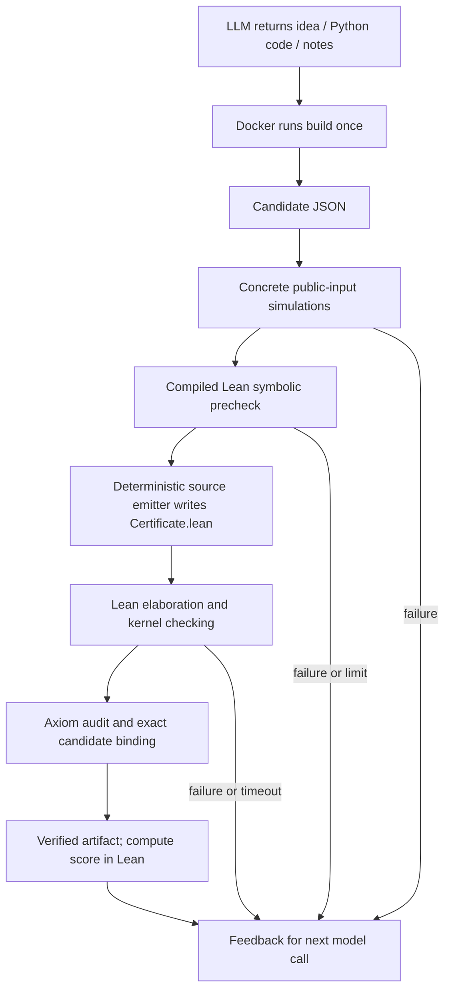

# Deep dive 2: what the models do, and how their programs become proved results

This companion answers Adrien's follow-up questions about the actual model interface, proof construction, theorem statements, axioms, timings, and failure feedback. Read it alongside [the original deep dive](DEEP_DIVE.md), where the short naming and bank-capacity clarifications are now marked **Adrien's notes**.

**The central answer:** a model writes a Python program that generates a candidate schedule. The harness executes that Python, then ordinary deterministic software constructs and checks a Lean certificate. **There is a real Lean proof for each accepted candidate, but no LLM call in certification.** The model does not supply the proof; the harness and Lean construct it using the previously proved checker-soundness theorem.

**Concrete follow-up:** [Fable's first two iterations, with the complete recorded transcript and an explicit all-input theorem](docs/FABLE_WALKTHROUGH.md). This includes the full prompts, both returned thinking summaries, both complete answers, Python execution records, feedback, and original certificates. The provider request explicitly used `thinking.display: "summarized"`: the saved thinking text is not an exhaustive internal reasoning trace.

To read “certificate” correctly, separate two proof steps. First, the reusable Lean theorem proves **checker success implies safe and correct execution for every allowed input**. Second, the candidate-specific theorem `checked`, proved by `by decide +kernel`, establishes **this exact candidate passes that checker**. Applying the first theorem to the second produces the all-input proof stored in the artifact. A JSON field saying `accepted: true` merely reports that outcome; it is not itself the proof. The follow-up makes the universal quantifier explicit in a [separately rechecked Lean theorem](docs/evidence/fable-two-iterations/recheck/FableContract.lean).

Written 25 November 2026. Implementation excerpts use the same pinned source snapshot as the original guide, `71c608a2b573c322993264945dbb2be8a9e5006f`. Historical records retain their own earlier source revisions. A separately labeled current-source check below was performed while preparing this companion. The implementation files at the working revision `cdabaf3` match the pinned snapshot; documentation additions do not change machine or checker semantics.

**Additional follow-up:** [why Docker is used](#docker), [what the model can actually call](#text-only-interface), [the mathematical proof of the checker](#proof-of-checker), [timings across the experiments](#timing-census), and [every observed error family, with a deduplicated exact-message catalogue](#error-census).

| Adrien's question | Where to read |
| --- | --- |
| 1. String identifier versus `CoefficientProfile` | Original guide, §2.1, **Adrien's notes**: version label, record type, and record value are different things. |
| 2. More banks means less capacity per bank? | Original guide, §2.2, **Adrien's notes**: 4,096 total slots are partitioned among the banks. |
| 3. Why these three axioms? | [§6. Axioms](#axioms) |
| 4. Coding agents, tools, terminal, and thinking traces? | [§1. Model interface and records](#model-interface) |
| 5. What exactly does the model return? | [§2. Text → Python → candidate](#output) |
| 6. Show a certificate and an actual error | [§3. Certificate files](#certificate) and [§8. Error feedback](#error-feedback) |
| 7. How is a certificate computed? | [§4. Construction and checking](#construction) |
| 8. Which model proves it, how long, how much reuse? | No model does the runtime proving; [§5. Reuse](#reuse), [§7. Measured time and size](#timings). |
| 9. What exact statements are proved? | [§5. Theorem statements](#theorems) |

<a id="model-interface"></a>

## 1. What the model can actually do

### A model call inside a fixed program

The experiment's model calls are text completions. The surrounding harness provides a repeated propose/check/feedback loop; it does not give the model interactive control of a terminal. Calling the whole system an optimization agent is reasonable, but calling each model response a tool-using coding-agent session would misdescribe this implementation.

The request contains two messages (system and user), model/settings, and an optional sampling seed. The call below has no `tools` or `functions` argument. The returned text is processed only after that one call finishes.

Source: [scripts/search.py:194–207](https://github.com/adrienX18/OptimalComputation/blob/71c608a2b573c322993264945dbb2be8a9e5006f/scripts/search.py#L194-L207).

<!-- source-excerpt {"commit": "71c608a2b573c322993264945dbb2be8a9e5006f", "path": "scripts/search.py", "start": 194, "end": 207} -->
```python
        for index in range(len(rows)+1, config['attempts']+1):
            messages = prompt.build(config, baseline, rows, root)
            directory = root / 'attempts' / f'{index:04d}'
            directory.mkdir()
            started = time.monotonic()
            request = dict(model=config['model'], messages=messages, max_tokens=config['max_tokens'],
                           timeout=config['request_timeout'], num_retries=0, stream=False)
            seed = attempt_seed(config['seed'], index)
            if seed_supported:
                request['seed'] = seed
            for key in ('temperature', 'reasoning_effort', 'api_base'):
                if key in config:
                    request[key] = config[key]
            write_json(directory / 'request.json', request)
```

Source: [scripts/harness/model.py:107–110](https://github.com/adrienX18/OptimalComputation/blob/71c608a2b573c322993264945dbb2be8a9e5006f/scripts/harness/model.py#L107-L110).

<!-- source-excerpt {"commit": "71c608a2b573c322993264945dbb2be8a9e5006f", "path": "scripts/harness/model.py", "start": 107, "end": 110} -->
```python
                response = sdk.completion(**(request | dict(num_retries=0, stream=False)), callbacks=[Logger()])
            if logging_errors:
                raise OSError(f'Provider archive failed: {logging_errors}')
            data = response.model_dump(mode='json')
```

The Python helper module's name, `candidate_tools`, is misleading if read as a list of callable LLM tools. Its functions are available **to the generated Python program**, and their source is shown to the model so it can write that program correctly.

| Available helper | What calling it in Python actually does |
| --- | --- |
| `baseline()` | Reads and returns the original certified candidate as a Python dictionary. |
| `seed()` | Reads the attempt's integer seed. |
| `load`, `store`, `add`, `mul`, `mac` | Construct instruction dictionaries. They do not execute accelerator instructions. |
| `issue(cycle, lane, instruction)` | Wraps an instruction with a scheduled cycle and lane. |
| `serial(instructions, lane=0, start=0)` | Builds a serial schedule using the fixed instruction latencies. |

The complete [helper source](scripts/harness/candidate_tools.py) is 46 lines at the pinned snapshot. The generator can also use Python's standard library: loops, lists, dictionaries, `random`, a private search algorithm, and so on. It runs in the configured Python Docker image, without network access and with CPU/memory/time limits. There is no exposed interactive shell tool, browser tool, or Lean tool for the model. Python execution is real, but **the harness initiates it after receiving the response**. Any exploratory computation in that Python must already have been written into the returned code.

The 30-cycle winner illustrates this distinction: Sol wrote a bounded depth-first scheduler, and the resulting Python searched for schedules in Docker. It did not ask the harness to run a command, inspect that command's result, and then send more code within the same response. Only the next attempt receives verification feedback.

<a id="text-only-interface"></a>

### Confirmation: the model receives text, not callable tools

**Yes: in these experiments the model cannot open a terminal, run its answer, inspect the result, and revise it within the same attempt.** The source of `candidate_tools.py` is a string appended to the system prompt. It is not an API tool declaration and does not install Python functions inside the model. The helper table above is the complete supplied helper interface; the generated program also has Python's standard library.

The proposed answer is a string in `message.content`, encoding a JSON object with the three string values `idea`, `code`, and `notes`. The API may additionally return a thinking summary and metadata. Once this response has finished, the harness parses `code`, writes it to a file, and runs `build()` once. Helper calls such as `baseline()` and `mac(...)` happen during **that later Python execution**.

There is one useful qualification: the model can put exploration or self-tests *inside the program it returns*. For example, `build()` can try several schedules, run its own Python calculations, and select one candidate. That is a single submitted program performing a computation. There is no intervening conversation in which the model sees the program's partial results and chooses its next tool call. On success, Python debug prints are archived but are not automatically inserted into the next prompt; on generator failure, the harness returns a bounded stderr excerpt.

The request and response records support this directly: all 1,250 requests in the main polynomial experiment lacked API `tools`/`functions`, and their received responses contained no tool calls. The [complete Fable walkthrough](docs/FABLE_WALKTHROUGH.md) shows the exact provider requests, helper source, returned text, post-response Python commands, and next prompts.

<a id="docker"></a>

### Why Docker is used, and which part needs it

Docker is the execution environment for the **LLM-written Python generator**. Running this code is necessary to expand loops or execute a search and obtain the final candidate JSON. The code is an arbitrary Python program, so it can also crash, loop indefinitely, allocate excessive memory, or attempt file and network access. The harness uses Docker to constrain that execution and to supply a consistent Python environment.

| Purpose | What this harness actually does |
| --- | --- |
| Limit file access and changes | Mounts only the prepared input directory read-only, uses a read-only container filesystem, and provides a 16 MiB temporary filesystem. The repository and credentials are not mounted. |
| Limit external access and privileges | Disables networking, drops Linux capabilities, prevents privilege escalation, and runs as UID/GID 65534. |
| Bound resource consumption | Sets one CPU, 256 MiB memory, a 64-process limit, an external generator timeout, and an output-size limit. |
| Make the environment identifiable | Resolves the configured Python image to a digest and archives that digest and the exact invocation. The selected Fable run used `python:3.12-slim-bookworm`. |
| Clean up after failure | Explicitly removes the container in a `finally` block, including when the Docker client times out. |

These choices are implemented by [the image resolver and generator runner](https://github.com/adrienX18/OptimalComputation/blob/71c608a2b573c322993264945dbb2be8a9e5006f/scripts/harness/evaluate.py#L97-L135); Fable's [actual command](docs/evidence/fable-two-iterations/attempts/0001/generation/process/request.json) records the flags and image digest used.

**Docker contributes isolation and reproducibility, not the mathematical correctness proof.** The local simulation and certification processes subsequently consume candidate JSON; the model API call is also outside the generator container. Given an existing candidate JSON file, `scripts/certify.py` can certify it without Docker or an LLM API key. Another suitably isolated Python runner could replace Docker without changing the Lean theorem. Bypassing it with unrestricted host execution would change the generator's access and resource limits.

### What records exist, and what they mean

| Record | What can be reconstructed | What it does not establish |
| --- | --- | --- |
| `request.json`, `provider-*-request.json` | The saved prompt, settings, and provider-adapter inputs. | Private provider-side computation. |
| `response.json`, `provider-*-response.json` | Returned answer, usage, stop reason, and any reasoning fields the provider exposed. | A complete internal reasoning trace for every model. |
| `proposal.json`, `generator.py` | The parsed strings and exact Python source. | Which branch every internal Python search step took. |
| `generation/process/{request,result}.json`, stdout/stderr | Command, limits, exit status, duration, emitted candidate, and diagnostic prints. | A chronological log of every call to `load()`, `baseline()`, etc. No such instrumentation is installed. |
| `simulation/.../trace.json` or its compressed copy | Modeled instruction issues, completions, and values for one supplied input. | The LLM's thinking or Python execution trace. |
| `certification/...` | Precheck results, generated Lean, kernel output and process result. | A conversational proof search by another LLM. |

For a concrete example, open the winner's [generator command](docs/evidence/deep-dive-2/polynomial/generation-request.json), [process result](docs/evidence/deep-dive-2/polynomial/generation/process/result.json), [empty generator stderr](docs/evidence/deep-dive-2/polynomial/generation-stderr.txt), and [complete machine trace for `generated-23`](docs/evidence/deep-dive-2/polynomial/trace.json). That last file explicitly says `unverified-simulation`; its scope is the chosen input.

### Did the models “think,” and is that saved?

The experiment requested medium reasoning. The records let us answer what was **returned**, without inferring unseen computation. A new metadata census of all 1,247 received responses in the completed polynomial experiment found:

| Model | Received responses | Nonempty returned reasoning text | Nonempty thinking-block list | Returned tool/function calls |
| --- | ---: | ---: | ---: | ---: |
| Fable | 247 | 246 | 246 | 0 |
| Opus | 250 | 208 | 208 | 0 |
| Sonnet | 250 | 23 | 23 | 0 |
| Astra | 250 | 0 | 0 | 0 |
| Sol | 250 | 0 | 0 | 0 |

Counts refer to `choices[0].message.reasoning_content`, `thinking_blocks`, and tool/function-call fields in the saved normalized responses. All 1,250 saved requests lacked `tools`/`functions` definitions; three Fable requests ended in API errors, leaving 247 responses. The [per-response metadata and hashes](docs/evidence/deep-dive-2/response-observations.json) and [export/census script](docs/build-deep-dive-2-evidence.py) make the counting rule inspectable. This census covers the polynomial study, not all possible provider behavior or the smoke study.

For Fable, Opus, and some Sonnet responses, provider-returned thinking text exists in the local raw archive. For Astra and Sol, these saved responses have no such text. In Sol's selected winner, the [saved usage](analysis/2026-11-23-five-model-search/walkthrough/winner/response.json) reports **1,927 reasoning tokens out of 4,358 completion tokens**, but does not reveal their text. Missing text does not imply no reasoning occurred. Returned reasoning text is an observable provider output, not an exhaustive or independently verified account of internal computation. The human-readable `idea` and `notes` fields are also model-authored explanations, not execution evidence.

The original polynomial archive remains local under `runs/nightly-five-models-20261123/`; the census lists exact response paths. A clone without that archive still has the selected Sol exchange and the census, but cannot inspect every response's text. The complete smoke archive has a [published download](analysis/2026-11-23-suite-smoke/data/README.md).

<a id="output"></a>

## 2. The response is text containing JSON containing Python

There are three different representations, in this order:

1. **Model response content:** a string containing a JSON object with exactly three string-valued keys: `idea`, `code`, `notes`.
2. **Generator:** parse that JSON and save its `code` string as `generator.py`. The code defines `build()`.
3. **Candidate:** run `build()` in Docker. It returns a Python dictionary describing configuration, layout, and the complete static schedule. The container serializes that dictionary to JSON.

This teaching example uses the actual response format, but is not an archived model answer. It simply returns the baseline unchanged:

```json
{"idea":"Keep the baseline.","code":"from candidate_tools import baseline

def build():
    return baseline()
","notes":"No optimization yet."}
```

The outer provider response adds its own metadata and `choices` wrapper. The harness reads `choices[0].message.content`, then parses the object above. A bare Python string or a direct candidate schedule is not the expected model response. An entire answer fenced as `json` is tolerated; extra keys, missing keys, non-string values, unfinished answers, or oversized code are rejected.

Source: [scripts/search.py:77–94](https://github.com/adrienX18/OptimalComputation/blob/71c608a2b573c322993264945dbb2be8a9e5006f/scripts/search.py#L77-L94).

<!-- source-excerpt {"commit": "71c608a2b573c322993264945dbb2be8a9e5006f", "path": "scripts/search.py", "start": 77, "end": 94} -->
```python
def proposal(response, config):
    choice = response['choices'][0]
    if choice.get('finish_reason') not in ('stop', 'end_turn'):
        raise ValueError(f"Incomplete response: {choice.get('finish_reason')}")
    content = choice['message']['content']
    if not isinstance(content, str):
        raise ValueError('Expected a text response.')
    text = content.strip()
    if text.startswith('```json\n') and text.endswith('```'):
        text = text[8:-3]
    result = evaluator.strict_json(text)
    if not isinstance(result, dict) or set(result) != {'idea', 'code', 'notes'} or not all(isinstance(v, str) for v in result.values()):
        raise ValueError('Return exactly three strings: idea, code, notes.')
    if len(result['code'].encode()) > config['code_bytes']:
        raise ValueError('Generator exceeds code_bytes.')
    if not result['code'].strip():
        raise ValueError('Empty generator.')
    return result
```

Yes, `for` loops are precisely how a short answer can describe thousands of instructions. For example, a loop can append one load instruction per lane. The loop executes on the host inside Docker; the resulting schedule contains explicit entries. The modeled accelerator never executes that Python loop and has no runtime branch instruction.

The model does **not** need to run its program before returning it. The following is the entire container entry point that runs the returned code. Generator printing is redirected to stderr so stdout can contain the candidate JSON.

Source: [scripts/harness/container_entry.py:1–15](https://github.com/adrienX18/OptimalComputation/blob/71c608a2b573c322993264945dbb2be8a9e5006f/scripts/harness/container_entry.py#L1-L15).

<!-- source-excerpt {"commit": "71c608a2b573c322993264945dbb2be8a9e5006f", "path": "scripts/harness/container_entry.py", "start": 1, "end": 15} -->
```python
"""Executed only inside the generator container."""
import contextlib
import json
from pathlib import Path
import random
import runpy
import sys

sys.path.insert(0, '/input')
random.seed(json.loads(Path('/input/randomness.json').read_text())['attemptSeed'])
with contextlib.redirect_stdout(sys.stderr):
    module = runpy.run_path('/input/generator.py')
    candidate = module['build']()
json.dump(candidate, sys.stdout, allow_nan=False)
sys.stdout.write('\n')
```

The generated code must return the dictionary rather than only print a candidate. If it crashes, times out, or returns an invalid object, the harness records a failed attempt. If it succeeds, the candidate is simulated and certified. The next model call can revise the code using that feedback.

<a id="certificate"></a>

## 3. Open the actual certificate

The string in the original §8.6 feedback,
`Certificate_4f62a6b595a2d7c69c6e898c7d10a1ee38f11e146492a6d7259ae00d43acf790.artifact`,
is the name of a Lean definition. The corresponding [complete original certificate](docs/evidence/deep-dive-2/polynomial/certification/Certificate.lean) is now included here: **9,073 bytes, 258 lines**. It was copied unchanged from Sol, seed 11, attempt 2. Its SHA-256 is recorded in the [original acceptance report](docs/evidence/deep-dive-2/polynomial/certification/result.json) and the new export [provenance file](docs/evidence/deep-dive-2/provenance.json).

The file begins with imports, a namespace, limits, the polynomial workload, and the literal candidate. Lines 10–242 contain the raw candidate, including all 224 scheduled instructions. The following is its actual closing proof section:

Exact archived text: [docs/evidence/deep-dive-2/polynomial/certification/Certificate.lean, lines 244–255](docs/evidence/deep-dive-2/polynomial/certification/Certificate.lean).

<!-- evidence-excerpt {"path": "docs/evidence/deep-dive-2/polynomial/certification/Certificate.lean", "start": 244, "end": 255} -->
```lean
def candidate : Candidate entry.adapter.shape :=
  (validateCandidate entry.adapter.shape raw).toOption.get (by decide)

theorem checked : (check entry.problem candidate 1000000 4096).toOption = some 30 := by decide +kernel

def artifact := entry.artifact candidate 1000000 4096 30 checked

theorem exactBinding : artifact.verified.candidate.toRaw = raw := by decide

#print axioms checked
#print axioms artifact
#print axioms exactBinding
```

Read the names in order:

- `candidate` is the typed version of the literal `raw` program, with structural validation evidence.
- `checked` proves that the symbolic checker returns `some 30` for that program and those budgets.
- `artifact` combines `checked` with the already-proved checker soundness theorem, producing safety and correctness proofs for every allowed input.
- `exactBinding` proves that serializing the typed, proof-bearing candidate recovers the whole `raw` value.
- `#print axioms` asks Lean to display the foundational dependencies of those three declarations.

The [kernel log](docs/evidence/deep-dive-2/polynomial/certification/kernel/stdout.txt) contains those dependency reports and the computed score. The [process record](docs/evidence/deep-dive-2/polynomial/certification/kernel/result.json) records exit code zero. A file named `Certificate.lean` on its own is not enough: failed attempts can also leave generated source behind.

### The historical certificate and today's certificate differ

The older polynomial experiment used a 1,000,000-boundary proof cap and reconstructed the typed candidate through `validateCandidate`. Today's emitter creates shared bounded register/address definitions and structural lemmas, then uses a cap of `min(requestedBoundaries, cycles + 2)`. This makes the cap 32 for this program. Both certificates describe the same 30-cycle candidate; 32 is a sufficient checking budget, not a different latency.

While preparing this companion, the saved candidate was certified again using the current source. Here is the corresponding section of the [new 631-line certificate](docs/evidence/deep-dive-2/current-polynomial/Certificate.lean):

Exact archived text: [docs/evidence/deep-dive-2/current-polynomial/Certificate.lean, lines 620–628](docs/evidence/deep-dive-2/current-polynomial/Certificate.lean).

<!-- evidence-excerpt {"path": "docs/evidence/deep-dive-2/current-polynomial/Certificate.lean", "start": 620, "end": 628} -->
```lean
theorem checked : (check entry.problem candidate 32 4096).toOption = some 30 := by decide +kernel

def artifact := entry.artifact candidate 32 4096 30 checked

theorem exactBinding : artifact.verified.candidate.toRaw = raw := by decide +kernel

#print axioms checked
#print axioms artifact
#print axioms exactBinding
```

The new proof file is 28,877 bytes and has a different namespace/hash. Its extra source mostly makes structural evidence explicit. A longer source file need not take longer to check: representation and reduction work matter, not just line count. The historical experiment's reported timings must stay attached to its historical proof file.

Complete historical certificates for the other illustrated winners are also available: [matrix multiplication](docs/evidence/deep-dive-2/matmul/certification/Certificate.lean), [Gram](docs/evidence/deep-dive-2/gram/certification/Certificate.lean), and [two-stage](docs/evidence/deep-dive-2/two-stage/certification/Certificate.lean). These were exported, not newly re-certified for this companion.

<a id="construction"></a>

## 4. How a certificate is constructed and checked

### The runtime sequence, including who does each part



The parts after the model response are ordinary Python, Docker, and Lean programs. The model adapter is used by the search loop, not by `scripts/certify.py`. This runtime fact does not establish who originally authored the repository's source code or whether they used AI assistance while developing it.

| Step | Concrete work |
| --- | --- |
| 1. Snapshot | `certify.py` reads one bounded copy of the candidate bytes, saves it, and hashes it. |
| 2. Parse and type | The compiled `certification_check` program finds the trusted workload by identifier and validates configuration, registers, layout counts/disjointness, and permitted accesses. |
| 3. Symbolic precheck | It runs the candidate once with symbolic polynomial inputs and interval bounds. This gives useful diagnostics or a proposed completion count. |
| 4. Emit | `Transport.certificateSource` writes literal candidate data, typed definitions, and fixed proof-obligation templates. No model invents the Lean text. A positive precheck still says `accepted: false`, `requires-kernel-check`. |
| 5. Prove the closed check | `lake env lean Certificate.lean` elaborates the source. `by decide +kernel` uses kernel reduction to establish the concrete checker equality. |
| 6. Apply shared theorems | `Entry.artifact` applies the generic soundness proof to this successful checker result, giving all-input safety and reference equality. |
| 7. Audit and score | The driver requires successful kernel exit and all three allowed-axiom reports. With an objective requested, Lean evaluates the new proof-bearing artifact and prints its score. |

The actual emitter writes the following proof section. These are **string-building expressions written in Lean**; the output of the function is Lean text to be checked later.

Source: [OptimalComputation/Certification/Transport.lean:124–136](https://github.com/adrienX18/OptimalComputation/blob/71c608a2b573c322993264945dbb2be8a9e5006f/OptimalComputation/Certification/Transport.lean#L124-L136).

<!-- source-excerpt {"commit": "71c608a2b573c322993264945dbb2be8a9e5006f", "path": "OptimalComputation/Certification/Transport.lean", "start": 124, "end": 136} -->
```lean
def certificateSource (entryName : String) (raw : RawCandidate) (boundaries maxTerms cycles : Nat) : String :=
  "import OptimalComputation.Certification.Catalog\n\n" ++
  "namespace GeneratedCertificate\n" ++
  "open OptimalComputation OptimalComputation.Hardware OptimalComputation.Candidates OptimalComputation.Certification\n" ++
  "set_option maxRecDepth 100000\nset_option maxHeartbeats 20000000\n\n" ++
  s!"def entry := {entryName}\n" ++
  "def raw : RawCandidate := " ++ rawSource raw ++ "\n\n" ++
  candidateSource raw ++
  s!"theorem checked : (check entry.problem candidate {boundaries} {maxTerms}).toOption = some {cycles} := by decide +kernel\n\n" ++
  s!"def artifact := entry.artifact candidate {boundaries} {maxTerms} {cycles} checked\n\n" ++
  "theorem exactBinding : artifact.verified.candidate.toRaw = raw := by decide +kernel\n\n" ++
  "#print axioms checked\n#print axioms artifact\n#print axioms exactBinding\n" ++
  "end GeneratedCertificate\n"
```

### What “symbolic execution” computes

Instead of substituting one test input, the checker represents each scalar input by a distinct variable, then follows every scheduled instruction. A register or memory value holds a normalized integer polynomial, an interval, and evidence that the interval encloses the polynomial for every input in the allowed box.

For polynomial evaluation there are eight coefficients and sixteen points. There are `16^8 × 8^16 = 2^80` allowed input vectors. The checker does not enumerate them. It manipulates expressions that stand for all of them at once.

For example, a MAC forming `c7*x0 + c6` produces the polynomial with terms `([6], 1)` and `([7,8], 1)`, in canonical order; the indices name input scalars, not registers. Since `c7,c6 ∈ [-8,7]` and `x0 ∈ [-4,3]`, ordinary interval multiplication and addition give the enclosing range `[-36,39]`. That result is within signed48 and can later be used as a signed16 multiplicand. This is a worked mathematical example of the checker's representation, not an extracted intermediate trace.

At later MACs, both multiplicands must still be proved signed16, and the result must be signed48. Timing, initialization, pending writes, bank capacity, and output stores are checked as well. A mathematically correct formula can fail because one intermediate is an illegal multiplicand.

Source: [OptimalComputation/Certification/Value.lean:48–55](https://github.com/adrienX18/OptimalComputation/blob/71c608a2b573c322993264945dbb2be8a9e5006f/OptimalComputation/Certification/Value.lean#L48-L55).

<!-- source-excerpt {"commit": "71c608a2b573c322993264945dbb2be8a9e5006f", "path": "OptimalComputation/Certification/Value.lean", "start": 48, "end": 55} -->
```lean
structure Value (box : Box) where
  polynomial : Polynomial
  interval : Interval
  sound : ∀ x, box.Allowed x → interval.Contains (polynomial.eval x)
  fits : interval.fits48 = true

def Value.eval (v : Value box) (x : Nat → Int) (hx : box.Allowed x) : Signed48 :=
  ⟨v.polynomial.eval x, Interval.signed48 (v.sound x hx) v.fits⟩
```

Source: [OptimalComputation/Certification/Value.lean:95–102](https://github.com/adrienX18/OptimalComputation/blob/71c608a2b573c322993264945dbb2be8a9e5006f/OptimalComputation/Certification/Value.lean#L95-L102).

<!-- source-excerpt {"commit": "71c608a2b573c322993264945dbb2be8a9e5006f", "path": "OptimalComputation/Certification/Value.lean", "start": 95, "end": 102} -->
```lean
def Value.mac (maxTerms : Nat) (a b acc : Value box) : Except ArithmeticFailure (Value box) := do
  a.require16 "left"
  b.require16 "right"
  if a.polynomial.length * b.polynomial.length > maxTerms then
    throw (.expressionBudget (a.polynomial.length * b.polynomial.length))
  -- Insert the usually small product into the accumulator, rather than
  -- rebuilding the accumulator by inserting each of its terms from scratch.
  ofPolynomial box ((a.polynomial.mul b.polynomial).add acc.polynomial) maxTerms
```

After the final effects drain, each output polynomial must match its workload's reference polynomial. Normalization permits algebraic rearrangement, cancellation, and reuse. A failure to match, or a range the interval method cannot prove, prevents certification. The checker is sufficient but incomplete: it can reject a safe program because an approximation lost useful correlations, as demonstrated in the original guide's §5.10.

Here is the full top-level checker. Every successful invocation goes through all these steps:

Source: [OptimalComputation/Certification/Checker.lean:66–71](https://github.com/adrienX18/OptimalComputation/blob/71c608a2b573c322993264945dbb2be8a9e5006f/OptimalComputation/Certification/Checker.lean#L66-L71).

<!-- source-excerpt {"commit": "71c608a2b573c322993264945dbb2be8a9e5006f", "path": "OptimalComputation/Certification/Checker.lean", "start": 66, "end": 71} -->
```lean
def check (p : Problem a) (candidate : Candidate a.shape) (boundaries maxTerms : Nat) : Except Diagnostic Nat := do
  let values ← (makeInputs p.box a.shape.inputCount maxTerms).mapError Diagnostic.inputBounds
  let initial := writeInputs candidate.layout.inputs values (State.empty p.box candidate.configuration)
  let result ← run maxTerms boundaries 0 (program candidate) initial
  checkOutputs result.state 0 candidate.layout.outputs p.outputs
  return result.cycles
```

### What `by decide +kernel` is doing

For a fixed candidate, the proposition “this bounded checker returns `some 30`” is decidable by computation. Lean constructs a proof term for that proposition and checks it through its kernel. This is often called proof by reflection: compute a check whose successful result is connected to the desired semantic theorem by an existing proof.

It is not asking an LLM to discover induction invariants or write a fresh proof of polynomial algebra. It also does not trust the precheck executable's answer as a premise. The emitted `some 30` is a claim that kernel reduction must validate independently. Changing it to `some 29` would require proving a different, false equality for this candidate.

The pinned [Lean 4.35.0 tactic implementation](https://github.com/leanprover/lean4/blob/v4.35.0/src/Lean/Elab/Tactic/Decide.lean#L83-L130) distinguishes the `+kernel` and `+native` paths. Its kernel path builds a proof and adds an auxiliary lemma using kernel checking; the two modes cannot be requested simultaneously. The local source was inspected for this explanation. A short tactic expression can require substantial reduction work, so a one-line proof can take seconds or minutes.

<a id="theorems"></a>

## 5. Exactly what is proved for each candidate

### The closed statements in the generated file

For the current polynomial certificate, the two visible named theorems are:

| Declaration | Statement, read literally |
| --- | --- |
| `checked` | Running `check` on this workload/problem and this exact typed candidate with 32 boundaries and a 4,096-term limit returns `some 30`. |
| `exactBinding` | The raw serialization of the artifact's typed candidate equals the literal `raw` record in the file, including its entire layout and schedule. |

There are also small structural proof obligations: configuration admissibility, bounded registers/addresses/lanes, layout counts, distinct addresses, and access membership. The newer source emitter gives many of these shared names such as `load24` or `store24`. Those names certify address permissions; they are not proofs of the final numerical answer.

The raw term is the file's parsed-and-emitted candidate representation. The kernel equality does not directly compare bytes on disk; parsing/emission and identification of the intended file remain part of the transport boundary. Hashes identify the input and proof files. They are useful audit evidence, not mathematical proof premises.

### The universal meaning comes from this already-proved theorem

Source: [OptimalComputation/Certification/Checker.lean:73–76](https://github.com/adrienX18/OptimalComputation/blob/71c608a2b573c322993264945dbb2be8a9e5006f/OptimalComputation/Certification/Checker.lean#L73-L76).

<!-- source-excerpt {"commit": "71c608a2b573c322993264945dbb2be8a9e5006f", "path": "OptimalComputation/Certification/Checker.lean", "start": 73, "end": 76} -->
```lean
theorem check_sound (p : Problem a) (candidate : Candidate a.shape) (boundaries maxTerms cycles : Nat)
    (h : check p candidate boundaries maxTerms = .ok cycles) (x : spec.Input) (hx : spec.AllowedInput x) :
    ∃ record, Evaluation.executeValues candidate (a.encode x hx) boundaries false = .success record ∧
      record.outputs = (a.outputScalars (spec.reference x)).toList := by
```

Read the hypothesis `h` as a successful checker result for this candidate. Read `x` as an arbitrary logical input, and `hx` as evidence that it satisfies the workload's allowed-input rule. The conclusion supplies an actual successful run of the ordinary machine and proves that **every output scalar** equals the reference answer.

This is the crucial move from a finite symbolic calculation to a statement about all inputs. It is valid because the symbolic machine was proved to match the concrete one. The proof is not “we ran enough examples.” No public test fixture appears in this theorem.

The `cycles` parameter constrains the successful checker result. The lower-level `run_sound` theorem also preserves the reported cycle count:

Source: [OptimalComputation/Certification/Runner.lean:24–28](https://github.com/adrienX18/OptimalComputation/blob/71c608a2b573c322993264945dbb2be8a9e5006f/OptimalComputation/Certification/Runner.lean#L24-L28).

<!-- source-excerpt {"commit": "71c608a2b573c322993264945dbb2be8a9e5006f", "path": "OptimalComputation/Certification/Runner.lean", "start": 24, "end": 28} -->
```lean
theorem run_sound (maxTerms fuel boundary : Nat) (queue : List (Evaluation.TimedAction c))
    (state : State box c) (result : RunResult box c) (h : run maxTerms fuel boundary queue state = .ok result)
    (x : Nat → Int) (hx : box.Allowed x) (counts : Evaluation.Counters) :
    ∃ counts', Evaluation.run false fuel boundary queue (state.eval x hx) counts [] =
      .finished ⟨result.cycles, result.state.eval x hx, counts', []⟩ := by
```

The public artifact interface stores safety and functional correctness as separate fields. This distinction excludes vacuous correctness for a candidate that never succeeds:

Source: [OptimalComputation/Evaluation/Verification.lean:109–129](https://github.com/adrienX18/OptimalComputation/blob/71c608a2b573c322993264945dbb2be8a9e5006f/OptimalComputation/Evaluation/Verification.lean#L109-L129).

<!-- source-excerpt {"commit": "71c608a2b573c322993264945dbb2be8a9e5006f", "path": "OptimalComputation/Evaluation/Verification.lean", "start": 109, "end": 129} -->
```lean
def ExecutionSafety (adapter : ScalarAdapter spec) (candidate : Candidate adapter.shape)
    (boundaries : Nat) : Prop :=
  ∀ x (h : spec.AllowedInput x), ∃ record,
    executeValues candidate (adapter.encode x h) boundaries false = .success record

/-- Functional correctness is separate from safety; it speaks only about actual
successful records and compares every output scalar in the workload codec. -/
def FunctionalCorrectness (adapter : ScalarAdapter spec) (candidate : Candidate adapter.shape)
    (boundaries : Nat) : Prop :=
  ∀ x (h : spec.AllowedInput x) record,
    executeValues candidate (adapter.encode x h) boundaries false = .success record →
      record.outputs = (adapter.outputScalars (spec.reference x)).toList

/-- A certificate binds the specification and scalar codecs, the complete
candidate (configuration, layout, schedule), and the fixed model semantics
called by executeValues. Neither an identifier nor a Boolean is a certificate. -/
structure VerifiedCandidate (adapter : ScalarAdapter spec) where
  candidate : Candidate adapter.shape
  sufficientBoundaries : Nat
  safety : ExecutionSafety adapter candidate sufficientBoundaries
  correctness : FunctionalCorrectness adapter candidate sufficientBoundaries
```

`ExecutionSafety` says an actual successful record exists for each allowed input within the supplied budget. Successful execution entails legal operations, no forbidden overflow/hazards, drained pending effects, and all required outputs written. `FunctionalCorrectness` says any successful record from that call has the exact reference outputs.

The generated `artifact` is a definition, not a declaration beginning with the word `theorem`, but its type contains those proofs. This shared function constructs it:

Source: [OptimalComputation/Certification/Catalog.lean:16–21](https://github.com/adrienX18/OptimalComputation/blob/71c608a2b573c322993264945dbb2be8a9e5006f/OptimalComputation/Certification/Catalog.lean#L16-L21).

<!-- source-excerpt {"commit": "71c608a2b573c322993264945dbb2be8a9e5006f", "path": "OptimalComputation/Certification/Catalog.lean", "start": 16, "end": 21} -->
```lean
def Entry.artifact (entry : Entry) (candidate : Candidate entry.adapter.shape)
    (boundaries maxTerms cycles : Nat)
    (h : (check entry.problem candidate boundaries maxTerms).toOption = some cycles) : Evaluation.VerifiedArtifact :=
  ⟨entry.specification, entry.adapter, entry.domainDecidable,
    certificate entry.problem candidate boundaries maxTerms cycles
      (check_of_toOption entry.problem candidate boundaries maxTerms cycles h)⟩
```

For the polynomial winner this means: **for every eight coefficients in `[-8,7]` and sixteen points in `[-4,3]`, this fixed program runs safely and returns the sixteen degree-seven polynomial values.** The schedule and layout are fixed; the input values vary. The other workloads substitute their own reference and input domain. No certificate claims global optimality, physical FPGA timing, correctness outside that domain, or correctness of arbitrary programs generated by the same Python source.

<a id="reuse"></a>

<a id="proof-of-checker"></a>

### Where is the proof that the checker is sound?

There are two different theorems, and both have proofs:

| Theorem | Scope | Where its proof comes from |
| --- | --- | --- |
| `check_sound` | Any supported problem, candidate, and budgets: successful checking implies safe execution and correct outputs for every allowed input. | A reusable mathematical proof in [Checker.lean, lines 73–111](https://github.com/adrienX18/OptimalComputation/blob/71c608a2b573c322993264945dbb2be8a9e5006f/OptimalComputation/Certification/Checker.lean#L73-L111), using the lower-level soundness lemmas. The linked range includes the complete proof after `:= by`. |
| `checked` | This particular candidate's check evaluates to the particular successful result, for example `some 30`. | A new proof constructed by `by decide +kernel` in [that candidate's certificate](docs/evidence/fable-two-iterations/attempts/0001/certification/Certificate.lean). |

The logical structure is ordinary implication elimination:

```text
General proof:   ∀ C, Check(C) = success  →  SafeAndCorrect(C)
Instance proof:       Check(thisCandidate) = success
Conclusion:                                SafeAndCorrect(thisCandidate)
```

The first line is not accepted because the checker calls itself correct. Its proof explains why the checker's symbolic computations agree with the concrete machine. The second line supplies its premise for a particular candidate.

### The mathematical argument, from arithmetic to whole programs

Fix an arbitrary assignment `x` of values to input variables satisfying the problem's input box. Write `eval_x(S)` for the concrete machine state obtained by evaluating every polynomial in symbolic state `S` at `x`.

1. **Symbolic arithmetic preserves meaning.** The polynomial library proves, for example, `eval_x(p.add(q)) = eval_x(p) + eval_x(q)` and the corresponding multiplication identity. Its normalization may reorder and combine terms, but the proofs establish that evaluation is preserved. See the complete proofs in [Polynomial.lean](https://github.com/adrienX18/OptimalComputation/blob/71c608a2b573c322993264945dbb2be8a9e5006f/OptimalComputation/Certification/Polynomial.lean#L88-L176).
2. **Numeric bounds are valid for every allowed assignment.** `Polynomial.bound_sound` proves that the derived interval contains `eval_x(p)`. A symbolic `Value` carries this range proof and evidence that its range fits signed48. `Value.require16_sound` proves that a successful multiplicand check implies its actual value fits signed16. `Value.add_sound`, `mul_sound`, and `mac_sound` then connect symbolic arithmetic to the concrete checked operations. See [Value.lean](https://github.com/adrienX18/OptimalComputation/blob/71c608a2b573c322993264945dbb2be8a9e5006f/OptimalComputation/Certification/Value.lean).
3. **A successful symbolic machine step implies a successful concrete step.** `prepare_sound` handles instructions; `step_sound` handles the boundary, including commits and the batch of issued instructions. The resulting concrete state is `eval_x(S')`, where `S'` is the symbolic result. Timing and resource restrictions are part of these checked transitions. See [Machine.lean](https://github.com/adrienX18/OptimalComputation/blob/71c608a2b573c322993264945dbb2be8a9e5006f/OptimalComputation/Certification/Machine.lean) and [Soundness.lean](https://github.com/adrienX18/OptimalComputation/blob/71c608a2b573c322993264945dbb2be8a9e5006f/OptimalComputation/Certification/Soundness.lean#L109-L155).
4. **Induction composes the steps into a run.** `run_sound` proves the correspondence for the whole schedule by induction on the boundary budget. A completed symbolic run corresponds to a completed concrete run, with the same completion cycle. See the full [Runner.lean proof](https://github.com/adrienX18/OptimalComputation/blob/71c608a2b573c322993264945dbb2be8a9e5006f/OptimalComputation/Certification/Runner.lean#L24-L55).
5. **Output equality connects the run to the specification.** `checkOutputs` compares the stored output polynomials with the expected ones. If two polynomial data structures are equal, applying the same evaluation function gives equal values for every `x`. This implication needs no sampling and no additional assumption that the checker is infallible. The earlier arithmetic lemmas justify how the stored polynomials were obtained. `checkOutputs_sound` also proves that required outputs are present. See [Checker.lean, lines 22–56](https://github.com/adrienX18/OptimalComputation/blob/71c608a2b573c322993264945dbb2be8a9e5006f/OptimalComputation/Certification/Checker.lean#L22-L56).
6. **The workload bridge supplies the intended mathematical answer.** `Problem.input_sound` connects allowed workload inputs to the box, and `Problem.output_sound` connects the expected symbolic polynomials to the reference function. Concrete workload entries must provide proofs of these fields. For this polynomial task, see [the workload instance](https://github.com/adrienX18/OptimalComputation/blob/71c608a2b573c322993264945dbb2be8a9e5006f/OptimalComputation/Certification/WorkloadInstances.lean#L85-L116).

Because `x` was arbitrary, this gives the result for every allowed input. In the final part of the actual `check_sound` proof, `run_sound` supplies the successful run, `checkOutputs_sound` supplies its outputs, and the workload bridge rewrites those outputs into the reference answer:

Source: [Checker.lean:101–111](https://github.com/adrienX18/OptimalComputation/blob/71c608a2b573c322993264945dbb2be8a9e5006f/OptimalComputation/Certification/Checker.lean#L101-L111).

<!-- source-excerpt {"commit": "71c608a2b573c322993264945dbb2be8a9e5006f", "path": "OptimalComputation/Certification/Checker.lean", "start": 101, "end": 111} -->
```lean
        obtain ⟨counts, hrun⟩ := run_sound maxTerms boundaries 0 (Evaluation.program candidate) initial result hr
          (environment a x) hbox (Evaluation.Counters.empty candidate.configuration)
        rw [hi] at hrun
        obtain ⟨hn, hout⟩ := checkOutputs_sound result.state 0 candidate.layout.outputs p.outputs ho
          (environment a x) hbox
        rw [p.output_sound x hx] at hout
        unfold Evaluation.executeValues
        rw [hrun]
        unfold Evaluation.finish
        simp only [hn, List.isEmpty_nil, ↓reduceIte]
        exact ⟨_, rfl, hout⟩
```

The last line constructs the witness execution record and the two proofs required by the theorem: successful execution and correct outputs. It is not a placeholder or an axiom declaration.

### Where is the proof of the checker equality itself?

For the concrete `checked` theorem, the entire candidate and all budgets are closed data: there are no free input variables in that equality. The checker operates on symbolic expressions, so this finite computation can be reduced to a result. Lean's `Decidable` machinery has proof-bearing true/false branches; `by decide +kernel` constructs and kernel-checks a proof of the proposition using that computation. The text is short because it invokes a general proof-producing procedure. If the result is an error rather than `some 30`, this tactic cannot prove that equality.

There is also an explicit small bridge between the two displayed result types. The generated equality uses `.toOption = some cycles`; `check_sound` takes `= .ok cycles`. The complete bridge proof is:

Source: [Checker.lean:114–119](https://github.com/adrienX18/OptimalComputation/blob/71c608a2b573c322993264945dbb2be8a9e5006f/OptimalComputation/Certification/Checker.lean#L114-L119).

<!-- source-excerpt {"commit": "71c608a2b573c322993264945dbb2be8a9e5006f", "path": "OptimalComputation/Certification/Checker.lean", "start": 114, "end": 119} -->
```lean
theorem check_of_toOption (p : Problem a) (candidate : Candidate a.shape) (boundaries maxTerms cycles : Nat)
    (h : (check p candidate boundaries maxTerms).toOption = some cycles) :
    check p candidate boundaries maxTerms = .ok cycles := by
  cases he : check p candidate boundaries maxTerms with
  | error e => simp [he, Except.toOption] at h
  | ok n => simpa [he, Except.toOption] using h
```

It considers both possible checker outcomes. The error branch would map to `none`, contradicting the hypothesis. The successful branch gives precisely the needed equality. `Entry.artifact` uses this bridge and then the shared `certificate` constructor; the constructor fills its `safety` and `correctness` fields using `check_sound`.

### How do we check that these proofs are correct?

Lean checks that each proof term has the stated theorem as its type. Tactics help construct those terms; their prose or apparent plausibility is not what establishes acceptance. The candidate proof and generic proof chain are also audited for axiom dependencies. Here the accepted dependencies are only `propext`, `Classical.choice`, and `Quot.sound`; a declaration that merely assumed `check_sound`, or a `sorry`, would add an unauthorized dependency.

For this follow-up, the eight source modules from polynomial arithmetic through `Catalog` were rechecked directly with `lake env lean`, and the thirteen relevant declarations were audited. All rechecks succeeded, and every printed axiom set was within the allowed three. The [commands, source hashes, exit statuses, and timings](docs/evidence/deep-dive-2-proof-audit/result.json), [audit source](docs/evidence/deep-dive-2-proof-audit/Axioms.lean), and [complete axiom output](docs/evidence/deep-dive-2-proof-audit/axioms.stdout.txt) are retained. These are new checks of the shared proofs, not new LLM experiments or candidate-timing samples.

For example, from a built checkout:

```sh
lake env lean OptimalComputation/Certification/Checker.lean
lake env lean docs/evidence/deep-dive-2-proof-audit/Axioms.lean
```

The precise confidence claim is a kernel-checked derivation from the allowed foundations and the written machine/workload definitions. Reviewing those definitions still matters: a proof about the wrong specification would establish the wrong thing, and this is not a proof about an unmodeled physical FPGA. There is also no claim of completeness: a conservative interval calculation can fail to prove a correct program safe.

### What is reused from one instruction or candidate to the next?

There are three levels of reuse:

| Level | Reused proof | New work for this candidate |
| --- | --- | --- |
| Arithmetic and one machine step | Polynomial normalization, interval enclosure, `Value.add_sound`, `Value.mul_sound`, `Value.mac_sound`, `prepare_sound`, `step_sound`. | Compute this instruction's actual symbolic operands, bounds, readiness, and state update. |
| Complete executions | `run_sound`, `checkOutputs_sound`, `check_sound`, and the `certificate` constructor. | Follow this whole schedule and compare its outputs with the reference. |
| Workload | `Problem.input_sound` and `Problem.output_sound`, proved once when adding a workload. | Use that fixed workload's box/reference with this candidate's layout and operations. |

For example, the following theorem covers **any** successful symbolic instruction preparation and any environment in the box:

Source: [OptimalComputation/Certification/Machine.lean:90–93](https://github.com/adrienX18/OptimalComputation/blob/71c608a2b573c322993264945dbb2be8a9e5006f/OptimalComputation/Certification/Machine.lean#L90-L93).

<!-- source-excerpt {"commit": "71c608a2b573c322993264945dbb2be8a9e5006f", "path": "OptimalComputation/Certification/Machine.lean", "start": 90, "end": 93} -->
```lean
theorem prepare_sound (s : State box c) (x : Nat → Int) (hx : box.Allowed x)
    (maxTerms t : Nat) (a : Action c) (p : Pending box)
    (h : prepare maxTerms t s a = .ok p) :
    Hardware.prepare t (s.eval x hx) a = .ok (p.eval x hx) := by
```

The MAC case uses the generic MAC soundness lemma; the run proof composes successful steps by induction. These proofs live in imported Lean modules. They are not rediscovered by a model for each multiplication or for each new proposal.

There is nevertheless new computation per candidate. The harness starts a fresh certification process for each accepted proposal path; it has no cross-candidate certificate cache and does not reuse a previous candidate's “checked” equality after an instruction changes. Even a repeated candidate is submitted for verification again. Lean can reuse imported declarations and perform internal caching within a module, but that is different from the search harness remembering that an earlier proposal was proved.

Within the newer emitted file, registers, addresses, and permission lemmas are shared, avoiding repeated structural reconstruction. It does **not** emit a separate English or tactic proof for each arithmetic instruction. Much of the per-instruction verification occurs through evaluation of the generic checker.

<a id="axioms"></a>

## 6. What the three allowed axioms mean

An axiom is a statement admitted as a foundation rather than proved from earlier declarations. Lean tracks which axioms a declaration depends on, directly or through library theorems. A finished proof is therefore a derivation relative to its logical foundations, not an assertion made without any assumptions. [Lean's reference on axioms](https://lean-lang.org/doc/reference/latest/Axioms/).

| Axiom | Plain-language meaning | Example of what it permits |
| --- | --- | --- |
| `propext` — propositional extensionality | If propositions `P` and `Q` imply each other, they can be identified as equal propositions. | Replacing one proposition by a logically equivalent one inside another expression. |
| `Quot.sound` — quotient soundness | Representatives related by the quotient's relation represent the same quotient element. | Treating two descriptions of the same equivalence class as equal. It also supports Lean's derivation of function extensionality. |
| `Classical.choice` | From the fact that a type has at least one element, select an element of it. | Classical existence arguments without providing an executable search procedure. |

Choice is not a magic runtime instruction that finds an optimized schedule. When it is used to produce data without an algorithm, Lean marks such definitions noncomputable. These foundations support ordinary classical reasoning; the actual candidate checker here is executable code. [Theorem Proving in Lean: axioms and computation](https://lean-lang.org/theorem_proving_in_lean4/Axioms-and-Computation/).

### Why permit these and reject others?

The project explicitly chose standard Lean foundations and rejects extra axioms. Allowing an axiom “this candidate is correct” would evade the experiment's entire purpose. An inconsistent axiom can make arbitrary conclusions derivable. `sorryAx`, introduced by unfinished proofs, is rejected for this reason; native-evaluation trust assumptions are also outside this project's whitelist. [Lean's standard-axiom and dependency documentation](https://lean-lang.org/doc/reference/latest/Axioms/).

The policy is enforced on the actual declarations, not just by searching the text for the word `axiom`. This code requires exactly the three named reports and checks each dependency set against the whitelist:

Source: [scripts/certify.py:57–65](https://github.com/adrienX18/OptimalComputation/blob/71c608a2b573c322993264945dbb2be8a9e5006f/scripts/certify.py#L57-L65).

<!-- source-excerpt {"commit": "71c608a2b573c322993264945dbb2be8a9e5006f", "path": "scripts/certify.py", "start": 57, "end": 65} -->
```python
def audit_kernel_output(output, namespace="GeneratedCertificate"):
    """Require all three declarations, not just absence of a forbidden axiom."""
    matches = re.findall(
        rf"'{re.escape(namespace)}\.(checked|artifact|exactBinding)' "
        r"(does not depend on any axioms|depends on axioms:\s*\[([^]]*)\])", output, re.S)
    if len(matches) != 3 or {m[0] for m in matches} != {'checked', 'artifact', 'exactBinding'}:
        return False
    return all(not m[2] or set(re.sub(r'\s+', '', m[2]).split(',')) <= ALLOWED_AXIOMS
               for m in matches)
```

For the original winning certificate, the reported dependencies are:

Exact archived text: [docs/evidence/deep-dive-2/polynomial/certification/kernel/stdout.txt, lines 1–9](docs/evidence/deep-dive-2/polynomial/certification/kernel/stdout.txt).

<!-- evidence-excerpt {"path": "docs/evidence/deep-dive-2/polynomial/certification/kernel/stdout.txt", "start": 1, "end": 9} -->
```text
'Certificate_4f62a6b595a2d7c69c6e898c7d10a1ee38f11e146492a6d7259ae00d43acf790.checked' depends on axioms: [propext,
 Classical.choice,
 Quot.sound]
'Certificate_4f62a6b595a2d7c69c6e898c7d10a1ee38f11e146492a6d7259ae00d43acf790.artifact' depends on axioms: [propext,
 Classical.choice,
 Quot.sound]
'Certificate_4f62a6b595a2d7c69c6e898c7d10a1ee38f11e146492a6d7259ae00d43acf790.exactBinding' depends on axioms: [propext,
 Classical.choice,
 Quot.sound]
```

This does not mean the proof makes three guesses about hardware. A dependency may enter indirectly through a library equality or finite-data theorem. It also does not show that each axiom is logically necessary for this particular mathematical claim; it reports the dependencies of this actual proof term.

The consequence for trust is precise: the kernel has checked a derivation using the permitted foundations and the stated machine/workload definitions. Confidence still depends on those definitions representing the intended problem, the integrity of the Lean environment, and the file-to-term boundary. None of the three axioms supplies a physical-hardware model or licenses an incorrect arithmetic result. The source decisions are in [the recorded proof-evaluation policy](docs/decisions.md#proof-evaluation-preserve-the-current-trust-boundary).

<a id="timings"></a>

## 7. How long it took, and how long the proofs are

<a id="timing-census"></a>

### Typical processing time across the experiments

**Yes, these durations were saved.** “Checker time” can mean either the fast compiled symbolic precheck or the entire certification process, including the Lean proof check. They have very different costs. The following census uses all saved attempt-stage records in the two reported experiments, rather than selecting only the winners. All times are host wall-clock seconds.

| Experiment / workload | Prechecks / completed Lean processes | Precheck median / p90 | Lean process median / p90 | Queue median | Successful certification total median / p90 |
| --- | ---: | ---: | ---: | ---: | ---: |
| Main polynomial study | 1,047 / 1,033 | 0.265 / 0.282 | 6.327 / 6.895 | not recorded | 6.589 / 7.167 |
| Suite smoke: polynomial | 49 / 43 | 0.201 / 0.332 | 3.936 / 4.597 | 0.000 | 4.138 / 6.040 |
| Suite smoke: matrix multiplication | 45 / 44 | 0.341 / 0.417 | 122.247 / 139.286 | 351.075 | 474.035 / 616.075 |
| Suite smoke: Gram | 46 / 46 | 0.242 / 0.357 | 82.941 / 93.703 | 187.924 | 262.033 / 343.797 |
| Suite smoke: two-stage | 52 / 49 | 0.225 / 0.345 | 59.028 / 64.424 | 112.050 | 170.169 / 239.445 |

Thus the main polynomial precheck typically took about a quarter of a second, and actual Lean certification about six to seven seconds. Matrix multiplication's completed Lean processes typically took about two minutes; waiting for the shared kernel slot often added several more minutes. The total column includes that wait. A queue median displayed as 0.000 means the measured median rounds to zero at millisecond precision, not that no attempt waited.

The underlying [per-attempt timing records](docs/evidence/deep-dive-2-census/attempts.json), [full statistics including minima/maxima and pilot runs](docs/evidence/deep-dive-2-census/summary.json), and [census script](docs/build-feedback-census.py) make these values reproducible. The p90 uses the nearest-rank convention: sort the observed durations and select position `ceil(0.9*n)`. Source revisions are retained per attempt. These are measurements under the experiments' actual concurrency and host load, not isolated benchmarks or a comparison of proof quality across models.

The sample counts differ for a reason. Malformed responses and failed generators never reach the checker; a failing concrete simulation also skips certification. A failed symbolic bound does reach the precheck but does not reach Lean. In the suite smoke there was one matrix Lean timeout at **600.019 seconds**, one interrupted two-stage Lean process, and two two-stage queue records still marked waiting. Those are retained as incomplete observations, not silently treated as successful proof durations. The displayed queue distribution includes records with an acquired slot; the successful-total distribution includes accepted certifications only.

The five concrete fixture simulations precede certification. Their median summed process time was **1.340 seconds** in the main polynomial study; in the suite smoke it was **1.071** for polynomial, **1.944** for matrix multiplication, **1.492** for Gram, and **1.211** for two-stage. These sums exclude orchestration gaps. Python generation and the LLM response are separate stages again. Do not add the precheck and Lean columns onto “certification total”: they are already inside it, and medians of different samples need not add exactly.

Specifically, the archive saves `generation/process/result.json`, `simulation/<fixture>/process/result.json`, `certification/precheck/result.json`, `certification/kernel/result.json`, and—where supported by the historical driver—`certification/kernel-queue.json`. Successful `certification/result.json` contains `totalSeconds` and `kernelSeconds`; `feedback.json` normally contains whole-attempt time. The subprocess duration includes startup, loading imports, elaboration, axiom output, and scoring. There is no separate saved measurement of only the kernel's internal reduction time. No LLM is used in these checker/proof stages.

### Four actual winning attempts

These are individual observations from the four illustrated winners, not model medians or controlled performance comparisons. All entries are **host wall-clock seconds**, except the final column. API time includes provider/transport overhead; it is not pure inference compute time. The source revisions differ across historical runs.

| Winner | Model call | Python generation | Precheck | Kernel queue | Active kernel process | Entire certification | Entire attempt | Modeled cycles |
| --- | ---: | ---: | ---: | ---: | ---: | ---: | ---: | ---: |
| polynomial | 72.634 | 0.722 | 0.259 | not recorded | 3.477 | 3.738 | 78.531 | 30 |
| matmul | 43.053 | 0.463 | 0.280 | 448.760 | 123.782 | 572.830 | 618.691 | 933 |
| gram | 57.692 | 0.550 | 0.243 | 192.862 | 64.502 | 257.611 | 317.596 | 478 |
| two-stage | 101.231 | 0.202 | 0.226 | 80.103 | 64.789 | 145.121 | 247.872 | 162 |

Polynomial is Sol/seed 11/attempt 2. Matrix and Gram are Astra/seed 11/attempt 3; two-stage is Sol/seed 11/attempt 3. The [measurement records](docs/evidence/deep-dive-2/measurements.json) list original archive paths and revisions. Each task's evidence directory retains the certificate result and precheck/kernel/generator process records. API and whole-attempt times are cross-checked against the already committed response and feedback files in the corresponding walkthrough.

The large difference between “active kernel” and “entire certification” is chiefly waiting for the kernel slot. For matrix multiplication, the wait was **448.760 seconds**, then the active process ran for **123.782 seconds**. The driver serializes memory-heavy proof checks while other model calls may continue. This is why treating 572.830 seconds as pure proving time would be misleading.

“Entire attempt” additionally includes model time, generation, all public simulations, cleanup, and bookkeeping. These columns are nested measurements and do not form a list to sum. The active kernel subprocess also includes Lean startup/import/elaboration, axiom printing, and requested score evaluation; there is no instrumentation isolating the time spent solely in the kernel's reduction routine. The older polynomial run did not save a queue record; that table cell is missing evidence, not an asserted zero.

### Source length is not mathematical difficulty

| Historical certificate | Source bytes | Source lines | Scheduled instructions |
| --- | ---: | ---: | ---: |
| [polynomial](docs/evidence/deep-dive-2/polynomial/certification/Certificate.lean) | 9,073 | 258 | 224 |
| [matmul](docs/evidence/deep-dive-2/matmul/certification/Certificate.lean) | 779,549 | 16,631 | 7,376 |
| [gram](docs/evidence/deep-dive-2/gram/certification/Certificate.lean) | 430,509 | 8,791 | 3,712 |
| [two-stage](docs/evidence/deep-dive-2/two-stage/certification/Certificate.lean) | 206,951 | 3,847 | 1,280 |

These counts measure each UTF-8 **`.lean` source file**, including candidate data and structural definitions. They do not measure the size of an expanded proof term, an `.olean` file, or all imported generic proofs. Most large-file lines spell out the program and its structural evidence. The decisive `checked` equality is still one source line.

The new polynomial certificate from this companion took **5.925 seconds end to end**, with `kernelSeconds = 5.572` in the driver report. It accepted the same candidate hash and the same 30-cycle score. This single later run is not a speed comparison with the original 3.738-second certification: source representation, process state, and host load differ. See the [new report](docs/evidence/deep-dive-2/current-polynomial/result.json).

No LLM is used in any of these proof-checking phases. The model named in a row authored the candidate generator. The prover is the pinned **Lean 4.35.0** toolchain running the generic checker/proofs and emitted certificate.

<a id="error-feedback"></a>

## 8. Wrong candidates and the feedback the model received

<a id="error-census"></a>

### All observed rejection messages, without duplicates

I inspected **all 1,506 saved live-model attempt feedback records**: the main polynomial study (1,250), suite smoke (240), five-model pilot (10), and earlier two-model pilot (6). Of these, **1,226 were certified and 280 were unaccepted**. The two reported studies account for 275 of those unaccepted attempts. The separate 43 offline replay/integration attempts are identified in the [scope record](docs/evidence/deep-dive-2-census/scope.json); their feedback was not sent to a live LLM and is excluded from this catalogue.

**[Open the complete deduplicated error-message catalogue](docs/ERROR_CATALOGUE.md).** It prints all **69 distinct nonempty message strings** exactly, including nested simulator diagnostics, Python tracebacks, parser errors, and provider errors. It lists occurrence counts and whether each string actually appears in a saved next prompt. Identical strings appear once; messages with different register/cycle/range values, traceback lines, or provider request IDs remain available as separate exact variants. The tables here group those variants by meaning.

There are **258 saved next requests containing failure feedback**, and **22 failures without a subsequent request**. Of the 69 exact strings, **63 appear in full in at least one next prompt**. Thus a recorded error is not automatically an error the model was shown. The [complete 280 failure records](docs/evidence/deep-dive-2-census/failures.json) retain both the original feedback and the actual next-prompt string when it exists.

#### Response and Python-generation failures

| Error family / message | Recorded attempts | With a next prompt | Meaning |
| --- | ---: | ---: | --- |
| `Incomplete response: content_filter` | 124 | 121 | The provider/adapter finish reason was `content_filter`; the harness did not accept a complete proposal. This label alone does not explain why the provider returned it. |
| `Generator exceeds code_bytes.` | 44 | 38 | The proposed Python source exceeded the configured code-size limit. |
| `Expecting value: line 1 column 1 (char 0)` | 13 | 12 | Parsing the proposed JSON failed at its beginning. |
| `Extra data: …` | 4 | 3 | Additional content remained after a JSON value. The four exact line/column variants are in the catalogue. |
| `Incomplete response: length` | 1 | 1 | The answer ended with a length-limit finish reason. |
| Python `SyntaxError` | 2 | 2 | An unclosed `(` or an unmatched `)`. |
| Python `AssertionError` | 4 | 4 | An assertion in the generated program failed. |
| Python `IndexError` | 5 | 5 | `list index out of range` or `Cannot choose from an empty sequence`. |
| Python `KeyError` | 2 | 2 | Missing dictionary key `17` or `10`. |
| Python `RuntimeError: schedule failed` | 1 | 1 | The submitted generator explicitly raised this error. |
| Python `ValueError: min() iterable argument is empty` | 1 | 1 | The program called `min()` without any candidate values. |
| Generator process timeout | 1 | 1 | The process status was `timeout`; its stderr/message was empty. The status is still feedback, despite there being no nonempty message string. |

The Python rows include their complete tracebacks in the exact catalogue. They are failures of the submitted generator, not Lean counterexamples to a completed candidate. Likewise, an invalid response format prevents the proposed program from reaching execution.

#### Candidate simulation and symbolic-bound failures

| Diagnostic | Recorded attempts | With a next prompt | Meaning |
| --- | ---: | ---: | --- |
| `pendingRead` | 14 | 12 | The schedule reads a register whose pending result is not ready. |
| `bankCapacity` | 9 | 8 | Too many memory accesses hit a bank in one cycle. |
| `operandOutOfRange` | 8 | 8 | A concrete execution uses **−34,952** as a signed16 left multiplicand; all exact cycle/lane variants are retained. |
| `output-mismatch` | 5 | 4 | The simulator completes but some outputs differ from the reference on a fixture. |
| `writebackCollision` | 3 | 3 | Two register results would write back to the same lane at the same boundary. |
| `issueCollision` | 2 | 2 | More than one instruction is issued on a lane in one cycle. |
| `uninitializedRegister` | 2 | 2 | The schedule reads a register with no initialized value. |
| `configuration: expected an object` | 2 | 0 | The candidate JSON's configuration has the wrong shape. These rejections were recorded on final attempts. |
| `incompleteOutput` | 1 | 0 | Required output addresses were unwritten at completion. The exact missing-address list is in the catalogue; no next request exists for this case. |
| `Cannot prove that the left fits signed 16 bits: derived range [-42596, 39319].` | 20 | 18 | The symbolic interval extends outside signed16. This alone is not a concrete counterexample. |
| `Cannot prove that the left fits signed 16 bits: derived range [-42568, 39287].` | 1 | 1 | The other observed symbolic-range message, with the same limitation. |

The first nine rows account for **46 candidates rejected by simulation**. Each feedback object has the top-level message `A public fixture failed.` and includes the first failed fixture's detailed report. The harness did run the remaining fixtures: there are **191 failing fixture reports** in total. The [full fixture-failure record](docs/evidence/deep-dive-2-census/fixture-failures.json) retains all of them and marks the 46 selected for feedback. The other fixture reports were archived but not all inserted into the model's prompt.

The 21 symbolic-range failures had passed the concrete fixtures. This is a useful example of why fixture success is insufficient for certification, and also why “not proved” should not automatically be called “wrong.”

#### Infrastructure and incomplete checks

| Error family / message | Recorded attempts | With a next prompt | Meaning |
| --- | ---: | ---: | --- |
| `litellm.InternalServerError … Internal server error` | 3 | 3 | Provider API failure. |
| `litellm.Timeout … Read timed out` | 2 | 2 | The model request exceeded its timeout. |
| `litellm.BadGatewayError … Error 502: Bad gateway` | 1 | 0 | Provider/gateway failure on a final attempt. |
| `Kernel checking exceeded its time budget; no certificate was accepted.` | 1 | 1 | Certification remained inconclusive after the Lean timeout. |
| `Interrupted attempt; artifacts retained.` | 4 | 3 | The attempt did not finish normally. |

These are not proof that the proposed mathematics or schedule was invalid. All exact provider strings, including their distinct request IDs and reported timeout durations, are retained once each in the catalogue.

#### Exactly how much feedback reached the LLM

For the main studies, the next prompt removes timing fields from the feedback object, JSON-encodes it as a string, and clips that string to 3,000 bytes. The earlier two-model pilot retained its timing field; the census uses its actual saved request rather than assuming today's formatting.

One Gram `output-mismatch` case—Sol, seed 11, attempt 2—was clipped mid-array: the expected output vector consumed the remaining space. Its human-readable mismatch message and list of mismatched indices were included, but the full expected/actual payload was not. The catalogue reproduces the **exact clipped string** sent in attempt 3. The outer request was valid JSON; the nested feedback string was no longer independently parseable JSON. This suggests a concrete improvement for a future run: reserve space for the category, message, first mismatches, and a compact expected/actual comparison before adding large vectors. No harness behavior was changed for this documentation update.

### One wrong candidate, explained end to end

Sonnet, seed 23, attempt 2 proposed an even/odd polynomial decomposition. Its explanation claimed that all multiplicands stayed small. On the allowed `negative-endpoints` fixture, however, the program tried to use **−34,952** as a signed16 multiplicand at cycle 30, lane 0. Signed16 stops at −32,768. That is a concrete illegal execution, not merely an inconclusive interval bound.

The fixture sets every coefficient to −8 and every point to −4. With `z = x² = 16`, the odd part is `O = −8 × (1 + 16 + 256 + 4096) = −34,952`. Computing `O` into a signed48 register is legal. The final combination `E + O*x` then uses `O` as a multiplicand, which must fit signed16; that is where the program fails. The model's algebraic identity is valid, but its intermediate use violates this machine's width rule.

The [original failed generator](docs/evidence/deep-dive-2/error/generator.py), [candidate](docs/evidence/deep-dive-2/error/candidate.json), [input](docs/evidence/deep-dive-2/error/simulation/negative-endpoints/input.json), and [simulator error](docs/evidence/deep-dive-2/error/simulation/negative-endpoints/process/stdout.txt) are included. Here is its complete saved feedback:

Exact archived text: [docs/evidence/deep-dive-2/error/feedback.json, lines 1–37](docs/evidence/deep-dive-2/error/feedback.json).

<!-- evidence-excerpt {"path": "docs/evidence/deep-dive-2/error/feedback.json", "start": 1, "end": 37} -->
```json
{
  "accepted": false,
  "category": "simulation-failed",
  "message": "A public fixture failed.",
  "failure": {
    "fixture": "negative-endpoints",
    "passed": false,
    "process": {
      "status": "completed",
      "exitCode": 1,
      "seconds": 0.27091312408447266
    },
    "report": {
      "status": "failure",
      "recordVersion": "cli-error-v1",
      "message": "OptimalComputation.Evaluation.Failure.arithmeticFailure\n  { cycle := 30,\n    lane := some 0,\n    rule := OptimalComputation.Hardware.MachineRule.arithmetic\n              (OptimalComputation.Hardware.ArithmeticError.operandOutOfRange\n                (OptimalComputation.Hardware.ArithmeticOperand.left)\n                16\n                (-34952)) }",
      "details": {
        "violation": {
          "value": -34952,
          "operand": "left",
          "name": "operandOutOfRange",
          "bits": 16
        },
        "rule": "OptimalComputation.Hardware.MachineRule.arithmetic\n  (OptimalComputation.Hardware.ArithmeticError.operandOutOfRange\n    (OptimalComputation.Hardware.ArithmeticOperand.left)\n    16\n    (-34952))",
        "lane": 0,
        "cycle": 30
      },
      "category": "arithmetic-failure"
    }
  },
  "attempt": 2,
  "idea": "Avoid the Horner range failure by splitting the polynomial into even and odd parts in y=x*x. That gives E=c0+y(c2+y(c4+y c6)) and O=c1+y(c3+y(c5+y c7)), with result=E+O*x. All multiplicands stay small. Each lane handles 2 points, and a greedy in-order hazard-aware scheduler emits the schedule.",
  "directory": "attempts/0002",
  "seconds": 43.537,
  "improved": false,
  "bestScore": 1520
}
```

The important fields are `accepted: false`, the concrete fixture/location/value, `improved: false`, and the unchanged `bestScore: 1520`. No certificate was constructed for this candidate because public simulation had already failed. The [skipped-certification record](docs/evidence/deep-dive-2/error/certification-skipped.json) confirms that control flow.

### What the next prompt contained

The next request carried the last generator as `latest.code` and a serialized feedback string as `latest.feedback`. Timing fields were removed recursively, and feedback was capped at 3,000 UTF-8 bytes. For this example it fits completely after removing the times: the failure details above survived. The next request also carried the baseline incumbent and the model's notebook/history.

The [exact next request](docs/evidence/deep-dive-2/error/next-request.json) preserves that evidence. This read-only command prints the actual carried feedback in readable form, rather than reconstructing a hypothetical prompt:

```sh
python3 - <<'PYCODE'
import json
from pathlib import Path
p = Path('docs/evidence/deep-dive-2/error/next-request.json')
request = json.loads(p.read_text())
context = json.loads(request['messages'][1]['content'])
print(json.dumps(json.loads(context['latest']['feedback']), indent=2))
PYCODE
```

This is the optimization loop's repair opportunity. The original provider call has ended; another call sees the failure and can return revised Python. The feedback contains no interactive debugger transcript.

By contrast, `range-not-proved` after the public simulations pass says the symbolic range method could not establish safety. It does not necessarily supply an input that violates the machine rules. The [two contrasting examples in the original guide](DEEP_DIVE.md#failure-walkthrough) distinguish these cases. “Rejected,” “wrong on a concrete input,” and “not proved within the method/budget” must stay separate.

<a id="inspection"></a>

## 9. Inspect and reproduce the evidence

The selected historical exports were checked against their original archive inventory entries before copying. The [provenance file](docs/evidence/deep-dive-2/provenance.json) lists exact source paths, sizes, hashes, and archive inventory hashes. The complete larger archives were not re-audited or re-certified for this companion.

Run the two documentation checks from the repository root:

```sh
python3 docs/check-deep-dive.py
python3 docs/check-deep-dive-2.py
```

The second check verifies source/evidence quotations, local and pinned source links, the four candidate/proof/score bindings, measured source sizes and timings, the response census arithmetic, the actual carried error feedback, and the separately saved new certificate result. It also checks the full rejection/timing census, its timing table, and the recorded shared-proof rechecks and thirteen axiom reports. It does not mistake archived exit status or a hash for a new kernel proof.

To certify the already saved candidate yourself, use a fresh archive directory after building the project:

```sh
lake build
out="$(mktemp -d /tmp/optimal-deep-dive-2.XXXXXX)"
python3 scripts/certify.py   analysis/2026-11-23-five-model-search/walkthrough/winner/candidate.json   --archive "$out/certification" --objective latency-v1 --fixture generated-23 --json
```

This needs neither Docker nor a model API key because it starts from candidate JSON. It writes a new certificate using the current emitter, preserving the historical file. To replay the Python generator itself, use the original guide's [separate replay recipe](DEEP_DIVE.md#replay-walkthrough), which requires its recorded Docker environment.

To rebuild the historical exports/census when the original archives are locally available:

```sh
python3 docs/build-deep-dive-2-evidence.py
python3 docs/build-feedback-census.py
```

This reads records and copies selected files. It neither sends provider requests nor runs model-written code. The current-polynomial directory is a separately observed check and is retained unless a new check is explicitly supplied to the exporter.

**Checks performed for this companion:** both documentation audits passed; the new polynomial certificate passed kernel checking and the axiom audit at 30 modeled cycles; and running the saved Sonnet failure through the current simulator reproduced the same signed16 operand failure at cycle 30, lane 0, value −34,952. The later follow-up rechecked eight shared-proof source modules and thirteen axiom reports, and audited 1,506 live attempts, 280 unaccepted attempts, all 69 distinct message strings, and their source hashes. No new model responses were requested.
