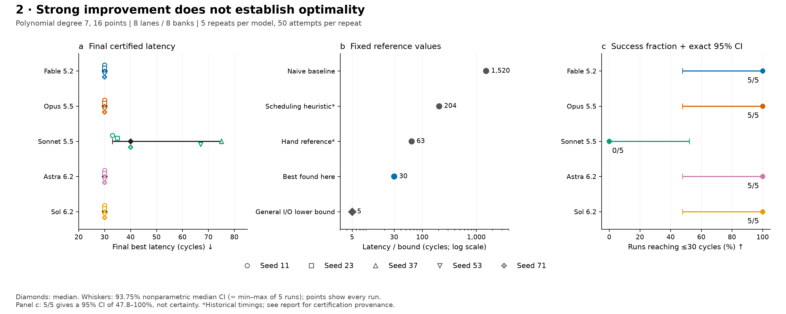
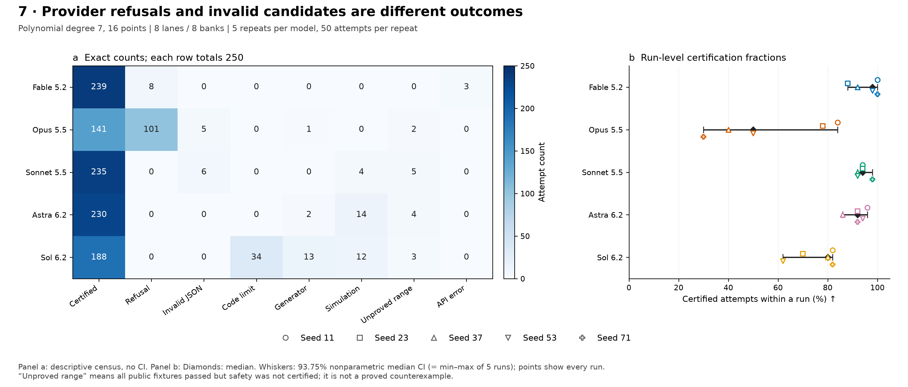
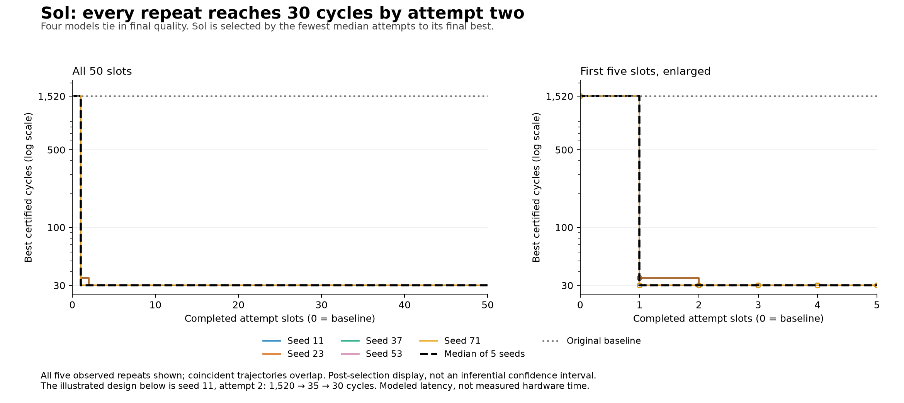
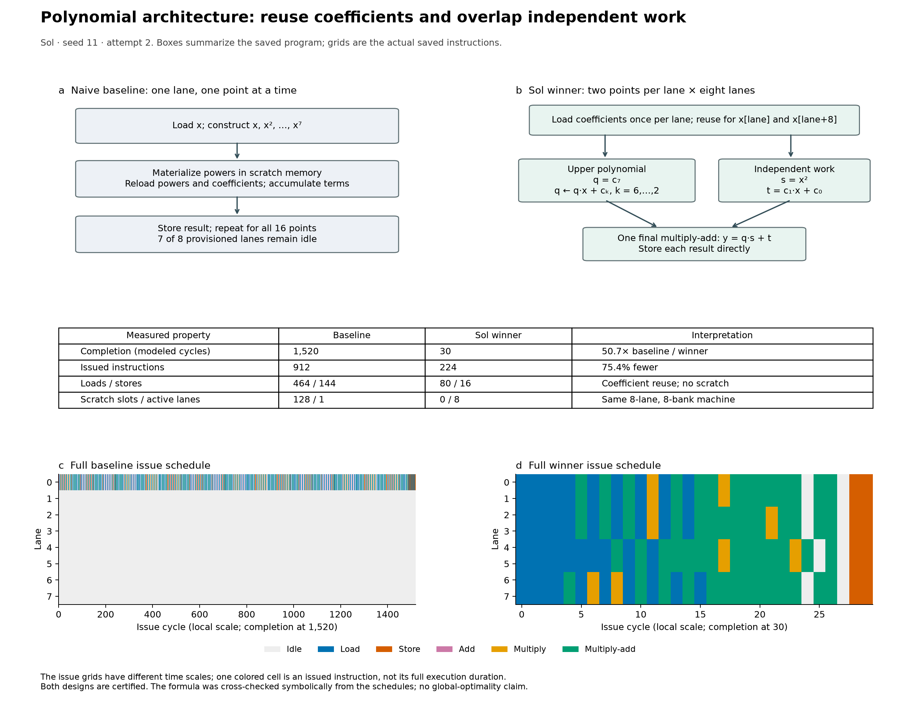

# First five-model search experiment: preliminary analysis

23 November 2026 · [reproducible metrics](metrics.json) · [25 run summaries](runs.csv) · [all convergence curves](convergence.csv)

The first ten figures below visualize the measured claims. Each has a vector PDF/SVG
alongside its PNG in [figures/](figures/). **Read the uncertainty correctly:**
points/lines show all five repeats; median whiskers/bands are **93.75% exact
nonparametric intervals** (the observed min–max at `n=5`). Figure 2c instead uses
**95% exact binomial intervals** for run-level success. These levels are
intentional; see [figure methods and assumptions](figure-methods.md). No within-run
attempts are treated as independent replicates, and no significance ranking is
claimed. Fixed counts and records are descriptive and receive no artificial CI.

The [archived loop walkthrough](#inside-the-loop-actual-inputs-outputs-and-a-winning-design)
adds two descriptive figures, complete saved inputs/outputs and a visual
comparison of a selected winning implementation with the baseline.

**The basic loop works, and four models consistently find a much faster certified
design. The main limitation exposed here is what happens after an early success:
many later attempts repeat an existing design or explore without improving it.**
This is one small workload under one configuration, not a general model ranking.

## What was run

Five models, five repeats each, 50 sequential attempts per repeat: **25 loops and
1,250 attempt slots**, with at most five loops active concurrently. The models
were Fable 5.2, Opus 5.5, Sonnet 5.5, Astra 6.2 and Sol 6.2. Repeat seeds were
**11, 23, 37, 53, 71**; each loop started from the same baseline with independent
history and notes.

The task was degree-seven polynomial evaluation at 16 points, on `arty-model-v1`
with eight lanes and eight memory banks, minimizing `latency-v1`. Coefficients
range from -8 to 7 and points from -4 to 3. Every accepted candidate must pass
public simulations and Lean kernel certification for **all allowed inputs**.
All models used medium reasoning, a 32,768-token output limit, a 32,000-byte
prompt limit and an 8,000-byte generated-program limit.

The experiment used commit `185e5daf8574a2cb92dd9cf5eb8f22afda5e4012`, ran from
08:25 to 13:51 UTC, and finished in **5 h 26 min**. All loops completed all 50
slots; errors consumed slots and were not automatically retried.


*Figure 1. Actual launch-to-exit spans and observed concurrency, including startup.
The right panel accounts for every attempt. Counts and timings are descriptive.*

## Quality: strong improvement, with a shared observed plateau

Lower cycle counts are better. Columns below follow the seed order above.

| Model | 11 | 23 | 37 | 53 | 71 | Certified attempts / 250 |
| --- | ---: | ---: | ---: | ---: | ---: | ---: |
| Fable 5.2 | 30 | 30 | 30 | 30 | 30 | 239 (95.6%) |
| Opus 5.5 | 30 | 30 | 30 | 30 | 30 | 141 (56.4%) |
| Sonnet 5.5 | 33 | 35 | 75 | 67 | 40 | 235 (94.0%) |
| Astra 6.2 | 30 | 30 | 30 | 30 | 30 | 230 (92.0%) |
| Sol 6.2 | 30 | 30 | 30 | 30 | 30 | 188 (75.2%) |

The original baseline is **1,520 cycles**, so 30 cycles is a **50.7× modeled
speedup**, or 98.0% fewer cycles. It also improves on the earlier 63-cycle hand
reference by **2.1×**, and the earlier 204-cycle scheduling heuristic by **6.8×**.
These comparisons use the same task, hardware configuration and objective;
see the [historical reference table](../../docs/results/section9-v1/summary.md)
and [certification validation](../../docs/validation.md). The historical ledger
has not been rewritten or retroactively relabeled.

**30 is the best found, not a proved global optimum.** The repository's general
compulsory-I/O lower bound is only five cycles. Closing 98.3% of that
naive-to-bound gap does not establish optimality. Several model notebooks offer
informal arguments against 29 cycles, but those arguments were not certified and
often assume a particular assignment of work to lanes.

Sonnet's median final result is 40 cycles and its mean is 50. It often produces
valid designs, but validity alone does not imply strong optimization. Its five
repeats show substantial variation; the other four models all reach the same
observed score on this instance.



*Figure 2. Left: five final scores per model and a median interval. Middle:
historical references on a log axis; the five-cycle point is a lower bound, not
an achieved design. Right: 95% exact success intervals use five runs, so 5/5 does
not imply guaranteed future success. Identical score intervals can collapse.*

## Convergence: most useful progress happened early

| Model | Attempt first reaching its final best, by seed | Median time to that best |
| --- | --- | ---: |
| Fable | 1, 2, 3, 2, 2 | 5.13 min |
| Opus | 10, 9, 20, 33, 10 | 19.35 min |
| Sonnet | 4, 3, 3, 8, 2 | 1.86 min |
| Astra | 2, 3, 2, 3, 2 | 1.69 min |
| Sol | 2, 2, 1, 1, 1 | 1.32 min |

Times sum completed attempt durations within each loop, including API calls,
generation and checking, but exclude baseline startup and time waiting in the
batch queue. Sonnet's time is to its own weaker final result, **not to 30 cycles**.

**23/25 loops found their eventual best by attempt 10.** Fable and Astra reached
30 in every repeat by attempt three, and Sol by attempt two. Opus had two slower
repeats, reaching 30 at attempts 20 and 33. Thus a ten-attempt budget would have
preserved 23 final results but missed those two later Opus improvements.

In hindsight, **1,119/1,250 attempts (89.5%) occurred after that loop first found
its eventual best**, without any further strict improvement. That is evidence
for testing a shorter budget or a stagnation policy; it is not an oracle that
would have told us when to stop during the run.

Median best-so-far cycles across the five repeats:

| Model | Attempt 1 | 3 | 5 | 10 | 20 | 50 |
| --- | ---: | ---: | ---: | ---: | ---: | ---: |
| Fable | 33 | 30 | 30 | 30 | 30 | 30 |
| Opus | 38 | 35 | 34 | 30 | 30 | 30 |
| Sonnet | 1520 | 75 | 40 | 40 | 40 | 40 |
| Astra | 34 | 30 | 30 | 30 | 30 | 30 |
| Sol | 30 | 30 | 30 | 30 | 30 | 30 |

The baseline remains the incumbent until a strictly better certified candidate
appears, which explains Sonnet's early 1,520 values.


*Figure 3. Thin lines show the five runs, heavy lines their median, and bands
the 93.75% pointwise median interval. Axes use log cycles and include the original
baseline; identical trajectories overlap. Bands are not simultaneous guarantees.*


*Figure 4. Every repeat is shown. Whiskers are 93.75% median intervals; the last
panel quantifies retrospective budget use. Sonnet's timing targets its own
weaker final score, not 30 cycles.*

## Repetition is a major difference between models

| Model | Distinct certified candidate structures | Certified submissions |
| --- | ---: | ---: |
| Fable | 8 | 239 |
| Opus | 36 | 141 |
| Sonnet | 7 | 235 |
| Astra | 210 | 230 |
| Sol | 144 | 188 |

Here a structure ignores the candidate identifier, JSON key order and instruction
serialization order, but preserves instructions, cycles, registers and layout.
This is **not a count of distinct algorithms**: even register renaming or unused
layout differences can make structures distinct. Counts pool all five repeats
within a model; repeated submissions still count in the certification rate.

The generated text confirms deliberate repetition in inspected cases. For
example, [Fable seed 11, attempt 25](../../runs/nightly-five-models-20261123/runs/fable/seed-11/attempts/0025/proposal.json)
explicitly resubmits the 30-cycle design without a new idea.
[Sonnet seed 37, attempt 50](../../runs/nightly-five-models-20261123/runs/sonnet/seed-37/attempts/0050/proposal.json)
resubmits its 75-cycle design while retaining untried improvements in its notes.
Conversely, Astra keeps generating different schedules, but none beats 30.

The preliminary interpretation is **both stagnation and an observed score
plateau**, depending on the model. A high acceptance rate can reflect repeated
submission of already working code; it should not be treated as a measure of
exploration or optimization ability.


*Figure 5. Left: exact pooled counts, with hatched repeat submissions. Right:
distinct/certified fraction within each run, with a 93.75% median interval.
Neither measure counts unique algorithms; the two panels have different scopes.*

## What the good designs changed

The 20 retained 30-cycle winners all use **224 instructions**: 80 loads, 16
stores, 16 multiplies and 112 multiply-adds. They distribute two points to each
lane, reuse that lane's eight coefficient loads across both points, and arrange
memory accesses so bank limits are respected. Interleaving the two evaluations
hides arithmetic latency.

Inspection of representative code shows at least two arithmetic approaches.
[Fable's first winner](../../runs/nightly-five-models-20261123/runs/fable/seed-11/attempts/0001/generator.py)
forms four linear coefficient pairs and combines them as a cubic in `x²`.
[Astra's seed-11 winner](../../runs/nightly-five-models-20261123/runs/astra/seed-11/attempts/0002/generator.py)
evaluates the upper quintic and combines `x² * quintic + (c1*x+c0)`.
Both avoid feeding the large final polynomial value back into a signed-16-bit
multiplication. This is a change in arithmetic as well as scheduling.

By contrast, [Sonnet's 75-cycle winner](../../runs/nightly-five-models-20261123/runs/sonnet/seed-37/attempts/0003/generator.py)
materializes powers and evaluates each lane's two points sequentially. It uses
368 instructions and reloads coefficients. This gives a concrete explanation for
one poor repeat; it does not explain every difference between models.

Some generated ideas claim a 29-cycle target even when the checked score is 30.
All tables here use the verifier's result, never the model's claimed latency.


*Figure 6. Exact instruction counts and representative issue events. All twenty
30-cycle winners share the same count breakdown. The issue plots share a cycle
axis and mark final completion; they illustrate scheduling differences, not an
isolated causal experiment on a single optimization.*

## Failures: the loop handled them, but they matter to the comparison

| Outcome | Attempts |
| --- | ---: |
| Certified | 1,033 |
| Provider refusal | 109 |
| Invalid response JSON | 11 |
| Generated program above 8,000 bytes | 34 |
| Generator failure | 16 |
| Public simulation failure | 30 |
| Range safety not proved after public fixtures passed | 14 |
| API server error | 3 |
| **Total** | **1,250** |

The **109 refusals** have raw provider stop reason `refusal`, normalized by the
adapter to `content_filter`: **101 Opus and eight Fable**. Opus therefore loses
40.4% of its slots to provider refusal, a material confound when judging its
optimization efficiency. This analysis does not establish why those refusals
occurred. The three API errors were HTTP 500 responses in Fable seed 37, attempts
29, 31 and 32; they were not three consecutive errors, and the run continued.

All **34 program-size rejections were Sol**. They hit the independent 8,000-byte
code limit, not the output-token limit. No response in this batch ended with a
token-length finish reason. Of the 16 generator failures, one was a timeout;
the others were nonzero process exits. Simulation failures include bank
collisions, reading a pending register, out-of-range operands and wrong outputs.

The **14 range failures passed all public fixtures** but could not establish
signed-16-bit multiplication safety. This demonstrates why fixture success is
insufficient. A failed conservative range proof is not itself a concrete
counterexample, so these remain labeled “not proved.” Overall, 82.6% of attempt
slots received certification; failures never displaced the certified incumbent.



*Figure 7. Counts retain every slot. The certification-fraction interval uses
five run-level fractions, not 250 independent Bernoulli attempts. Range-not-proved
outcomes remain distinct from concrete simulation failures.*


*Figure 8. Each row is one complete 50-attempt loop. Colors and letters show
refusal clusters, Sol's size-limit failures, and the three Fable server errors
without smoothing or discarding failed attempts. This is descriptive sequence data.*

## Resource use and memory

| Model | Reported output tokens, including reasoning | Total API time across 250 slots | Median API call |
| --- | ---: | ---: | ---: |
| Fable | 930,180 | 2.65 h | 28.1 s |
| Opus | 1,781,239 | 4.98 h | 71.3 s |
| Sonnet | 326,590 | 0.61 h | 7.0 s |
| Astra | 477,888 | 3.30 h | 46.3 s |
| Sol | 1,628,357 | 8.64 h | 121.6 s |

API time includes failed requests; tokens are the usage returned on the 1,247
responses, so tokens associated with API errors may be missing. Total reported
input plus output usage is **11,877,802 tokens**. Durations above overlap because
the batch ran concurrently; they are not the elapsed overnight duration or a
measurement of provider compute. Sol finds its best quickly but spends much
more time on its remaining attempts. Sonnet is quick, with weaker final scores.
Astra reaches 30 quickly with fewer output tokens and fewer rejected attempts
than Opus or Sol in this batch.

Only Opus and Sonnet have non-null SDK cost estimates: **$41.25 and $5.95**,
respectively. Fable, Astra and Sol have no stored price estimate. These are
unverified SDK estimates, not invoices; **the full experiment's dollar cost
cannot be established from these records**.


*Figure 9. The first three panels show five run summaries and 93.75% median
intervals. Within-run median call times differ in definition from the table's
pooled call median. Costs are descriptive stored estimates; unavailable prices
are explicitly N/A, not zero.*

The largest prompt was **29,861 bytes**, below the 32,000-byte cap. No compact
history rows were dropped in any attempt. This supports that context growth
was bounded for these 50-step loops; it does not mean all previous code or notes
were shown. The next prompt contains the best/latest code, compact history and
a bounded notebook. Repetition occurred even while the compact history fit.


*Figure 10. Prompt traces show all runs, their median and 93.75% pointwise
interval. Dashed lines mark the two different byte limits. Code-size dots are
individual, dependent attempts; red crosses exceed 8,000 bytes. Refusals and
unparseable replies have no code-size measurement.*

## What this does and does not establish

The archive contains **83,816 inventoried files / 979,484,527 bytes**. The analysis
verified every file's size/hash, all 1,250 requests and feedback records, the
1,247 responses plus three API-error records, and all 1,033 accepted
candidate/certificate hash bindings, stored kernel exits and scores. It did not
re-run the proofs. No completed attempt was excluded from these tables.

This is only five repeats per model on one small instance, after earlier pilot
runs had already exercised the same task. The intervals assume independent,
exchangeable runs within a model and concern this task; there are no statistical
significance or cross-task generalization claims. Fixed seeds identify repeats and control ordinary local randomness, but
Anthropic exposes no sampling seed and OpenAI seeds are best effort. Identical
live reruns are not guaranteed. Equal “medium” reasoning and token limits also
do not imply equal compute across providers. The generated programs can perform
their own searches inside the fixed Docker budget, so this compares the complete
model-plus-generator workflow. These are abstract hardware cycles, not measured
FPGA speed, energy, or end-to-end application speed.

## Small next steps suggested by these results

1. **Test stagnation handling against this unchanged baseline.** A short initial
   budget followed by explicit exploration or a fresh restart is worth comparing
   with another 50-step loop. Log repeated candidates and consider avoiding their
   repeated verification. Preserve the late Opus improvements when choosing a
   stopping rule; ten steps is not universally enough.
2. **Investigate the Opus refusal pattern separately.** It is too large to hide
   inside a single validity percentage. Also decide whether Sol's program-size
   failures justify a different code budget in a separately labeled experiment.
3. **Make the instance more discriminating.** Try the existing memory-limited
   `(8,1)` and compute-limited `(2,8)` configurations, or the other existing
   workloads. The shared 30-cycle plateau limits what another identical batch
   can tell us about final solution quality.
4. **Separate a best-found result from an optimality claim.** A stronger lower
   bound or an explicitly scoped exhaustive schedule search could investigate
   29 cycles. A model-written impossibility argument is not sufficient.

These are proposals for later work; this analysis changes no experiment or
search behavior.

The evidence for these proposals is in Figures 3–5 (stagnation), 7–8 (refusals),
and 2 (the shared plateau and gap to the general lower bound). We do not plot
hypothetical outcomes of experiments that have not been run.

<!-- BEGIN GENERATED WALKTHROUGH -->

## Inside the loop: actual inputs, outputs and a winning design

There is **no unique winner in final quality**: Fable, Opus, Astra and Sol all
reach 30 cycles in all five repeats. To pick one concrete example, we break that
tie by the **median attempt first reaching the final best**: Sol 1, Fable 2,
Astra 2, Opus 10. We therefore illustrate **Sol**, using the smallest fixed seed,
11. Its retained best first appeared at **attempt 2**: **1,520 → 35 → 30 cycles**.
This is an explicitly post-hoc selection rule, not a claim of statistical superiority.



*Figure 11. The full budget and the first five slots are shown. All five observed
trajectories are plotted, with coincident values overlapping; the dashed line is
their median. We do not attach an inferential interval to a model selected after
seeing the results. Figures 2–4 retain the original per-model uncertainty analysis.*

### What the LLM actually sees and returns

**Saved example: Sol 6.2, polynomial latency (8 lanes, 8 banks), seed 11, attempt 2.** No prompt was reconstructed with today’s code.

Each attempt sends two messages: a **system message** with machine rules,
output requirements and the complete `candidate_tools` helper source; and a
**user message** containing the task, objective, configuration, seeds, budget,
baseline summary, best code, latest feedback, compact history and short notebook.
The baseline summary contains its layout, instruction count and a few leading
and trailing instructions, not its entire schedule. The generated program can
read the full baseline through `candidate_tools.baseline()`.

The LLM returns **one JSON object with three strings**: `idea`, Python `code`
defining `build()`, and `notes` for the next attempt. The harness executes the
Python in its generator environment to obtain a `candidate-v1` artifact: memory
layout, configuration and static instructions with cycle/lane/register choices.
Simulations, certification and scoring happen afterward. Only a certified
improvement replaces the incumbent.

The archive is richer than the next prompt. Each call starts with a fresh
two-message request, not the entire conversation. It retains best/latest code,
short history rows and a notebook capped at 2,000 bytes. Old history rows can be
dropped to fit the prompt cap; timing fields are removed from feedback before
it is sent back. The saved request below shows exactly what survived these rules.

In this example, the prompt is **11,128 bytes** (serialized
message array), contains **1 earlier history row(s)**,
and shows the previous certified score **35 cycles**.
The returned code is **6,988 bytes**. The limits were
32,000 prompt bytes, 8,000 code bytes and 32,768 output tokens;
these are different budgets, not interchangeable units.

**Exact previous feedback as shown to the model** (the stored JSON string decoded):

````json
{
  "accepted": true,
  "category": "certified",
  "score": 35,
  "unit": "cycles",
  "cycles": 35,
  "certificate": "Certificate_ee46a82f082f34714b02584756024910d578f8343f1a3e8fd7bc37ccd8873d2c.artifact",
  "attempt": 1,
  "idea": "Evaluate two points per lane, sharing the eight coefficient loads. Use Horner for coefficients c7 through c2, then combine that result with the linear term using x². Search static schedules that respect bank bandwidth, writeback slots, and register lifetimes.",
  "directory": "attempts/0001",
  "improved": true,
  "bestScore": 35
}
````

**Exact returned `idea` string:**

````text
Pack the same signed16-safe polynomial evaluation into four lane-pair schedules. Search for a 29-cycle schedule first, requiring each pair to load a given coefficient in a different cycle. Assign point and output banks after scheduling, when their available bank slots are known.
````

Expand the following blocks to see **all input message contents and all three
output strings**, with no omitted fields. JSON objects are pretty-printed for
reading; string values are unchanged. For exact serialization, use the
[saved request](walkthrough/winner/request.json),
[normalized response](walkthrough/winner/response.json), and
[raw provider request](walkthrough/winner/provider-001-request.json).
The provider request's message array was checked to equal the harness messages.

<details>
<summary>Complete system message (verbatim string)</summary>

````text
Optimize a finite candidate for the fixed arty-model-v1 machine.
Return ONLY a JSON object with strings: idea, code, notes. code defines build()
returning candidate-v1 JSON. notes replaces your short notebook for the next attempt.
Use Python's standard library and candidate_tools. No external packages or tools.
Python's global random module is seeded for each attempt. If you create a private
PRNG, use random.Random(candidate_tools.seed()); avoid time or OS entropy.
Generator loops expand a static schedule; the machine itself has no runtime branches.
You may change algorithm, layout, registers, schedule, and (only for energy) configuration.
Keep the workload and model fixed. Only a kernel-certified candidate can be best.
Hardware: lanes/banks independently 1,2,4,8; 4096 address slots (0..4095).
Bank = address % banks, at most 2 memory accesses/bank/cycle. Same-address
simultaneous accesses must both be reads. Inputs, outputs, scratch are disjoint
unique address lists. Inputs are read-only. Only inputs and r0 start initialized.
Each lane has r0=0 and writable r1..r15, one instruction issued per cycle,
at most 3 pending instructions, and at most one register writeback per cycle.
Loads/stores take 1 cycle; add/multiply/multiplyAdd take 3. Commit before issue.
A pending destination cannot be read or overwritten. Stores capture their source
at issue. Communication between lanes uses explicit stores/loads.
Signed16 multiplicands [-32768,32767], signed48 addition/accumulation/results.
Overflow is invalid, never wrapping. All stores must finish. A certification
limit means inconclusive, not necessarily wrong. The next attempt may repair your
latest failure or explore a different design. All times in feedback are modeled cycles
unless explicitly labeled seconds. Avoid repeating an unsuccessful idea unchanged.

Available candidate_tools.py:
"""Tiny helpers available to generators. These build data, not proofs."""
import json
from pathlib import Path


def seed():
    """Seed assigned to this attempt; use it for any private random.Random instance."""
    return json.loads(Path('/input/randomness.json').read_text())['attemptSeed']


def baseline():
    """Return a fresh copy of this run's original certified candidate."""
    return json.loads(Path('/input/baseline.json').read_text())


def load(destination, address):
    return dict(kind='load', destination=destination, address=address)


def store(source, address):
    return dict(kind='store', source=source, address=address)


def add(destination, left, right):
    return dict(kind='add', destination=destination, left=left, right=right)


def mul(destination, left, right):
    return dict(kind='multiply', destination=destination, left=left, right=right)


def mac(destination, left, right, accumulator):
    return dict(kind='multiplyAdd', destination=destination, left=left, right=right, accumulator=accumulator)


def issue(cycle, lane, instruction):
    return dict(cycle=cycle, lane=lane, instruction=instruction)


def serial(instructions, lane=0, start=0):
    """Issue each instruction at its predecessor's completion boundary."""
    schedule = []
    for instruction in instructions:
        schedule.append(issue(start, lane, instruction))
        start += 1 if instruction['kind'] in ('load', 'store') else 3
    return schedule

````

</details>

<details>
<summary>Complete user message (JSON decoded; all values preserved)</summary>

````json
{
  "task": "Inputs c[0..7] in [-8,7], then 16 points x in [-4,3]. Output sum(c[k]*x^k,k=0..7) per point.",
  "objective": "latency-v1",
  "configuration": [
    8,
    8
  ],
  "attempt": 2,
  "limit": 50,
  "runSeed": 11,
  "attemptSeed": 1162763546,
  "codeByteLimit": 8000,
  "notebookByteLimit": 2000,
  "baseline": {
    "score": 1520,
    "unit": "cycles",
    "layout": {
      "scratch": [
        40,
        41,
        42,
        43,
        44,
        45,
        46,
        47,
        48,
        49,
        50,
        51,
        52,
        53,
        54,
        55,
        56,
        57,
        58,
        59,
        60,
        61,
        62,
        63,
        64,
        65,
        66,
        67,
        68,
        69,
        70,
        71,
        72,
        73,
        74,
        75,
        76,
        77,
        78,
        79,
        80,
        81,
        82,
        83,
        84,
        85,
        86,
        87,
        88,
        89,
        90,
        91,
        92,
        93,
        94,
        95,
        96,
        97,
        98,
        99,
        100,
        101,
        102,
        103,
        104,
        105,
        106,
        107,
        108,
        109,
        110,
        111,
        112,
        113,
        114,
        115,
        116,
        117,
        118,
        119,
        120,
        121,
        122,
        123,
        124,
        125,
        126,
        127,
        128,
        129,
        130,
        131,
        132,
        133,
        134,
        135,
        136,
        137,
        138,
        139,
        140,
        141,
        142,
        143,
        144,
        145,
        146,
        147,
        148,
        149,
        150,
        151,
        152,
        153,
        154,
        155,
        156,
        157,
        158,
        159,
        160,
        161,
        162,
        163,
        164,
        165,
        166,
        167
      ],
      "outputs": [
        24,
        25,
        26,
        27,
        28,
        29,
        30,
        31,
        32,
        33,
        34,
        35,
        36,
        37,
        38,
        39
      ],
      "inputs": [
        0,
        1,
        2,
        3,
        4,
        5,
        6,
        7,
        8,
        9,
        10,
        11,
        12,
        13,
        14,
        15,
        16,
        17,
        18,
        19,
        20,
        21,
        22,
        23
      ]
    },
    "scheduleSize": 912,
    "firstInstructions": [
      {
        "lane": 0,
        "instruction": {
          "kind": "load",
          "destination": 3,
          "address": 8
        },
        "cycle": 0
      },
      {
        "lane": 0,
        "instruction": {
          "source": 3,
          "kind": "store",
          "address": 40
        },
        "cycle": 1
      },
      {
        "lane": 0,
        "instruction": {
          "right": 0,
          "left": 0,
          "kind": "add",
          "destination": 3
        },
        "cycle": 2
      },
      {
        "lane": 0,
        "instruction": {
          "kind": "load",
          "destination": 1,
          "address": 40
        },
        "cycle": 5
      },
      {
        "lane": 0,
        "instruction": {
          "kind": "load",
          "destination": 2,
          "address": 8
        },
        "cycle": 6
      }
    ],
    "lastInstructions": [
      {
        "lane": 0,
        "instruction": {
          "kind": "load",
          "destination": 3,
          "address": 167
        },
        "cycle": 1518
      },
      {
        "lane": 0,
        "instruction": {
          "source": 3,
          "kind": "store",
          "address": 39
        },
        "cycle": 1519
      }
    ]
  },
  "best": {
    "score": 35,
    "code": "from candidate_tools import baseline, load, store, mul, mac, issue, seed\nfrom random import Random\n\n\ndef build():\n    candidate = baseline()\n    layout = candidate['layout']\n    layout['scratch'] = []\n    inputs, outputs = layout['inputs'], layout['outputs']\n    graphs = []\n    for lane in range(8):\n        g = []\n        def node(kind, deps=(), addr=-1):\n            g.append((kind, deps, addr, 1 if kind < 2 else 3))\n            return len(g)-1\n        c = [node(0, addr=inputs[k]) for k in range(8)]\n        for p in (lane, lane+8):\n            x = node(0, addr=inputs[8+p])\n            q = c[7]\n            for k in range(6, 1, -1):\n                q = node(3, (q, x, c[k]))\n            sq = node(2, (x, x))\n            low = node(3, (c[1], x, c[0]))\n            val = node(3, (q, sq, low))\n            node(1, (val,), outputs[p])\n        graphs.append(g)\n    n = len(graphs[0])\n    # Use counts include both occurrences of the operand in a square.\n    uses = [0]*n\n    depth = [0]*n\n    for i in reversed(range(n)):\n        kind, deps, addr, dt = graphs[0][i]\n        depth[i] += dt\n        for j in deps:\n            uses[j] += 1\n            depth[j] = max(depth[j], depth[i])\n    rng = Random(seed())\n    lanes = list(range(8))\n    best = None\n    bound = 70\n    for trial in range(576):\n        left = [set(range(n)) for l in lanes]\n        refs = [uses[:] for l in lanes]\n        regs = [[0]*n for l in lanes]\n        free = [set(range(1,16)) for l in lanes]\n        ready = [[1000]*n for l in lanes]\n        writes = [set() for l in lanes]\n        trace = []\n        noise = rng.choice((0.6, 1.5, 2.5, 4.0, 6.0, 9.0))\n        arithmetic = rng.uniform(-0.5, 3.0)\n        lastuse = rng.uniform(0.0, 1.5)\n        point_bias = rng.uniform(-1.5, 1.5)\n        static = [[rng.uniform(-noise, noise) for i in range(n)] for l in lanes]\n        for t in range(bound):\n            banks = [0]*8\n            rng.shuffle(lanes)\n            for l in lanes:\n                g, f, r, u, w = graphs[l], free[l], ready[l], refs[l], writes[l]\n                key, chosen = -10000, -1\n                for i in left[l]:\n                    k, ds, a, dt = g[i]\n                    if k != 1 and t+dt in w:\n                        continue\n                    if k < 2 and banks[a%8] == 2:\n                        continue\n                    if any(r[j] > t for j in ds):\n                        continue\n                    released = sum(u[j] == ds.count(j) for j in set(ds))\n                    if k != 1 and not f and not released:\n                        continue\n                    s = depth[i] + (arithmetic if k >= 2 else 0) + released*lastuse + static[l][i] + rng.random()*noise\n                    if i >= 8:\n                        s += point_bias if i < 18 else -point_bias\n                    if s > key:\n                        key, chosen = s, i\n                if chosen < 0:\n                    continue\n                i = chosen\n                k, ds, a, dt = g[i]\n                args = [regs[l][j] for j in ds]\n                for j in ds:\n                    u[j] -= 1\n                    if u[j] == 0:\n                        f.add(regs[l][j])\n                if k != 1:\n                    d = min(f)\n                    f.remove(d)\n                    regs[l][i] = d\n                    w.add(t+dt)\n                    r[i] = t+dt\n                if k < 2:\n                    banks[a%8] += 1\n                if k == 0:\n                    inst = load(d, a)\n                elif k == 1:\n                    inst = store(args[0], a)\n                elif k == 2:\n                    inst = mul(d, *args)\n                else:\n                    inst = mac(d, *args)\n                trace.append(issue(t, l, inst))\n                left[l].remove(i)\n            if len(trace) == 8*n:\n                best = trace\n                bound = t\n                break\n    candidate['schedule'] = best if best is not None else baseline()['schedule']\n    if best is None:\n        return baseline()\n    return candidate\n"
  },
  "latest": {
    "code": "(same as best)",
    "feedback": "{\"accepted\": true, \"category\": \"certified\", \"score\": 35, \"unit\": \"cycles\", \"cycles\": 35, \"certificate\": \"Certificate_ee46a82f082f34714b02584756024910d578f8343f1a3e8fd7bc37ccd8873d2c.artifact\", \"attempt\": 1, \"idea\": \"Evaluate two points per lane, sharing the eight coefficient loads. Use Horner for coefficients c7 through c2, then combine that result with the linear term using x². Search static schedules that respect bank bandwidth, writeback slots, and register lifetimes.\", \"directory\": \"attempts/0001\", \"improved\": true, \"bestScore\": 35}"
  },
  "notebook": "Attempt 1: split Horner at x². q evaluates c7..c2, |q| <= 10920; final mac(q,x²,c1*x+c0) keeps all multiplicands signed16. Each lane shares coeff loads across 2 points, 28 instructions/lane. 576 randomized forward list schedules with explicit writeback/bank/liveness checks. If certified but slow, optimize scheduling first; Estrin is a shorter critical path but costs 2 more issues/lane. If proof times out, inspect baseline representation and try matching its algebraic structure.",
  "history": [
    {
      "attempt": 1,
      "idea": "Evaluate two points per lane, sharing the eight coefficient loads. Use Horner for coefficients c7 th",
      "status": "certified",
      "score": 35
    }
  ]
}
````

</details>

<details>
<summary>Complete output: idea, code and notes (verbatim decoded strings)</summary>

**idea**

````text
Pack the same signed16-safe polynomial evaluation into four lane-pair schedules. Search for a 29-cycle schedule first, requiring each pair to load a given coefficient in a different cycle. Assign point and output banks after scheduling, when their available bank slots are known.
````

**code**

````python
from candidate_tools import baseline, load, store, mul, mac, issue, seed
from random import Random


def build():
    rng = Random(seed())
    # SSA nodes: coefficients, then each point's computation.
    deps = [()] * 8
    kinds = [0] * 8
    def node(k, *ds):
        i = len(deps)
        deps.append(ds)
        kinds.append(k)
        return i
    xs, ys = [], []
    for p in range(2):
        x = node(0)
        xs.append(x)
        q = 7
        for k in range(6, 1, -1):
            q = node(2, q, x, k)
        s = node(1, x, x)
        lo = node(2, 1, x, 0)
        ys.append(node(2, q, s, lo))
    n = len(deps)
    bits = [1 << i for i in range(n)]
    full = (1 << n) - 1
    pre = [sum(1 << j for j in set(ds)) for ds in deps]
    lat = [3 if k else 1 for k in kinds]
    use = [0] * n
    for ds in deps:
        for j in ds:
            use[j] += 1
    for y in ys:
        use[y] += 1

    def template(h, bans, budget):
        # The two stores are issued at h-2 and h-1. All loads and
        # arithmetic precede them, with the last MAC no later than h-4.
        end = h - 3
        due = [h - 4] * n
        due[ys[0]] = h - 5
        for i in range(n-1, -1, -1):
            for j in deps[i]:
                due[j] = min(due[j], due[i] - lat[j])
        overdue = [sum(bits[i] for i in range(n) if due[i] < t) for t in range(end+1)]
        masks = [full] * end
        for i in range(8):
            for t in bans[i]:
                masks[t] &= ~bits[i]
        order = sorted(range(n), key=lambda i: due[i] * rng.uniform(.4, 1.1) + rng.uniform(0, 13))
        dead = set()
        path = []
        def dfs(t, mask, a, b, left):
            nonlocal budget
            if not left:
                return True
            if budget <= 0 or t >= end or end-t < left or overdue[t] & ~mask:
                return False
            key = (t, mask, a, b)
            if key in dead:
                return False
            budget -= 1
            avail = masks[t] & ~mask
            ready = mask & ~(a | b)
            for i in order:
                bit = bits[i]
                if not avail & bit or pre[i] & ~ready or (not kinds[i] and b):
                    continue
                path.append((t, i))
                if dfs(t+1, mask | bit, bit if kinds[i] else 0, a, left-1):
                    return True
                path.pop()
                if budget <= 0:
                    return False
            if end-t > left and dfs(t+1, mask, 0, a, left):
                return True
            dead.add(key)
            return False
        if dfs(0, 0, 0, 0, n):
            return path

    chosen = None
    for h, tries in [(29, 36), (30, 30), (31, 18), (32, 16), (33, 12), (34, 12), (35, 8)]:
        for rep in range(tries):
            bans = [set() for _ in range(8)]
            paths = []
            for pair in range(4):
                path = template(h, bans, 4800 if rep < tries//2 else 12500)
                if path is None:
                    break
                paths.append(path)
                for t, i in path:
                    if i < 8:
                        bans[i].add(t)
            if len(paths) == 4:
                chosen = paths
                break
        if chosen is not None:
            break

    if chosen is None:
        return fallback(rng)
    c = baseline()
    inputs = list(range(8)) + [None]*16
    outputs = [None]*16
    bank_use = [[0]*8 for _ in range(h)]
    for path in chosen:
        for t, i in path:
            if i < 8:
                bank_use[t][i] += 2
    nextrow = [1]*8
    def alloc(t):
        row = bank_use[t]
        b = min(range(8), key=row.__getitem__)
        assert row[b] < 2
        row[b] += 1
        a = nextrow[b]*8 + b
        nextrow[b] += 1
        return a
    schedule = []
    for lane in range(8):
        refs = use[:]
        regs = [0]*n
        free = set(range(1, 16))
        for t, i in chosen[lane//2]:
            args = [regs[j] for j in deps[i]]
            for j in deps[i]:
                refs[j] -= 1
                if refs[j] == 0:
                    free.add(regs[j])
            d = min(free)
            free.remove(d)
            regs[i] = d
            if i < 8:
                op = load(d, inputs[i])
            elif not kinds[i]:
                p = lane + 8*xs.index(i)
                inputs[8+p] = alloc(t)
                op = load(d, inputs[8+p])
            else:
                op = (mul if kinds[i] == 1 else mac)(d, *args)
            schedule.append(issue(t, lane, op))
        for p, i in enumerate(ys):
            t = h-2+p
            idx = lane + 8*p
            outputs[idx] = alloc(t)
            schedule.append(issue(t, lane, store(regs[i], outputs[idx])))
    c['layout'].update(inputs=inputs, outputs=outputs, scratch=[])
    c['schedule'] = sorted(schedule, key=lambda v: (v['cycle'], v['lane']))
    return c


def fallback(rng):
    c = baseline()
    # Deterministic hazard-free serial progression within each lane pair.
    # Start pairs two cycles apart so identical coefficient reads never overlap.
    inp, out = c['layout']['inputs'], c['layout']['outputs']
    schedule = []
    for l in range(8):
        t = l//2
        for k in range(8):
            schedule.append(issue(t, l, load(k+1, inp[k])))
            t += 1
        for p in (l, l+8):
            schedule.append(issue(t, l, load(9, inp[8+p])))
            t += 1
            schedule.append(issue(t, l, mul(10, 9, 9)))
            t += 1
            schedule.append(issue(t, l, mac(11, 2, 9, 1)))
            t += 1
            q = 8
            for k in range(6, 1, -1):
                schedule.append(issue(t, l, mac(12, q, 9, k+1)))
                t += 3
                q = 12
            schedule.append(issue(t, l, mac(12, q, 10, 11)))
            t += 3
            schedule.append(issue(t, l, store(12, out[p])))
            t += 1
    # Reassign point and output banks to avoid overlaps with late coefficient reads.
    uses = [[0]*8 for _ in range(80)]
    for v in schedule:
        op = v['instruction']
        if op['kind'] == 'load' and op['address'] in inp[:8]:
            uses[v['cycle']][op['address']%8] += 1
    newinp, newout = inp[:], out[:]
    for v in schedule:
        op = v['instruction']
        if op['kind'] == 'store' or (op['kind'] == 'load' and op['address'] not in inp[:8]):
            row = uses[v['cycle']]
            b = min(range(8), key=row.__getitem__)
            row[b] += 1
            a = 256 + 8*v['lane'] + b
            if op['kind'] == 'store':
                p = out.index(op['address'])
                a += 128 + 64*(p//8)
                newout[p] = a
            else:
                p = inp.index(op['address'])
                a += 64*((p-8)//8)
                newinp[p] = a
            op['address'] = a
    c['layout'].update(inputs=newinp, outputs=newout, scratch=[])
    c['schedule'] = sorted(schedule, key=lambda v: (v['cycle'], v['lane']))
    return c

````

**notes**

````text
Attempt 2 keeps the certified split Horner DAG (5 MACs for c7..c2, plus square, linear MAC, final MAC per point). With 28 issues, a 29-cycle schedule is a lower bound for this per-lane graph: the last MAC needs two intervening cycles and only one other store can fill them. Search four duplicated templates with distinct issue times for each coefficient, then allocate point/output banks on demand. DFS tracks the previous two arithmetic destinations, deadlines, and idle budget. If 29 certifies, a further gain needs a different algorithm or work distribution rather than tighter packing of this graph.
````

</details>

**Actual harness feedback after this attempt:**

````json
{
  "accepted": true,
  "category": "certified",
  "score": 30,
  "unit": "cycles",
  "cycles": 30,
  "certificate": "Certificate_4f62a6b595a2d7c69c6e898c7d10a1ee38f11e146492a6d7259ae00d43acf790.artifact",
  "attempt": 2,
  "idea": "Pack the same signed16-safe polynomial evaluation into four lane-pair schedules. Search for a 29-cycle schedule first, requiring each pair to load a given coefficient in a different cycle. Assign point and output banks after scheduling, when their available bank slots are known.",
  "directory": "attempts/0002",
  "seconds": 78.531,
  "improved": true,
  "bestScore": 30
}
````

The [actual next request](walkthrough/next-request.json) then carries score 30,
this code as the incumbent, and this proposal's notebook. It is available to
verify the return path from feedback to the next model call.

### What the winning implementation looks like

The baseline computes powers of each point, writes intermediate values to
scratch memory, reloads values and coefficients, and accumulates the polynomial.
It completes one point after another on **lane 0**, leaving seven provisioned
lanes unused.

The Sol winner assigns points `l` and `l+8` to lane `l`. Each lane loads the eight
coefficients once and reuses them for both points. For each point it computes:

```text
q = c7
for k = 6, 5, 4, 3, 2: q = q*x + c[k]
s = x*x
t = c1*x + c0
y = q*s + t
```

This is the original degree-seven polynomial, factored into an upper quintic
and a linear tail. Splitting the computation keeps the values fed into the
machine's signed16 multiplier small enough; the final result can use signed48.
The two evaluations overlap on each lane, while coefficient loads and the
point/output memory layout are scheduled to respect bank limits. The generator
searches candidate schedules locally, but its **output is one static schedule**.



*Figure 12. The dataflow boxes summarize the inspected code and algebra. The
colored grids are the actual saved issue events, using explicitly different time
scales. A colored cell denotes issue, not the instruction's execution duration.
All counts describe fixed artifacts and receive no confidence interval.*

The model's notes discuss a 29-cycle target. **The measured, certified result is
30**, and the report does not endorse the model's lower-bound arguments.

| Fixed artifact property | Original baseline | Selected winner |
| --- | ---: | ---: |
| Modeled cycles | 1,520 | 30 |
| Issued instructions | 912 | 224 |
| Scratch slots | 128 | 0 |
| Loads | 464 | 80 |
| Stores | 144 | 16 |
| Adds | 96 | 0 |
| Multiplies | 0 | 16 |
| Multiply-adds | 208 | 112 |

That is **50.7× baseline/winner modeled latency** and
**75.4% fewer issued instructions**.
Instruction count and elapsed cycles measure different things: parallel work,
dependencies and bank constraints determine how the instructions fit into time.

Inspect the [winning generator](walkthrough/winner/generator.py),
[full winning schedule](walkthrough/winner/candidate.json),
[winning score](walkthrough/winner/score.json),
[full baseline schedule](walkthrough/baseline/candidate.json), and
[baseline score](walkthrough/baseline/score.json). These links work from GitHub;
they point to tracked exports, not ignored local run paths. The retained
candidate identifier still contains `naive`; it was inherited from the baseline.
The changed instructions and their hash identify the winner.

### Evidence and reproduction of this section

The [export manifest](walkthrough/provenance.json) records each original archive
path, size and SHA-256. Every copied file was checked against the original
inventory. The [derived architecture data](walkthrough/architecture.json) check
instruction counts, completion time and output formulas by symbolic execution
of the saved schedules. Archived candidate/certificate hash bindings and the
successful kernel exit were also checked. This does not rerun Lean or substitute
for the archived range and machine-validity certificates.

From the repository root, regenerate both walkthrough exports with the local
archives present, then render the sections and figures from their tracked data:

```sh
python3 analysis/build-walkthroughs.py
python3 analysis/write-walkthroughs.py
/tmp/optimal-plots-venv/bin/python analysis/plot-walkthroughs.py
```

The latter two commands do not need API keys or the original archive. Plotting
uses the report's pinned plotting requirements. [Figure provenance](figures/walkthrough-provenance.json)
records input hashes, versions and label-bound checks. These commands make no
model calls, execute no generated Python and launch no experiment.

<!-- END GENERATED WALKTHROUGH -->

## Files and reproduction

Run from the repository root, with the original local archive present:

```sh
python3 analysis/2026-11-23-five-model-search/analyze.py
```

The script uses only the Python standard library, verifies the archive and
regenerates [metrics.json](metrics.json), [runs.csv](runs.csv) and
[convergence.csv](convergence.csv), plus [attempts.csv](attempts.csv),
[timeline.csv](timeline.csv) and [winner-schedules.json](winner-schedules.json)
for the plots. The report's numerical tables are rounded
views of those files; interpretation and code inspection are written manually.
“After eventual best” is a retrospective count, certification counts submissions,
and uniqueness uses the structural normalization described above.

To regenerate the plots from these tracked data files (no API keys or raw archive
needed), use a separate plotting environment:

```sh
python3 -m venv /tmp/optimal-plots-venv
/tmp/optimal-plots-venv/bin/pip install -r analysis/2026-11-23-five-model-search/requirements-plots.txt
/tmp/optimal-plots-venv/bin/python analysis/2026-11-23-five-model-search/plot.py
/tmp/optimal-plots-venv/bin/python analysis/2026-11-23-five-model-search/check-plots.py
```

The [figure-methods note](figure-methods.md) explains coverage levels, units,
limits, source bindings, and why fixed totals have no confidence intervals.

The [raw archive](../../runs/nightly-five-models-20261123/) remains local under
ignored `runs/`; it is needed for regeneration and the example source links.
This folder contains small summaries suitable for Git, not a backup of that
archive. The historical reference source is
[`docs/results/section9-v1/summary.json`](../../docs/results/section9-v1/summary.json).
