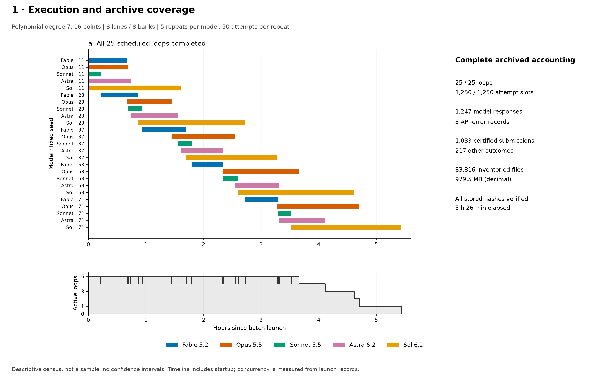
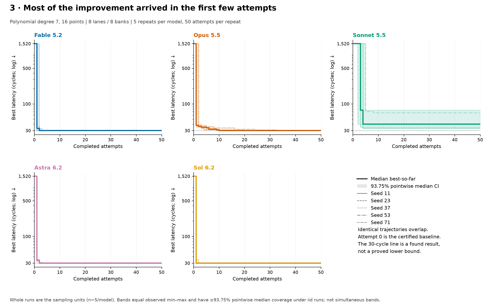
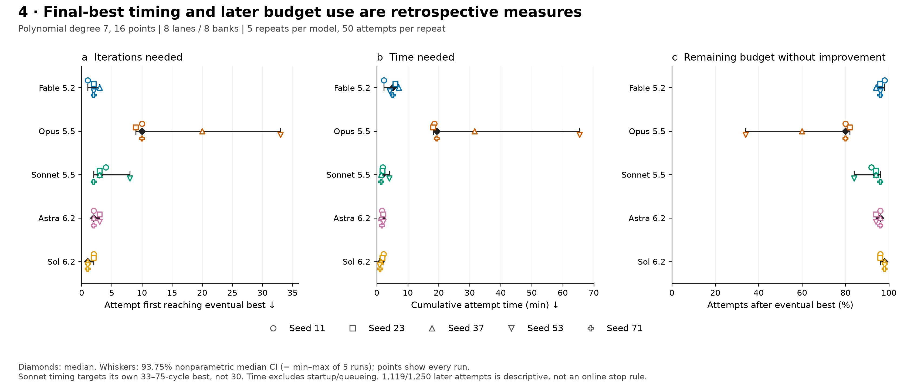
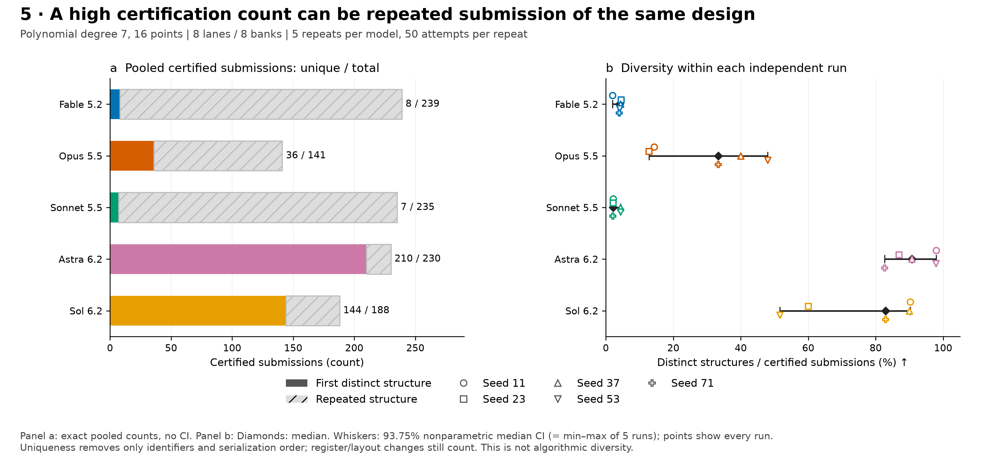
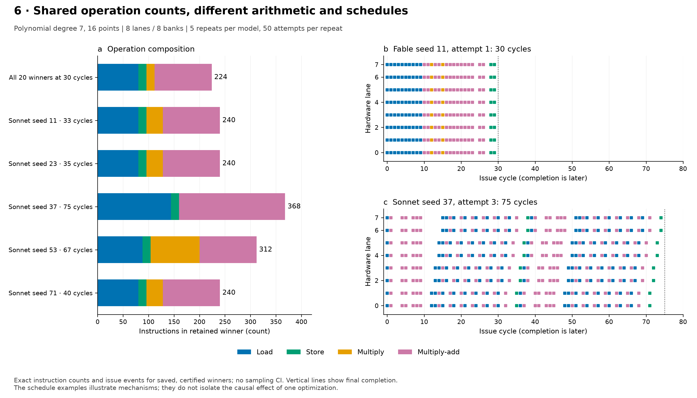
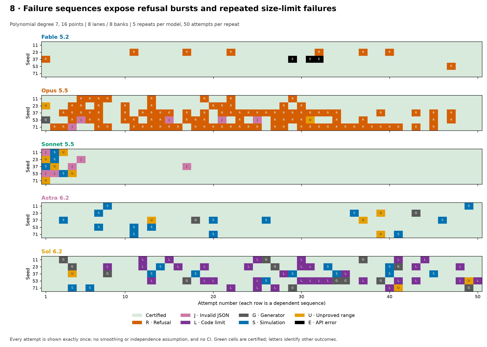
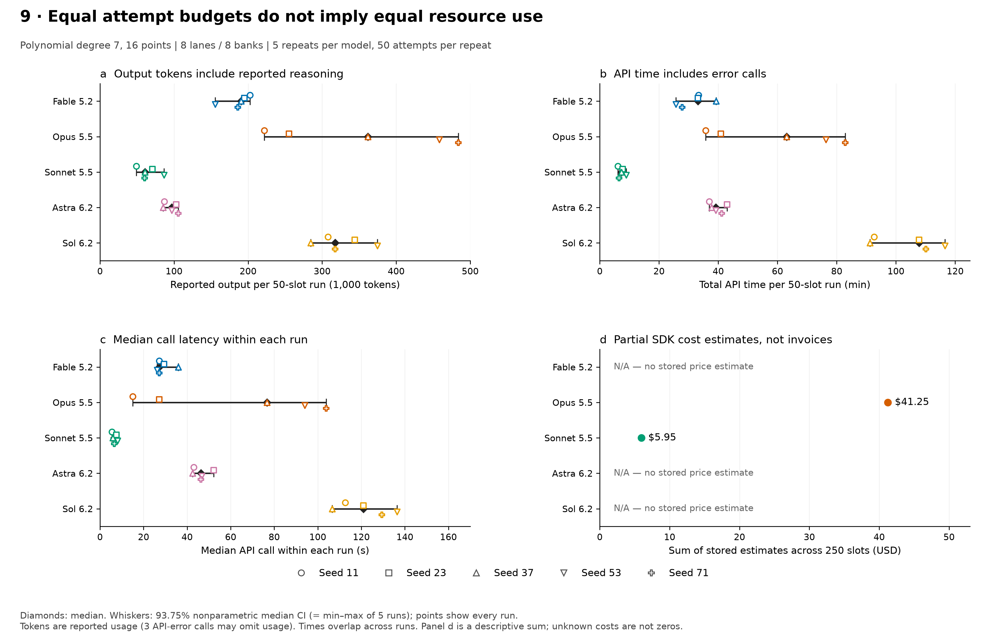
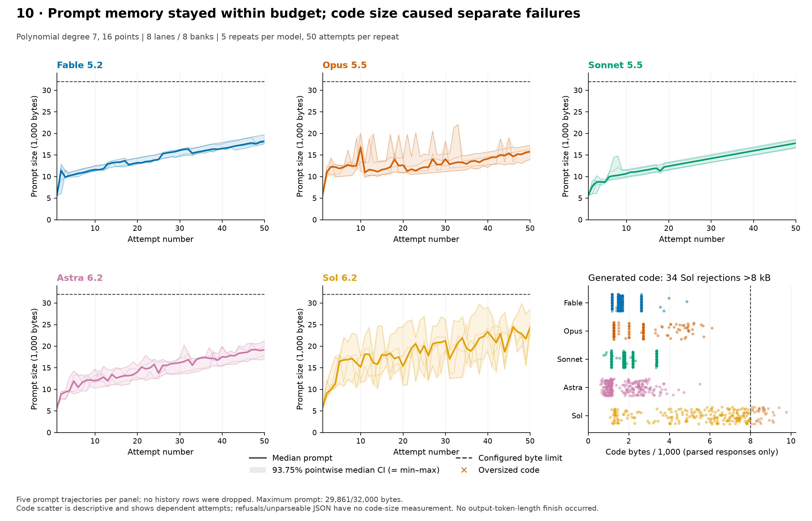

# First five-model search experiment: preliminary analysis

23 November 2026 · [reproducible metrics](metrics.json) · [25 run summaries](runs.csv) · [all convergence curves](convergence.csv)

Ten figures below visualize the measured claims. Each has a vector PDF/SVG
alongside its PNG in [figures/](figures/). **Read the uncertainty correctly:**
points/lines show all five repeats; median whiskers/bands are **93.75% exact
nonparametric intervals** (the observed min–max at `n=5`). Figure 2c instead uses
**95% exact binomial intervals** for run-level success. These levels are
intentional; see [figure methods and assumptions](figure-methods.md). No within-run
attempts are treated as independent replicates, and no significance ranking is
claimed. Fixed counts and records are descriptive and receive no artificial CI.

**The basic loop works, and four models consistently find a much faster certified
design. The main limitation exposed here is what happens after an early success:
many later attempts repeat an existing design or explore without improving it.**
This is one small workload under one configuration, not a general model ranking.

## What was run

Five models, five repeats each, 50 sequential attempts per repeat: **25 loops and
1,250 attempt slots**, with at most five loops active concurrently. The models
were Fable 5.2, Opus 5.5, Sonnet 5.5, Astra 6.2 and Sol 6.2. Repeat seeds were
**11, 23, 37, 53, 71**; each loop started from the same baseline with independent
history and notes.

The task was degree-seven polynomial evaluation at 16 points, on `arty-model-v1`
with eight lanes and eight memory banks, minimizing `latency-v1`. Coefficients
range from -8 to 7 and points from -4 to 3. Every accepted candidate must pass
public simulations and Lean kernel certification for **all allowed inputs**.
All models used medium reasoning, a 32,768-token output limit, a 32,000-byte
prompt limit and an 8,000-byte generated-program limit.

The experiment used commit `185e5daf8574a2cb92dd9cf5eb8f22afda5e4012`, ran from
08:25 to 13:51 UTC, and finished in **5 h 26 min**. All loops completed all 50
slots; errors consumed slots and were not automatically retried.



*Figure 1. Actual launch-to-exit spans and observed concurrency, including startup.
The right panel accounts for every attempt. Counts and timings are descriptive.*

## Quality: strong improvement, with a shared observed plateau

Lower cycle counts are better. Columns below follow the seed order above.

| Model | 11 | 23 | 37 | 53 | 71 | Certified attempts / 250 |
| --- | ---: | ---: | ---: | ---: | ---: | ---: |
| Fable 5.2 | 30 | 30 | 30 | 30 | 30 | 239 (95.6%) |
| Opus 5.5 | 30 | 30 | 30 | 30 | 30 | 141 (56.4%) |
| Sonnet 5.5 | 33 | 35 | 75 | 67 | 40 | 235 (94.0%) |
| Astra 6.2 | 30 | 30 | 30 | 30 | 30 | 230 (92.0%) |
| Sol 6.2 | 30 | 30 | 30 | 30 | 30 | 188 (75.2%) |

The original baseline is **1,520 cycles**, so 30 cycles is a **50.7× modeled
speedup**, or 98.0% fewer cycles. It also improves on the earlier 63-cycle hand
reference by **2.1×**, and the earlier 204-cycle scheduling heuristic by **6.8×**.
These comparisons use the same task, hardware configuration and objective;
see the [historical reference table](../../docs/results/section9-v1/summary.md)
and [certification validation](../../docs/validation.md). The historical ledger
has not been rewritten or retroactively relabeled.

**30 is the best found, not a proved global optimum.** The repository's general
compulsory-I/O lower bound is only five cycles. Closing 98.3% of that
naive-to-bound gap does not establish optimality. Several model notebooks offer
informal arguments against 29 cycles, but those arguments were not certified and
often assume a particular assignment of work to lanes.

Sonnet's median final result is 40 cycles and its mean is 50. It often produces
valid designs, but validity alone does not imply strong optimization. Its five
repeats show substantial variation; the other four models all reach the same
observed score on this instance.


*Figure 2. Left: five final scores per model and a median interval. Middle:
historical references on a log axis; the five-cycle point is a lower bound, not
an achieved design. Right: 95% exact success intervals use five runs, so 5/5 does
not imply guaranteed future success. Identical score intervals can collapse.*

## Convergence: most useful progress happened early

| Model | Attempt first reaching its final best, by seed | Median time to that best |
| --- | --- | ---: |
| Fable | 1, 2, 3, 2, 2 | 5.13 min |
| Opus | 10, 9, 20, 33, 10 | 19.35 min |
| Sonnet | 4, 3, 3, 8, 2 | 1.86 min |
| Astra | 2, 3, 2, 3, 2 | 1.69 min |
| Sol | 2, 2, 1, 1, 1 | 1.32 min |

Times sum completed attempt durations within each loop, including API calls,
generation and checking, but exclude baseline startup and time waiting in the
batch queue. Sonnet's time is to its own weaker final result, **not to 30 cycles**.

**23/25 loops found their eventual best by attempt 10.** Fable and Astra reached
30 in every repeat by attempt three, and Sol by attempt two. Opus had two slower
repeats, reaching 30 at attempts 20 and 33. Thus a ten-attempt budget would have
preserved 23 final results but missed those two later Opus improvements.

In hindsight, **1,119/1,250 attempts (89.5%) occurred after that loop first found
its eventual best**, without any further strict improvement. That is evidence
for testing a shorter budget or a stagnation policy; it is not an oracle that
would have told us when to stop during the run.

Median best-so-far cycles across the five repeats:

| Model | Attempt 1 | 3 | 5 | 10 | 20 | 50 |
| --- | ---: | ---: | ---: | ---: | ---: | ---: |
| Fable | 33 | 30 | 30 | 30 | 30 | 30 |
| Opus | 38 | 35 | 34 | 30 | 30 | 30 |
| Sonnet | 1520 | 75 | 40 | 40 | 40 | 40 |
| Astra | 34 | 30 | 30 | 30 | 30 | 30 |
| Sol | 30 | 30 | 30 | 30 | 30 | 30 |

The baseline remains the incumbent until a strictly better certified candidate
appears, which explains Sonnet's early 1,520 values.



*Figure 3. Thin lines show the five runs, heavy lines their median, and bands
the 93.75% pointwise median interval. Axes use log cycles and include the original
baseline; identical trajectories overlap. Bands are not simultaneous guarantees.*



*Figure 4. Every repeat is shown. Whiskers are 93.75% median intervals; the last
panel quantifies retrospective budget use. Sonnet's timing targets its own
weaker final score, not 30 cycles.*

## Repetition is a major difference between models

| Model | Distinct certified candidate structures | Certified submissions |
| --- | ---: | ---: |
| Fable | 8 | 239 |
| Opus | 36 | 141 |
| Sonnet | 7 | 235 |
| Astra | 210 | 230 |
| Sol | 144 | 188 |

Here a structure ignores the candidate identifier, JSON key order and instruction
serialization order, but preserves instructions, cycles, registers and layout.
This is **not a count of distinct algorithms**: even register renaming or unused
layout differences can make structures distinct. Counts pool all five repeats
within a model; repeated submissions still count in the certification rate.

The generated text confirms deliberate repetition in inspected cases. For
example, [Fable seed 11, attempt 25](../../runs/nightly-five-models-20261123/runs/fable/seed-11/attempts/0025/proposal.json)
explicitly resubmits the 30-cycle design without a new idea.
[Sonnet seed 37, attempt 50](../../runs/nightly-five-models-20261123/runs/sonnet/seed-37/attempts/0050/proposal.json)
resubmits its 75-cycle design while retaining untried improvements in its notes.
Conversely, Astra keeps generating different schedules, but none beats 30.

The preliminary interpretation is **both stagnation and an observed score
plateau**, depending on the model. A high acceptance rate can reflect repeated
submission of already working code; it should not be treated as a measure of
exploration or optimization ability.



*Figure 5. Left: exact pooled counts, with hatched repeat submissions. Right:
distinct/certified fraction within each run, with a 93.75% median interval.
Neither measure counts unique algorithms; the two panels have different scopes.*

## What the good designs changed

The 20 retained 30-cycle winners all use **224 instructions**: 80 loads, 16
stores, 16 multiplies and 112 multiply-adds. They distribute two points to each
lane, reuse that lane's eight coefficient loads across both points, and arrange
memory accesses so bank limits are respected. Interleaving the two evaluations
hides arithmetic latency.

Inspection of representative code shows at least two arithmetic approaches.
[Fable's first winner](../../runs/nightly-five-models-20261123/runs/fable/seed-11/attempts/0001/generator.py)
forms four linear coefficient pairs and combines them as a cubic in `x²`.
[Astra's seed-11 winner](../../runs/nightly-five-models-20261123/runs/astra/seed-11/attempts/0002/generator.py)
evaluates the upper quintic and combines `x² * quintic + (c1*x+c0)`.
Both avoid feeding the large final polynomial value back into a signed-16-bit
multiplication. This is a change in arithmetic as well as scheduling.

By contrast, [Sonnet's 75-cycle winner](../../runs/nightly-five-models-20261123/runs/sonnet/seed-37/attempts/0003/generator.py)
materializes powers and evaluates each lane's two points sequentially. It uses
368 instructions and reloads coefficients. This gives a concrete explanation for
one poor repeat; it does not explain every difference between models.

Some generated ideas claim a 29-cycle target even when the checked score is 30.
All tables here use the verifier's result, never the model's claimed latency.



*Figure 6. Exact instruction counts and representative issue events. All twenty
30-cycle winners share the same count breakdown. The issue plots share a cycle
axis and mark final completion; they illustrate scheduling differences, not an
isolated causal experiment on a single optimization.*

## Failures: the loop handled them, but they matter to the comparison

| Outcome | Attempts |
| --- | ---: |
| Certified | 1,033 |
| Provider refusal | 109 |
| Invalid response JSON | 11 |
| Generated program above 8,000 bytes | 34 |
| Generator failure | 16 |
| Public simulation failure | 30 |
| Range safety not proved after public fixtures passed | 14 |
| API server error | 3 |
| **Total** | **1,250** |

The **109 refusals** have raw provider stop reason `refusal`, normalized by the
adapter to `content_filter`: **101 Opus and eight Fable**. Opus therefore loses
40.4% of its slots to provider refusal, a material confound when judging its
optimization efficiency. This analysis does not establish why those refusals
occurred. The three API errors were HTTP 500 responses in Fable seed 37, attempts
29, 31 and 32; they were not three consecutive errors, and the run continued.

All **34 program-size rejections were Sol**. They hit the independent 8,000-byte
code limit, not the output-token limit. No response in this batch ended with a
token-length finish reason. Of the 16 generator failures, one was a timeout;
the others were nonzero process exits. Simulation failures include bank
collisions, reading a pending register, out-of-range operands and wrong outputs.

The **14 range failures passed all public fixtures** but could not establish
signed-16-bit multiplication safety. This demonstrates why fixture success is
insufficient. A failed conservative range proof is not itself a concrete
counterexample, so these remain labeled “not proved.” Overall, 82.6% of attempt
slots received certification; failures never displaced the certified incumbent.


*Figure 7. Counts retain every slot. The certification-fraction interval uses
five run-level fractions, not 250 independent Bernoulli attempts. Range-not-proved
outcomes remain distinct from concrete simulation failures.*



*Figure 8. Each row is one complete 50-attempt loop. Colors and letters show
refusal clusters, Sol's size-limit failures, and the three Fable server errors
without smoothing or discarding failed attempts. This is descriptive sequence data.*

## Resource use and memory

| Model | Reported output tokens, including reasoning | Total API time across 250 slots | Median API call |
| --- | ---: | ---: | ---: |
| Fable | 930,180 | 2.65 h | 28.1 s |
| Opus | 1,781,239 | 4.98 h | 71.3 s |
| Sonnet | 326,590 | 0.61 h | 7.0 s |
| Astra | 477,888 | 3.30 h | 46.3 s |
| Sol | 1,628,357 | 8.64 h | 121.6 s |

API time includes failed requests; tokens are the usage returned on the 1,247
responses, so tokens associated with API errors may be missing. Total reported
input plus output usage is **11,877,802 tokens**. Durations above overlap because
the batch ran concurrently; they are not the elapsed overnight duration or a
measurement of provider compute. Sol finds its best quickly but spends much
more time on its remaining attempts. Sonnet is quick, with weaker final scores.
Astra reaches 30 quickly with fewer output tokens and fewer rejected attempts
than Opus or Sol in this batch.

Only Opus and Sonnet have non-null SDK cost estimates: **$41.25 and $5.95**,
respectively. Fable, Astra and Sol have no stored price estimate. These are
unverified SDK estimates, not invoices; **the full experiment's dollar cost
cannot be established from these records**.



*Figure 9. The first three panels show five run summaries and 93.75% median
intervals. Within-run median call times differ in definition from the table's
pooled call median. Costs are descriptive stored estimates; unavailable prices
are explicitly N/A, not zero.*

The largest prompt was **29,861 bytes**, below the 32,000-byte cap. No compact
history rows were dropped in any attempt. This supports that context growth
was bounded for these 50-step loops; it does not mean all previous code or notes
were shown. The next prompt contains the best/latest code, compact history and
a bounded notebook. Repetition occurred even while the compact history fit.



*Figure 10. Prompt traces show all runs, their median and 93.75% pointwise
interval. Dashed lines mark the two different byte limits. Code-size dots are
individual, dependent attempts; red crosses exceed 8,000 bytes. Refusals and
unparseable replies have no code-size measurement.*

## What this does and does not establish

The archive contains **83,816 inventoried files / 979,484,527 bytes**. The analysis
verified every file's size/hash, all 1,250 requests and feedback records, the
1,247 responses plus three API-error records, and all 1,033 accepted
candidate/certificate hash bindings, stored kernel exits and scores. It did not
re-run the proofs. No completed attempt was excluded from these tables.

This is only five repeats per model on one small instance, after earlier pilot
runs had already exercised the same task. The intervals assume independent,
exchangeable runs within a model and concern this task; there are no statistical
significance or cross-task generalization claims. Fixed seeds identify repeats and control ordinary local randomness, but
Anthropic exposes no sampling seed and OpenAI seeds are best effort. Identical
live reruns are not guaranteed. Equal “medium” reasoning and token limits also
do not imply equal compute across providers. The generated programs can perform
their own searches inside the fixed Docker budget, so this compares the complete
model-plus-generator workflow. These are abstract hardware cycles, not measured
FPGA speed, energy, or end-to-end application speed.

## Small next steps suggested by these results

1. **Test stagnation handling against this unchanged baseline.** A short initial
   budget followed by explicit exploration or a fresh restart is worth comparing
   with another 50-step loop. Log repeated candidates and consider avoiding their
   repeated verification. Preserve the late Opus improvements when choosing a
   stopping rule; ten steps is not universally enough.
2. **Investigate the Opus refusal pattern separately.** It is too large to hide
   inside a single validity percentage. Also decide whether Sol's program-size
   failures justify a different code budget in a separately labeled experiment.
3. **Make the instance more discriminating.** Try the existing memory-limited
   `(8,1)` and compute-limited `(2,8)` configurations, or the other existing
   workloads. The shared 30-cycle plateau limits what another identical batch
   can tell us about final solution quality.
4. **Separate a best-found result from an optimality claim.** A stronger lower
   bound or an explicitly scoped exhaustive schedule search could investigate
   29 cycles. A model-written impossibility argument is not sufficient.

These are proposals for later work; this analysis changes no experiment or
search behavior.

The evidence for these proposals is in Figures 3–5 (stagnation), 7–8 (refusals),
and 2 (the shared plateau and gap to the general lower bound). We do not plot
hypothetical outcomes of experiments that have not been run.

## Files and reproduction

Run from the repository root, with the original local archive present:

```sh
python3 analysis/2026-11-23-five-model-search/analyze.py
```

The script uses only the Python standard library, verifies the archive and
regenerates [metrics.json](metrics.json), [runs.csv](runs.csv) and
[convergence.csv](convergence.csv), plus [attempts.csv](attempts.csv),
[timeline.csv](timeline.csv) and [winner-schedules.json](winner-schedules.json)
for the plots. The report's numerical tables are rounded
views of those files; interpretation and code inspection are written manually.
“After eventual best” is a retrospective count, certification counts submissions,
and uniqueness uses the structural normalization described above.

To regenerate the plots from these tracked data files (no API keys or raw archive
needed), use a separate plotting environment:

```sh
python3 -m venv /tmp/optimal-plots-venv
/tmp/optimal-plots-venv/bin/pip install -r analysis/2026-11-23-five-model-search/requirements-plots.txt
/tmp/optimal-plots-venv/bin/python analysis/2026-11-23-five-model-search/plot.py
/tmp/optimal-plots-venv/bin/python analysis/2026-11-23-five-model-search/check-plots.py
```

The [figure-methods note](figure-methods.md) explains coverage levels, units,
limits, source bindings, and why fixed totals have no confidence intervals.

The [raw archive](../../runs/nightly-five-models-20261123/) remains local under
ignored `runs/`; it is needed for regeneration and the example source links.
This folder contains small summaries suitable for Git, not a backup of that
archive. The historical reference source is
[`docs/results/section9-v1/summary.json`](../../docs/results/section9-v1/summary.json).
