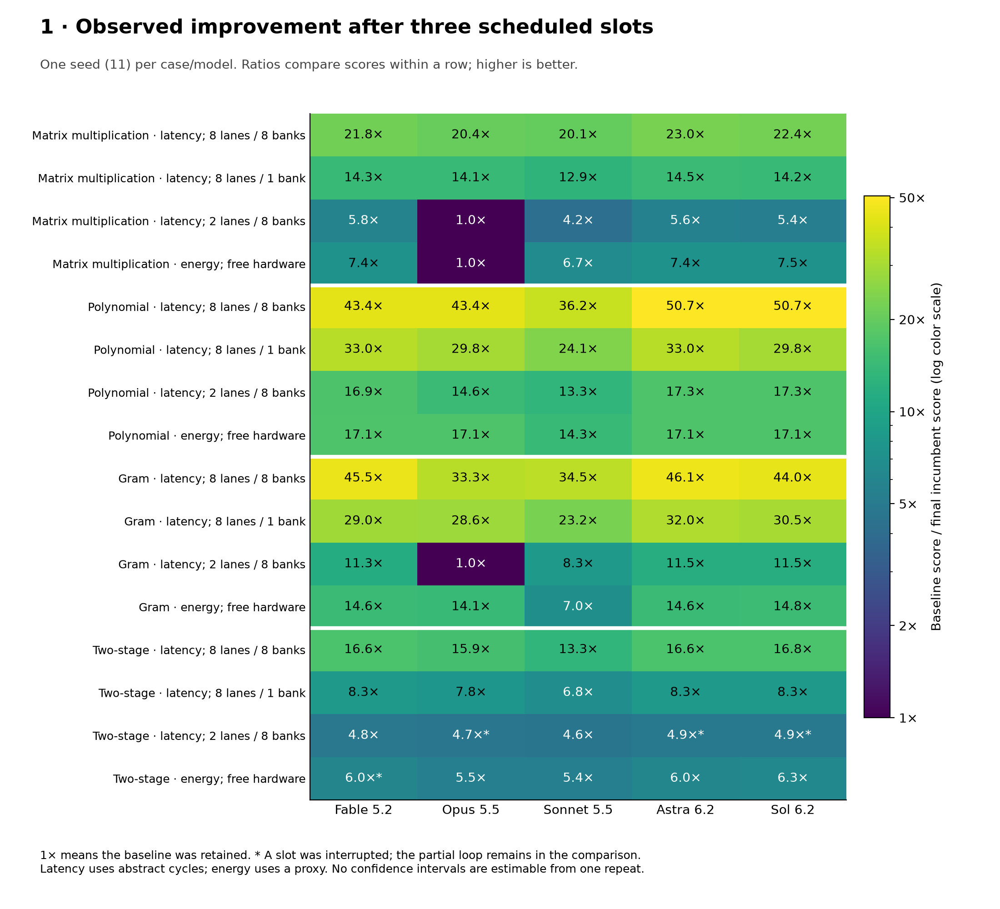
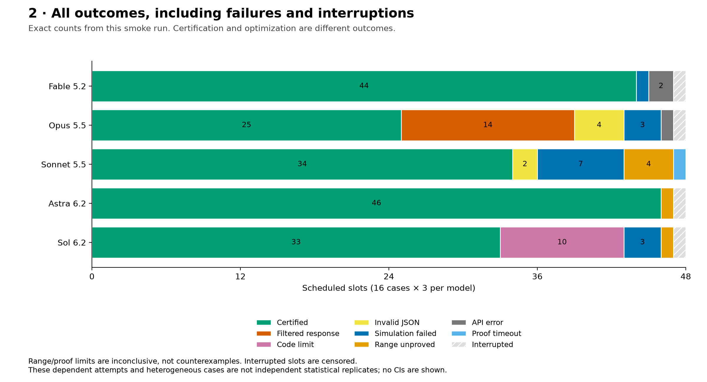

# Full-suite smoke study: minimal preliminary analysis

23–24 November 2026 · **Smoke data, not the full experiment**

[Download the complete raw archive](https://github.com/adrienX18/OptimalComputation/releases/download/suite-smoke-2026-11-23/suite-smoke-20261123.tar.gz)
· [Data, checksum and extraction instructions](data/README.md)
· [Run-level results](runs.csv) · [All attempt records](attempts.csv)
· [Best-so-far trajectories](convergence.csv) · [Metrics](metrics.json)

**Most loops already improve the naive baseline, but this pilot is too short
and too lightly replicated to rank models or establish convergence.** We retain
every scheduled slot, including failures and four interrupted attempts.

## Scope and uncertainty

The run covered matrix multiplication, degree-seven polynomial evaluation,
Gram products and a two-stage linear map. Each workload had latency cases at
`(lanes,banks) = (8,8), (8,1), (2,8)` and an energy-proxy case with free hardware
selection: **16 cases × 5 models × one seed (11) × three slots = 240 slots**.
The exact models, budgets and source snapshots are in the raw manifest. Common
limits included medium reasoning, 32,768 output tokens, 8,000 generator bytes,
48,000 prompt bytes and a 600-second verification-phase budget.

There is **one repeat per case/model**, not five. Sequential attempts are
dependent, and the 16 cases are different problems rather than exchangeable
replicates. Accordingly, these figures show the observed values and counts;
we do not manufacture confidence intervals, significance tests or a pooled
model leaderboard. Error and interruption rates also affect these comparisons.

## 1. Useful improvements are already visible

**77/80 loops improved their certified naive baseline.** Every workload/model
combination produced at least one certified candidate somewhere in its four
cases. The three unchanged loops were Opus on matrix latency `(2,8)`, matrix
energy and Gram latency `(2,8)`; they retained the existing certified baseline.



*Each cell is baseline score divided by final incumbent score; higher is better.
Comparisons are within the same row. Stars flag loops with an interrupted slot.
All numerical scores and selected hardware are in [runs.csv](runs.csv).*

For example, matrix latency at `(8,8)` fell from 21,504 cycles to 933–1,071
across these five observed runs. Polynomial latency at `(8,8)` reached 30–42
cycles from 1,520. These are **abstract machine scores**, not measured FPGA
speedups. The baselines are intentionally naive, and large gains neither prove
optimality nor imply the same gain over a strong hand-optimized implementation.
Energy scores use the documented proxy, not joules; their ratios are not pooled
with latency into a single performance number.

## 2. The failure mechanisms differ and should remain visible



*Each bar accounts for all 48 scheduled slots for one model. These are counts
for this fixed case set, not estimates from independent repeated trials.*

There were **182 certified submissions**, 14 filtered/incomplete responses,
10 code-size violations, six invalid JSON replies, 14 simulation failures,
six unproved-range results, three API errors, one proof timeout and four
interrupted slots. Repeated submissions still count as submissions.

All 14 filtered responses were Opus; all ten code-size violations were Sol.
These are material operational constraints, not interchangeable measures of
mathematical correctness. Range/proof-budget failures remain inconclusive.
The API errors were two Fable read timeouts and one Opus HTTP 502.

After a connection restart, the batch resumed without repeating potentially
billed requests. **236 attempts finished and four slots were interrupted**:
three retained model responses and partial evaluation records; one has the
request but no received response. Those four remain explicitly censored in the
tables and raw data. Their incumbent is carried forward, never replaced by an
unverified candidate.

## 3. Three steps are not evidence of convergence


*Left: the first slot attaining each loop's final incumbent, including the
three retained baselines. Right: every recorded kernel duration; black marks
are medians and crosses identify terminated checks. No inference is made from
the visual jitter. These timings measure verification on the host.*

**35/80 loops improved on their third and final slot.** For Astra that happened
in 13/16 cases. This shows that the short horizon often cut off an actively
improving search; it does not quantify what another 47 attempts would achieve.
The exported trajectories include the baseline at slot zero and preserve
flat incumbent values through rejected or interrupted slots.

The run took **3 h 55 min 34 s**, including interruption/recovery. Five search
loops could run concurrently, while memory-heavy kernel checks shared one
slot. Median recorded active proof time was about **123 s for matrix, 83 s for
Gram, 59 s for two-stage and 4 s for polynomial**. The timing plot includes
the timed-out and interrupted checks. This makes verifier throughput an
important practical constraint on a larger run; it is separate from the
quality of the designs being searched.

## Data preservation and reproduction

The downloadable archive contains **all 28,083 raw files**, including the
original inventory, lock files, source snapshots, prompts, received raw/model
responses, generators, artifacts, simulation traces, verifier output, scores,
errors and interruption records. It is 130,158,610 bytes compressed; no raw
files were omitted. The 28,001-file experimental inventory and all 970
compressed traces passed the existing audit. The package additionally verifies
every tar member against the original bytes, including files outside that
inventory, and was scanned for configured credentials and key patterns.

The local original remains at `runs/suite-smoke-20261123`. The tarball is also
kept locally under this folder's ignored `data/` directory and published as a
repository release asset; it is not embedded as a large Git blob. The small
tables, plots, source code, checksum and this report are tracked in Git.

After downloading and extracting the archive as described in [data/README.md](data/README.md),
run from the repository root:

```sh
python3 analysis/2026-11-23-suite-smoke/analyze.py
/tmp/optimal-plots-venv/bin/python analysis/2026-11-23-suite-smoke/plot.py
```

`analyze.py` uses the standard library and the repository's archive auditor.
It checks stored hashes, lossless traces, accepted certificate bindings and
scores; it does not rerun Lean proofs or make model calls. Plotting uses
Matplotlib and NumPy; exact dependencies are in [requirements-plots.txt](requirements-plots.txt).
The PNG figures also have PDF/SVG versions in [figures/](figures/), with input
hashes, library versions and label-bound checks in [figure provenance](figures/provenance.json).

This minimal analysis does not inspect individual algorithms, measure novelty,
compare against optimized reference implementations, or estimate API invoices.
It does not launch or alter the prepared full experiment.
