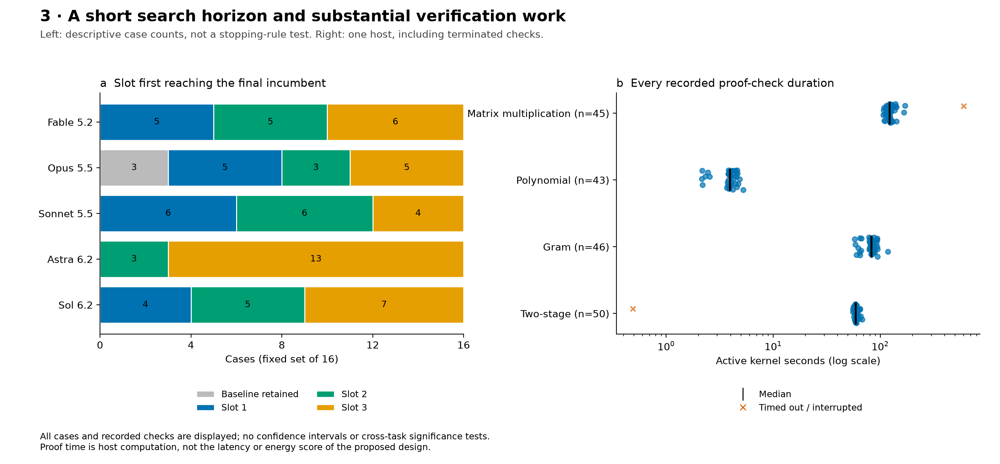
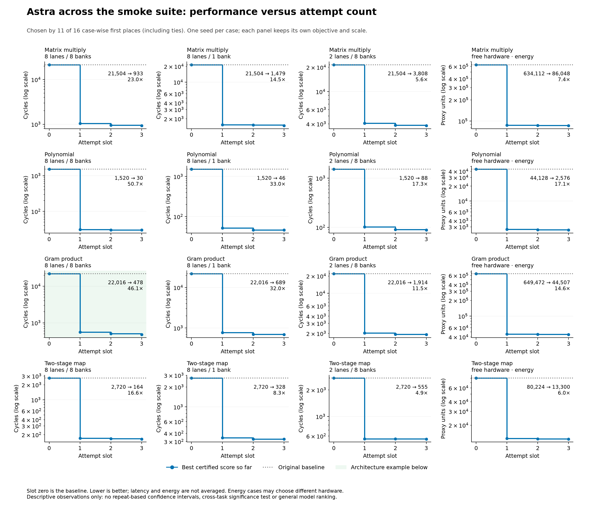

# Full-suite smoke study: minimal preliminary analysis

23–24 November 2026 · **Smoke data, not the full experiment**

[Download the complete raw archive](https://github.com/adrienX18/OptimalComputation/releases/download/suite-smoke-2026-11-23/suite-smoke-20261123.tar.gz)
· [Data, checksum and extraction instructions](data/README.md)
· [Run-level results](runs.csv) · [All attempt records](attempts.csv)
· [Best-so-far trajectories](convergence.csv) · [Metrics](metrics.json)

**Most loops already improve the naive baseline, but this pilot is too short
and too lightly replicated to rank models or establish convergence.** We retain
every scheduled slot, including failures and four interrupted attempts.

The [archived loop walkthrough](#inside-the-loop-actual-inputs-outputs-and-a-winning-design)
shows the exact saved model input/output and visualizes a selected winning
implementation against its baseline.

## Scope and uncertainty

The run covered matrix multiplication, degree-seven polynomial evaluation,
Gram products and a two-stage linear map. Each workload had latency cases at
`(lanes,banks) = (8,8), (8,1), (2,8)` and an energy-proxy case with free hardware
selection: **16 cases × 5 models × one seed (11) × three slots = 240 slots**.
The exact models, budgets and source snapshots are in the raw manifest. Common
limits included medium reasoning, 32,768 output tokens, 8,000 generator bytes,
48,000 prompt bytes and a 600-second verification-phase budget.

There is **one repeat per case/model**, not five. Sequential attempts are
dependent, and the 16 cases are different problems rather than exchangeable
replicates. Accordingly, these figures show the observed values and counts;
we do not manufacture confidence intervals, significance tests or a pooled
model leaderboard. Error and interruption rates also affect these comparisons.

## 1. Useful improvements are already visible

**77/80 loops improved their certified naive baseline.** Every workload/model
combination produced at least one certified candidate somewhere in its four
cases. The three unchanged loops were Opus on matrix latency `(2,8)`, matrix
energy and Gram latency `(2,8)`; they retained the existing certified baseline.


*Each cell is baseline score divided by final incumbent score; higher is better.
Comparisons are within the same row. Stars flag loops with an interrupted slot.
All numerical scores and selected hardware are in [runs.csv](runs.csv).*

For example, matrix latency at `(8,8)` fell from 21,504 cycles to 933–1,071
across these five observed runs. Polynomial latency at `(8,8)` reached 30–42
cycles from 1,520. These are **abstract machine scores**, not measured FPGA
speedups. The baselines are intentionally naive, and large gains neither prove
optimality nor imply the same gain over a strong hand-optimized implementation.
Energy scores use the documented proxy, not joules; their ratios are not pooled
with latency into a single performance number.

## 2. The failure mechanisms differ and should remain visible


*Each bar accounts for all 48 scheduled slots for one model. These are counts
for this fixed case set, not estimates from independent repeated trials.*

There were **182 certified submissions**, 14 filtered/incomplete responses,
10 code-size violations, six invalid JSON replies, 14 simulation failures,
six unproved-range results, three API errors, one proof timeout and four
interrupted slots. Repeated submissions still count as submissions.

All 14 filtered responses were Opus; all ten code-size violations were Sol.
These are material operational constraints, not interchangeable measures of
mathematical correctness. Range/proof-budget failures remain inconclusive.
The API errors were two Fable read timeouts and one Opus HTTP 502.

After a connection restart, the batch resumed without repeating potentially
billed requests. **236 attempts finished and four slots were interrupted**:
three retained model responses and partial evaluation records; one has the
request but no received response. Those four remain explicitly censored in the
tables and raw data. Their incumbent is carried forward, never replaced by an
unverified candidate.

## 3. Three steps are not evidence of convergence



*Left: the first slot attaining each loop's final incumbent, including the
three retained baselines. Right: every recorded kernel duration; black marks
are medians and crosses identify terminated checks. No inference is made from
the visual jitter. These timings measure verification on the host.*

**35/80 loops improved on their third and final slot.** For Astra that happened
in 13/16 cases. This shows that the short horizon often cut off an actively
improving search; it does not quantify what another 47 attempts would achieve.
The exported trajectories include the baseline at slot zero and preserve
flat incumbent values through rejected or interrupted slots.

The run took **3 h 55 min 34 s**, including interruption/recovery. Five search
loops could run concurrently, while memory-heavy kernel checks shared one
slot. Median recorded active proof time was about **123 s for matrix, 83 s for
Gram, 59 s for two-stage and 4 s for polynomial**. The timing plot includes
the timed-out and interrupted checks. This makes verifier throughput an
important practical constraint on a larger run; it is separate from the
quality of the designs being searched.

<!-- BEGIN GENERATED WALKTHROUGH -->

## Inside the loop: actual inputs, outputs and a winning design

For this walkthrough, **Astra is the representative suite winner by the number
of case-wise first places**, counting ties: Astra 11, Sol 9, Fable 4, Opus 1,
Sonnet 0. These counts sum above 16 because ties count for each model. This is an
explicit descriptive selection rule for these saved runs, **not evidence that
Astra is generally the best model**. It also ignores the size of each margin.
We do not average energy and latency scores.

The figure shows **all 16 Astra trajectories**, with the original baseline at
slot zero. For the architecture example, we choose **Gram latency (8,8)** because
its symmetry and work distribution can be visualized clearly; it is not the
largest improvement ratio. That exact run improved **22,016 → 556 → 508 → 478
cycles**, and 478 was the best among all five models on that case.



*Figure 4. Every panel compares against its own baseline, with independent log
axes and explicit units. One seed per case means no repeat-based confidence
interval can be estimated. This is a post-selection description of the archive.*

### What the LLM actually sees and returns

**Saved example: Astra 6.2, Gram latency (8 lanes, 8 banks), seed 11, attempt 3.** No prompt was reconstructed with today’s code.

Each attempt sends two messages: a **system message** with machine rules,
output requirements and the complete `candidate_tools` helper source; and a
**user message** containing the task, objective, configuration, seeds, budget,
baseline summary, best code, latest feedback, compact history and short notebook.
The baseline summary contains its layout, instruction count and a few leading
and trailing instructions, not its entire schedule. The generated program can
read the full baseline through `candidate_tools.baseline()`.

The LLM returns **one JSON object with three strings**: `idea`, Python `code`
defining `build()`, and `notes` for the next attempt. The harness executes the
Python in its generator environment to obtain a `candidate-v1` artifact: memory
layout, configuration and static instructions with cycle/lane/register choices.
Simulations, certification and scoring happen afterward. Only a certified
improvement replaces the incumbent.

The archive is richer than the next prompt. Each call starts with a fresh
two-message request, not the entire conversation. It retains best/latest code,
short history rows and a notebook capped at 2,000 bytes. Old history rows can be
dropped to fit the prompt cap; timing fields are removed from feedback before
it is sent back. The saved request below shows exactly what survived these rules.

In this example, the prompt is **14,270 bytes** (serialized
message array), contains **2 earlier history row(s)**,
and shows the previous certified score **508 cycles**.
The returned code is **4,242 bytes**. The limits were
48,000 prompt bytes, 8,000 code bytes and 32,768 output tokens;
these are different budgets, not interchangeable units.

**Exact previous feedback as shown to the model** (the stored JSON string decoded):

````json
{
  "accepted": true,
  "category": "certified",
  "score": 508,
  "unit": "cycles",
  "cycles": 508,
  "certificate": "Certificate_966cc02d5cea25130172c9c9f3af9d5eb3ffc3dac4115b7c44f04fa15a1fc205.artifact",
  "attempt": 2,
  "idea": "Search for two small row sets whose even translations cover every unordered pair. Within each tile, stagger the loads onto alternate cycles and match MACs to periodic slots, allowing a few MACs to finish during the next column's loads.",
  "directory": "attempts/0002",
  "improved": true,
  "bestScore": 508
}
````

**Exact returned `idea` string:**

````text
Amortize the load/writeback transition over multiple columns: try periodic templates with unequal gaps between load bursts, and use spare registers to extend selected operand lifetimes. Match each dot update to a slot and drain the stores as soon as their accumulators are ready.
````

Expand the following blocks to see **all input message contents and all three
output strings**, with no omitted fields. JSON objects are pretty-printed for
reading; string values are unchanged. For exact serialization, use the
[saved request](walkthrough/winner/request.json),
[normalized response](walkthrough/winner/response.json), and
[raw provider request](walkthrough/winner/provider-001-request.json).
The provider request's message array was checked to equal the harness messages.

<details>
<summary>Complete system message (verbatim string)</summary>

````text
Optimize a finite candidate for the fixed arty-model-v1 machine.
Return ONLY a JSON object with strings: idea, code, notes. code defines build()
returning candidate-v1 JSON. notes replaces your short notebook for the next attempt.
Use Python's standard library and candidate_tools. No external packages or tools.
Python's global random module is seeded for each attempt. If you create a private
PRNG, use random.Random(candidate_tools.seed()); avoid time or OS entropy.
Generator loops expand a static schedule; the machine itself has no runtime branches.
You may change algorithm, layout, registers, schedule, and (only for energy) configuration.
Keep the workload and model fixed. Only a kernel-certified candidate can be best.
Hardware: lanes/banks independently 1,2,4,8; 4096 address slots (0..4095).
Bank = address % banks, at most 2 memory accesses/bank/cycle. Same-address
simultaneous accesses must both be reads. Inputs, outputs, scratch are disjoint
unique address lists. Inputs are read-only. Only inputs and r0 start initialized.
Each lane has r0=0 and writable r1..r15, one instruction issued per cycle,
at most 3 pending instructions, and at most one register writeback per cycle.
Loads/stores take 1 cycle; add/multiply/multiplyAdd take 3. Commit before issue.
A pending destination cannot be read or overwritten. Stores capture their source
at issue. Communication between lanes uses explicit stores/loads.
Signed16 multiplicands [-32768,32767], signed48 addition/accumulation/results.
Overflow is invalid, never wrapping. All stores must finish. A certification
limit means inconclusive, not necessarily wrong. The next attempt may repair your
latest failure or explore a different design. All times in feedback are modeled cycles
unless explicitly labeled seconds. Avoid repeating an unsuccessful idea unchanged.
Minimize latency-v1: elapsed cycles through final completion. Keep the configured lanes and banks fixed.

Available candidate_tools.py:
"""Tiny helpers available to generators. These build data, not proofs."""
import json
from pathlib import Path


def seed():
    """Seed assigned to this attempt; use it for any private random.Random instance."""
    return json.loads(Path('/input/randomness.json').read_text())['attemptSeed']


def baseline():
    """Return a fresh copy of this run's original certified candidate."""
    return json.loads(Path('/input/baseline.json').read_text())


def load(destination, address):
    return dict(kind='load', destination=destination, address=address)


def store(source, address):
    return dict(kind='store', source=source, address=address)


def add(destination, left, right):
    return dict(kind='add', destination=destination, left=left, right=right)


def mul(destination, left, right):
    return dict(kind='multiply', destination=destination, left=left, right=right)


def mac(destination, left, right, accumulator):
    return dict(kind='multiplyAdd', destination=destination, left=left, right=right, accumulator=accumulator)


def issue(cycle, lane, instruction):
    return dict(cycle=cycle, lane=lane, instruction=instruction)


def serial(instructions, lane=0, start=0):
    """Issue each instruction at its predecessor's completion boundary."""
    schedule = []
    for instruction in instructions:
        schedule.append(issue(start, lane, instruction))
        start += 1 if instruction['kind'] in ('load', 'store') else 3
    return schedule

````

</details>

<details>
<summary>Complete user message (JSON decoded; all values preserved)</summary>

````json
{
  "task": "Input row-major A[16,16], all signed16. Output A*A^T row-major.",
  "objective": "latency-v1",
  "configuration": [
    8,
    8
  ],
  "attempt": 3,
  "limit": 3,
  "runSeed": 11,
  "attemptSeed": 1433171591,
  "codeByteLimit": 8000,
  "notebookByteLimit": 2000,
  "baseline": {
    "score": 22016,
    "unit": "cycles",
    "objectiveBreakdown": {
      "unit": "cycles",
      "score": 22016,
      "identifier": "latency-v1",
      "direction": "minimize",
      "coefficients": null,
      "breakdown": [
        {
          "quantity": 22016,
          "label": "elapsed cycles",
          "cost": 22016,
          "coefficient": 1
        }
      ]
    },
    "layout": {
      "scratch": [
        512,
        513,
        514,
        515,
        516,
        517,
        518,
        519,
        520,
        521,
        522,
        523,
        524,
        525,
        526,
        527,
        528,
        529,
        530,
        531,
        532,
        533,
        534,
        535,
        536,
        537,
        538,
        539,
        540,
        541,
        542,
        543,
        544,
        545,
        546,
        547,
        548,
        549,
        550,
        551,
        552,
        553,
        554,
        555,
        556,
        557,
        558,
        559,
        560,
        561,
        562,
        563,
        564,
        565,
        566,
        567,
        568,
        569,
        570,
        571,
        572,
        573,
        574,
        575,
        576,
        577,
        578,
        579,
        580,
        581,
        582,
        583,
        584,
        585,
        586,
        587,
        588,
        589,
        590,
        591,
        592,
        593,
        594,
        595,
        596,
        597,
        598,
        599,
        600,
        601,
        602,
        603,
        604,
        605,
        606,
        607,
        608,
        609,
        610,
        611,
        612,
        613,
        614,
        615,
        616,
        617,
        618,
        619,
        620,
        621,
        622,
        623,
        624,
        625,
        626,
        627,
        628,
        629,
        630,
        631,
        632,
        633,
        634,
        635,
        636,
        637,
        638,
        639,
        640,
        641,
        642,
        643,
        644,
        645,
        646,
        647,
        648,
        649,
        650,
        651,
        652,
        653,
        654,
        655,
        656,
        657,
        658,
        659,
        660,
        661,
        662,
        663,
        664,
        665,
        666,
        667,
        668,
        669,
        670,
        671,
        672,
        673,
        674,
        675,
        676,
        677,
        678,
        679,
        680,
        681,
        682,
        683,
        684,
        685,
        686,
        687,
        688,
        689,
        690,
        691,
        692,
        693,
        694,
        695,
        696,
        697,
        698,
        699,
        700,
        701,
        702,
        703,
        704,
        705,
        706,
        707,
        708,
        709,
        710,
        711,
        712,
        713,
        714,
        715,
        716,
        717,
        718,
        719,
        720,
        721,
        722,
        723,
        724,
        725,
        726,
        727,
        728,
        729,
        730,
        731,
        732,
        733,
        734,
        735,
        736,
        737,
        738,
        739,
        740,
        741,
        742,
        743,
        744,
        745,
        746,
        747,
        748,
        749,
        750,
        751,
        752,
        753,
        754,
        755,
        756,
        757,
        758,
        759,
        760,
        761,
        762,
        763,
        764,
        765,
        766,
        767
      ],
      "outputs": [
        256,
        257,
        258,
        259,
        260,
        261,
        262,
        263,
        264,
        265,
        266,
        267,
        268,
        269,
        270,
        271,
        272,
        273,
        274,
        275,
        276,
        277,
        278,
        279,
        280,
        281,
        282,
        283,
        284,
        285,
        286,
        287,
        288,
        289,
        290,
        291,
        292,
        293,
        294,
        295,
        296,
        297,
        298,
        299,
        300,
        301,
        302,
        303,
        304,
        305,
        306,
        307,
        308,
        309,
        310,
        311,
        312,
        313,
        314,
        315,
        316,
        317,
        318,
        319,
        320,
        321,
        322,
        323,
        324,
        325,
        326,
        327,
        328,
        329,
        330,
        331,
        332,
        333,
        334,
        335,
        336,
        337,
        338,
        339,
        340,
        341,
        342,
        343,
        344,
        345,
        346,
        347,
        348,
        349,
        350,
        351,
        352,
        353,
        354,
        355,
        356,
        357,
        358,
        359,
        360,
        361,
        362,
        363,
        364,
        365,
        366,
        367,
        368,
        369,
        370,
        371,
        372,
        373,
        374,
        375,
        376,
        377,
        378,
        379,
        380,
        381,
        382,
        383,
        384,
        385,
        386,
        387,
        388,
        389,
        390,
        391,
        392,
        393,
        394,
        395,
        396,
        397,
        398,
        399,
        400,
        401,
        402,
        403,
        404,
        405,
        406,
        407,
        408,
        409,
        410,
        411,
        412,
        413,
        414,
        415,
        416,
        417,
        418,
        419,
        420,
        421,
        422,
        423,
        424,
        425,
        426,
        427,
        428,
        429,
        430,
        431,
        432,
        433,
        434,
        435,
        436,
        437,
        438,
        439,
        440,
        441,
        442,
        443,
        444,
        445,
        446,
        447,
        448,
        449,
        450,
        451,
        452,
        453,
        454,
        455,
        456,
        457,
        458,
        459,
        460,
        461,
        462,
        463,
        464,
        465,
        466,
        467,
        468,
        469,
        470,
        471,
        472,
        473,
        474,
        475,
        476,
        477,
        478,
        479,
        480,
        481,
        482,
        483,
        484,
        485,
        486,
        487,
        488,
        489,
        490,
        491,
        492,
        493,
        494,
        495,
        496,
        497,
        498,
        499,
        500,
        501,
        502,
        503,
        504,
        505,
        506,
        507,
        508,
        509,
        510,
        511
      ],
      "inputs": [
        0,
        1,
        2,
        3,
        4,
        5,
        6,
        7,
        8,
        9,
        10,
        11,
        12,
        13,
        14,
        15,
        16,
        17,
        18,
        19,
        20,
        21,
        22,
        23,
        24,
        25,
        26,
        27,
        28,
        29,
        30,
        31,
        32,
        33,
        34,
        35,
        36,
        37,
        38,
        39,
        40,
        41,
        42,
        43,
        44,
        45,
        46,
        47,
        48,
        49,
        50,
        51,
        52,
        53,
        54,
        55,
        56,
        57,
        58,
        59,
        60,
        61,
        62,
        63,
        64,
        65,
        66,
        67,
        68,
        69,
        70,
        71,
        72,
        73,
        74,
        75,
        76,
        77,
        78,
        79,
        80,
        81,
        82,
        83,
        84,
        85,
        86,
        87,
        88,
        89,
        90,
        91,
        92,
        93,
        94,
        95,
        96,
        97,
        98,
        99,
        100,
        101,
        102,
        103,
        104,
        105,
        106,
        107,
        108,
        109,
        110,
        111,
        112,
        113,
        114,
        115,
        116,
        117,
        118,
        119,
        120,
        121,
        122,
        123,
        124,
        125,
        126,
        127,
        128,
        129,
        130,
        131,
        132,
        133,
        134,
        135,
        136,
        137,
        138,
        139,
        140,
        141,
        142,
        143,
        144,
        145,
        146,
        147,
        148,
        149,
        150,
        151,
        152,
        153,
        154,
        155,
        156,
        157,
        158,
        159,
        160,
        161,
        162,
        163,
        164,
        165,
        166,
        167,
        168,
        169,
        170,
        171,
        172,
        173,
        174,
        175,
        176,
        177,
        178,
        179,
        180,
        181,
        182,
        183,
        184,
        185,
        186,
        187,
        188,
        189,
        190,
        191,
        192,
        193,
        194,
        195,
        196,
        197,
        198,
        199,
        200,
        201,
        202,
        203,
        204,
        205,
        206,
        207,
        208,
        209,
        210,
        211,
        212,
        213,
        214,
        215,
        216,
        217,
        218,
        219,
        220,
        221,
        222,
        223,
        224,
        225,
        226,
        227,
        228,
        229,
        230,
        231,
        232,
        233,
        234,
        235,
        236,
        237,
        238,
        239,
        240,
        241,
        242,
        243,
        244,
        245,
        246,
        247,
        248,
        249,
        250,
        251,
        252,
        253,
        254,
        255
      ]
    },
    "scheduleSize": 13312,
    "firstInstructions": [
      {
        "lane": 0,
        "instruction": {
          "right": 0,
          "left": 0,
          "kind": "add",
          "destination": 3
        },
        "cycle": 0
      },
      {
        "lane": 0,
        "instruction": {
          "kind": "load",
          "destination": 1,
          "address": 0
        },
        "cycle": 3
      },
      {
        "lane": 0,
        "instruction": {
          "kind": "load",
          "destination": 2,
          "address": 0
        },
        "cycle": 4
      },
      {
        "lane": 0,
        "instruction": {
          "right": 2,
          "left": 1,
          "kind": "multiplyAdd",
          "destination": 3,
          "accumulator": 3
        },
        "cycle": 5
      },
      {
        "lane": 0,
        "instruction": {
          "kind": "load",
          "destination": 1,
          "address": 1
        },
        "cycle": 8
      }
    ],
    "lastInstructions": [
      {
        "lane": 0,
        "instruction": {
          "kind": "load",
          "destination": 3,
          "address": 767
        },
        "cycle": 22014
      },
      {
        "lane": 0,
        "instruction": {
          "source": 3,
          "kind": "store",
          "address": 511
        },
        "cycle": 22015
      }
    ]
  },
  "best": {
    "score": 508,
    "code": "from candidate_tools import baseline,load,mac,store,issue\nfrom itertools import combinations,permutations\n\ndef build():\n    def cls(a,b):\n        if a%2!=b%2:\n            if a%2:a,b=b,a\n            return ((b-a)%16)//2\n        z=(b-a)%16\n        return 8+4*(a%2)+min(z,16-z)//2-1\n    blocks=[]\n    for n in (4,5):\n        for rs in combinations(range(16),n):\n            if not (0 in rs or 1 in rs):continue\n            es=list(combinations(rs,2)); mask=sum(1<<j for j in set(cls(*e) for e in es))\n            blocks.append((n,mask,rs,es))\n    best=None\n    for n,m,r,e in blocks:\n        for N,M,R,E in blocks:\n            if m|M!=65535 or not any(x%2==0 for x in r+R) or not any(x%2 for x in r+R):continue\n            key=(n+N,-min(m.bit_count(),M.bit_count()))\n            if best is None or key<best[0]:best=(key,(r,R),(e,E))\n    _,rs,edges=best\n    def plan(half):\n        tiles=[[],[]];opp=[None,None]\n        for j in sorted(range(16),key=lambda j:sum(cls(*e)==j for es in edges for e in es)):\n            if j in (11,15):\n                p=(j-11)//4\n                op=next((i,e) for i,es in enumerate(edges) for e in es if cls(*e)==j)\n                # The two lanes separated by four translate this same edge onto itself.\n                if half!=p:continue\n            opts=[(i,e) for i,es in enumerate(edges) for e in es if cls(*e)==j]\n            i,e=min(opts,key=lambda q:len(tiles[q[0]]));tiles[i].append(e)\n        for p in (0,1):\n            opts=[(i,(a,a)) for i,r in enumerate(rs) for a in r if a%2==p];i,e=min(opts,key=lambda q:len(tiles[q[0]]));tiles[i].append(e)\n        return tiles\n    def template(es):\n        rows=sorted(set(a for e in es for a in e));n=len(rows);m=len(es);assert n+m<=15\n        for extra in range(1,5):\n            P=n+m+extra\n            for order in permutations(rows):\n                at={a:2*i for i,a in enumerate(order)};ls=set(at.values());slots=[t for t in range(P) if t not in ls and (t+2)%P not in ls];mch={}\n                def fit(i,seen):\n                    a,b=es[i];lo=max(at[a],at[b])+1;hi=P+min(at[a],at[b]);\n                    for t in slots:\n                        v=t if t>=lo else t+P\n                        if not lo<=v<=hi or t in seen:continue\n                        seen.add(t)\n                        if t not in mch or fit(mch[t][0],seen):mch[t]=(i,v);return True\n                    return False\n                if len(slots)>=m and all(fit(i,set()) for i in range(m)):\n                    return order,P,at,dict(mch.values())\n        return rows,n+m+2,{a:i for i,a in enumerate(rows)},{i:n+i for i in range(m)}\n    c=baseline();s=[];ins=[8*(16*(r%2)+k)+r//2 for r in range(16) for k in range(16)];outs=[None]*256\n    for h in (0,1):\n        tiles=plan(h);temps=list(map(template,tiles))\n        for lane in range(4*h,4*h+4):\n            t=0;cnt=0\n            def row(a):return (a+2*lane)%16\n            for es,(order,P,at,mt) in zip(tiles,temps):\n                reg={a:i+1 for i,a in enumerate(order)};n=len(order)\n                for k in range(16):\n                    for a in order:s.append(issue(t+k*P+at[a],lane,load(reg[a],ins[16*row(a)+k])))\n                    for i,(a,b) in enumerate(es):\n                        d=n+1+i;s.append(issue(t+k*P+mt[i],lane,mac(d,reg[a],reg[b],d if k else 0)))\n                t+=15*P+max(mt.values())+3\n                for i,(a,b) in enumerate(es):\n                    x,y=row(a),row(b)\n                    for u,v in ([(x,y),(y,x)] if x!=y else [(x,y)]):\n                        addr=256+8*cnt+lane;cnt+=1;assert outs[16*u+v] is None;outs[16*u+v]=addr;s.append(issue(t,lane,store(n+1+i,addr)));t+=1\n    assert None not in outs;c['layout']={'inputs':ins,'outputs':outs,'scratch':[]};c['schedule']=sorted(s,key=lambda q:(q['cycle'],q['lane']));return c"
  },
  "latest": {
    "code": "(same as best)",
    "feedback": "{\"accepted\": true, \"category\": \"certified\", \"score\": 508, \"unit\": \"cycles\", \"cycles\": 508, \"certificate\": \"Certificate_966cc02d5cea25130172c9c9f3af9d5eb3ffc3dac4115b7c44f04fa15a1fc205.artifact\", \"attempt\": 2, \"idea\": \"Search for two small row sets whose even translations cover every unordered pair. Within each tile, stagger the loads onto alternate cycles and match MACs to periodic slots, allowing a few MACs to finish during the next column's loads.\", \"directory\": \"attempts/0002\", \"improved\": true, \"bestScore\": 508}"
  },
  "notebook": "Uses orbit classes under translation by two. A same-parity diameter is stored only by one four-lane half, with opposite choices for the two parities. Each half has an independent lockstep schedule, so even when phases differ each contributes at most one access per bank. Template matcher binds a fixed issue offset to each dot, between its last source load and first source overwrite. Fallback batches loads then MACs.",
  "history": [
    {
      "attempt": 1,
      "idea": "Assign a cyclic row-pair index to each lane and compute 17 distinct dot products per lane, in two re",
      "status": "certified",
      "score": 556
    },
    {
      "attempt": 2,
      "idea": "Search for two small row sets whose even translations cover every unordered pair. Within each tile, ",
      "status": "certified",
      "score": 508
    }
  ]
}
````

</details>

<details>
<summary>Complete output: idea, code and notes (verbatim decoded strings)</summary>

**idea**

````text
Amortize the load/writeback transition over multiple columns: try periodic templates with unequal gaps between load bursts, and use spare registers to extend selected operand lifetimes. Match each dot update to a slot and drain the stores as soon as their accumulators are ready.
````

**code**

````python
from candidate_tools import baseline,load,mac,store,issue,seed
from itertools import combinations
import random

def build():
 rng=random.Random(seed());c=baseline()
 def cls(a,b):
  if (a^b)&1:
   if a&1:a,b=b,a
   return ((b-a)%16)//2
  return 8+4*(a%2)+min((a-b)%16,(b-a)%16)//2-1
 blocks={}
 for n in (4,5):
  for r in combinations(range(16),n):
   if min(r)>1:continue
   es=list(combinations(r,2));mask=sum(1<<x for x in set(cls(*e) for e in es));blocks.setdefault((n,mask),(r,es))
 best=None
 for (n,m),x in blocks.items():
  for (N,M),y in blocks.items():
   if m|M==65535:
    key=(n+N,-min(m.bit_count(),M.bit_count()))
    if best is None or key<best[0]:best=key,[x,y]
 bs=best[1]
 def plan(h):
  ts=[[],[]]
  for j in sorted(range(16),key=lambda j:sum(cls(*e)==j for r,es in bs for e in es)):
   if j in (11,15) and h!=(j-11)//4:continue
   i,e=min(((i,e) for i,(r,es) in enumerate(bs) for e in es if cls(*e)==j),key=lambda x:len(ts[x[0]]));ts[i].append(e)
  for p in (0,1):
   i,e=min(((i,(a,a)) for i,(r,_) in enumerate(bs) for a in r if a%2==p),key=lambda x:len(ts[x[0]]));ts[i].append(e)
  return ts
 def template(es):
  rows=sorted(set(a for e in es for a in e));n=len(rows);m=len(es);sp=15-n-m;assert sp>=0
  best=None
  for trial in range(1800):
   q=rng.choice([1,2,2,4]);T=q*(n+m)+rng.choice([1,1,2,q,q+1]);order=rows[:];rng.shuffle(order)
   extra=order[:min(sp,n)] if q>1 else [];reg={a:i+1 for i,a in enumerate(rows)};dup={a:n+m+i+1 for i,a in enumerate(extra)}
   gaps=[0]*q;g=T-2*n*q
   if g<0:continue
   if trial%3:gaps[-1]=g
   else:
    for _ in range(g):gaps[rng.randrange(q)]+=1
   at=[];st=0
   for k in range(q):
    if rng.random()<.25:rng.shuffle(order)
    at.append({a:st+2*i for i,a in enumerate(order)});st+=2*n+gaps[k]
   ls={v for d in at for v in d.values()};slots=set(range(T))-ls-{(t-2)%T for t in ls}
   if len(slots)<m*q:continue
   opts={}
   for k in range(q):
    for i,(a,b) in enumerate(es):
     lo=max(at[k][a],at[k][b])+1
     def end(a):
      z=k+1+(a in dup);return at[z%q][a]+T*(z//q)
     hi=min(end(a),end(b))-1
     opts[k,i]=[v for v in range(lo,hi+1) if v%T in slots]
   if not all(opts.values()):continue
   match={}
   def fit(j,seen):
    for v in opts[j]:
     t=v%T
     if t in seen:continue
     seen.add(t)
     if t not in match or fit(match[t][0],seen):match[t]=(j,v);return True
    return False
   if not all(fit(j,set()) for j in sorted(opts,key=lambda j:len(opts[j]))):continue
   mt=dict(match.values());
   if any(mt[(k+1)%q,i]+(T if k+1==q else 0)-mt[k,i]<3 for k in range(q) for i in range(m)):continue
   def times(k,i):return k//q*T+mt[k%q,i]
   last=max(times(15,i) for i in range(m));used={times(k,i) for k in range(16) for i in range(m) if times(k,i)>=times(15,0)-2*T};used.update((16//q-1)*T+v for d in at for v in d.values())
   sts=[]
   for i in sorted(range(m),key=lambda i:times(15,i)):
    a,b=es[i];v=times(15,i)+3
    for e in ([(a,b)] if a==b else [(a,b),(b,a)]):
     while v in used:v+=1
     sts.append((v,i,e));used.add(v)
   end=max(v for v,i,e in sts)+1
   if best is None or end<best[0]:best=end,q,T,at,mt,reg,dup,sts
  if best is None:
   T=n+m+2;best=16*T+2*m,1,T,[{a:i for i,a in enumerate(rows)}],{(0,i):n+i for i in range(m)},reg,{},[(16*T+2*i+j,i,e) for i,(a,b) in enumerate(es) for j,e in enumerate([(a,b)] if a==b else [(a,b),(b,a)])]
  return best
 ins=[8*(16*(r%2)+k)+r//2 for r in range(16) for k in range(16)];outs=[None]*256;s=[]
 for h in (0,1):
  tiles=plan(h);temps=list(map(template,tiles))
  for l in range(4*h,4*h+4):
   t=cnt=0
   def row(a):return (a+2*l)%16
   for es,(end,q,T,at,mt,reg,dup,sts) in zip(tiles,temps):
    for k in range(16):
     z=t+k//q*T;d=k%q
     def rr(a):return dup.get(a,reg[a]) if k%2 else reg[a]
     for a,v in at[d].items():s.append(issue(z+v,l,load(rr(a),ins[16*row(a)+k])))
     for i,(a,b) in enumerate(es):
      dst=len(reg)+i+1;s.append(issue(z+mt[d,i],l,mac(dst,rr(a),rr(b),dst if k else 0)))
    for v,i,(a,b) in sts:
     addr=256+8*cnt+l;cnt+=1;outs[16*row(a)+row(b)]=addr;s.append(issue(t+v,l,store(len(reg)+i+1,addr)))
    t+=end
 assert None not in outs;c['layout']=dict(inputs=ins,outputs=outs,scratch=[]);c['schedule']=sorted(s,key=lambda x:(x['cycle'],x['lane']));return c
````

**notes**

````text
Keeps the translation-orbit covering. Period search includes one-, two-, and four-column groups with alternating registers for selected rows. Only accept matchings with cross-column accumulator spacing >=3. Stores use otherwise vacant cycles in the tail.
````

</details>

**Actual harness feedback after this attempt:**

````json
{
  "accepted": true,
  "category": "certified",
  "score": 478,
  "unit": "cycles",
  "cycles": 478,
  "certificate": "Certificate_5eca61d1deecafac3e6e9729d9d3a7c976299059af24b01cab68e0ef1c59b0e2.artifact",
  "attempt": 3,
  "idea": "Amortize the load/writeback transition over multiple columns: try periodic templates with unequal gaps between load bursts, and use spare registers to extend selected operand lifetimes. Match each dot update to a slot and drain the stores as soon as their accumulators are ready.",
  "directory": "attempts/0003",
  "seconds": 317.596,
  "improved": true,
  "bestScore": 478
}
````

Attempt 3 was the last slot. Its feedback and notes were saved, but **no fourth prompt was sent**.

### What the winning implementation looks like

The baseline computes all 256 ordered row-pair dot products, one after another
on lane 0, including both `G[i,j]` and `G[j,i]`. It uses scratch memory and later
copies results to the output region.

The winning program uses **symmetry**: there are only `16×17/2 = 136` distinct
dot products, including the diagonal. It assigns **17 per lane**, accumulates
each across the 16 input columns, and writes an off-diagonal result to both
output positions. Loaded row values serve multiple accumulators. Its generator
searches periodic load/multiply-add schedules and uses spare registers to keep
selected operands alive longer. This happens while constructing the design;
the resulting machine schedule is fixed and has no runtime search or branches.

The output map below is decoded from the actual stores: matching colors across
the diagonal show that a single lane writes both symmetric entries. The baseline
and winner use exactly the same eight lanes and eight banks. The winner has no
scratch allocation. All 256 outputs remain present and were certified.


*Figure 5. Boxes are explanatory summaries; output maps and issue grids come
from the saved candidate instructions. The issue grids have different time
scales. Dense baseline events are an overview; the linked JSON retains every
cycle. These are fixed artifact properties, so they receive no confidence interval.*

| Fixed artifact property | Original baseline | Selected winner |
| --- | ---: | ---: |
| Modeled cycles | 22,016 | 478 |
| Issued instructions | 13,312 | 3,712 |
| Scratch slots | 256 | 0 |
| Loads | 8,448 | 1,280 |
| Stores | 512 | 256 |
| Adds | 256 | 0 |
| Multiplies | 0 | 0 |
| Multiply-adds | 4,096 | 2,176 |

That is **46.1× baseline/winner modeled latency** and
**72.1% fewer issued instructions**.
Instruction count and elapsed cycles measure different things: parallel work,
dependencies and bank constraints determine how the instructions fit into time.

Inspect the [winning generator](walkthrough/winner/generator.py),
[full winning schedule](walkthrough/winner/candidate.json),
[winning score](walkthrough/winner/score.json),
[full baseline schedule](walkthrough/baseline/candidate.json), and
[baseline score](walkthrough/baseline/score.json). These links work from GitHub;
they point to tracked exports, not ignored local run paths. The retained
candidate identifier still contains `naive`; it was inherited from the baseline.
The changed instructions and their hash identify the winner.

### Evidence and reproduction of this section

The [export manifest](walkthrough/provenance.json) records each original archive
path, size and SHA-256. Every copied file was checked against the original
inventory. The [derived architecture data](walkthrough/architecture.json) check
instruction counts, completion time and output formulas by symbolic execution
of the saved schedules. Archived candidate/certificate hash bindings and the
successful kernel exit were also checked. This does not rerun Lean or substitute
for the archived range and machine-validity certificates.

From the repository root, regenerate both walkthrough exports with the local
archives present, then render the sections and figures from their tracked data:

```sh
python3 analysis/build-walkthroughs.py
python3 analysis/write-walkthroughs.py
/tmp/optimal-plots-venv/bin/python analysis/plot-walkthroughs.py
```

The latter two commands do not need API keys or the original archive. Plotting
uses the report's pinned plotting requirements. [Figure provenance](figures/walkthrough-provenance.json)
records input hashes, versions and label-bound checks. These commands make no
model calls, execute no generated Python and launch no experiment.

<!-- END GENERATED WALKTHROUGH -->

## Data preservation and reproduction

The downloadable archive contains **all 28,083 raw files**, including the
original inventory, lock files, source snapshots, prompts, received raw/model
responses, generators, artifacts, simulation traces, verifier output, scores,
errors and interruption records. It is 130,158,610 bytes compressed; no raw
files were omitted. The 28,001-file experimental inventory and all 970
compressed traces passed the existing audit. The package additionally verifies
every tar member against the original bytes, including files outside that
inventory, and was scanned for configured credentials and key patterns.

The local original remains at `runs/suite-smoke-20261123`. The tarball is also
kept locally under this folder's ignored `data/` directory and published as a
repository release asset; it is not embedded as a large Git blob. The small
tables, plots, source code, checksum and this report are tracked in Git.

After downloading and extracting the archive as described in [data/README.md](data/README.md),
run from the repository root:

```sh
python3 analysis/2026-11-23-suite-smoke/analyze.py
/tmp/optimal-plots-venv/bin/python analysis/2026-11-23-suite-smoke/plot.py
```

`analyze.py` uses the standard library and the repository's archive auditor.
It checks stored hashes, lossless traces, accepted certificate bindings and
scores; it does not rerun Lean proofs or make model calls. Plotting uses
Matplotlib and NumPy; exact dependencies are in [requirements-plots.txt](requirements-plots.txt).
The PNG figures also have PDF/SVG versions in [figures/](figures/), with input
hashes, library versions and label-bound checks in [figure provenance](figures/provenance.json).

The walkthrough inspects one representative winning algorithm. This analysis
does not measure novelty, compare against optimized reference implementations,
or estimate API invoices.
It does not launch or alter the prepared full experiment.
